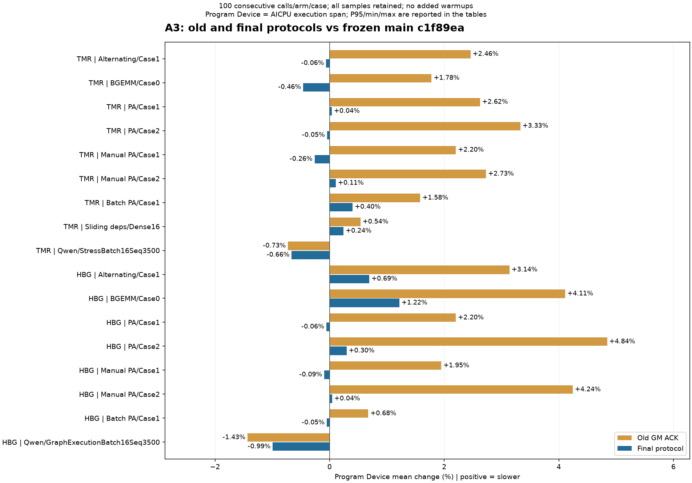
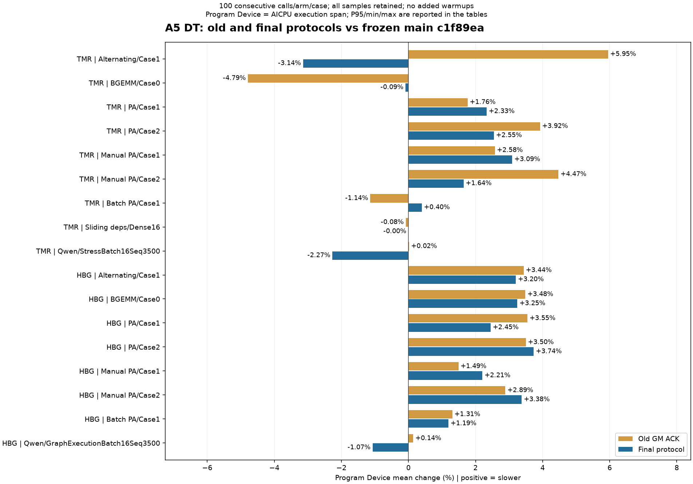
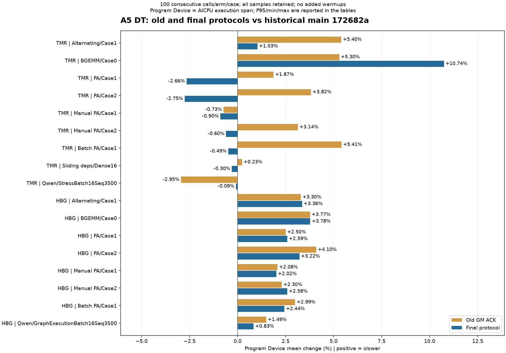

# AICore exit freshness: validation and measured cost

The freshness contract is described in [cache coherency](cache-coherency.md#exit-acknowledgement-freshness).
This page records the final protocol and the latest default-100 comparison for
[issue #2520](https://github.com/hw-native-sys/simpler/issues/2520).
All performance tables and figures below use the same new 2026-10-15 batch.
Earlier grouped experiments are not pooled with these measurements.

## Versions, scope and conditions

Here **main means the frozen unpatched version in the table**, not a claim
about the moving upstream tip. **Old** means the complete GM-ACK safety
implementation; **new** means the final COND-nonce implementation, with its
GM-ACK fallback. These are three versions of the same base in each table.

| Comparison | Main | Old GM ACK | New final protocol |
| ---------- | ---- | ---------- | ------------------ |
| A3 current; A5 current | `c1f89ea431f5306f78c0e4ab9573c829756d7f1e` | Same main plus the complete 33-file patch from `7c698515c97a4b66efb19bf91de952b65f70b30b` | Exact measured final commit `0b7d7cb0540c96b3391e0b0f265dc71edb4452be` |
| A5 historical | `172682a6be554592293c957acf5d9410b904f11f` | Original PR commit `03a343317b97051e74c2f78e3d20d653e03d8572` | Same historical main plus the final current-main execution/test/build patch (35 files), applied without adaptation |

All versions use PTO-ISA `418de18dde8fa33773dc5c384fdfe5506463b628` and their own compatible
Host/AICPU/AICore/dispatcher/Python-extension sets. The historical table revisits
the source versions of the original approximately 218 us BGEMM observation;
it does not reuse that observation as a sample of the new batch.

| Platform / runtime | Hardware / logical device | Build/activation SDK | Order and sampling |
| ------------------ | ------------------------- | -------------------- | ------------------ |
| A3 TMR | A3; device 1 | CANN 9.0; aarch64; Python 3.10 | main -> old -> new, all 9 original cases, 100 consecutive calls per case/arm |
| A3 HBG | A3; device 4, separate allocation from TMR | CANN 9.0; aarch64; Python 3.10 | main -> old -> new, all 8 original cases, 100 consecutive calls per case/arm |
| A5 TMR + HBG, current and historical | Original Ascend 950 DT / V120; device 0 | CANN 9.3; aarch64; Python 3.10 | One allocation: current three arms, then historical three arms; each uses the original TMR9/HBG8 lists and 100 consecutive calls per case/arm |

The SDK labels identify the build/activation environment; they do not establish
the exact loaded CANN runtime version. Same-case arms compare on the same
allocated chip. Device locks are held; the host is not exclusive. No cross-card
pairing is used. Worker level 2 / Native Program, STRACE and the existing
per-case configuration are retained; OMP/OpenBLAS/PyTorch thread counts are 4.

- Use the original `tools/benchmark_rounds.sh` defaults, with source-root and
  log-output path adaptation only: `bash benchmark_rounds.sh -p <a2a3|a5> -d <TASK_DEVICE> -r <runtime> -v`.
  No `-n` override, added warmups, repeated groups, first-call removal or high-value
  exclusion. Each table has 17 cases x 3 arms x 100 calls = 5100 calls; total 15300.
- Means are the original **untrimmed Avg**. Minimum, maximum and nearest-rank
  P95 use all the same 100 raw calls. One ordered sequence is not a multi-batch
  equivalence test, and its maximum is only the observed maximum.
- Actual input bytes, scalar values and alias identities match across all
  three arms for all 51 platform/base/cases, including Qwen. A5 inputs also
  match between bases. Source/component identities, actual Host/extension
  loads, normal close, health and device-lock release pass the recorded audit.
- The original `--skip-golden` remains enabled. This performance batch adds
  no numerical or abnormal-exit validation; those retain their separate source bindings.
- **Program Device is the AICPU execution span**, not caller-stream Level-0
  latency, pure exit-handshake time or Host end-to-end latency. Whole-span
  differences alone do not locate a physical cause.

The new protocol is selected for Native A3 TMR/HBG and Native A5 TMR.
A5 HBG, its legacy executor and unstamped paths retain GM ACK. A5 HBG results
therefore measure the complete patch's regression scope, not a COND-nonce benefit.
All modes retain exclusive claims, READY/REQUESTED arbitration, a shared
deadline, broadcast-before-poll, close/readback/drain-before-release and no
release of unresponsive targets. Compatible artifacts must be deployed together.

## A3 current-base results

**A3 mean latency is close to frozen main in this batch:** new-minus-main
ranges from -0.993% to +1.219% over 17 cases. Fifteen means are lower than the
old scheme; the two Qwen cases are higher than old but lower than main.
TMR BGEMM is -3.597 us (-0.461%); HBG BGEMM retains +8.670 us (+1.219%).
This supports submitting the safety fix for review, not strict zero-regression
or unchanged-tail claims. Dense16's P95/maximum increase by 2.580/137.900 us;
TMR batch PA's P95 increases by 22.540 us.

Every cell lists **mean / minimum / maximum / P95** in us; **n = 100 per arm**.
Positive deltas mean slower. Case paths use their original benchmark names.

| Runtime / case | Main: mean / min / max / P95 (us) | Old: mean / min / max / P95 (us) | New: mean / min / max / P95 (us) | New - main (us / %) | New - old (us / %) |
| -------------- | --------------------------------- | -------------------------------- | -------------------------------- | ------------------- | ------------------ |
| TMR `alternating_matmul_add/Case1` | 816.071 / 802.100 / 1048.840 / 829.500 | 836.142 / 819.940 / 1060.440 / 849.380 | 815.577 / 803.880 / 1045.359 / 838.699 | -0.494 / -0.061% | -20.565 / -2.459% |
| TMR `benchmark_bgemm/Case0` | 779.723 / 763.760 / 1019.040 / 788.900 | 793.598 / 774.780 / 1048.940 / 804.240 | 776.126 / 755.339 / 1032.619 / 787.900 | -3.597 / -0.461% | -17.472 / -2.202% |
| TMR `paged_attention_unroll/Case1` | 1128.367 / 1114.480 / 1442.139 / 1137.120 | 1157.986 / 1142.840 / 1489.540 / 1173.700 | 1128.803 / 1112.680 / 1462.860 / 1138.720 | +0.435 / +0.039% | -29.183 / -2.520% |
| TMR `paged_attention_unroll/Case2` | 620.709 / 605.880 / 832.720 / 632.819 | 641.371 / 627.000 / 852.880 / 659.540 | 620.424 / 604.860 / 833.920 / 629.180 | -0.285 / -0.046% | -20.947 / -3.266% |
| TMR `paged_attention_unroll_manual_scope/Case1` | 1122.886 / 1108.220 / 1385.800 / 1131.379 | 1147.634 / 1132.460 / 1394.639 / 1156.100 | 1119.947 / 1107.020 / 1394.120 / 1126.159 | -2.939 / -0.262% | -27.687 / -2.413% |
| TMR `paged_attention_unroll_manual_scope/Case2` | 615.104 / 599.620 / 844.060 / 628.120 | 631.890 / 610.580 / 829.280 / 643.319 | 615.770 / 598.820 / 846.160 / 628.940 | +0.666 / +0.108% | -16.120 / -2.551% |
| TMR `batch_paged_attention/Case1` | 3563.382 / 3531.500 / 4193.200 / 3581.080 | 3619.782 / 3580.220 / 4221.000 / 3652.320 | 3577.720 / 3535.260 / 4199.719 / 3603.620 | +14.338 / +0.402% | -42.061 / -1.162% |
| TMR `sliding_window_deps/Dense16` | 16998.451 / 16877.800 / 17266.580 / 17092.960 | 17089.993 / 16949.500 / 17516.620 / 17171.079 | 17039.867 / 16936.660 / 17404.480 / 17095.540 | +41.417 / +0.244% | -50.126 / -0.293% |
| TMR `qwen3_14b_decode/StressBatch16Seq3500` | 34877.199 / 34786.480 / 35183.240 / 34933.440 | 34623.269 / 34520.620 / 35018.600 / 34683.480 | 34646.344 / 34583.480 / 35065.060 / 34693.620 | -230.855 / -0.662% | +23.075 / +0.067% |
| HBG `alternating_matmul_add/Case1` | 904.266 / 877.080 / 1225.380 / 911.820 | 932.652 / 907.260 / 1324.880 / 941.620 | 910.537 / 891.439 / 1244.680 / 929.400 | +6.272 / +0.694% | -22.115 / -2.371% |
| HBG `benchmark_bgemm/Case0` | 711.486 / 682.020 / 1091.580 / 716.680 | 740.743 / 716.420 / 1117.520 / 746.400 | 720.156 / 692.240 / 1114.919 / 729.740 | +8.670 / +1.219% | -20.587 / -2.779% |
| HBG `paged_attention_unroll/Case1` | 1203.663 / 1176.040 / 1659.580 / 1215.439 | 1230.183 / 1210.179 / 1659.360 / 1235.360 | 1202.975 / 1182.300 / 1662.180 / 1207.420 | -0.688 / -0.057% | -27.208 / -2.212% |
| HBG `paged_attention_unroll/Case2` | 599.936 / 576.360 / 1043.680 / 608.660 | 628.997 / 612.339 / 1058.000 / 637.520 | 601.715 / 575.240 / 1035.260 / 610.140 | +1.779 / +0.297% | -27.282 / -4.337% |
| HBG `paged_attention_unroll_manual_scope/Case1` | 1204.637 / 1186.140 / 1661.940 / 1211.280 | 1228.119 / 1208.500 / 1677.220 / 1237.880 | 1203.517 / 1182.600 / 1644.500 / 1209.500 | -1.120 / -0.093% | -24.602 / -2.003% |
| HBG `paged_attention_unroll_manual_scope/Case2` | 599.020 / 569.700 / 1036.119 / 609.199 | 624.440 / 593.640 / 1033.920 / 637.320 | 599.288 / 567.040 / 1073.220 / 607.800 | +0.268 / +0.045% | -25.152 / -4.028% |
| HBG `batch_paged_attention/Case1` | 2735.748 / 2642.500 / 3175.320 / 2771.440 | 2754.223 / 2667.900 / 3239.080 / 2795.760 | 2734.384 / 2656.220 / 3217.300 / 2782.440 | -1.364 / -0.050% | -19.839 / -0.720% |
| HBG `qwen3_14b_decode/GraphExecutionBatch16Seq3500` | 38249.656 / 38068.500 / 38933.420 / 38332.480 | 37701.972 / 37511.740 / 38432.940 / 37838.720 | 37869.836 / 37685.560 / 38726.780 / 37968.600 | -379.820 / -0.993% | +167.864 / +0.445% |

**Figure 1. A3, mean change from the same frozen main for all 17 original cases.**
Old and new share the base above. Bars use all 100 calls per arm; they are
observed mean differences, without an inferred confidence interval.
Full observed tails are in the table, not implied by the bars.

## A5 current-base results

TMR BGEMM means are main 1348.789, old 1284.213, new 1347.597 us.
New-minus-main is -1.193 us (-0.088%), while new-minus-old is +63.384 us
(+4.936%). New's P95 is 1490.044 versus main 1415.947 us (+74.097 us).
This batch does not support an A5 BGEMM benefit or unchanged tail latency.

Every cell lists **mean / minimum / maximum / P95** in us; **n = 100 per arm**.

| Runtime / case | Main: mean / min / max / P95 (us) | Old: mean / min / max / P95 (us) | New: mean / min / max / P95 (us) | New - main (us / %) | New - old (us / %) |
| -------------- | --------------------------------- | -------------------------------- | -------------------------------- | ------------------- | ------------------ |
| TMR `alternating_matmul_add/Case1` | 1250.141 / 1093.923 / 1457.427 / 1342.707 | 1324.537 / 1134.153 / 1606.285 / 1499.717 | 1210.858 / 1053.129 / 1477.629 / 1407.865 | -39.283 / -3.142% | -113.679 / -8.583% |
| TMR `benchmark_bgemm/Case0` | 1348.789 / 1166.860 / 1540.308 / 1415.947 | 1284.213 / 1121.905 / 1568.692 / 1415.578 | 1347.597 / 1103.413 / 1535.259 / 1490.044 | -1.193 / -0.088% | +63.384 / +4.936% |
| TMR `paged_attention_unroll/Case1` | 1512.007 / 1440.584 / 1746.393 / 1600.432 | 1538.669 / 1451.985 / 1699.292 / 1630.544 | 1547.242 / 1449.936 / 1736.500 / 1635.639 | +35.235 / +2.330% | +8.573 / +0.557% |
| TMR `paged_attention_unroll/Case2` | 848.291 / 814.053 / 1074.463 / 879.710 | 881.562 / 848.774 / 1118.918 / 900.294 | 869.907 / 825.247 / 1126.258 / 893.220 | +21.616 / +2.548% | -11.655 / -1.322% |
| TMR `paged_attention_unroll_manual_scope/Case1` | 1449.171 / 1376.512 / 1667.166 / 1489.666 | 1486.496 / 1439.389 / 1751.329 / 1549.150 | 1493.999 / 1440.064 / 1667.449 / 1524.056 | +44.828 / +3.093% | +7.503 / +0.505% |
| TMR `paged_attention_unroll_manual_scope/Case2` | 851.754 / 811.032 / 1119.226 / 872.865 | 889.840 / 859.697 / 1126.836 / 907.421 | 865.756 / 836.517 / 1135.196 / 883.803 | +14.002 / +1.644% | -24.084 / -2.707% |
| TMR `batch_paged_attention/Case1` | 6479.323 / 6298.416 / 6658.876 / 6556.951 | 6405.462 / 6160.571 / 6621.097 / 6542.821 | 6505.158 / 6123.290 / 6718.980 / 6615.345 | +25.835 / +0.399% | +99.696 / +1.556% |
| TMR `sliding_window_deps/Dense16` | 25765.292 / 25703.718 / 26209.204 / 25814.815 | 25744.955 / 25590.254 / 26274.990 / 25853.206 | 25764.812 / 25590.376 / 26115.449 / 25876.525 | -0.480 / -0.002% | +19.857 / +0.077% |
| TMR `qwen3_14b_decode/StressBatch16Seq3500` | 33351.580 / 32864.045 / 33969.009 / 33703.960 | 33356.856 / 32916.928 / 34013.698 / 33732.606 | 32595.573 / 31977.057 / 33260.324 / 32968.362 | -756.007 / -2.267% | -761.284 / -2.282% |
| HBG `alternating_matmul_add/Case1` | 692.120 / 680.026 / 750.336 / 703.135 | 715.905 / 700.384 / 778.264 / 727.651 | 714.274 / 701.866 / 773.846 / 723.959 | +22.154 / +3.201% | -1.631 / -0.228% |
| HBG `benchmark_bgemm/Case0` | 686.246 / 673.441 / 774.836 / 695.479 | 710.151 / 692.702 / 777.469 / 722.244 | 708.527 / 698.116 / 762.676 / 718.332 | +22.281 / +3.247% | -1.624 / -0.229% |
| HBG `paged_attention_unroll/Case1` | 919.289 / 886.242 / 1007.904 / 939.165 | 951.905 / 915.441 / 1033.148 / 972.967 | 941.816 / 911.184 / 1023.052 / 954.919 | +22.528 / +2.451% | -10.089 / -1.060% |
| HBG `paged_attention_unroll/Case2` | 652.446 / 627.239 / 727.462 / 681.582 | 675.273 / 650.139 / 731.002 / 703.859 | 676.819 / 652.012 / 789.564 / 699.800 | +24.374 / +3.736% | +1.546 / +0.229% |
| HBG `paged_attention_unroll_manual_scope/Case1` | 1132.815 / 1101.231 / 1401.404 / 1144.145 | 1149.701 / 1110.789 / 1365.510 / 1166.990 | 1157.800 / 1130.142 / 1243.813 / 1179.285 | +24.985 / +2.206% | +8.099 / +0.704% |
| HBG `paged_attention_unroll_manual_scope/Case2` | 759.767 / 707.666 / 835.124 / 795.093 | 781.696 / 739.600 / 855.885 / 812.407 | 785.426 / 735.304 / 850.063 / 814.116 | +25.660 / +3.377% | +3.730 / +0.477% |
| HBG `batch_paged_attention/Case1` | 3409.129 / 2879.575 / 3627.517 / 3612.327 | 3453.684 / 2890.303 / 3658.616 / 3644.269 | 3449.767 / 2908.783 / 3657.197 / 3640.625 | +40.638 / +1.192% | -3.917 / -0.113% |
| HBG `qwen3_14b_decode/GraphExecutionBatch16Seq3500` | 29746.531 / 29543.878 / 30193.852 / 29887.165 | 29788.903 / 29534.149 / 30307.366 / 29943.286 | 29428.479 / 29241.090 / 29887.403 / 29565.042 | -318.052 / -1.069% | -360.423 / -1.210% |

**Figure 2. A5 DT on current frozen main, old/new mean changes over 17 cases.**
A5 HBG still uses the GM-ACK fallback. The figure does not attribute a
whole-span change to the exit protocol alone.

## A5 historical-base results

TMR BGEMM means are main 1202.539, old 1266.229, new 1331.736 us.
Old-minus-main is +63.690 us (+5.296%); the previous approximately 218 us
increase is **not reproduced in this default-100 batch**. New-minus-main
is +129.198 us (+10.744%) and new-minus-old is +65.507 us (+5.173%).
The new protocol retains a material A5 regression on this historical base.
The cause remains open; these tables do not prove a particular intervening
commit or isolate execution from exit costs.

Every cell lists **mean / minimum / maximum / P95** in us; **n = 100 per arm**.

| Runtime / case | Main: mean / min / max / P95 (us) | Old: mean / min / max / P95 (us) | New: mean / min / max / P95 (us) | New - main (us / %) | New - old (us / %) |
| -------------- | --------------------------------- | -------------------------------- | -------------------------------- | ------------------- | ------------------ |
| TMR `alternating_matmul_add/Case1` | 1256.361 / 1092.462 / 1517.677 / 1352.198 | 1324.197 / 1164.606 / 1533.917 / 1402.453 | 1269.341 / 1099.575 / 1506.827 / 1363.543 | +12.980 / +1.033% | -54.856 / -4.143% |
| TMR `benchmark_bgemm/Case0` | 1202.539 / 1117.129 / 1532.481 / 1340.024 | 1266.229 / 1122.448 / 1488.002 / 1416.868 | 1331.736 / 1140.398 / 1520.314 / 1431.702 | +129.198 / +10.744% | +65.507 / +5.173% |
| TMR `paged_attention_unroll/Case1` | 1545.656 / 1459.291 / 1751.712 / 1637.243 | 1574.597 / 1492.498 / 1731.346 / 1673.182 | 1504.546 / 1430.190 / 1824.764 / 1620.639 | -41.110 / -2.660% | -70.051 / -4.449% |
| TMR `paged_attention_unroll/Case2` | 870.953 / 834.855 / 1101.721 / 901.319 | 904.239 / 849.661 / 1112.279 / 932.251 | 846.963 / 809.453 / 1180.345 / 872.463 | -23.991 / -2.755% | -57.276 / -6.334% |
| TMR `paged_attention_unroll_manual_scope/Case1` | 1506.752 / 1437.655 / 1689.712 / 1552.916 | 1495.722 / 1438.550 / 1682.596 / 1548.717 | 1493.224 / 1409.511 / 1718.232 / 1540.085 | -13.528 / -0.898% | -2.498 / -0.167% |
| TMR `paged_attention_unroll_manual_scope/Case2` | 865.678 / 833.507 / 1121.086 / 885.703 | 892.872 / 860.314 / 1135.964 / 918.960 | 860.455 / 821.382 / 1150.805 / 883.730 | -5.223 / -0.603% | -32.417 / -3.631% |
| TMR `batch_paged_attention/Case1` | 6452.547 / 6183.018 / 6631.594 / 6561.981 | 6801.900 / 6206.705 / 6950.386 / 6903.280 | 6420.994 / 6069.965 / 6561.194 / 6511.857 | -31.553 / -0.489% | -380.906 / -5.600% |
| TMR `sliding_window_deps/Dense16` | 25832.911 / 25698.009 / 26331.529 / 25914.988 | 25892.727 / 25811.036 / 26322.515 / 25941.100 | 25755.336 / 25608.964 / 26158.369 / 25836.608 | -77.575 / -0.300% | -137.391 / -0.531% |
| TMR `qwen3_14b_decode/StressBatch16Seq3500` | 33325.347 / 32848.271 / 34075.304 / 33646.524 | 32343.470 / 31732.933 / 32839.842 / 32660.405 | 33296.757 / 32848.350 / 33728.330 / 33590.769 | -28.589 / -0.086% | +953.288 / +2.947% |
| HBG `alternating_matmul_add/Case1` | 690.280 / 677.849 / 927.100 / 695.132 | 713.044 / 698.877 / 774.178 / 723.551 | 713.493 / 702.140 / 782.827 / 722.343 | +23.213 / +3.363% | +0.449 / +0.063% |
| HBG `benchmark_bgemm/Case0` | 682.760 / 668.969 / 757.575 / 691.953 | 708.527 / 693.210 / 759.115 / 721.481 | 708.569 / 692.036 / 752.412 / 721.742 | +25.809 / +3.780% | +0.042 / +0.006% |
| HBG `paged_attention_unroll/Case1` | 915.417 / 886.618 / 1012.021 / 931.270 | 938.297 / 902.433 / 983.601 / 954.985 | 939.085 / 893.058 / 1004.670 / 955.175 | +23.667 / +2.585% | +0.788 / +0.084% |
| HBG `paged_attention_unroll/Case2` | 653.423 / 617.440 / 739.035 / 680.944 | 680.185 / 652.500 / 759.794 / 720.307 | 674.449 / 648.173 / 742.279 / 703.103 | +21.027 / +3.218% | -5.735 / -0.843% |
| HBG `paged_attention_unroll_manual_scope/Case1` | 1130.852 / 1103.795 / 1279.296 / 1151.539 | 1154.354 / 1124.315 / 1263.057 / 1171.767 | 1153.657 / 1096.039 / 1243.733 / 1173.510 | +22.805 / +2.017% | -0.698 / -0.060% |
| HBG `paged_attention_unroll_manual_scope/Case2` | 758.315 / 700.795 / 838.472 / 789.224 | 775.775 / 730.735 / 861.037 / 803.177 | 777.911 / 731.421 / 857.624 / 809.901 | +19.596 / +2.584% | +2.135 / +0.275% |
| HBG `batch_paged_attention/Case1` | 3357.574 / 2885.527 / 3613.663 / 3600.695 | 3458.055 / 2902.526 / 3668.991 / 3634.529 | 3439.341 / 2902.161 / 3699.886 / 3631.502 | +81.768 / +2.435% | -18.714 / -0.541% |
| HBG `qwen3_14b_decode/GraphExecutionBatch16Seq3500` | 29291.429 / 29102.961 / 29778.630 / 29447.533 | 29727.357 / 29454.989 / 30103.389 / 29890.349 | 29535.619 / 29322.083 / 29969.352 / 29666.951 | +244.190 / +0.834% | -191.738 / -0.645% |

**Figure 3. A5 DT on the historical frozen base, old/new mean changes over 17 cases.**
This is a new three-arm run on the original source base, not the old 218 us
measurement. Current and historical tables are separate comparisons.

[Machine-readable statistics and all 15300 Device samples](aicore-exit-freshness/measurements.json)
include source/input fingerprints and SHA identities of the audited records.
The 35 execution/test/build file hashes bind the measured final source;
documentation-only publication does not change that source.

## Correctness and remaining coverage

The original issue's retained-COND observations and controlled counterexample
remain source-bound [in the issue reply](https://github.com/hw-native-sys/simpler/issues/2520#issuecomment-6117083083).
A current report identifies startup; a current nonce response proves retirement.
Acceptance does not require a prior IDLE observation. A nonresponder is not
closed or released when the shared deadline expires; existing host recovery
owns it. Concurrent descriptor reuse remains invalid.

CPU regression covers retained fixed EXITED, both reserved nonces, pre-IDLE
failure, partial responders, late requests, gate ordering and protocol selection.
Selected simulation and separate controlled-hardware evidence are reported
with their source identities in the PR. A normal performance run does not
substitute for abnormal-exit validation.

A2 hardware, an uninstrumented natural failure rate, a readable machine-code
ordering proof and caller-stream Level-0 latency are not established by this
batch. Full system-test coverage belongs to the PR CI; production acceptance
is a separate decision.

### Controlled A5 abnormal exits

A separate same-device diagnostic reuses the original early-failure and
nonresponse scenarios around the final Native TMR code. Its five-file
diagnostic overlay has a separate 256-byte descriptor and is not timed.
Four seed launches establish retained state on each actual physical core;
launch five publishes its current report and pauses before its first IDLE.

- **Early failure:** all 32 AIC + 64 AIV targets reject retained fixed EXITED
  while gate is zero. Only after the same cores resume, observe EXIT and echo
  their current nonces do all 96 retire and return.
- **Nonresponse:** all 96 initially reject the retained nonce. The silent
  target remains at EXIT, gate/released/done zero and failure status when the
  shared deadline expires; the other 95 complete retirement. This is not a
  successful retirement of the unresponsive core.
- Existing runtime reset/recovery owns the failure. After each fault,
  the ordinary uninstrumented candidate passes four HBG and four TMR runs:
  16 post-fault recovery runs total. Source/component identities, actual
  Host/extension/callable identities, per-physical-core seed predecessors,
  device health, task exit zero and external device-lock release are checked.

These are controlled counterexamples and recovery checks, not an observed
natural failure rate. Earlier A3 abnormal-exit measurements remain tied to
their earlier candidate; current real-executor CPU regression also covers
pre-IDLE failure and both retained nonce values.
