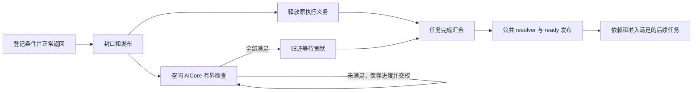

# A5 HBG AICore 异步完成开发参考

更新于 2026-11-08。本文件是本功能唯一的设计与开发参考，包含本轮目标、最终实现与验收结果。
当前状态：**Python 接线已全部撤回：`python/` 相对开发前基线无差异。通信域使用恢复既有回调退出时登记，Worker 恢复既有失败策略。本轮相关 Python／a5sim 验证通过；另已合并两处无附加行为的准备入口包装、移除无用 include；相关 Host 库增量构建，AIC/AIV 执行器沿用已验证产物。**
对应 [#2832](https://github.com/hw-native-sys/simpler/issues/2832)，父工作线为 [#2667](https://github.com/hw-native-sys/simpler/issues/2667)。

## 1. 本轮目标与范围

> 基于 nalinaly/simpler main，复用既有 run/domain/buffer owner、条件登记、普通依赖释放和 ready 发布。资源声明框架、可选能力声明及其 Python／callable 接线、独立 SDMA Host 配置控制链、逐组诊断与独立解析视图均删除。所有普通或手写 kernel 无需声明，每次物理执行默认预留 64 条条件。保留普通任务、SPMD、MIX、sync-start、单层 Graph、跨核检查、真实 SDMA、公共入口 DCache 和失败保活。只保留验证实际行为及关键并发边界的测试；不为已删除的概念保留测试框架。
>
> 条件读取继续沿用 DCCI／标量实现，不评估 `ld_dev` 差异，不增加读取方式开关。验证使用隔离构建环境和现有缓存，不切换共享分支、不覆盖现用安装。

目标是减少长期维护的概念与信息传递链路。不能因为某个抽象已经实现，就把保留它视为前提。
以下约束优先于历史文档中“保留可选声明校验”“保留所有新增公共 ABI”等要求。

- 工作基于 `nalinaly/simpler` 的 main；实施前核对当前提交、依赖 pin、实际安装与其他会话的在途文件。
- 源码按共享 main 协作，不切换或重置共享分支，不覆盖其他会话修改。需要独立构建、对方版本测试时使用隔离环境，复用已有缓存。
- 保持真实 SDMA 和 COUNTER、普通任务、SPMD、MIX masks 3/5/6/7、sync-start、单层 Graph 内异步任务的范围。
- 任意有服务机会且具备相应观察能力的 AIC/AIV 都可检查；AICPU 仅承担已有启动、退出、错误职责。
- 不扩大为新后端、kernel 抢占/续跑、嵌套 Graph、非阻塞 SDMA 提交或完整模型性能项目，不新增行为开关。
- 不以修改 PyPTO Graph/tensor 格式、要求 extern kernel 提供资源信息或增加编译器声明作为基本使用前提。
- 只维护这一份开发参考；转发用的实现对比是历史分析，不构成保留旧框架的设计要求。
- 本轮 Goal 不自动包含提交和推送，按当次明确授权执行。

这里的 `defer_wait` 延后逻辑任务完成。登记调用本身不隐式 return，也不保存 kernel 栈；kernel 正常返回后执行核才回到调度器。
依赖数据的计算位于后续 task，通过已有依赖连接。现有 PyPTO waiter 的限制由其实际前端合同决定，本轮不修改门禁来扩大支持。

## 2. 目标实现与必须保留的行为

### 最小职责

| 对象或已有机制 | 目标职责 |
| -------------- | -------- |
| 完成条件 | 记录类型、地址、目标值；回答一次观察是否满足 |
| 一次物理执行的 AsyncGroup | 条件登记与封口、剩余条件、检查进度，以及恰好一次完成贡献 |
| CHECK 认领状态 | 让有资格的空闲核独占一个有界检查片段，保存进度后交回认领权 |
| 逻辑 task 完成汇合及 FINISH | 汇合执行释放与条件完成，用公共 resolver 续接依赖释放 |
| 既有 run/domain/buffer owner | 保持真实资源有效，依据已有退出与访问结束事实决定复用或释放 |

CHECK／FINISH 是调度器内部工作，不增加业务 TaskId，不消耗普通 ready ticket，不占业务执行 slot。
Host 只需为稳定记录、物理执行映射、目录及必要后端控制数据规划空间，检查形状、算术边界和总预算。
稳定存储是必需的，Host 静态预分配是沿用的实现选择；这不要求 Host 理解每个条件的 payload 归属。

### 默认预留与登记

- 保留 `get_async_ctx`、`save_expected_notification_counter` 等基础 kernel API 的语义；AICPU 与 resident 路径共用登记主体。
- 所有可执行 kernel 每次物理执行默认预留 64 条条件，不要求同步标识、容量、资源、consumer 或 peer 用途声明。
- 实际登记数为 0 时正常完成，不发布 CHECK；1～64 条正常登记，溢出、非法类型、错误对齐和未结束预留明确失败。
- 同步标识和精确容量接口不再保留；同步 kernel 同样预留记录，零登记时跳过 CHECK，执行释放仍通过同一 FINISH／resolver 完成。
- 保留必要的 token 格式、指针数值边界、容量、运行与执行身份及一次性操作检查；格式正确不证明裸地址属于有效分配。
- immutable 布局在 Host／挂载边界验证，登记状态在 writer／封口边界验证；CHECK 不重复遍历 Host 参数、资源表和已验证的不变身份。
- resident 封口发布实际登记前缀和 writer 状态，再让 CHECK 可见；上下文副本共享预留状态，不能形成两个独立 writer。
- 条件和记录存储在 run 内稳定存在，不能引用返回后复用的栈、slot 或 kernel 私有 UB；本轮不引入动态记录池及容量等待。

### 跨核检查与公共完成

沿用常驻记录、活动位图和版本化 lease。只有成功认领者读取或修改 mutable 进度；内容发布、取得所有权和交权必须有实际屏障。
运行时原子控制行与 cached writer 分离，不能用整行写回覆盖其他核的原子更新；布局压缩继续遵守对齐和地址空间要求。

- 首次发布：内容与 pending 贡献先于 RUNNABLE 和活动位置位。PENDING 只交回 lease，活动位保持，终态只清位一次。
- 认领失败立即返回正常调度；无固定等待核、无固定重试间隔。目录为空、CAS 失败或观察到 OWNED 都不是全局完成。
- 沿用当前有限服务初值：最多 4 个目录字、2 次候选探测、2 次认领 CAS、8 个工作单元，每个片段最多认领一条记录；收尾另有固定上界。
- 游标轮转并分散起点，CHECK／FINISH 交替优先。待定条件在同片段不重复忙读，已满足条件不再读取。
- 忙时最多累计 4 次业务返回后提供一次异步服务；空闲或准入失败时每轮至多一次。已取得 cooperative 执行许可就直接进入 kernel。
- PENDING 扫描、失败 CAS、游标和 lease generation 变化不算真实进展。条件减少、实际后继处理或发布才更新相应进展。
- pending group 的增加先于所属 block 释放；最后 block 与最后条件通过同一汇合机制决定唯一 FINISH。MIX 每 block 只贡献一次执行释放。
- 普通完成、Graph、FINISH 继续共用完整 resolver 与 ready 发布主体，保留直接补位、MIX 前缀和长 fanin 前的 ready 前缀发布。
- FINISH 保存完整续接进度；成功移交后继后不再访问其旧链字段，发布重试不重复摘链、reserve 或 enqueue。
- ticket 预留后必须在不让出的有界尾部发布；队列端点已提交而目录尚未发布时，只续接剩余责任。
- TaskDone、后继发布完成和资源可回收是不同边界；整次运行完成计数晚于完整 resolve drain，CHECK／FINISH 不计作业务任务。

单片段预算不构成全局轮询频率上限；单热点仍可能竞争。全部核运行长 kernel 时，本功能不能抢占，也不承诺固定微秒发现延迟。
一次性目录若继续使用 fetch-add 置位／清位，保留唯一贡献前提、最高位及相邻位测试；该技巧不能替代通用 OR／AND。

### SDMA 与缓存

- 继续使用真实 SDK 完成记录；COUNTER 按有符号 INT32 与非负阈值比较，负值保持 PENDING；SDMA 按完整无符号 64-bit post id 比较。
- 条件地址使用后端单次读取与屏障，不用原子 RMW 猜测外部 DMA／通知状态，不由检查器清零信号。
- 条件读取沿用已验证的 DCCI／标量实现；`ld_dev` 差异评估、替代版本构建及专项对比均不在本轮范围内，不新增读取方式开关。
- 两类 SDMA 入口复用同一提交主体；真实物理队列锁、固定顺序多队列获取、SDK 元数据发布先于解锁必须保留。
- 条件容量按可信的后端记录数上界，在产生 DMA 提交副作用前预留；实际条数与记录格式在返回后核对，不能假设一次请求只有一个条件。
- workspace 仍由原有通信域入口创建；队列数由 kernel 的现有 SDK 提交参数传入。同一 workspace 的调用者须保持一致，Host 不再新增 SDMA_ONLY 分类或逐 rank 配置校验。实际物理队列锁和多队列能力保留。
- 保留零工作、合法 UB 偏移 0、实际 SDK 支持的 TPUT 同步回退及非空 TGET 非法事件处理；提交副作用不明时锁存首错误。
- 提交锁只覆盖共享队列状态更新，不覆盖 DMA 整个寿命；SDK 提交自身可能存在背压，本轮不承诺非阻塞提交。
- 实际消费者继续在公共执行入口维护自己的 DCache；更早的 predicate 读取沿用原有独立维护。删除消费者声明、区间表和准备计划。
- 发布方先完成 payload 发布再通知；DMA 写入前处理旧 dirty cache。检查核观察到完成不能替代消费核获取数据。

### 资源持有与失败退出

资源持有与资源区间校验是两件事。复用现有 `PreparedRunResources`、`PreparedRunUse`、借用记录和通信 owner，保证访问结束前资源不释放。
基本 defer_wait 不验证任意裸指针的 owner 或任意业务覆写；调用方仍负责合法地址、信号单调性、数据依赖和 peer 使用约定。

| 场景 | 最小必要处理 |
| ---- | ------------ |
| 正常完成 | 条件与后继发布完成后，沿用实际 run／核／backend 退出路径，再按已有 owner 规则释放 |
| 当前提交前失败 | 当前请求不产生 DMA；保留首错误，已存在的其他访问仍按正常退出约束处理 |
| 提交后失败、超时、核故障 | 停止新的业务和提交，不伪造成功；外部访问未确认结束时保留 owner，禁止复用 |
| 已证实访问结束，但任务结果失败 | 保留错误结果；现有机制可表达时允许回收，不为精细回收再造通用证明框架 |
| 跨 peer 或下一 epoch 复用 | 使用真实依赖和已有通信确认；保活不授予覆写权，本地 ACK 不证明远端停止 |

AICore 退出、普通 stream 完成、活动位图为空、清理函数返回成功都不能单独证明独立 SDMA 或远端访问结束。
不得根据条件类型是 COUNTER 推断 kernel 没有其他外部副作用，也不通过重新命名 CORE_PIPELINES_ONLY 声明恢复原框架。
优先采用既有 owner 的保守失败保留；没有现成证明时可以拒绝复用，必须报告该限制，不能声称已经自动恢复。
若现有退出流程确有缺口，先保留能区分提前释放的针对性失败用例，再在真正负责资源的层补最小修复。
删除专用 last-use 接口之前，要迁移其实际回收判据；目标是减少接口与概念，不是删除这个正确性约束。

## 3. 当前代码分布与删减边界

| 范围 | 保留内容 |
| ---- | -------- |
| `runtime/async_*`、`aicore_completion_mailbox*` 与 `backend/sdma/` | 公共登记／预留主体、执行上下文、真实 SDMA 提交与队列保护；沿用旧 AICPU mailbox 入口 |
| `src/a5/runtime/host_build_graph/host/async_plan.*` | 根据已展开任务的 block／lane 数分配固定容量记录；不读取 callable 能力或资源声明 |
| `runtime/scheduler/scheduler_async_*` | 条件登记封口、CHECK 认领与有界检查、执行／条件汇合、可让出的公共 resolver 完成流程 |
| 现有 executor、dispatch、completion 入口 | 挂载等待区间，连接 kernel 返回与执行释放，在调度机会中提供异步服务 |
| `backend/async_backend.h` | COUNTER／SDMA 单次观察及观察顺序 |
| `src/common` 的已有 run／owner 路径 | 失败时不提前释放；保留最小退出结果与平台错误传递，没有资源区间声明框架 |
| Python 公共入口 | 无 defer_wait 增量；沿用已有回调退出时的通信域登记和失败退出策略 |
| 现有 `scheduler_protocol_export.h`、`native_protocol.py`、`native_causality.py` | 复用 TaskDone 和 execution 记录，区分跨核完成；不再另建异步组导出和解析 |

已删除的扩展：

- `CoreAsyncCapability`、条件类型声明、callable 附加描述与哈希／表传递、Python 绑定及编译 spec 中的 `async_capability`。
- `CommSdmaOwnerConfiguration` 及 SDK_ONLY／LEGACY 分类、Host 控制请求、Python `sdma_sdk_queue_num` 和配置一致性校验。该链原本不负责初始化 SDK 队列数。
- CHECK／FINISH 逐组计数、周期、封口／释放／终态打点；相应布局表、AICPU 专用超时快照、`scheduler_async_protocol_export.h`、`native_async.py`、`async_lane.py`。
- 上述机制的内部测试，以及仅用于重复跑“有声明／无声明”路径的场景。业务 payload、依赖门槛、容量溢出、未登记导致提前消费的负对照仍保留。
- 子任务提交时提前登记通信域、`provenance_locked` 传递及任务组附带校验。原有 `ExitStack` 会在正常或异常离开编排回调时统一登记；回调内 release 和并发 release 继续沿用原有公共机制。仅检查提前登记内部状态的 236 行测试一并删除。
- 本次附带的 Worker 错误退出优化已从生产代码撤回，单独保存为未应用补丁。恢复原有更保守的失败策略，不把该通用优化算作 defer_wait 必需条件。
- Onboard／sim 的 `simpler_prepare_run` 直接使用原有实现主体，删除仅作转发的 `prepare_run_impl` 包装；移除 `chip_run_lane.h` 中无用的 `<vector>` 引入。

保留的公共层改动有实际故障职责：A5 平台将已退核的特定业务错误通过现有结果区传回 Host；Host 在逻辑完成失败或外部访问未证实结束时保留原 owner，并阻止把本地 reset 当成外部访问结束。退核 payload 不授予 SDMA／peer 资源释放资格。这些行为不能随空包装一起删除，现有具体实现仍可在独立故障验证下继续收拢。

普通任务的完成记录保留一个 bit31 标记，表示由 FINISH 发布 TaskDone，允许完成核与执行核不同。现有因果审计继续要求执行记录和 block 完成先于 TaskDone、依赖满足先于消费。它不能再声称证明了内部 CHECK 的次数或每组 pending 时间。

当前内部布局为 v8，mailbox 恢复原有 v7。导出 schema 为 v14／v15（普通／native Graph），仅使用现有任务／执行记录。读取器继续支持原有 v1～v9，不再支持已删除的详细异步 v10～v13 格式；旧捕获需使用当时版本的工具读取。

## 4. 成本与限制

统一默认预留减少公共概念和跨层接线，也牺牲精确容量优化：

- 每次实际物理执行预留 64 × 32 = 2,048 字节条件内容，另有身份、writer、进度、目录、汇合等记录；Graph 控制节点和 Host 已完成节点不分配执行组。
- run 存在 AIV 执行时预留一组物理 SDMA 队列保护记录，即使当次 kernel 最终没有提交 SDMA。它是 run 级共享存储，不是每 task 一组队列锁。
- 同步 kernel 和只登记少量条件的 kernel 也支付默认存储与执行封口／FINISH 成本。上一版“显式同步执行不分配等待区间”的结论不再成立；删代码不等于性能改善。
- 删除详细诊断后，不再导出 CHECK／FINISH 活跃周期、内部认领次数、逐条件终态或独立异步泳道。原有任务、执行、依赖与错误身份仍在。
- Host 不校验任意裸指针归属、peer 访问协议或 SDK 队列配置一致性。kernel 与调用方负责合法地址、数据依赖和一致的 workspace 使用。
- 没有 kernel 抢占、固定发现时延、非阻塞 SDMA 提交或任意硬件故障后的自动恢复保证。失败时资源可能保守保留。

实际 Host planner 的无诊断布局测量如下（字节；包含上述共享控制记录）：

| 执行形态 | 完整等待区间 | 条件内容 |
| -------- | -----------: | -------: |
| 1 次 AIC 执行 | 3,840 | 2,048 |
| 1 次 AIV 执行 | 10,112 | 2,048 |
| 1,024 次 AIC 执行 | 2,863,360 | 2,097,152 |
| 1,024 次 AIV 执行 | 2,869,632 | 2,097,152 |

这些数值适用于同步和异步 kernel；不能用过去显式同步的零分配数据替代。测量程序及原始输出保存为 `probe_storage.cpp`／`storage.jsonl`。

## 5. 当前代码分布、对比与验证

统计包含注释、空行和测试支撑代码，不含文档及其他会话草稿；对已存在文件只统计改动行，不计入整个文件。两侧分别减去自身开始开发 defer_wait 前的基线，避免把其间 main 的其他变更算进功能量。对方分支已重新核实，最新提交仍为 2026-11-06 的 “Fix: preserve progress and visibility in A5 deferred completion”。

| 类别 | 对方保留新增 | 本地保留新增 | 对方净增 | 本地净增 |
| ---- | -----------: | -----------: | -------: | -------: |
| 生产代码 | 2,539 | 4,596 | 2,294 | 4,021 |
| 测试代码 | 5,292 | 11,994 | 5,269 | 11,961 |

下表均为净增行数：

| 分布 | 对方 | 本地 | 本地多出 |
| ---- | ---: | ---: | -------: |
| A5 HBG runtime：调度、登记、后端 | 1,908 | 3,147 | 1,239 |
| Host 预分配及导出接入 | 268 | 398 | 130 |
| AIC／AIV／AICPU 执行器及公共类型 | 91 | 140 | 49 |
| A5 platform：运行结果及退出处理 | 2 | 153 | 151 |
| src/common：公共运行时及资源退出 | 0 | 158 | 158 |
| Python API 与绑定 | 0 | 0 | 0 |
| simpler_setup：既有诊断解析 | 25 | 25 | 0 |
| C++ A5 HBG 单测 | 2,066 | 5,211 | 3,145 |
| C++ common 单测 | 1 | 1,418 | 1,417 |
| C++ 测试支撑 | 0 | 81 | 81 |
| Python 单测及其支撑代码 | 287 | 43 | -244 |
| A5 场景测试 | 2,913 | 5,208 | 2,295 |
| 其他集成测试 | 2 | 0 | -2 |

本地生产净增仍多 1,727 行，测试净增仍多 6,692 行。生产差额主要在调度／后端实现，以及本地额外的运行结果与资源退出接入；测试差额主要是 C++ 内部及生命周期测试和额外场景。代码更多不等于这些部分都不可删除，也不能从行数直接推断正确性或性能优劣。

撤回 Python 接线及清理公共层空包装共净减少生产代码 28 行、测试 236 行；加上上一轮清理，生产共净删 2,406 行、测试共净删 3,611 行。文档另计。

### 本轮验证

- 210 个既有 Python 用例通过，2 个因原测试仅支持 L3 而跳过。覆盖 Worker、缓存通信域参数在回调结束后的登记、回调内 release、并发 release、失败回调和重复使用后的释放；没有新增私有状态测试。
- 17 个 a5sim 异步用例通过，覆盖条件边界、容量溢出、pending 期间关闭、重复运行、Graph 实例及跳过执行。
- 公共准备入口恢复原实现后，6 个相关 C++ 目标通过；模拟器与 A5 Host 库完成增量构建。业务 kernel、AIC/AIV 执行器和 ABI 未变，真实设备与性能未重测。
- 最终提交检查和公共入口回归记录在 `logs/defer-wait-cleanup-submit-20261108/`；原有异步容量溢出、pending 期间关闭和成功完成路径做针对性复测。
- 本轮源码改动、未应用的 `worker-error-handling-unapplied.patch`、逐文件对比和原始测试日志位于仓库同级 `logs/defer-wait-python-unwind-20261108/`。对比文件为 `distribution-comparison.json`，使用的基线与分支身份保存在文件中。

### 上一轮核心实现的验证边界

上一轮已完成 19 个相关 C++ 目标、相关 Python 测试、39 个 a5sim 异步用例及任务形态／进展场景，并构建 A5 Host／AICPU／AICore 产物。A5 异步场景首轮 43 通过，1 个用例及同卡复测因设备 0 初始化失败，plog 报告 `507033`、DMA jetty／SQ-CQ 分配失败；换用空闲 4／5 卡后通过，未重置设备。

此前跨 peer COUNTER、SDMA 完成记录 66＋2 次复用、双 AIV 共享通道、多队列、任务形态／超核数等待和同步回归通过；70 份保留的成功捕获通过既有因果审计。原始结果保存在 `logs/defer-wait-minimal-20261108/`，其中包含已经撤回的 Python 行为，不作为当前 Python 修改的新增验收。

历史 L1 对照位于 `logs/defer-wait-simplify-20261108/` 与 `logs/defer-wait-resume-20261108/`，不能直接套用于统一预留后的版本。本轮没有全仓、完整模型或新 L1 性能结论。

### 必须保留的验收边界

- 条件数 0／1／64／65，阈值相等、已超过、负 COUNTER、重复 getter／上下文副本、重复或非法登记。
- 普通、SPMD、各 MIX mask、sync-start、单层 Graph、多实例及超过 AIV 核数的等待任务；条件不满足时核可继续执行发布任务。
- 真实 SDMA 返回后仍 pending、payload 完整性、共享物理队列与多队列、复用超过 64 次提交；提交前容量预留。
- 消费者实际读到新数据，输出和保护区间正确；故意遗漏登记会被提前消费负对照捕获。
- 失败／超时保留真实错误并禁止不安全复用；本地线程退出不能冒充 DMA 或 peer 访问结束。

测试优先检查这些业务行为。仅在业务场景难以稳定制造的竞争处保留小范围内部测试，如恰好一次贡献、认领权交接、ticket 预留后的发布和错误竞争；不再为内部表字段或每一个诊断计数建立完整测试矩阵。
