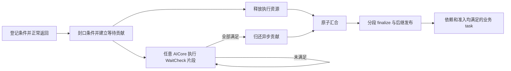

# A5 HBG AICore 异步完成开发参考

本文件是本功能唯一的开发参考，包含协议、接线、资源约束和验收要求。
更新于 2026-11-04，状态为**设计方案，尚未实现**；文中的新增记录和 helper 名称是实现约定。
对应 [#2832](https://github.com/hw-native-sys/simpler/issues/2832)，父工作线为 [#2667](https://github.com/hw-native-sys/simpler/issues/2667)。

## 1. 范围、基线与完成语义

### 工作基线

后续在本地 `main` 开发；本文核对提交为 `ed1fd4d9cdd5bd857974e2f6e4a74f85201944e6`，
PTO-ISA pin 为 `f83d4b7e4be0a4ca9805944ae2d9ce8c84e581f7`。本地 main 不等同于上游 main；
开始实施和提交前重查基线、在途 PR、依赖 pin 与实际二进制身份，不迁移旧版本的测试资格。

当前运行时有普通 TICKET/H8 ready pool、ordered/MIX/sync-start 准入、native Graph control 服务。
Graph 使用 `SchedulerGraphAccess` 和 native image，协议为普通 v8 / Graph v9。
异步实现接入这些路径，不沿用旧分支的 `remaining_children`、分块物化或 v12 接线。

### 必须交付的范围

- 首批用 **SDMA 真实搬运**验收，同时接通已有通知 COUNTER，覆盖 PyPTO `defer_wait` 消费者。
- 普通任务、SPMD、MIX masks 3/5/6/7、sync-start，以及当前单层 Graph 内的异步任务均在最终范围内。
- 任一参与的 AICore 都可领取检查，原执行核不持有永久观察权；AICPU 保留已有启动、退出和错误职责。
- 条件未满足就重新具备领取资格，不设置固定重试时间，不 sleep，不要求换一个核。
- 不增加 kernel 抢占/恢复、嵌套 Graph、多 block/MIX predicate，或未验收的 URMA/RDMA/CCU 原生事件支持。

业务 kernel 正常返回后，resident 循环取得控制权；`defer_wait` 本身不隐式 return，也不保存 continuation。
它后面的代码仍会执行。依赖收到数据的计算放在另一 task，通过 `deps=[wait_tid]` 连接。

| 边界 | 含义 | 尚不能推导的结论 |
| ---- | ---- | ---------------- |
| KernelReturned | 本次调用结束，条件登记封口 | 异步数据已可用 |
| ExecutionReleased | slot、block/MIX 局部执行义务已释放 | 原逻辑 task 已完成 |
| TaskDone | 所有计算与异步条件完成，结果满足可见性合同 | 后继链已全部发布、资源已可回收 |
| ResolveDrained | 后继释放和相应完成记账均已收敛 | 其他核或外部 DMA 已停止 |
| RunRetired | 既有 run/核退休与外部访问证明成立 | 可忽略其他 run/peer 的资源使用 |



### 两种条件及现有 PyPTO 合同

| 条件 | 判据 | 必须建立的发布关系 |
| ---- | ---- | ------------------ |
| SDMA post-done | 同一 workspace generation 中，64-bit completed post id 达到 expected post id | 数据搬运完成先于相应 post-done |
| 通知 COUNTER | 本 rank 的信号槽达到 expected epoch | 远端 payload 发布先于 notify，本地消费者能看到相应 payload |

`save_expected_notification_counter` 的历史 engine 标签也是 SDMA，但类型为 COUNTER。
按 `completion_type` 和后端合同选择观察方法；不能把通知误判为 SDMA event 或强制要求其 workspace。
共享 post-done 与通知槽都不能由检查器清零。未知类型明确失败，不能猜测已完成。

PyPTO 当前要求 window-bound INT32 信号、`WaitCmp.Ge`、expected 在 `[0, INT32_MAX]`。
waiter 为专门登记条件的 task，登记开始后只允许更多登记和纯标量记账；不执行 payload/通信/缓存工作。
它拒绝 predicate、`allow_early_resolve=True` 和嵌套在 `pl.spmd`/其他 task-launch scope 中的 waiter。
原生运行时全形状验收与 DSL 支持分别记录，不通过删除前端门禁扩大支持。
无效 AsyncCtx 会报错或 trap；仅 SDMA adapter 有既有 `event.Wait` 兼容分支，不能把 waiter 静默改成阻塞等待。

## 2. 存储、容量与可重复领取的记录

### 选定的 wait 容器

采用**常驻记录表＋活动位图＋版本化领取状态**。这里的 `wait_task` 是轻量控制工作，
不用普通 ready ticket，不创建新的业务 TaskId，不占业务 dispatch slot 或 cooperative admission。
每条记录在一个 run 中只首次发布一次，重试只交回领取权；运行中不搬移或回收记录。

main 的 [ticket 队列](../../src/a5/runtime/host_build_graph/runtime/scheduler/scheduler_ticket_queue.h)
按任务总数分配一次性 entry，出队不恢复容量；linked/chunk 候选也不允许节点在 run 内反复使用。
因此它们只负责原业务 ready，不能用来存放反复重入队的 WaitCheck。

| 记录 | 数量 | 身份与用途 |
| ---- | ---- | ---------- |
| `AsyncGroup` | 每个声明异步能力的物理执行一条 | run epoch、task ref、block、subtask；保存封口条件及剩余条件 mask |
| `AsyncTaskFinish` | 每个含上述执行的逻辑 task 一条 | 汇合计数、唯一 TaskDone、可移交的后继释放进度 |
| 活动目录 | CHECK 与 FINISH 各一组位图 | 每 64 条记录一个 atomic-only 目录字，所有核可访问 |
| 核本地状态 | 每核固定大小 | 两类扫描游标、优先类型、业务服务额度与诊断计数；不藏待重新发布的记录 |

公开 task id、Graph parent/child、执行 worker 和原 slot generation 作为审计身份保存；
路由使用稳定的内部 task ref。旧 slot 的地址、栈对象、AsyncSession 和 UB scratch 不能作为 pending 记录的 backing。
Host 将 `(task_ref, block_idx, subtask_slot)` 映射到固定组记录；映射与 DFX 是否开启无关，
不能依赖只在 profiling 时分配的 trace 数组。AsyncCtx 的有效 TaskId 也不替代这个组身份。

### 条件容量与注册接口

复用 `get_async_ctx`、`register_completion_condition`、`CompletionToken`；有效上下文满足 `1 <= capacity <= 64`。
声明过能力但本次分支没有登记条件时，实际 count=0 是合法完成，不分配活动检查工作。
纯同步 kernel 使用既有路径；静态证明整 run 无异步能力时，不分配异步区、不探测目录。

Host 需要取得每次执行的已验证条件上界 `c_e`。优先自动传递 PyPTO 的
`deferred_completion_waiter` 标记与 `static_max_count`；不要求模型作者重复手填，不增加全局开关。
**容量元数据在 callable 注册/序列化中的承载方式仍待接口确认**，不可把提案写成已有参数。
实现时须参与身份/hash/cache key，不占用 wire padding；缺字段不能证明旧 kernel 不含 defer_wait。
旧异步生成物须显式兼容或重编译，不能保证自动识别、自动同步回退。

当前编译器上界、generated adapter 的 static_assert 和运行期 capacity 检查都固定为 64，
扩大单上下文容量必须跨仓修改并重编译。多 block 的总条件数可以超过 64，由各组分别持有；
不把 legacy 的单逻辑任务等待表或 `MAX_ASYNC_WAITS` 当作本实现的全局上限。

SDMA adapter 在提交前预留足够条件槽并验证类型、workspace 与资源持有关系，再提交、填充和 commit。
预留按匹配 pin 的后端可证明的记录条数上界计算，不能把一个 DMA 请求假设为一个条件；
event 返回后核对实际条数，归还本次未使用预留。无法得到可信上界的适配器先补齐合同，不能先提交再碰运气登记。
提交前失败可归还未使用预留；已尝试提交而副作用不明时，锁存错误并保留资源，不能丢掉追踪依据。
纯 COUNTER 登记不发起 DMA，不强加硬件提交事务；overflow/非法条件同样不能变成成功 TaskDone。

### 布局与成本

记录分离为三种不共线的区域：immutable 身份/封口条件、atomic-only 领取/计数字、owner 独占的 mutable 进度。
第一版按当前 resident 布局采用 128 B 隔离单元；不得让 cached writeback 覆盖原子字段。
每组的变长 token 区按实际 `c_e` 分配，header/error 与 token 均单 writer；封口后不再修改 token。
进度使用独占期间的 bypass 读写并在交权前完成发布，下一 owner 在成功 CAS 后执行必要读取屏障。

设异步物理执行数为 E、对应逻辑任务数为 T，record 中不含 token 的固定 stride 为 Sg/Sf：

```text
记录空间 = E*Sg + T*Sf + Σ align_up(slab_header + 32*c_e, 128)
目录空间 = 128*(ceil(E/64) + ceil(T/64))
核本地空间 = worker_count * 固定游标/预算状态
```

Host 在 launch 前检查算术溢出、任务上限和总预算，报告分配/初始化字节并拒绝不可容纳的 run。
第一版明确接受空间按总异步执行数增长；不引入运行中复用池及容量等待，避免检查资源反过来卡住发送任务。
必须同时测量峰值在途数与总执行数，不能声称该方案空间只与并发度相关。Sg/Sf 由实现 `sizeof` 固定并审计。

## 3. 领取、交接与调度服务

### 记录状态与线性化点

领取字编码 `(lease_generation, phase)`；phase 为 DORMANT、RUNNABLE、OWNED、TERMINAL 或 FAILED。
run 内身份不复用，lease generation 每次交权递增，溢出受控失败。外部错误处理不改写仍由某核持有的 OWNED。

| 转换 | 唯一操作者 | 必须先完成的动作 |
| ---- | ---------- | ---------------- |
| DORMANT → RUNNABLE | 首次发布者 | 发布条件/身份或 finalize 初始进度；组 pending 贡献先于发布 |
| RUNNABLE(g) → OWNED(g) | 任意核，单次成功 CAS | 核对本 run、记录类型与索引；CAS 成功后再读取 mutable 进度 |
| OWNED(g) → RUNNABLE(g+1) | 当前 owner | 保存游标/mask/continuation，完成写入屏障后交权 |
| OWNED → TERMINAL | 当前 owner | 完成全部共享写入和诊断发布，随后清除本记录活动位 |
| OWNED → FAILED | 当前 owner | 锁存首错误和完整身份；保留 backing，停止新提交/新领取 |

首次发布顺序为“内容与贡献 → 发布 RUNNABLE → atomic OR 活动位”。
重试保持活动位为 1，只把 OWNED 改回 RUNNABLE；无需 enqueue、预留 ticket 或等待队列容量。
终态发布后 atomic AND 清除自己的位；其他记录的并发 OR/AND 不互相覆盖。
尚未设置活动位的发布者不得进入业务 kernel；该发布尾部只有固定数量的非等待操作。

同一记录只会首次置位、终态清位，不反复置位/清位来表达领取。因此不存在
“检查失败重入队被另一核清位”窗口。目录暂空、读到 OWNED 或 CAS 失败都不代表全局完成。
陈旧目录位最多导致一次无效探测；领取 CAS 必须包含完整版本，TERMINAL 不能重新领取。

### 有界发现与进度交接

每核对 CHECK 和 FINISH 各保存 `(word_cursor, bit_cursor)`，起点按 worker 分散。
每次探测后推进游标，包括 CAS 失败和遇到 OWNED；一个字内从上次 bit 之后选取，避免总抢最低位。
两类工作交替优先；优先类型没找到可领取记录时，在剩余预算内探测另一类。
游标循环覆盖整个目录，不能用一次“空”缓存永久关闭发现，也不要求所有核同步推进游标。

目录是运行时自有的 atomic-only 字，权威探测使用原子观察；仅可用 bypass 值作可丢弃的提示。
领取字的过期快照只允许造成 CAS 失败；不能据此读取进度或宣布完成。
`acquire/release` 参数在 AICore helper 中并不自动生成相应屏障，实施必须逐处使用实际 GM 发布/观察指令。
对 DMA/远端写入的条件地址不擅自使用 atomic-add-zero；后端观察方法与运行时目录原子读取分开。

一次 slice 的初始内部预算为：最多 4 个目录字、2 个候选 lease 探测、2 次领取 CAS，以及 8 个工作单元。
读到非 RUNNABLE 也消耗候选额度；成功领取一条后不再领取第二条，交权或终态后返回普通调度。
工作单元是一次条件观察或一次依赖路由步骤；后继 fanin 检查和 link CAS 也计入，不能把整条链算一个单元。
所有失败尝试消耗预算，耗尽即返回调度循环。这些是可测的内部初值，不是用户配置或时间间隔。

PENDING 保存未满足 mask 和循环游标，已满足位不再读取；条件必须在本 generation 内单调成立。
同一 slice 中不对同一未满足条件反复读到预算耗尽。检查多于 8 条的组通过多次 slice 完成一次遍历。
保存进度后交权不需要额外 CAS 重试循环：只有 owner 能改变 OWNED；单次交权 CAS 失败是状态损坏，走错误收敛。
没有任何私有“待重新入队”任务跨越业务 kernel，固定的终态/贡献发布尾部也不等待 peer 或容量。

### 普通 ready 与检查工作的关系

保留 main 的 TICKET/H8、类型/credit、ordered/MIX/sync-start 准入和 Graph control 服务。
调度循环先处理退出/错误、完成回收、Graph control 与已有 ready 待发布工作；这些服务不能被 WaitCheck 绕过。
所有正常、pending-publication、cohort 暂不可进入的循环路径都应到达异步安全服务点；
审计现有 `continue`，尤其是 `scheduler_ready_pool_has_pending`，不能只在最后的 idle 分支加检查。

首版采用按业务忙闲分配工作额度：

| 本核状态 | 服务规则 |
| -------- | -------- |
| 有可合法进入的业务 kernel | 优先业务；累计最多 4 次业务返回后，下一业务 kernel 前执行至多一个异步 slice |
| 无可执行业务或正在等待 admission/cohort | 每轮执行至多一个异步 slice，随后重新服务普通 ready 和控制路径 |
| 有活动记录但本次 CAS 失败/读到 OWNED | 立即返回正常调度；不等领取成功，不给该记录加时间门槛 |
| 无可服务业务、控制工作或异步记录 | 沿用既有空闲策略；它不改变任何 WaitCheck 的可领取时间 |

业务计数到额度后，无论本次探测成功与否均归零；没有异步能力的 run 跳过该分支。
到额度的服务点放在领取本核 ready slot、调用可能提交 admission 的 `scheduler_ordered_can_enter_slot` 之前；
已取得 cohort 执行许可就直接进入 kernel，不能夹入 WaitCheck。准入未成功时可执行 idle slice 后重试。
服务 CHECK/FINISH 的优先类型每次 slice 轮换，普通与异步均有机会，避免 idle 核在单一热点上连续用完无限预算。
业务额度 4 和工作预算 8 需要 L1 对照；它们替代“一个完整检查 task 对一个业务 task”的粗粒度比例，
不保证时间公平或固定微秒响应。所有核都执行长 kernel 时，条件发现仍必须等核返回，本功能不抢占 kernel。

多条记录时用分散起点和推进游标减少碰撞；看到 OWNED 就跳过，不持续 CAS 同一个版本。
只有一个热点时，任意核即时重抢仍会产生随空闲核数增加的聚合探测压力；单次预算不等于全局频率上限。
首版接受这个边界，以单热点多核 L1 用例量化，不声称已消除争用，也不偷偷加冷却时间或固定观察核。

进展保证基于核持续回到服务点、原子操作能完成：固定记录总数和轮转游标使长期 RUNNABLE 的记录被反复访问；
CAS 失败说明另一核取得过相应版本，其他核可继续别的工作。单纯 PENDING、CAS 重试和扫描不刷新进展 watchdog。

## 4. 完成汇合、后继发布与资源复用

### 计算与异步贡献的原子汇合

仅对含异步能力的逻辑 task 增加一个 atomic-only 64-bit 汇合字：
低 16 位为 pending_groups，接着 16 位为 unreleased_blocks，高位保留 sticky FAILED 和协议校验位。
初始化为 `(logical_block_num << 16)`。当前每 task 的 block/subtask 数上限为 INT16_MAX，两个计数域足够；
尺寸检查和静态断言绑定这个前提，不能将布局隐式扩展到更大任务。

所有合法计数变化使用单次 GM fetch-add，避免多字段丢唤醒及无界 CAS 更新循环：

1. 非零条件组封口：pending_groups 加 1，发布组后才能释放该执行的局部义务。
2. 计算 block 真正释放：unreleased_blocks 减 1。纯 lane 由该 block 的执行核贡献；MIX 由 coordinator
   收齐实际参与 lane 的返回、必要发布与局部关闭后贡献一次。零条件、同步 lane、合法 predicate skip 也覆盖在此计数中。
3. 条件组 terminal、活动位已清且不再写组记录后：pending_groups 减 1，恰好归还一次贡献。

每次递减检查返回的旧计数非零，违规立即锁存错误；每项贡献有唯一 slot-generation/组 owner，不能盲目补偿重试。
只有让两个计数首次同时为零且无 FAILED 的递减者，负责激活预分配的 `AsyncTaskFinish`。
它先发布 FINISH 记录内容/状态，再置活动位；期间不得进入业务 kernel，也不等待其他核。
单纯读取计数或设置错误位不触发激活。

计数汇合不丢唤醒的理由是：每个组的 pending 增加发生在所属 block 释放之前，
所以 unreleased_blocks 到零后不会再出现新登记。最后计算与最后事件在同一原子字中有唯一先后顺序，
后到的合法递减者必定看到两个计数均为零；不需要一个核等待另一个核的单独 flag。

必须区分当前 `completed_blocks` 的计算贡献与新的“发布/局部资源已释放”贡献。
不能直接把现有 `TASK_LAST` 返回值当作新门槛：async 路径需要在 trace/条件发布和 MIX 收尾之后贡献新计数。
正常路径不再调用原来的直接 TaskDone 分支，而由 FINISH 统一处理；不含异步能力的 task 保持原完成路径。

### 分段 finalize 与完整 drain

`AsyncTaskFinish` 也是可跨核领取的常驻记录，沿用同一状态/目录协议，不占业务核的执行 slot。
其进度必须保存在 GM 记录中，包括：是否发布 TaskDone、是否摘取 wake-list、当前后继与下一个引用、
未完成的 fanin 路由、最多 8 项的待发布批次和完成计数是否已贡献。不得只保存在某核的栈或 `local->control_resolve`。

首次 owner 核对汇合条件和 run 错误，完成数据可见性要求后，唯一发布原 task 的 DONE 并摘取 wake-list。
发布 DONE 与记录摘链进度是有界且不让出的短事务；核故障走整个 run 的错误/隔离路径，不尝试盲目接管半写状态。
之后按 slice 预算继续路由。借鉴现有 `scheduler_service_controls` 的 continuation，但需把异步 continuation
变成可交接记录，并为 `scheduler_route_task` 增加真正可返回的步骤接口，不能在一个后继内部仍遍历无界 fanin/CAS。
从旧 wake-list 取节点时，先保存旧 `next_waiter`，再尝试将该节点挂到下一 producer。
挂接 CAS 成功就是责任移交点：下一 producer 可以立即摘链并改写该节点，当前 FINISH 不再读写它；
只推进自己保存的后继游标。挂接失败/预算耗尽才把未移交节点及 fanin/CAS 阶段留在 FINISH 中。
READY_TO_ENQUEUE 同样只生成一次待发布责任；不能通过重新扫描原 wake-list 恢复进度。

遇到发布 RETRY，保存唯一批次/当前后继的阶段，交回 FINISH；下次从该阶段继续，不重新摘链或重新路由已发布 task。
若使用普通 ready 的 ticket，一旦预留成功，必须在不让出的固定长度尾部完成最多 8 项发布；
预留前 RETRY 可重试，预留后禁止再 reserve 同一批。辅助状态跟随 FINISH，不藏进原观察核的私有 pending 描述符。
下游业务 task 仍经原依赖与准入规则决定是否执行，不能直接由检查器强制 READY。

全部后继已路由、所有批次已公开、诊断已发布后，FINISH terminal 并清活动位，
最后才给原 task 的 `pending_completed` 贡献一次。TaskDone 可以早于 resolve 尾部结束，
全 run 的正常完成计数必须晚于这个尾部；不把 CHECK/FINISH 本身算入业务 task 数。
Graph CHILD 的完成通过当前 body → EXIT 边推进，EXIT 与其他 control 节点沿用 main 的 control 服务和计数。

### 可见性与所有权

封口 token 的写回必须先于 RUNNABLE/目录发布；owner 的 mutable 进度发布先于交权，下一 owner 成功 CAS 后才读取。
atomic-only 控制行上不做 cached store 或整行 dirty writeback；bypass-only 进度行不混入 RMW。
状态字的唯一 CAS 权只解决所有权，不能代替条件、数据、trace 和后继发布的屏障。

SDMA 要证明“数据 DMA → post-done → AICore 观察 → TaskDone → 消费者读数据”。
通知要证明“远端 payload 发布 → notify → 本地观察 → TaskDone → 消费者读 payload”。
目标旧 dirty cache 在交给 DMA 前处理，完成后不能把旧内容写回覆盖新数据；消费者缓存按后端合同处理。
使用匹配 pin 的公共完成记录接口，不在新实现中猜私有队列布局；读取 flag 本身不证明 payload 新鲜。

**首版禁止对同一可写 payload/signal 槽重叠使用不同 epoch。**
新写者只能在旧 epoch 的相关消费者及 peer 访问已结束后取得复用权；证明来自现有 run/通信资源 owner 的使用记录，
不从 `counter >= expected` 推导，不新增全局 Host barrier。需要并发时使用独立 payload 与 signal 槽，
或消费已有且经验证的完成前缀协议；仅双缓冲 payload 而共享可乱序 notify 的 counter 仍不足以保证正确。
不能提供所有权/代次证明的 raw-address 异步接入不纳入支持，须明确诊断或由调用者提供相应资源句柄。

Counter 在一个 live generation 内单调，PyPTO 模型只发布非负 INT32 epoch。
旧 run epoch、通信窗口 generation、通知 epoch 和 SDMA post id 分别校验；不能相互替代。
到 INT32/post-id 上限后不得回绕复用，须待全部相关使用静止后建立新 generation。
检查器缓存某条件已经满足，仅在这个单调、不可提前重置的合同下成立。

源数据保留至最后 DMA 读取结束；目标和 signal 保留至最后消费者结束；workspace、完成记录及通信窗口
还须覆盖远端和后端的最后访问。UB scratch/栈不得在 kernel 返回后继续被引擎引用，后端接入需给出证据。
上述使用关系在 launch 前归入现有 run/domain 所有权体系，CompletionToken 的裸地址本身不是资源租约。

### 正常结束与异常关闭

| 路径 | 必须成立的条件与处理 |
| ---- | -------------------- |
| 正常结束 | 所有原 task 的 resolve-drained 计数成立；所有已激活记录终态；再经现有 AICore/run 退出 fence |
| 提交前失败 | 不发起该次 DMA，释放未使用预留；此前已提交工作的 owner 继续持有 |
| 提交后错误、超时 | 锁存首错误，停止新业务/新 DMA；不伪造 TaskDone，不把超时解释为硬件停止 |
| 某 owner 故障 | 不覆盖其 OWNED 或强制复用记录；走 run 退出与隔离，保留可能仍被写入的 backing |
| 正常 close | 收敛已接收工作及异步访问，确认最后使用后归还资源 |
| 错误 close | 先证明停止提交，再证明 AICore 退休和实际后端/peer 访问结束；证明不足则保留 owner、拒绝复用并报告失败 |

最后一个组清位、归还贡献、激活 FINISH，以及 FINISH 清位、贡献完成计数，均是固定长度的不让出尾部；
中途暂停不能导致正常 run 提前结束，因为原 task 尚未贡献 resolve-drained 计数。
一旦发生硬件故障，依靠既有退出/隔离证明持有 backing，不保证从任意指令恢复该短事务。
活动位图为空不是独立回收依据，退休前不能重新初始化 lease 或 slab。AICore ACK 也不代替在途 DMA 停止。
不为正常路径增加 AICPU 条件轮询；故障处置只使用实际存在且验证过的后端能力，不臆造 cancel/drain API。

## 5. 开发接线与验收

### 实现入口与顺序

| 范围 | 必须交付的接线 |
| ---- | -------------- |
| Host/callable | 取得可信 c_e、实例/物理执行映射、预分配记录和目录、预算检查、资源使用绑定 |
| `async_kernel_api.h` / adapter | 有效上下文、非零/零登记、提交前预留、类型与代次校验、失败传播 |
| `scheduler_memory.h` | 目录/lease 的原子观察，进度交权的实际屏障；CPU/sim 与 AICore 实现分别验证 |
| `aicore_executor.cpp` | kernel 返回封口、局部执行释放、所有循环路径的安全服务点及忙闲额度 |
| ordered / GM MIX completion | 每组登记与每 block 释放唯一贡献；异步 task 不走旧直接 TaskDone 分支 |
| ready / Graph control | 可交接的 FINISH continuation、预算内路由与准确发布责任、body → EXIT 与 drain |
| 生命周期 / DFX | run/domain 使用持有、错误退出、独立等待 span、业务完成数不含检查次数 |

先实现常驻记录原语和跨核交接模型，再接通知 COUNTER 与单 lane 真 SDMA，随后扩展完整 SPMD/MIX/sync-start/Graph。
各内部阶段不等于最终支持范围完成。同步路径和原 main 的调度优化应有独立回归。
容量元数据的具体 ABI、AIC/AIV 发起/观察 SDMA 的实际资格、A5 数据可见性及故障停止证明仍是实施门槛；
条件不足时报告具体缺口，不改成 legacy、阻塞 fallback 或另一种核代跑以获得通过。

### 必测反例

| 场景 | 判据 |
| ---- | ---- |
| 一条记录反复 PENDING，次数远超记录数 | 无 ticket 消耗、无新分配、空间恒定；同核和其他核均可再次领取 |
| 多核持旧 lease 竞争、owner 交权、终态清位与别组发布交错 | 至多一个 owner，无重复贡献、无漏活动位；CAS 失败立即返回正常服务 |
| 最后 block 与最后条件任意交错、暂停在终态/归还/激活边界 | 恰好一次 FINISH 激活，无提前 TaskDone 或 run 退休 |
| FINISH 超长 fanout/fanin、发布 RETRY、预留后暂停 | 工作预算有效，续接不丢失/重复后继；业务与检查服务均能推进 |
| 单个热点＋大量空闲核，1/64 条条件，持续业务 ready | 分开统计有效观察、CAS 失败、目录探测和完成发现延迟，不以轮询次数当进展 |
| 零登记、已满足、多 peer、64/65 编译上界、非法地址/类型/代次 | 保留前端与 runtime 拒绝；零登记不会悬挂或缺有效上下文 |
| 普通分波、MIX 3/5/6/7、sync-start 容量边界 | block 唯一领取、局部资源释放与逻辑完成分离；不因检查扣住 cohort |
| Graph 多实例、外部/内部 fanin、多个 sink、普通任务混排 | 事件不串实例，CHILD/EXIT 正确延后，完整 resolve drain |
| peer 提前写下一 epoch、旧事件/窗口复用 | 无证明的重叠被拒绝或由资源协议阻止；payload 与 signal 的版本同时核对 |
| 提交前/后故障、pending 时 close、owner 故障 | 首错误保持；没有停止证明时不释放 backing，不宣称恢复成功 |
| 原生单 block predicate 与 DSL waiter 禁止组合 | native skip 不发 DMA；保留 PyPTO predicate/early-resolve/嵌套 SPMD 负例 |

真实 SDMA 场景为 A 提交搬运、B 依赖 A 消费输出、C 独立：必须观察 A 已返回而真实事件仍 PENDING，
C 能推进，B 在条件满足前不能执行；同时校验搬运结果和 B 的结果。未观察到这个窗口不算异步重叠通过。
通知另测真实 remote_store → notify → waiter → consumer，并让等待任务先达到实际 AIV 饱和压力、publisher 后提交。
保留有界的阻塞负对照；已有 A5 四 waiter 用例不能替代饱和与当前 resident 证据。
至少一项有效负对照需使提前完成或跳过条件的生产 helper 变体失败；不能只测试与实现同构的计数加减。

每次调用核对新鲜 mode publication、resident producer、实际 kernel/数据身份；sim 和 A5 onboard 分别报告。
PyPTO-Lib MoE 的 `dispatch_meta_wait`、`dispatch_wait`、`combine_wait` 分别等待通知，
每个实际登记 `N_RANKS-1` 条，编译器静态上界可能为 N_RANKS，不能把三处调用当成三个条件。
meta waiter 不依赖本地 publish，而 finalize 依赖二者；保留这个 DAG，不能为阻塞替代方案悄悄补边。
完整 decode 的设备 count/route 驱动 Host 构图问题独立处理，异步完成不提供 Host 构图暂停恢复。

### 性能、协议与交付资格

正式性能只用 **L1**：同机同卡、同输入和计算核，比较 main 与候选的同步 CSA/SWA/Qwen，以及等工作量的
kernel 内等待与 deferred。建议 5 次预热、100 次正式调用、B/A/A/B，保留全部样本和异常，不挑最优结果。
L3/L4 用于因果诊断，不能混入 L1。报告完整 Device、kernel window、Host 端到端、P95 和资源成本。
忙闲额度/预算可在固定算法下比较；记录每次调度新增成本、目录扫描和满足到发现延迟，再决定内部常量。
尚未约定可接受退化阈值，所有稳定退化需披露，不预先承诺固定加速比。

协议区分 registration_sealed、execution_released、condition pending/ready/failed、logical_done、resolve_drained。
保存 task/Graph/block/subtask、run 与资源 generation、lease、观察核和条件类型；PENDING 合并为 span/次数。
跨核因果以发布/领取关系核对，不能仅靠不可比较时钟；旧 schema 保留读取，异步另分配新版本。
ArgsDump AFTER 若接入须位于实际数据完成之后；未验收的组合明确拒绝。诊断截断不能补造缺失证据。

硬件工作按仓库要求做架构检查、通过 task-submit 独占设备并隔离日志；复用构建缓存，先做相关检查。
交付保存精确源码/库/依赖身份、构建和测试命令、原始 L1 与诊断证据；相关、全量、sim、硬件、故障结果分别报告。

当前仅完成文档和源码核对。两组“登记、发布、终态、归还贡献、计算释放”的顺序一致抽象模型，
枚举 2,268 种合法交错未出现提前汇合或重复激活；这不证明 A5 内存序、后继发布协议或实际 runtime 正确。
新增功能的编译、单元/仿真、上板、故障与性能资格均尚未获得。

### 来源与接口同步

- Simpler：[原子/发布 helper](../../src/a5/runtime/host_build_graph/runtime/scheduler/scheduler_memory.h)、
  [完成路径](../../src/a5/runtime/host_build_graph/runtime/scheduler/scheduler_completion.h)、
  [Graph control 服务](../../src/a5/runtime/host_build_graph/runtime/scheduler/scheduler_graph_control.h)、
  [公开异步 API](../../src/a5/runtime/host_build_graph/runtime/async_kernel_api.h)。
- PyPTO `be23606f`：[waiter 合同与 64 上界](https://github.com/hw-native-sys/pypto/blob/be23606f791fa2251d7fccabdb91c75582268fad/include/pypto/ir/transforms/utils/deferred_wait_contract.h)、
  [生成 adapter](https://github.com/hw-native-sys/pypto/blob/be23606f791fa2251d7fccabdb91c75582268fad/python/pypto/backend/pto_backend.py)、
  [既有分布式测试](https://github.com/hw-native-sys/pypto/blob/be23606f791fa2251d7fccabdb91c75582268fad/tests/st/distributed/test_l3_deferred_completion.py)。
- PyPTO-Lib `26ef3e86`：[MoE 的三个通知 waiter](https://github.com/hw-native-sys/pypto-lib/blob/26ef3e865733747a89c3356ec145e567851ad985/models/deepseek_v4_1_flash/decode_moe.py)。
- 2026-11-04 核对 open/draft PR：[#2847](https://github.com/hw-native-sys/simpler/pull/2847) `693fcd6a52` 修改 workspace 所有权/接口，
  [#2650](https://github.com/hw-native-sys/simpler/pull/2650) `e22f05a798` 涉及公共完成记录，
  [#2750](https://github.com/hw-native-sys/simpler/pull/2750) `f0f6b314bb` 涉及 ArgsDump 边界。
  实施前重新读取实际合入版本，复用既有接口，不建立另一套传输或资源管理实现。
