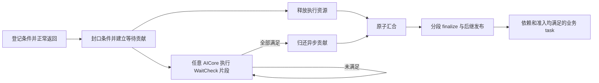

# A5 HBG AICore 异步完成开发参考

本文件是本功能唯一的开发参考，包含协议、接线、资源约束和验收要求。
更新于 2026-11-07，现有异步完成、公共入口 DCache 简化及第一轮结构精简已有相关验收记录。
文首保留本轮目标和实施结果；编号章节描述当前实现的合同与接线，验证资格以本轮结果为准。
本文区分目标、当前实现与已验证范围，资格边界见末尾状态段。
对应 [#2832](https://github.com/hw-native-sys/simpler/issues/2832)，父工作线为 [#2667](https://github.com/hw-native-sys/simpler/issues/2667)。

## 下一轮实施计划（已完成）

### 可直接设置的 Goal

> 基于当前 main，实施本文件“下一轮实施计划”的六项工作，优先完成有效进展判定、resident 登记集中发布和公共 ready 发布原语复用，再精简热数据、局部快照与重复校验。保留已验收的异步语义、同步快路径、UNKNOWN 默认预留、公共 ABI、SDMA 物理队列保护及错误后的资源保留。完成相关 C++、Python、a5sim、A5 验收与小规模 L1 前后对照，更新本文件，报告实际删除的重复代码、存储变化和全部验证结果。最后独立评估 `ld_dev` 条件观察；仅在正确性、可见性及收益得到验证后采用，否则保留现有读取实现并记录具体结论。

Goal 的完成范围包含下面六项；“优先前三项”表示实施顺序，不代表只完成前三项即可结束。
第六项交付的是有证据的采用或保留决定，不预先要求替换指令。
本轮按该计划实施；各阶段的测试只证明其对应源码和产物，不赋予旧结果对后续修改的验证资格。

### 本轮结果

- 第 1–5 项已实施：有效进展、resident 封口集中发布、公共 ready 发布、紧凑热数据/局部视图和按责任边界收拢校验。
  内部布局为 v6，公共 ABI、UNKNOWN 默认容量和同步免分配保持。
- 正常 CMake 构建后的 31 个相关 C++ 测试目标已通过，涵盖 native SDMA 失败后的保活、协议导出和普通/MIX/Graph 调度。
  首次构建发现一个公共平台测试仍使用旧局部视图接口，已迁移并重新通过；记录保留。
  128 个 Python 协议解析测试与 a5sim 相关场景通过（48 个独立用例、2 个场景项，后者覆盖 31 个工作负载）。
  A5 优化运行时构建完成，53 个独立异步验收用例及同步回归的 5 个测试项（30 个工作负载）通过。
  48 个新增/增强场景也完成验收：单卡 31、双卡 9、四卡 8；双卡首轮一项测试组织错误及其修复见下。
  12 组 L1 及第 6 项独立评估完成；最终保留 DCCI 读取。这些是相关集合，并非全仓测试。
- 前两项候选已有 A5 构建与 10 组 L1 结果，每组 5 次预热、100 次正式调用，保留 native Host/Device 日志。
  `register64` 的登记 kernel 中位时间从 33.274 μs 到 11.560 μs，但 Device 中位时间从 501.035 μs 到 521.622 μs，增加 4.11%。
  该中间结果显示无业务 kernel 执行的区间增加，未归因到具体调度步骤；最终完整版本的匹配基线复核结果见下，不以 kernel 缩短代替整体时间。
- 已补充稀疏等待叠加 4 条普通 ready 链、以及双 AIV 竞争 2 条重叠 SDMA 队列的用例；均在旧基线上通过。
  新测试逐次校验独立 payload 和每条队列的提交序号。新增场景及受测试代码变化影响的原场景，已使用相同的新测试程序重采基线。
  未变化的同步链、UNKNOWN 零登记、fanin/fanout 继续使用已保存基线；全部样本及源码身份分别记录，最终对照不混用不同测试程序。

本轮实现的尺寸核对如下；计入实际对齐，不等同于性能收益：

| 对象 | 修改前 | 当前实现 |
| ---- | ------ | -------- |
| task 映射 | 32 B | 24 B |
| 组只读身份 | 128 B | 40 B |
| writer 记录 | 128 B，含诊断 | 64 B，仅登记状态 |
| CHECK 热进度 | 128 B，含诊断 | 32 B |
| FINISH 只读身份 | 128 B | 32 B |
| FINISH 热进度 | 256 B，含诊断 | 168 B |
| 每核异步执行状态 | 288 B | 72 B |
| CHECK writer 局部对象 / 每次读取 | 128 B / 64 B | 32 B / 32 B |
| 完整 resolver 游标 | 192 B | 152 B |
| 独立 ready 发布临时对象 | 复用 192 B 完整游标 | 96 B |
| `SchedulerLocalState` | 816 B | 776 B |
| 组 / FINISH 的可选诊断记录 | 包含在热记录内 | 192 B / 48 B，仅现有 DFX 等级 ≥ 3 分配 |

只读身份和 writer 分别为 40 B 与 64 B；保留两个紧凑数组，比将每组合并后按 128 B 对齐少 24 B/组。
writer 与相邻 writer 各占独立 64 B 缓存行；lease、join、目录保持原子区隔离。
CHECK/FINISH 热进度只经 bypass 读写，按 8 B 对齐；其诊断统计由持有同一 lease 的核更新，release 在诊断记录中独占另一缓存行。
只读布局在每核挂载时一次建立缓存视图，运行期不复制完整布局，必须在 run 生命周期内保持不可变。

以 1 万个单 AIV、默认 64 条件任务并含 48 队列保护为例，异步镜像由 32,366,720 B 降到 27,966,720 B（L0–L2），减少 4,400,000 B；
开启诊断时为 30,366,720 B，减少 2,000,000 B。
单个同形任务的非诊断镜像仍为 10,112 B；开启诊断时为 10,496 B，比原来多 384 B，来自可选区间的对齐和 release 隔离。
这些是实际 planner 结果；Host 初始化/H2D 耗时和编译后实际栈使用不能由 `sizeof` 或字节差额推断。

本轮校验的责任边界：

| 边界 | 去重与保留依据 |
| ---- | -------------- |
| Host / 挂载 | 保留形状、容量、总预算、区间不重叠、可选声明及真实资源 owner 校验；布局只在挂载时取得只读缓存视图 |
| payload 绑定 / 封口 / 激活 | 保留完整 task-map 关系、身份、writer 指针、条件容量及登记合同校验，成功后才发布 CHECK/FINISH lease |
| CHECK / FINISH 片段 | 复用封口/激活已验证且不可变的身份，不再逐片段重读 task-map；保留 epoch、进度、条件格式、外部观察及一次性贡献检查 |
| SDMA | 非零提交由 reserve 检查 writer 可用性，零字节调用仍单独检查；容量在 SDK 构造前预留，物理队列锁、真实回执、workspace 与双端精确区间校验保留 |
| 失败与诊断 | 封口失败仍发布容量范围内的已登记前缀，保留首次错误；错误不贡献成功，也不放宽外部访问未确认结束时的资源保留 |

删除了生产入口不再使用的整布局 backend mount 重载。token 格式实现共用一处，writer、封口和裸条件观察是不同的验证边界，未为了少调用一次而取消外部地址解引用前的检查。

本轮最终代码核算不包含其他会话的在途文件：生产源码新增 736 行、删除 565 行，净增加 171 行；测试新增 550 行、删除 204 行，净增加 346 行。
新公共发布文件的 274 行主要来自完整 resolver 的迁移，不能作为净删除收益。
实际消除的独立算法主体包括 inbox 尾部 CAS 与旧尾连接、bootstrap 的 ticket 预留/发布组合，以及 linked/chunk 的独立准备和 pending 提交组合；调用入口保留各自的批次管理和重试责任。
`scheduler_ready.h` 中三个被改写函数原来分别为 33、18、51 行，包含适配和检查；这些行数也不能全部视为重复逻辑或净减少。
可选诊断区及其导出、挂载检查增加了源码，但减少了非诊断运行的热记录和片段搬运量；这一取舍与代码行数分别报告。

缓存维护与读写成本按源码计算，不冒充 PMU 实测：

- 连续登记 1/8/64 条时，原登记 API 的 token 前缀分别涉及 1/20/1056 次缓存行写回调用，另有 count/error 各一次/条；resident 路径改为封口时对实际 token 前缀写回 1/4/32 行。
  这里不统计两版共有的绑定、writer 发布、SDK 队列交接及其他 cache 操作，也不等同于外部存储总线流量。
- writer 快照读取从 64 B 到 32 B；CHECK 进度从 128 B 到 32 B；FINISH 进度从 256 B 到 168 B。
  DFX 关闭时不读写拆出的诊断记录；原子 lease、join 和目录操作仍保留。
- 相同 Host、相同 `-O2` 的独立初始化小测，每组 5 次预热、100 次采样，并反向复测：1 万个 UNKNOWN 默认容量任务、不含分配与 H2D 时，原初始化中位时间约 1.33–1.45 ms，候选约 1.07–1.19 ms。
  这只是 Host 镜像初始化；实际调用的 `chip.run.bind` 包含绑定与镜像准备，`chip.run.publish_image` 包含发布/H2D，不能把 `prepare_execution` 当作纯异步初始化时间。
- 当前 L1 未采集 PMU 缓存流量或原子操作计数；对象尺寸不代表编译后栈帧尺寸。

### 本轮 L1 与条件读取评估

下面比较修改前主线与完成第 1–5 项的 DCCI 候选。设备、CANN/PTO-ISA、业务测试程序一致，每组 5 次预热、100 次正式调用；同时校验数值和逐次 payload。
全部时间取 L1，表中的 Device 来自 native `device_wall`，不是业务 kernel 的首尾区间，也不包含 Python 验证耗时。
`register1/8/64` 是单个普通 AIV 登记对应数量的 COUNTER、登记门、消费者和辅助发布者组成的四任务小图；业务条件在启动前已满足。
它测登记/封口/调度的固定开销，不是等待真实搬运的耗时；真实 SDMA 对照另列。

| 用例（设备） | Device 中位数 μs，前 → 后 | 变化 | Device P95 μs，前 → 后 |
| ------------ | ------------------------- | ---- | ---------------------- |
| `sync_chain`（4） | 1304.870 → 1262.414 | -3.25% | 1313.430 → 1282.216 |
| `unknown_zero`（4） | 3227.131 → 2373.226 | -26.46% | 3265.688 → 2429.939 |
| `register1`（4） | 348.878 → 371.675 | +6.53% | 356.053 → 394.508 |
| `register8`（4） | 356.342 → 370.573 | +3.99% | 365.638 → 387.678 |
| `register64`（4） | 530.528 → 438.471 | -17.35% | 540.649 → 456.842 |
| `hotspot`（4） | 5375.811 → 5380.076 | +0.08% | 5387.909 → 5396.883 |
| `saturation`（4） | 5988.778 → 5877.970 | -1.85% | 6023.219 → 5907.860 |
| `sparse_ready`（4） | 5566.412 → 5216.666 | -6.28% | 6477.079 → 7964.868 |
| `fanout`（4） | 6173.895 → 5535.574 | -10.34% | 6687.626 → 6044.215 |
| `fanin`（4） | 6630.361 → 5534.337 | -16.53% | 6867.260 → 6091.689 |
| `shared_sdma`（4） | 1018.290 → 944.062 | -7.29% | 1135.292 → 995.350 |
| `shared_sdma`（5） | 995.822 → 980.567 | -1.53% | 1054.597 → 1038.539 |
| `shared_multiqueue`（4） | 4996.151 → 5229.032 | +4.66% | 5412.050 → 5848.426 |
| `shared_multiqueue`（5） | 4986.613 → 5069.359 | +1.66% | 5375.615 → 5919.062 |

回退没有隐去：再次采集同样的 100 次正式调用，`register1`、`register8`、双队列 SDMA 的设备 4 仍分别比基线慢约 9.14%、3.11%、4.54%。
1/8 条条件的登记 kernel 没有变慢，业务 kernel 首尾区间基本持平或缩短；增加的 Device 时间主要落在该区间之外。
L1 尚未把它定位到具体的启动、完成收尾或调度内部步骤。双队列场景也保留其回退，不因其他场景加速而宣称全面改善。
前两项候选的 `register64` +4.11% 属于中间结果；完整候选使用匹配测试程序重采的基线后，已转为表中的 -17.35%。

Host 镜像准备与发布的现有跨度中位数如下；包含对应公共流程，不是只计异步记录的初始化或纯 DMA 时间：

| 用例 | `bind` μs，前 → 后 | `publish_image` μs，前 → 后 |
| ---- | ------------------ | --------------------------- |
| `sync_chain` | 93.465 → 102.485 | 45.965 → 55.140 |
| `unknown_zero` | 127.190 → 113.525 | 103.640 → 66.060 |
| `register1` | 218.840 → 177.515 | 47.790 → 45.265 |
| `register64` | 216.065 → 183.820 | 53.070 → 47.020 |

第 6 项的结论是保留 DCCI/标量读取：

- 同一 CCEC 分别为 AIC/AIV 生成 `LD_DEV.b32` 和 `LD_DEV.b64`；4 个独立真机边界用例检查 4 字节地址步进、负 COUNTER、32 位边界和跨越 2³²/2⁶³ 的完整无符号 64 位比较，均通过。
- 仅替换条件观察的隔离运行时通过 48 个单卡原有用例、5 个双卡真实 SDMA 用例和 3 个跨卡通知工作负载。
  成功完成记录证明 AIC/AIV 都参与过 COUNTER 和真实 SDMA 的终态观察，并观察到跨执行核的完成；pending 计数是组级汇总，不据此推断每个 pending 片段在哪个核上。
- 静态读取循环耗时明显下降，但该小测每个组合只有一次调用；真正采用与否依据完整 L1 对照。
  相对 DCCI 候选，`register64` 的 Device 中位数仅改善约 0.48%，`register1/8` 分别增加约 0.87%/0.13%；fanin、稀疏等待和单队列 SDMA 的部分结果也变慢。
  12 组对照未证明稳定的整体收益，因此不替换生产读取实现，不把指令条数减少等同于调度器提速。
- 最终实现继续使用已验证的 DCCI/标量观察、既有消费者公共入口和原有内存顺序。没有增加选择读取方式的配置开关。

本机证据目录相对仓库根为 `../logs/async-round2-20261107/`：
`candidate-l1-comparison.json`、`candidate-dcci-repeat-l1-comparison.json` 保存中位数/P95、Host 跨度和 kernel 区间；各 L1 目录保存全部原始样本与 native 日志。
`observer-evaluation/decision.json` 与 `runtime-l1-comparison.json` 保存第 6 项决定及直接对照；该目录还保留构建命令、隔离源码、二进制身份、边界检查及观察核证据。
ELF 的 `.text` 段从 7,816,728 B 到 7,442,200 B；这是编译产物代码段大小，不是栈大小或整个运行时的设备存储占用。

### 最终验证与交付边界

- C++：正常 CMake 构建后的 31 个相关测试目标通过；Python：128 个协议解析测试通过。
- a5sim：48 个独立用例、2 个场景测试项通过，后者覆盖 31 个工作负载。
- A5：53 个原有及新增独立异步用例、48 个增强工作负载、同步回归 5 个测试项/30 个工作负载通过。
  覆盖普通/SPMD/MIX/sync-start/单层 Graph、UNKNOWN 默认容量、关闭和错误、跨卡通知、真实 SDMA，以及双 AIV 共享单/双队列。
  这些是相关集合；没有运行全仓测试或完整模型性能回归。
- 增强双卡首轮失败必须保留：新增双队列场景与两个默认场景放在同一测试类，复用了同一 Worker/communicator，触发既有 SDMA owner 的固定配置检查。
  真机负例捕获 `incompatible SDMA owner access/q (1/0 requested 2/2)`；错误发生在域初始化阶段，未执行该场景的业务 kernel。
  双队列场景已移入独立测试类，获得独立 Worker，随后三个共享通道场景通过。没有放宽 owner 检查，也没有修改 payload、序号或条件数断言。
  AST 与参数核对证明工作负载不变；之前 L1 每次使用独立 Worker，其数据继续有效。
- 首次 C++ 构建发现公共平台测试仍调用旧局部视图接口，迁移测试接线后重新构建并通过。
  CCEC 不接受设备端 `-S` 的指令探针改用对象编译加反汇编，32/64 位指令已核实；失败记录与最终结果分别保留。
- 现有 nanobind 退出时对象保留提示仍存在；正常测试返回成功不证明 Python 清理问题已解决。
  1/8 条条件小图和双队列 SDMA 的性能回退保留在上表及本机问题记录中，不宣称所有场景提速。
- 生产代码与完成验收的构建快照一致，仅有一处解释 writer 快照边界的注释修正；测试组织修正已单独通过真机验证。
  公共 ABI、依赖 pin、共享分支、其他会话的在途文件及现用安装保持。源码改动以 main 为基线，提交范围仅包含本次修改。

相对仓库根的 `../logs/async-round2-20261107/qualification/` 保存相关构建、测试命令和日志，
`current-owned-source.patch`、`current-owned-manifest.json`、`current-code-counts.json`、`source-to-tested-artifact-relation.json` 保存交付身份和范围；
`completion-audit.json` 对照六项要求及保留的不变量列出证据。
增强测试的首轮双卡失败、四卡通过、固定配置负例及测试分组修正后的通过分别记录，不能将它们合写成一次全绿运行。

### 基线与取舍

- 本地基线是已推送 main 的“重构：精简 A5 HBG 异步完成协议并统一登记与依赖释放”。
  对照 [poursoul 的异步分支](https://github.com/poursoul/simpler/commits/feat/a5-hbg-async-completion/)，源码核对日期为 2026-11-07。
  开始时重查双方提交、依赖 pin 和实际构建产物，固定本轮对照版本。
- 当前本地已经统一普通完成、Graph 控制和异步 FINISH 的完整 resolver，以及 resident writer 和两类 SDMA 提交入口。
  下一轮在此基础上减少重复工作，不重新叠加另一套完成框架。
- 吸收对方的有效进展判定、封口集中发布、紧凑组头/索引和独立有限步发布接口。
  保留本地的同步免分配、显式容量、直接续接、完整发布语义、可选声明校验、错误保活与跨核诊断。
- 对方当前 Host 调用点仍为所有可执行 lane 使用默认 64 条容量；其 planner 支持容量参数，不等于已经接入能力信息。
  对方 Graph/FINISH 共用新 resolver，普通完成仍有另一套主体，不能把这一结构重新带回本地。
- 形成计划时没有新增 L1 测量；本轮的速度结论以文首实际对照为准，不由代码行数、对象大小或指令条数推断。

下表记录修改前双方尺寸，作为本轮减法基线；当前实现尺寸见文首，完整成本按第 2 节计算：

| 对象 | 当前本地 | 对方参考 | 比较边界 |
| ---- | -------- | -------- | -------- |
| 组身份和 writer | 128 B + 128 B | 合并组头 128 B | 本地包含诊断和并发 release 信息，不能直接删除其职责 |
| task 映射和描述 | task map 32 B；FINISH identity 128 B | task 索引 4 B；异步 task 描述 16 B | 另计 join、lease、progress、条件和目录 |
| 常驻异步执行状态对象 | 288 B，其中布局副本 216 B | 56 B | 不是整个执行器的栈大小，缩小后仍须核对 GM 访问次数 |
| 默认 64 条件组 | 2560 B | 2432 B，另有组 offset 索引 | 两者都未计任务级记录、目录和整个 run 的对齐开销 |

### 保留的核心职责与行为

| 核心概念 | 职责 | 不承担的职责 |
| -------- | ---- | ------------ |
| 完成条件 | 保存既有 token 的类型、地址和阈值，回答本次观察是否满足 | 分配通信资源、证明任意 raw 地址有效、管理 payload 的所有权 |
| 一次物理执行的 AsyncGroup | 登记、封口、保存未满足条件和检查进度，保证一次贡献 | 通道分配、消费者准备、另一套资源权限或提交凭证协议 |
| 逻辑 task 的完成状态与通用 resolver | 汇合所有执行返回和条件完成，发布后继并完成记账 | 为异步任务复制一套后继遍历和 ready 发布算法 |

CHECK 是对 AsyncGroup 的一次有界检查；FINISH 是使用通用 resolver 续接逻辑完成的薄适配。
它们不增加业务 TaskId，不占普通 ready ticket，不要求原核持续负责等待。
Host 的通用异步规划只依据展开后的执行形状、已有能力信息和预算分配存储；可选声明由后端单独校验。
run/domain/buffer 的保活继续由已有 owner 层负责，不再为异步检查建立一套资源身份。
SDMA 后端负责 SDK 会话、提交保护、队列状态发布及完成记录获取，通用检查流程不读取其资源用途或凭证表。

- UNKNOWN 无须新增声明，默认容量 64；已有 SYNCHRONOUS 与明确小容量信息继续生效。
- 保留普通任务、SPMD、MIX、sync-start、当前单层 Graph，完成仍由 AICore 自己观察。
- KernelReturned 不等于 TaskDone；TaskDone 不等于依赖发布已结束或资源已经可以回收。
- 条件可由任意有服务机会的 AIC/AIV 检查；未满足就交回领取权，不设置固定检查核或重试冷却时间。
- 保留容量、格式、身份、一次性完成、首次错误和未确认停止时的资源保留要求。
  不根据 COUNTER 类型就推断 kernel 不可能发起外部工作。
- 消费者继续通过公共执行入口维护 DCache，不恢复消费者区间表或逐消费者准备计划。
- 公共 Graph/tensor 格式与 dispatch 既有偏移保留；内部布局按实际变化升级版本并重新构建匹配生成物。
- SDMA 多队列按固定顺序领取，提交与 SDK 元数据发布后交权；保护不延伸到等待 DMA 完成。
- 不恢复提交包、授权/凭证、每条件绑定旁表或新的资源所有权框架；默认裸地址的有效性与寿命仍由调用方及已有 owner 合同保证。
- 本轮不新增后端、kernel continuation/抢占、嵌套 Graph 或行为配置开关，也不扩大为完整模型性能专项。
- 在当前 main 修改源码，构建和测试复用隔离环境；保持共享分支、现用安装及其他会话的在途文件不受影响。

以下文件入口均位于 `src/a5/runtime/host_build_graph/`，部分同目录文件仅列文件名；实施时按当前代码核实调用链。

### 1. 有效进展判定（P0）

修改前 `scheduler_async_runtime_service` 只要领取后未报错就返回 `PROGRESS`，
`scheduler_async_execution_service` 将它传给主循环，使仍为 PENDING 的检查也重置空闲退避。
这是已核实的控制流差异，尚未测量额外轮询开销或延迟影响，不据此判定死锁。

- 主要入口：`runtime/scheduler/scheduler_async_runtime.h`、`scheduler_async_execution.h`、`aicore/aicore_executor.cpp`。
- CHECK 仅在剩余条件减少或进入终态时报告推进；轮询游标、lease generation 和诊断计数变化不算条件推进。
  FINISH 按实际遍历、fanin 路由、发布或终态推进判定，失败 CAS 与相同状态的重试不算推进。
- 复用现有服务门和空闲退避，保持每次有界检查、即时交还领取权及普通任务的服务机会。
  不增加逐 wait 冷却计时、固定观察核或新的调度状态机。
- 验收：持续 PENDING、领取碰撞、发布 RETRY 均不伪造进展；条件满足及 FINISH 前进能够报告进展。
  检查结束计数仍正常刷新，有限等待正常完成，永不满足的条件不能报成功。

### 2. resident 登记集中发布与轻量格式检查（P0）

修改前通知及 SDMA 登记路径会调用前缀写回；连续登记 N 条时可能重复处理长度为 1 到 N 的区间。
对方 resident 路径在 kernel 返回封口时统一发布，适合作为本轮减法方向。

- 主要入口：`runtime/async_kernel_api.h`、`async_completion_writer.h`、`runtime/scheduler/scheduler_async_runtime.h`、
  `runtime/backend/sdma/sdma_submission.h`、`runtime/backend/async_observer.h`。
- resident 登记只更新当前执行独占的 writer；封口时发布实际使用的条件区间与登记状态，再发布 lease/目录。
  保留 legacy 的既有发布需求，以及 SDMA 交权前必须完成的 SDK 队列元数据发布。
- 共用一个轻量 token 格式检查，尽早拒绝类型、对齐和阈值错误；封口继续核对容量、未结束预留、身份及必要后端合同。
  不以格式正确推断资源有效或延长寿命，也不因提前检查而丢失首次错误。
- 验收：0/1/8/64/65 条边界、复制上下文、重复 getter、过期/未结束预留、错误被忽略和非法 token 均符合合同。
  跨核 CHECK 在封口后读到完整记录；减少的是重复前缀处理，不提前承诺等量的实际 GM 流量下降。

### 3. 公共有限步 ready 发布原语（P1）

修改前已有完整公共 resolver，但 `scheduler_ready.h` 的部分发布入口与 resolver 内仍有各自的队列发布主体。
吸收对方 `ReadyPublication` 的职责划分，进一步统一发布语义。

- 主要入口：`runtime/scheduler/scheduler_ready.h`、`scheduler_completion_resolver.h`、
  `scheduler_completion_state.h`、`scheduler_graph_control.h`、`scheduler_async_finish.h`。
- 把准备、队列提交和目录发布收敛为同一个有限步主体。普通完成、Graph、FINISH 及语义适合的 bootstrap 入口复用它。
  同步调用方连续推进，异步调用方按预算推进；输入适配不再复制队列提交代码。
- 保留 direct refill、MIX 前缀、长 fanin 前发布已就绪批次和控制节点路由。
  待发布引用与阶段由调用者持有的完整 cursor 保存，跨核交权不借用上一核私有状态。
- 验收：长 fanin/fanout、混合队列、强制 CAS RETRY、预留后发布、Graph EXIT 与交权均无漏发/重发。
  实际删除重复发布主体；仅移动文件、改名或增加包装层不算完成。

### 4. 紧凑热数据与局部视图（P1）

- 主要入口：`runtime/scheduler/scheduler_async_layout.h`、`scheduler_async_runtime.h`、
  `scheduler_async_protocol.h`、`host/async_plan.*`、`host/scheduler_async_protocol_export.h`。
- 优先压缩 task 索引/描述、FINISH identity、组身份与 writer 中可推导或重复的字段；条件容量继续按已有能力信息分配。
- 将仅供诊断的时间点和计数纳入已有 DFX 分配与等级控制，保持错误码、终态和跨核因果证据。
  writer 的 release 区可能与 CHECK 并发访问，必须先按读写者分离职责，不能直接把两个 128 B 记录拼在同一缓存行。
- lease、join、目录等原子字段继续独立隔离。缩小每核布局副本及 CHECK 快照，仅搬运实际需要的字段，核对由此增加的 GM 读取。
  GM 记录的对齐要求与局部视图分开处理，保留 AIC/AIV 编译及地址空间正确性。
- 验收：报告每组、每逻辑 task、每 run、每 worker 的真实尺寸、对齐、初始化/H2D 和热路径访问成本。
  说明相同能力下实际减少的表、字段和拷贝；公共 ABI 保持，内部布局变更须升级版本并重建匹配产物。

### 5. 按唯一责任边界收拢校验（P2）

- 主要入口：`host/async_backend_plan.*`、`runtime/backend/async_backend.h`、`runtime/async_execution_context.h`、
  `runtime/backend/sdma/sdma_completion_kernel.h`、`sdma_submission.h`、`sdma_submission_guard.h`。
- Host 检查形状、容量、预算及可选声明；writer 检查格式、容量、预留和封口；SDK 适配检查提交与真实回执；CHECK 观察封口条件。
  列明现有重复检查的责任方与保留位置，只消除已经由明确不变量覆盖的检查。
- 默认 UNKNOWN 继续无需额外资源信息，也不因此要求 PyPTO 增加声明。
  显式声明不能变成空操作，保留 Graph 实际参数、精确源/目的区间、workspace、队列配置和已有 owner 的必要检查。
- SDMA 继续使用实际物理队列保护；保留 SDK 构造前容量预留、UB 偏移 0、零工作、合法同步回退及交权前元数据发布。
- 验收：每项移除的检查有明确责任归属，相关负例仍有效；提交前错误无 SDK 副作用，提交后错误不伪造完成或提前回收资源。

### 6. 独立评估 bypass 条件观察（P2）

- 主要入口：`runtime/backend/async_observer.h` 及现有 AIC/AIV、通知与 SDMA 观察用例。
- 在前五项形成稳定候选后，单独比较现有 DCCI/标量读取与 `ld_dev`；保持条件协议、消费者入口和其他调度逻辑相同。
- 保持 COUNTER 有符号比较和负值 PENDING、64-bit post-id 比较及 READY 后的顺序保证。
  运行时自有原子目录与外部条件地址分别处理，外部通知/DMA 记录不使用原子 RMW 代替普通观察。
- 验收：AIC/AIV、32/64 位、跨核/跨卡发布、负值/边界阈值和真实 SDMA 均验证；仅编译通过不等于可见性得到证明。
  有稳定收益且合同成立时采用，否则保留当前实现并给出测量、失败或缺失证据，不把未经验证的候选写成最终实现。

### 验证范围与执行顺序

先完成第 1–3 项，形成一个可对照的行为候选；第 4–5 项逐项说明减法和保留的不变量；第 6 项独立测量与决定。
优先复用现有用例和构建缓存，先做相关 C++/Python、a5sim 及小范围 AIC/AIV 编译，按依赖安排真机 runtime 构建。
已通过且未受新修改影响的检查不重复执行；不为每次文字整理或小范围检查反复全量优化编译。

L1 使用双方均支持的同一 CANN/PTO-ISA 组合、同机同卡、同输入和等量计算。
在修改前保存当前主线基线，每项候选单独 A/B；L3/L4 仅作因果诊断，不混入性能样本。

| L1 用例 | 主要判断 |
| ------- | -------- |
| 明确同步、UNKNOWN 零登记、1/8/64 条登记 | 同步附加开销、登记/封口重复处理、存储与初始化成本 |
| 单热点等待加大量空闲核；稀疏等待加持续普通 ready 工作 | 无效探测、竞争、发现延迟及业务服务机会 |
| 长 fanin/fanout 与发布重试 | 前缀公开时间、普通任务延迟、续接工作量与一次性发布 |
| 双 AIV 共享 SDMA 与重叠多队列 | 独立 payload、提交序号唯一且可合法续号、提交开销和完成延迟 |

报告 L1 端到端时间、中位数/P95、可获得的缓存维护/原子操作计数、实际内存及 Host/H2D 成本。
指令/源码操作数估算与实测流量分开；尚未约定统一退化百分比阈值，稳定退化须分析并披露。

整合后复核受影响的相关 C++/Python 集合、a5sim/A5，以及既有 47 个新增/增强场景、52 项异步验收和同步回归。
保留 pending close、首次错误、未确认外部访问结束、重复 run、漏登记负例及逐次独立 payload 断言。
内部结构测试可迁移，不能通过删除行为断言掩盖语义下降；相关、全量、模拟和真机结果分别报告。
硬件测试继续做架构预检并通过 task-submit 分配设备；构建与测试保持隔离。

### 完成判据与交付

- 六项工作逐项有实现结果或第六项有证据的评估决定；真实阻碍记录具体证据和剩余事项，不能标成完成。
- 普通完成、Graph、FINISH 及适用发布入口沿同一公共流程；resident 登记在封口统一发布；原有行为边界与失败保活成立。
- 列出实际删除的重复主体、表和字段，报告生产代码、测试/构建代码及完整存储变化；没有仅用文件搬迁代替精简。
- 提供基线与候选的源码/依赖/产物身份、构建测试命令、原始 L1 样本、正确性结果及失败解释。
- 按最终实现更新本文件的编号章节与验证状态；只保留这一份开发参考。提交和推送按当次明确授权执行。

实施前核对与资源 owner、ready 队列及 Worker 初始化相关的在途改动，避免重复修改。
不能仅凭相同错误码认定故障同源，也不把未合入的行为当作已有保证。

## 1. 范围、基线与完成语义

### 工作基线

后续基于 `nalinaly/simpler` 的 `main` 开发；以下为历史源码与依赖记录，当前轮次按文首要求固定新基线。
最初源码核对提交为 `ed1fd4d9cdd5bd857974e2f6e4a74f85201944e6`，
PTO-ISA pin 为 `f83d4b7e4be0a4ca9805944ae2d9ce8c84e581f7`。本地 main 不等同于上游 main；
开始实施和提交前重查基线、在途 PR、依赖 pin 与实际二进制身份，不迁移旧版本的测试资格。
早期 runtime 构建基线为 `2172f462`，后续 PTO-ISA pin 为 `5487a6b0`；专项测试以各自记录的源码身份为准，上述历史基线不代表最新主线的验证资格。

当前运行时有普通 TICKET/H8 ready pool、ordered/MIX/sync-start 准入、native Graph control 服务。
Graph 使用 `SchedulerGraphAccess` 和 native image；旧普通 v8 / Graph v9 保持兼容，异步事件使用 v10 / v11。
异步实现接入这些路径，不沿用旧分支的 `remaining_children`、分块物化或 v12 接线。

### 必须交付的范围

- 首批用 **SDMA 真实搬运**验收，同时接通已有通知 COUNTER，覆盖 PyPTO `defer_wait` 消费者。
- 普通任务、SPMD、MIX masks 3/5/6/7、sync-start，以及当前单层 Graph 内的异步任务均在最终范围内。
- 任一参与的 AICore 都可领取检查，原执行核不持有永久观察权；AICPU 保留已有启动、退出和错误职责。
- 条件未满足就重新具备领取资格，不设置固定重试时间，不 sleep，不要求换一个核。
- 不增加 kernel 抢占/恢复、嵌套 Graph、多 block/MIX predicate，或未验收的 URMA/RDMA/CCU 原生事件支持。

业务 kernel 正常返回后，resident 循环取得控制权；`defer_wait` 本身不隐式 return，也不保存 continuation。
它后面的代码仍会执行。依赖收到数据的计算放在另一 task，通过 `deps=[wait_tid]` 连接。

| 边界 | 含义 | 尚不能推导的结论 |
| ---- | ---- | ---------------- |
| KernelReturned | 本次调用结束，条件登记封口 | 异步数据已可用 |
| ExecutionReleased | slot、block/MIX 局部执行义务已释放 | 原逻辑 task 已完成 |
| TaskDone | 所有计算与异步条件完成，结果满足可见性合同 | 后继链已全部发布、资源已可回收 |
| ResolveDrained | 后继释放和相应完成记账均已收敛 | 其他核或外部 DMA 已停止 |
| RunRetired | 既有 run/核退休与外部访问证明成立 | 可忽略其他 run/peer 的资源使用 |



### 两种条件及现有 PyPTO 合同

| 条件 | 判据 | 必须建立的发布关系 |
| ---- | ---- | ------------------ |
| SDMA post-done | 同一已获资格并保活的 workspace 使用期内，64-bit completed post id 达到 expected post id | 数据搬运完成先于相应 post-done |
| 通知 COUNTER | 本 rank 的信号槽达到 expected epoch | 远端 payload 发布先于 notify，本地消费者能看到相应 payload |

`save_expected_notification_counter` 的历史 engine 标签也是 SDMA，但类型为 COUNTER。
按 `completion_type` 和后端合同选择观察方法；不能把通知误判为 SDMA event 或强制要求其 workspace。
共享 post-done 与通知槽都不能由检查器清零。未知类型明确失败，不能猜测已完成。

PyPTO 当前要求 window-bound INT32 信号、`WaitCmp.Ge`、expected 在 `[0, INT32_MAX]`。
waiter 为专门登记条件的 task，登记开始后只允许更多登记和纯标量记账；不执行 payload/通信/缓存工作。
它拒绝 predicate、`allow_early_resolve=True` 和嵌套在 `pl.spmd`/其他 task-launch scope 中的 waiter。
原生运行时全形状验收与 DSL 支持分别记录，不通过删除前端门禁扩大支持。
无效 AsyncCtx 会报错或 trap；仅 SDMA adapter 有既有 `event.Wait` 兼容分支，不能把 waiter 静默改成阻塞等待。

## 2. 存储、容量与可重复领取的记录

### 选定的 wait 容器

采用**常驻记录表＋活动位图＋版本化领取状态**。这里的 `wait_task` 是轻量控制工作，
不用普通 ready ticket，不创建新的业务 TaskId，不占业务 dispatch slot 或 cooperative admission。
每条记录在一个 run 中只首次发布一次，重试只交回领取权；运行中不搬移或回收记录。

main 的 [ticket 队列](../../src/a5/runtime/host_build_graph/runtime/scheduler/scheduler_ticket_queue.h)
按任务总数分配一次性 entry，出队不恢复容量；linked/chunk 候选也不允许节点在 run 内反复使用。
因此它们只负责原业务 ready，不能用来存放反复重入队的 WaitCheck。

| 记录 | 数量 | 身份与用途 |
| ---- | ---- | ---------- |
| `AsyncGroup` | 每个声明异步能力的物理执行一条 | run epoch、task ref、block、subtask；保存封口条件及剩余条件 mask |
| `AsyncTaskFinish` | 每个含上述执行的逻辑 task 一条 | 汇合计数、唯一 TaskDone、可移交的后继释放进度 |
| 活动目录 | CHECK 与 FINISH 各一组位图 | 每 64 条记录一个 atomic-only 目录字，所有核可访问 |
| 核本地状态 | 每核固定大小 | 两类扫描游标、优先类型、业务服务额度与诊断计数；不藏待重新发布的记录 |

公开 task id、Graph parent/child、执行 worker 和原 slot generation 作为审计身份保存；
路由使用稳定的内部 task ref。旧 slot 的地址、栈对象、AsyncSession 和 UB scratch 不能作为 pending 记录的 backing。
Host 将 `(task_ref, block_idx, subtask_slot)` 映射到固定组记录；映射与 DFX 是否开启无关，
不能依赖只在 profiling 时分配的 trace 数组。AsyncCtx 的有效 TaskId 也不替代这个组身份。

### 能力、容量与条件身份

保留 `get_async_ctx`、条件登记 API 的语义；旧 `CompletionToken` 通过明确版本的 adapter 接入。
有效上下文满足 `1 <= capacity <= 64`；未知布局不能与新记录直接混读。
声明过能力但本次分支没有登记条件时，实际 count=0 是合法完成，不分配活动检查工作。
纯同步 kernel 使用既有路径；静态证明整 run 无异步能力时，不分配异步区、不探测目录。

能力声明用于减少预留成本，不是运行前提。省略能力描述或标为 `UNKNOWN` 的 kernel，
每次物理执行默认预留 64 条条件，允许现有 COUNTER 和 SDMA post-done 类型；返回时读取实际登记数。
count=0 正常完成且不发布 CHECK，count>0 进入现有 AsyncGroup/CHECK/FINISH 流程。
明确 `SYNCHRONOUS` 的执行不预留；明确 `DEFERRED` 的执行按声明上界与类型预留并校验。
PyPTO 可自动导出 `deferred_completion_waiter` / `static_max_count` 来节省空间，但 extern kernel
和手写 kernel 无须新增能力或资源声明，也不增加全局开关。UNKNOWN 的默认成本按图中物理执行总数计算，
不能当成按核数分配；静态同步和小容量信息仍有价值。

当前使用 `CoreAsyncCapability v1`（version/mode/max_conditions/condition_types）与 `CallableImageHeader v1`。
公开描述随二进制注册、序列化并进入身份/hash/cache key；默认预留不把该描述改成 SYNCHRONOUS 或改写其身份。
缺少能力表的有效已注册 callable 采用相同默认值；错误版本、非法容量/类型仍拒绝，旧无版本二进制镜像仍须重编译。
`ChipTensor`、`TensorData`、`GraphDefinition` 与 `LocalContext` 的公共格式保持；kernel 局部 `AsyncCtx` 包含 writer 预留状态引用，大小见接线段。这不表示 DSL 全范围已验收。

资源声明同样可选。没有条件资源声明的执行沿用动态登记合同：kernel 保证登记地址和关联 payload
在任务完成前有效、发布顺序及缓存维护正确，默认路径校验条件格式、类型、宽度、对齐、容量和 run/执行身份。
它不从裸地址猜 owner 或 allocation generation，也不要求 Host 穷举可能的信号地址。
检查器仍通过公共观察入口维护条件 DCache；真正消费者的入口统一维护数据 DCache。
未知外部副作用采用保守的失败保活策略，不能仅凭核退出就判定外部搬运停止。
该路径出错时普通 close 可能因资源回收未获证明而失败；Host 仍输出已验证的原始终态错误码，
不能让资源保留的诊断遮住条件溢出等运行错误。这层退出资格检查不属于旧 AICPU 默认登记机制。

存在显式条件资源声明时，Host 校验已有 owner、精确区间及 SDK workspace 合同，并输出按逻辑 task 共享的稀疏后端声明；
未匹配的条件不能回退为动态许可，空的显式集合也不是动态许可。
声明匹配在登记封口时完成；成功封口的条件在 run 内不可修改。CHECK 只读取这些条件，不再次读取资源声明或匹配索引。
每条件绑定旁表已删除；DFX 的 `binding_index` 和 `owner_generation` 为 null，不为诊断保留业务不再需要的表，
也不把 run_epoch 当作 allocation generation。已有 Host/run/domain owner 继续保活所属资源。
带声明的区间检查和 owner 查询不能替代防覆写协议，后者见第 4 节。
旧 token 已用 64-bit `backend_cookie` 保存 SDMA post id；无需重定义整个公共 API。

当前编译器上界、generated adapter 的 static_assert 和运行期 capacity 检查都固定为 64，
扩大单上下文容量必须跨仓修改并重编译。多 block 的总条件数可以超过 64，由各组分别持有；
不把 legacy 的单逻辑任务等待表或 `MAX_ASYNC_WAITS` 当作本实现的全局上限。

默认 `AsyncCtx` 与 args-aware SDMA 入口使用同一个 `sdma_submit` 主体，后者只取得当前执行上下文并转发。
调用前验证传输形状、scratch、操作类型及已有声明；有声明的 TGET 匹配 workspace、源/目的精确区间和固定队列数。
无声明入口保持调用方负责有效地址和 workspace 使用合同，不要求编译器生成资源声明。
按 session 队列数预留条件容量，再构造 session、提交、取得实际完成记录；检查格式、条数、重复地址及声明区间后登记。
实际记录在交出队列前复制到本次调用的局部存储；receipt 回调使用这些副本，不在下一提交可能改动 SDK 状态后重新查询。
TPUT 保持当前 SDK 的同步 MTE fallback：合法零 handle 不产生等待条件；非空 TGET 的零 handle 仍是错误。

已有异步区的 run 中，存在未声明且可能调用 SDMA 的 AIV（含同步执行），或存在显式 SDMA 使用时，
预留一个 128 B 头和 48 个各 128 B 的 atomic-only 队列保护记录，共 6272 B。
明确仅使用 COUNTER 且没有其他潜在 SDMA AIV 的 run 不分配；全同步 run 仍无异步区，沿用既有 SDK 所有权合同。
默认调用使用一个队列；声明调用使用 owner 已验证的固定队列数。物理核位置决定通道组，多队列按编号升序领取。
同一 run 的两个入口使用同一保护区；不同 workspace 使用重叠物理队列时也保守串行化。

保护只覆盖 session 构造、提交、条件登记及 SDK 状态发布，统一完成 SDK 脏缓存状态发布后释放。
同步调用在释放后执行 event.Wait，receipt 回调也在释放后运行；不存在 bundle/grant/provenance 提交状态机。
领取超时明确失败；部分队列尚未进入 SDK 时领取失败，只释放自己已取得的记录。
进入 SDK 后失败会污染本次持有的队列，后续提交拒绝，run 保留首错误及可能仍被外部访问的资源。
保护不覆盖 DMA 的整个寿命，也不允许持有时等待依赖其他业务 task 的条件。
跨 run 排他、固定 queue_num、绕过 adapter 的 SDK 调用及资源寿命继续遵循既有 owner/调用方合同。

预留按匹配 pin 的后端可证明的记录条数上界计算，不能把一个 DMA 请求假设为一个条件；
event 返回后核对实际条数，归还本次未使用预留。无法得到可信上界的适配器先补齐合同，不能先提交再碰运气登记。
提交前失败可归还未使用预留；已尝试提交而副作用不明时，锁存错误并保留资源，不能丢掉追踪依据。
纯 COUNTER 登记不发起 DMA，不强加硬件提交事务；overflow/非法条件同样不能变成成功 TaskDone。

预留条件存储不等于 SDMA 提交队列或 flag 槽可用。匹配 pin 的 `EnsureFlagPayloadSlotAvailable`
会等待旧 post；该时间仍计入 kernel，验收必须覆盖连续提交、槽位压力及 session/workspace 复用。
本功能不承诺非阻塞提交；若要支持它，须另有能判定副作用的 backend 合同与提交续接设计，
不能在产生副作用后返回 WOULD_BLOCK 并重跑整个 kernel。

### 布局与成本

记录分离为三种不共线的区域：immutable 身份/封口条件、atomic-only 领取/计数字、owner 独占的 mutable 进度。
v6 的 atomic-only 行继续以 128 B 隔离，cached writer 按 64 B 隔离；只读数组和 bypass-only 进度使用紧凑步长。
不得让 cached writeback 覆盖原子字段或另一 writer；所有数组区间起点仍按 128 B 对齐。
每组的变长 token 区按实际 `c_e` 分配，header/error 与 token 均单 writer；封口后不再修改 token。
进度使用独占期间的 bypass 读写并在交权前完成发布，下一 owner 在成功 CAS 后执行必要读取屏障。

设图内 task 数为 N、异步物理执行数为 E、含异步执行的逻辑 task 数为 T、每组条件容量为 c_e：

```text
记 A(x) = align_up(x, 128)，没有异步执行时全部为 0。
通用记录 = A(232) + A(24*N)
         + A(40*E) + A(64*E) + 128*E + A(32*E)
         + A(32*T) + 256*T + A(168*T)
可选诊断 = 等级 >= 3 时 A(192*E) + A(48*T)，否则 0
条件内容 = Σ align_up(32*c_e, 128)
活动目录 = 128*(ceil(E/64) + ceil(T/64))
可选后端声明 = align_up(64 + 40*声明task数 + 24*信号区间数 + 56*搬运声明数, 128)
SDMA 队列保护 = 需要时 6272 B，否则 0
核本地空间 = 原调度状态 + 共享 resolver 游标及有界的后端临时数据
```

Host 在 launch 前检查算术溢出、任务上限和总预算，报告分配/初始化字节并拒绝不可容纳的 run。
当前实现接受空间按总异步执行数增长；不引入运行中复用池及容量等待，避免检查资源反过来卡住发送任务。
无声明时后端声明空间为 0，不能把公式中的 64 B 头算入默认路径。成本核对包含真实 sizeof 和对齐；
Host 初始化和 H2D 耗时按本轮保留的 native spans 分别报告，不能用字节比例代替计时。
例如 10 万组各 64 条条件仅条件内容就有 204.8 MB；这是十进制估算，不是实际布局或性能结果。
65,536 个组有 1,024 个目录字，每次最多看 4 字时，单核全覆盖至少需 256 次 CHECK slice；
记录稀疏不会自动缩短目录，不能直接将发现延迟除以核数。布局合并按文首计划评估，目录层级或分片优化另行讨论。

## 3. 领取、交接与调度服务

### 记录状态与线性化点

领取字编码 `(lease_generation, phase)`；phase 为 DORMANT、RUNNABLE、OWNED、TERMINAL 或 FAILED。
run 内身份不复用，lease generation 每次交权递增，溢出受控失败。外部错误处理不改写仍由某核持有的 OWNED。

| 转换 | 唯一操作者 | 必须先完成的动作 |
| ---- | ---------- | ---------------- |
| DORMANT → RUNNABLE | 首次发布者 | 发布条件/身份或 finalize 初始进度；组 pending 贡献先于发布 |
| RUNNABLE(g) → OWNED(g) | 任意核，单次成功 CAS | 核对本 run、记录类型与索引；CAS 成功后再读取 mutable 进度 |
| OWNED(g) → RUNNABLE(g+1) | 当前 owner | 保存游标/mask/continuation，完成写入屏障后交权 |
| OWNED → TERMINAL | 当前 owner | 完成全部共享写入和诊断发布，随后清除本记录活动位 |
| OWNED → FAILED | 当前 owner | 锁存首错误和完整身份；保留 backing，停止新提交/新领取 |

首次发布顺序为“内容与贡献 → 发布 RUNNABLE → publish_once 置活动位”。
重试保持活动位为 1，只把 OWNED 改回 RUNNABLE；无需 enqueue、预留 ticket 或等待队列容量。
终态发布后 clear_once 清除自己的位；其他记录的并发贡献不得互相覆盖。
尚未设置活动位的发布者不得进入业务 kernel；该发布尾部只有固定数量的非等待操作。

同一记录只会首次置位、终态清位，不反复置位/清位来表达领取。因此不存在
“检查失败重入队被另一核清位”窗口。目录暂空、读到 OWNED 或 CAS 失败都不代表全局完成。
陈旧目录位最多导致一次无效探测；领取 CAS 必须包含完整版本，TERMINAL 不能重新领取。

### 一次性目录原语

现有 `scheduler_gm_fetch_or/and` 在 AICore 上包含 CAS 重试循环，不能作为固定一次操作计入尾部预算。
当前使用专用的单次 unsigned 64-bit fetch-add 协议；其一次性置位/清位前提不能替换通用 OR/AND 语义：

```text
mask = uint64(1) << bit_index                 // 0 <= bit_index < 64
publish_once: old = fetch_add(word, mask);     require (old & mask) == 0
clear_once:   old = fetch_add(word, 0 - mask); require (old & mask) != 0
```

目录初始为零，每位由唯一发布者置位、唯一终态 owner 清位，各一次；`0 - mask` 按 unsigned 64-bit 模运算。
合法操作不向邻位进位或借位，bit 63 同样成立。唯一性来自状态机和 lease，而非事后返回值检查。
重复贡献可能已经破坏邻位，必须锁存协议错误并终止 run，不做反向补偿，不宣称错误检查前没有其他核继续执行。
内容、终态与进度的实际屏障仍须保留，读取旧 bypass 值不能替代原子返回值校验。
验证覆盖同字不同位交错、最高位、重复贡献及 A5 指令行为；若该实现不成立，须提供另一种有明确上界的实现。
固定原子操作次数不等于固定纳秒延迟；已有 CAS helper 也不能仅因存在循环就被认定会死锁。

### 有界发现与进度交接

每核对 CHECK 和 FINISH 各保存 `(word_cursor, bit_cursor)`，起点按 worker 分散。
每次探测后推进游标，包括 CAS 失败和遇到 OWNED；一个字内从上次 bit 之后选取，避免总抢最低位。
两类工作交替优先；优先类型没找到可领取记录时，在剩余预算内探测另一类。
游标循环覆盖整个目录，不能用一次“空”缓存永久关闭发现，也不要求所有核同步推进游标。

目录是运行时自有的 atomic-only 字，权威探测使用原子观察；仅可用 bypass 值作可丢弃的提示。
领取字的过期快照只允许造成 CAS 失败；不能据此读取进度或宣布完成。
`acquire/release` 参数在 AICore helper 中并不自动生成相应屏障，实施必须逐处使用实际 GM 发布/观察指令。
对 DMA/远端写入的条件地址不擅自使用 atomic-add-zero；后端观察方法与运行时目录原子读取分开。

一次 slice 的初始内部预算为：最多 4 个目录字、2 个候选 lease 探测、2 次领取 CAS，以及 8 个工作单元。
读到非 RUNNABLE 也消耗候选额度；成功领取一条后不再领取第二条，交权或终态后返回普通调度。
工作单元是一次含必要观察屏障的条件观察，或一个依赖路由/发布步骤；fanin 检查和 link CAS 也计入，不能把整条链算一个单元。
所有失败尝试消耗预算，耗尽即返回调度循环。这些是可测的内部初值，不是用户配置或时间间隔。
目录/lease 观察、CAS、数据屏障、进度交权和发布尾部分别计价，不能只统计八次条件检查。
每次领取或继续工作前保留最坏交权/收尾额度，预算不足就停止新增工作；大范围缓存处理须分段或另有上界。
64 条均 PENDING 的组完整遍历至少需要 8 次成功领取/交权，即 16 次 lease CAS，另有扫描与发布成本。

PENDING 保存未满足 mask 和循环游标，已满足位不再读取；条件必须在本 generation 内单调成立。
observe_once 在同一次有界调用中完成观察及其屏障，返回 READY 后清位；不保留独立的 acquire 阶段或获取游标。
检查只依赖封口条件和当前观察核，不依赖上一观察核的临时 UB、栈或局部缓存状态。
同一 slice 中不对同一未满足条件反复读到预算耗尽。检查多于 8 条的组通过多次 slice 完成一次遍历。
保存进度后交权不需要额外 CAS 重试循环：只有 owner 能改变 OWNED；单次交权 CAS 失败是状态损坏，走错误收敛。
没有任何私有“待重新入队”任务跨越业务 kernel，固定的终态/贡献发布尾部也不等待 peer 或容量。

### 普通 ready 与检查工作的关系

保留 main 的 TICKET/H8、类型/credit、ordered/MIX/sync-start 准入和 Graph control 服务。
调度循环先处理退出/错误、完成回收、Graph control 与已有 ready 待发布工作，然后经过统一异步服务门。
门前服务须能返回或有独立上界；不能用内部无界 fanin/CAS 使服务门永久不可达。
本地状态区分 BeforeAdmission、AdmissionDenied、PermitGranted，仅前两者允许异步服务；
所有正常循环出口统一收口，helper 不直接控制外层 `continue`，错误/退出可直接结束。
`scheduler_ready_pool_has_pending` 只禁止进入业务 kernel，不能绕过服务门；准入失败也回到服务状态。

当前按业务忙闲分配工作额度：

| 本核状态 | 服务规则 |
| -------- | -------- |
| 有可合法进入的业务 kernel | 优先业务；累计最多 4 次业务返回后，下一业务 kernel 前执行至多一个异步 slice |
| 无可执行业务或正在等待 admission/cohort | 每轮执行至多一个异步 slice，随后重新服务普通 ready 和控制路径 |
| 有活动记录但本次 CAS 失败/读到 OWNED | 立即返回正常调度；不等领取成功，不给该记录加时间门槛 |
| 无可服务业务、控制工作或异步记录 | 沿用既有空闲策略；它不改变任何 WaitCheck 的可领取时间 |

业务计数到额度后，无论本次探测成功与否均归零；没有异步能力的 run 跳过该分支。
到额度的服务点放在领取本核 ready slot、调用可能提交 admission 的 `scheduler_ordered_can_enter_slot` 之前；
已取得 cohort 执行许可就直接进入 kernel，不能夹入 WaitCheck。准入未成功时可执行 idle slice 后重试；
每轮记录异步额度是否已用，避免 BeforeAdmission 和 AdmissionDenied 在同一轮各执行一个 slice。
服务 CHECK/FINISH 的优先类型每次 slice 轮换，普通与异步均有机会，避免 idle 核在单一热点上连续用完无限预算。
业务额度 4 和工作预算 8 的性能取舍留待后续 L1 对照；它们替代“一个完整检查 task 对一个业务 task”的粗粒度比例，
不保证时间公平或固定微秒响应。所有核都执行长 kernel 时，条件发现仍必须等核返回，本功能不抢占 kernel。

多条记录时用分散起点和推进游标减少碰撞；看到 OWNED 就跳过，不持续 CAS 同一个版本。
只有一个热点时，任意核即时重抢仍会产生随空闲核数增加的聚合探测压力；单次预算不等于全局频率上限。
当前接受这个边界；本轮已加入单热点多核 L1 对照，不据此声称消除了争用，也不增加冷却时间或固定观察核。

进展保证基于核持续回到服务点、原子操作能完成：固定记录总数和轮转游标使长期 RUNNABLE 的记录被反复访问；
CAS 失败说明另一核取得过相应版本，其他核可继续别的工作。单纯 PENDING、CAS 重试和扫描不刷新进展 watchdog。

## 4. 完成汇合、后继发布与资源复用

### 计算与异步贡献的原子汇合

仅对含异步能力的逻辑 task 增加一个 atomic-only 64-bit 汇合字：
低 16 位为 pending_groups，接着 16 位为 unreleased_blocks，高位保留 sticky FAILED 和协议校验位。
初始化为 `(logical_block_num << 16)`。当前每 task 的 block/subtask 数上限为 INT16_MAX，两个计数域足够；
尺寸检查和静态断言绑定这个前提，不能将布局隐式扩展到更大任务。

所有合法计数变化使用单次 GM fetch-add，避免多字段丢唤醒及无界 CAS 更新循环：

1. 非零条件组封口：pending_groups 加 1，发布组后才能释放该执行的局部义务。
2. 计算 block 真正释放：unreleased_blocks 减 1。纯 lane 由该 block 的执行核贡献；MIX 由 coordinator
   收齐实际参与 lane 的返回、必要发布与局部关闭后贡献一次。零条件、同步 lane、合法 predicate skip 也覆盖在此计数中。
3. 条件组 terminal、活动位已清且不再写组记录后：pending_groups 减 1，恰好归还一次贡献。

每次递减检查返回的旧计数非零，违规立即锁存错误；每项贡献有唯一 slot-generation/组 owner，不能盲目补偿重试。
只有让两个计数首次同时为零且无 FAILED 的递减者，负责激活预分配的 `AsyncTaskFinish`。
它先发布 FINISH 记录内容/状态，再置活动位；期间不得进入业务 kernel，也不等待其他核。
单纯读取计数或设置错误位不触发激活。

计数汇合不丢唤醒的理由是：每个组的 pending 增加发生在所属 block 释放之前，
所以 unreleased_blocks 到零后不会再出现新登记。最后计算与最后事件在同一原子字中有唯一先后顺序，
后到的合法递减者必定看到两个计数均为零；不需要一个核等待另一个核的单独 flag。

必须区分当前 `completed_blocks` 的计算贡献与新的“发布/局部资源已释放”贡献。
不能直接把现有 `TASK_LAST` 返回值当作新门槛：async 路径需要在 trace/条件发布和 MIX 收尾之后贡献新计数。
正常路径不再调用原来的直接 TaskDone 分支，而由 FINISH 统一处理；不含异步能力的 task 保持原完成路径。

### 分段 finalize 与完整 drain

`AsyncTaskFinish` 也是可跨核领取的常驻记录，沿用同一状态/目录协议，不占业务核的执行 slot。
其进度必须保存在 GM 记录中，包括：是否发布 TaskDone、是否摘取 wake-list、当前后继与下一个引用、
未完成的 fanin 路由、最多 8 项的待发布批次和完成计数是否已贡献。不得只保存在某核的栈或 `local->control_resolve`。

首次 owner 核对汇合条件和 run 错误，完成数据可见性要求后，唯一发布原 task 的 DONE 并摘取 wake-list。
发布 DONE 与记录摘链进度是有界且不让出的短事务；核故障走整个 run 的错误/隔离路径，不尝试盲目接管半写状态。
之后按 slice 预算调用共享的 `scheduler_resolve_completion_step`；它持有完整的 `SchedulerCompletionCursor`，
负责摘链、fanin 路由、后继批次和发布重试。普通完成使用本地 cursor 并保留直接 refill；Graph control 保存本核续接，
异步 FINISH 将同一 cursor 随 lease 交接。三者共用一套后继释放实现，不为同步短路径创建 GM FINISH。
`SchedulerReadyPublication` 是 cursor 内的 96 B 有限步发布状态；prepare、队列提交和目录发布由公共入口推进，bootstrap/control/pending 入口也复用相同主体。
完整 cursor 为 152 B，异步 FINISH 按预算交权，同步调用持续推进；端点提交后只保留尚未完成的目录责任，不再次发布批次。
cursor 为仅含引用、索引和阶段的 POD；每步至多检查一个 fanin 或尝试一次挂链 CAS，失败也扣预算。
结果明确区分 Linked、Ready、Yield、Drained、Error，不能用一个“完成”返回值混淆责任已经转移和仍由本记录持有。
内层 `scheduler_resolve_step` 按 fanin/CAS 拆步，不能把调用整个函数包装成一个工作单元。已有 ready 前缀在长 fanin 路由前发布。
从旧 wake-list 取节点时，先保存旧 `next_waiter`，再尝试将该节点挂到下一 producer。
挂接 CAS 成功就是责任移交点：下一 producer 可以立即摘链并改写该节点，当前 FINISH 不再读写它；
只推进自己保存的后继游标。挂接失败/预算耗尽才把未移交节点及 fanin/CAS 阶段留在 FINISH 中。
READY_TO_ENQUEUE 同样只生成一次待发布责任；不能通过重新扫描原 wake-list 恢复进度。

遇到发布 RETRY，保存唯一批次/当前后继的阶段，交回 FINISH；下次从该阶段继续，不重新摘链或重新路由已发布 task。
若使用普通 ready 的 ticket，一旦预留成功，必须在不让出的固定长度尾部完成最多 8 项发布；
预留前 RETRY 可重试，预留后禁止再 reserve 同一批。辅助状态跟随 FINISH，不藏进原观察核的私有 pending 描述符。
下游业务 task 仍经原依赖与准入规则决定是否执行，不能直接由检查器强制 READY。

全部后继已路由、所有批次已公开、诊断已发布后，FINISH terminal 并清活动位，
最后才给原 task 的 `pending_completed` 贡献一次。TaskDone 可以早于 resolve 尾部结束，
全 run 的正常完成计数必须晚于这个尾部；不把 CHECK/FINISH 本身算入业务 task 数。
Graph CHILD 的完成通过当前 body → EXIT 边推进，EXIT 与其他 control 节点沿用 main 的 control 服务和计数。

### 可见性与所有权

封口 token 的写回必须先于 RUNNABLE/目录发布；owner 的 mutable 进度发布先于交权，下一 owner 成功 CAS 后才读取。
atomic-only 控制行上不做 cached store 或整行 dirty writeback；bypass-only 进度行不混入 RMW。
状态字的唯一 CAS 权只解决所有权，不能代替条件、数据、trace 和后继发布的屏障。

backend adapter 负责下列合同，CHECK 只消费条件观察结果；这些概念操作不是已经存在的 PTO-ISA API。

| 操作 | 责任与接线 |
| ---- | ---------- |
| validate_and_reserve / submit_and_commit | 发起核资格、资源与容量验证；提交前源数据发布和目标旧 dirty cache 处理；追踪实际副作用 |
| observe_once | 对单条件有限检查并完成观察屏障，返回 PENDING/READY/FAILED；不等待条件变 READY，不保留获取续接 |
| 业务 kernel 入口 | 实际执行核在依赖和最终准入满足后，统一执行全 DCache 的 `dcci` 与完成屏障，再进入业务 kernel；更早的 predicate 读取沿用自己的缓存维护 |
| prove_last_use | 现有资源 owner 依据实际 AICore、backend 和 peer 证据决定复用或释放 |

每种条件分别列出 AIC/AIV 发起、观察、消费资格及指令、屏障、scratch、失败返回合同。
匹配 pin 的 `CheckPostDoneIds` 调用 `GetValue`，后者使用 GM→UB 和 pipeline barrier，不能直接视为任意核的标量读。
若观察需要 scratch，必须为该观察核提供合法 resident scratch，不能引用原 kernel 的 UB；其空间和流水线影响计入预算。
全部参与核均能检查是交付要求，核资格未验证时不得改成固定 AIV 代查并宣称全范围完成。
使用公开完成记录接口；SDMA 必须证明“DMA → post-done → 检查核获取 → 汇合/TaskDone → 消费核获取 → payload 读取”，
通知则证明“远端 payload 发布 → notify → 同样的本地获取链”。清旧 dirty cache 必须先于 DMA，完成后不能写回旧数据。

消费侧可见性使用统一业务入口合同。AICore DCache 的维护是普通跨核任务同样需要的责任，
与等待条件由本核还是另一核检查无关。每个实际执行 lane 在依赖及最终准入满足后，
执行 `scheduler_observe_data_cache`，完成全 DCache 的 `dcci` 和屏障，再开始本次业务执行。
普通任务、SPMD、MIX、sync-start 和 Graph CHILD 使用相同入口；Graph 控制节点不读取业务 payload。
调度期间更早执行的 predicate 判断继续对描述符和条件地址做原有的独立缓存维护，不依赖消费计划。

Host 不生成消费者区间表，不要求消费者声明，不维护消费准备游标、写序号或额外的准备 cohort。
原有 ordered/MIX/sync-start 准入保留；SDMA 提交并发由后端物理队列保护负责，不再增加通用提交准入。
`rt_declare_async_consumer` 仅保留源代码兼容，声明不产生设备侧消费计划。

`async_plan` 只预分配 AsyncGroup、条件和 FINISH，建立物理执行映射并检查预算。
`async_backend_plan` 只为显式声明解析实际参数和已有 owner；默认路径不解码这些参数，不做 owner 查询，也不生成资源表。
它输出按逻辑 task 共用的 `AsyncBackendTask`、压缩信号区间 `AsyncCounterRange` 和 `AsyncSdmaTransfer`，不按 block/lane 展开。
无条件声明、空的显式声明、合法非空声明三个含义保持不同；已有 consumer 声明不产生设备存储。

私有异步布局为 v6，头大小 232 B；保留可选 backend 与 SDMA guard 区，并按现有 DFX 等级分配组/FINISH 诊断区。
不再存在 resources/uses/scratch 三套接线，也没有新的资源所有权表。
`execution_contract` 直接属于 run 布局；只有所有实际 task 的显式声明都覆盖 CORE_PIPELINES_ONLY，才获得相应退休资格。
条件类型为 COUNTER 本身不提供此资格。Host 的保活判定不再挂载资源表。
共享 `AsyncCtxStorage` 保持 40 B，`LocalContext` 保持 48 B，`DispatchPayload` 保持 512 B。
`AsyncExecutionContext` 的 32 B 嵌入 dispatch 尾部，扩展指针、参数和 GlobalContext 的既有偏移不变。
kernel 局部 `AsyncCtx` 为 56 B，只引用当前执行上下文及共享预留状态；resident 上下文只解析一次格式，legacy 保留零扩展适配。
同步执行不分配条件，但在已有异步区的 run 中可通过内嵌错误字上报被调用方忽略的 SDK 失败。

writer 的 reserve/commit/finish 使用共享 serial、起点、上限和已写数；上下文复制不复制预留状态。
封口拒绝未结束的预留，过期或跨 writer 的预留不能写入下一段；首次错误保持，封口后不再改写公开状态。
resident 登记不逐次写回前缀；封口一次发布实际使用的 token 区间和 writer，再发布 lease/目录。legacy 路径的 API 边界写回保留。
封口失败也发布容量范围内的登记前缀用于诊断；不会激活成功 CHECK 或清除首次错误。
不含数组间对齐的边际成本为：默认 64 条件组 2312 B，含异步执行的逻辑 task 另有 456 B FINISH 相关记录；
诊断等级 ≥ 3 时再分别增加 192 B 和 48 B。task map、目录、对齐和后端存储另计，不能把边际值当作一个组的实际总分配。
`SchedulerLocalState` 为 776 B，每核异步执行状态另为 72 B；这些是对象尺寸，不是编译后实际栈占用。

生产者仍须在通知前完成 payload 发布，上一执行不能留下会覆盖异步新数据的脏副本；
统一入口不会修复违反发布、缓存行独占或资源复用合同的业务 kernel。
全 DCache 维护的成本按普通任务入口统计，不按 payload 字节数生成分段调度工作；其性能尚需测量。

**首版禁止对同一可写 payload/signal 槽重叠使用不同 epoch。**
新写者只能在旧 epoch 的相关消费者及 peer 访问已结束后取得复用权；证明来自现有 run/通信资源 owner 的使用记录，
不从 `counter >= expected` 推导，不新增全局 Host barrier。需要并发时使用独立 payload 与 signal 槽，
或消费已有且经验证的完成前缀协议；仅双缓冲 payload 而共享可乱序 notify 的 counter 仍不足以保证正确。
默认 raw-address 路径不能自动证明调用方遵守了防覆写合同；调用方必须通过依赖或既有资源协议保证它，
运行时不因此要求 UNKNOWN kernel 新增资源声明，也不声称会自动识别任意错误复用。
Available → Writing(epoch) → Published → Consuming → Available 仅说明防覆写责任，不要求另建统一资源状态机。
已支持的 fixed-run 范围复用既有 owner、显式依赖及真实 peer 协议；保活不授予覆写权，当前不自动验证任意覆写，重叠 epoch 首版不支持。
同 run 的下一写者必须依赖所有真实旧消费者，含其异步读取；跨 peer 复用使用通信协议实际提供的确认。
没有确认能力时使用独立槽或拒绝复用，不能新增一个本地 ACK 标志假装远端已停止，也不另建生命周期账本。
独立槽解决覆写冲突，最终释放仍需最后访问证明；依赖登记遗漏属于接入错误，不能以 allocation 尚存活代替检查。

Counter 在一个 live generation 内单调，PyPTO 模型只发布非负 INT32 epoch。
run epoch、既有 allocation generation、通知 epoch 和 SDMA post id 语义不同；当前条件表不逐条携带 allocation generation。
已有 owner 提供的 run 使用身份不等于 allocation generation。
到 INT32/post-id 上限后不得回绕复用，须待全部相关使用静止后按既有 owner/通信协议重建资源身份。
检查器缓存某条件已经满足，仅在这个单调、不可提前重置的合同下成立。

源数据保留至最后 DMA 读取结束；目标和 signal 保留至最后消费者结束；workspace、完成记录及通信窗口
还须覆盖远端和后端的最后访问。UB scratch/栈不得在 kernel 返回后继续被引擎引用，后端接入需给出证据。
上述使用关系在 launch 前归入现有 run/domain 所有权体系，CompletionToken 的裸地址本身不是资源租约。

### 正常结束与异常关闭

| 路径 | 必须成立的条件与处理 |
| ---- | -------------------- |
| 正常结束 | 所有原 task 的 resolve-drained 计数成立；所有已激活记录终态；再经现有 AICore/run 退出 fence |
| 提交前失败 | 不发起该次 DMA；容量/参数错误锁存到当前执行，未结束预留不能被当作成功登记；此前工作及当前 run 的 owner 按退出资格继续持有 |
| 提交后错误、超时 | 锁存首错误，停止新业务/新 DMA；不伪造 TaskDone，不把超时解释为硬件停止 |
| 某 owner 故障 | 不覆盖其 OWNED 或强制复用记录；走 run 退出与隔离，保留可能仍被写入的 backing |
| 正常 close | 收敛已接收工作及异步访问，确认最后使用后归还资源 |
| 错误 close | 先证明停止提交，再证明 AICore 退休和实际后端/peer 访问结束；证明不足则保留 owner、拒绝复用并报告失败 |

最后一个组清位、归还贡献、激活 FINISH，以及 FINISH 清位、贡献完成计数，均是固定长度的不让出尾部；
中途暂停不能导致正常 run 提前结束，因为原 task 尚未贡献 resolve-drained 计数。
一旦发生硬件故障，依靠既有退出/隔离证明持有 backing，不保证从任意指令恢复该短事务。
活动位图为空不是独立回收依据，退休前不能重新初始化 lease 或 slab。AICore ACK 也不代替在途 DMA 停止。
不为正常路径增加 AICPU 条件轮询；故障处置只使用实际存在且验证过的后端能力，不臆造 cancel/drain API。

## 5. 开发接线与验收

### 实现入口与顺序

| 范围 | 必须交付的接线 |
| ---- | -------------- |
| Host/callable | 保留能力和默认预留，规划物理执行及预算；可选后端声明只验证实际使用的已有 owner |
| `async_execution_context.h` / `async_kernel_api.h` | 一个 resident 上下文解释、共享 writer、非零/零登记及同步错误传播 |
| `async_backend.h` / `sdma_submission.h` | 可选声明校验、单次观察、统一提交与实际 SDK 状态发布；不增加资源所有权或提交凭证 |
| `scheduler_memory.h` | 一次性目录原语、lease 原子观察和实际屏障；CPU/sim 与 AICore 分别验证 |
| `aicore_executor.cpp` | 返回封口、统一服务门及完整预算、业务入口 DCache 维护、局部执行释放 |
| ordered / GM MIX completion | 保留协同执行准入，每组登记与每 block 释放唯一贡献；异步 task 不走旧直接 TaskDone |
| ready / Graph control | 共享 resolver 步骤语义、可交接 FINISH、准确发布责任、body → EXIT 与 drain |
| 生命周期 / DFX | 持有与防覆写依赖/peer 确认、错误退出、独立等待 span、业务完成数不含检查次数 |

当前主路径为 Host 规划 → kernel 登记 → 返回封口 → 有界 CHECK → 逻辑汇合 → 通用 resolver。
重构顺序和每步验收见开头计划；每次删除后检查实际调用点和错误分支，不能只让新路径存在而保留旧主体。
本轮不引入页剪枝、软分片、FINISH 直接执行或运行中记录复用。若后续需要优化，独立测量其收益和状态成本。

### 必测反例

| 场景 | 判据 |
| ---- | ---- |
| 一条记录反复 PENDING，次数远超记录数 | 无 ticket 消耗、无新分配、空间恒定；同核和其他核均可再次领取 |
| 多核持旧 lease 竞争、owner 交权、终态清位与别组发布交错 | 至多一个 owner，无重复贡献、无漏活动位；CAS 失败立即返回正常服务 |
| 一次性目录同字不同位、bit 63、错误重复贡献 | 合法加减不改变邻位；违规终止 run、不补偿；CPU/sim 与 A5 分别核对 |
| 最后 block 与最后条件任意交错、暂停在终态/归还/激活边界 | 恰好一次 FINISH 激活，无提前 TaskDone 或 run 退休 |
| FINISH 超长 fanout/fanin、发布 RETRY、预留后暂停 | 工作预算有效，续接不丢失/重复后继；业务与检查服务均能推进 |
| 单个热点＋大量空闲核，1/64 条条件，持续业务 ready | 每次检查有界，业务与等待均有服务机会；不以轮询次数当进展 |
| 大量预分配记录、极少在途、运行尾部仅剩少数等待 | 游标持续覆盖所有可运行记录，无提前退出；扫描延迟留待性能测量 |
| publication 持续 RETRY、admission 反复失败、所有核长 kernel | 服务门可达、每轮最多一 slice、许可后直接进 kernel；明确不可抢占造成的延迟 |
| 零登记、已满足、多 peer、64/65 编译上界、非法地址/类型/代次 | 保留前端与 runtime 拒绝；零登记不会悬挂或缺有效上下文 |
| 旧二进制、缺失/错误能力描述、序列化与 cache 混用 | 有效缺省/UNKNOWN 按 64 条预留；错误描述仍拒绝，不能将未知产物当成同步执行 |
| 普通分波、MIX 3/5/6/7、sync-start 容量边界 | block 唯一领取、局部资源释放与逻辑完成分离；不因检查扣住 cohort |
| Graph 多实例、外部/内部 fanin、多个 sink、普通任务混排 | 事件不串实例，CHILD/EXIT 正确延后，完整 resolve drain |
| peer 提前写下一 epoch、旧事件/窗口复用 | 无证明的重叠被拒绝或由资源协议阻止；payload 与 signal 的版本同时核对 |
| 检查/FINISH/消费分处不同核，消费者已缓存旧值、目标含旧 dirty cache | 按核类型验证真实数据可见性；多 fanin/Graph control 后的真实消费者均经过统一入口 |
| 连续 SDMA 提交、flag 槽压力、session/workspace 复用 | 单独记录提交侧等待及完成侧重叠，核对实际登记条数、源数据与完成记录寿命 |
| 同簇双 AIV 共享 SDMA 队列，默认与声明接口混用 | post id 唯一、条件无丢失；逐次搬运到不同输出区间，避免重复相同数据掩盖丢请求；SDK 状态发布先于交权 |
| 提交前/后故障、pending 时 close、owner 故障 | 首错误保持；没有停止证明时不释放 backing，不宣称恢复成功 |
| 原生单 block predicate 与 DSL waiter 禁止组合 | native skip 不发 DMA；保留 PyPTO predicate/early-resolve/嵌套 SPMD 负例 |

真实 SDMA 场景为 A 提交搬运、B 依赖 A 消费输出、C 独立：必须观察 A 已返回而真实事件仍 PENDING，
C 能推进，B 在条件满足前不能执行；同时校验搬运结果和 B 的结果。未观察到这个窗口不算异步重叠通过。
通知另测真实 remote_store → notify → waiter → consumer，并让等待任务先达到实际 AIV 饱和压力、publisher 后提交。
保留有界的阻塞负对照；预期失活应单独报告，不能把超时当正常延迟样本或修改依赖来制造可比负载。
已有 A5 四 waiter 用例不能替代饱和与当前 resident 证据。
至少一项有效负对照需使提前完成或跳过条件的生产 helper 变体失败；不能只测试与实现同构的计数加减。

每次调用核对新鲜 mode publication、resident producer、实际 kernel/数据身份；sim 和 A5 onboard 分别报告。
PyPTO-Lib MoE 的 `dispatch_meta_wait`、`dispatch_wait`、`combine_wait` 分别等待通知，
每个实际登记 `N_RANKS-1` 条，编译器静态上界可能为 N_RANKS，不能把三处调用当成三个条件。
meta waiter 不依赖本地 publish，而 finalize 依赖二者；保留这个 DAG，不能为阻塞替代方案悄悄补边。
完整 decode 的设备 count/route 驱动 Host 构图问题独立处理，异步完成不提供 Host 构图暂停恢复。

### 性能、协议与交付资格

已完成的第一轮结构精简未设性能门槛；下一轮按文首计划完成小规模 L1 前后对照，并沿用以下测量约定。
正式性能只用 **L1**：同机同卡、同输入和等量计算，
当前轮次比较修改前主线与完整候选，选用文首四类小用例；CSA/SWA/Qwen 等完整模型回归另行明确纳入任务后执行。
旧 AICPU 路径仅作辅助背景，其总耗时差不能全部归因于条件检查者。
建议 5 次预热、100 次正式调用、B/A/A/B，保留全部样本和异常，不挑最优结果。
L3/L4 用于因果诊断，不能混入 L1。报告完整 Device、kernel window、Host 端到端、P95 和资源成本。
忙闲额度/预算与各优化单独比较；记录提交等待、有效观察/碰撞、目录扫描、交权/路由、
事件满足到发现及到消费者执行的延迟，另报总内存、初始化/H2D 和消费者获取成本，再决定内部常量。
尚未约定可接受退化阈值，所有稳定退化需披露，不预先承诺固定加速比。

协议区分 registration_sealed、execution_released、condition pending/ready/failed、logical_done、resolve_drained。
保存 task/Graph/block/subtask、run、lease/dispatch generation、观察核及条件类型；真实资源 generation 缺失时明确记为缺失。
PENDING 汇总服务片段次数与片段内活跃周期，不以跨核 seal→terminal 时间伪造连续忙等 span。
跨核因果以发布/领取关系核对，不能仅靠不可比较时钟；旧 schema 保留读取，异步使用独立版本。
ArgsDump AFTER 若接入须位于实际数据完成之后；未验收的组合明确拒绝。诊断截断不能补造缺失证据。

硬件工作按仓库要求做架构检查、通过 task-submit 独占设备并隔离日志；复用构建缓存，先做相关检查。
交付保存精确源码/库/依赖身份、构建和测试命令、原始 L1 与诊断证据；相关、全量、sim、硬件、故障结果分别报告。

**上一轮结构精简验证：2026-11-07。**

- 已删除旧资源绑定、提交包、授权、凭证及双提交主体，内嵌上下文与新后端规划接入实际 Host/AICore 路径。
- 相关 C++ 31 个目标通过，包括统一登记/提交、上下文、runtime、Host 规划和 native owner 的失败保留路径；后续 args 入口校验的 5 个专项用例也通过。
- a5sim：47 个独立用例与 2 个 scene 测试通过，后者覆盖 31 个场景；128 个 Python 诊断测试通过。退出时仍打印已有 nanobind 保留诊断，未扩大其清理资格。
- AIC waiter、AIV 声明式 SDMA 和默认共享通道 kernel 编译/链接通过；A5 优化运行时构建完成。
- A5：47 个新增/增强场景与 52 项原有异步验收通过，包含 UNKNOWN 无声明、真实 SDMA、2/4 rank 双 AIV 共享队列、普通/SPMD/MIX/sync-start/Graph 和关闭、错误、重复运行边界。
- 通用 resolver 的同步 A5 回归：5 个 pytest items、30 个场景通过，覆盖普通 DAG、MIX 与核内 rendezvous、Graph 宽 fanin/控制节点和 SPMD 多 fanin。
- 首轮共享 SDMA 用例曾返回 `-1000`：提交前校验误把合法的 scratch UB 偏移 0 当作空指针。CPU 负例复现后已修复，最终两卡和四卡用例均通过；原失败记录保留，不将首轮改写为通过。
- 默认 64 条件组减少 1024 B 绑定旁表；完整 resolver 使每 worker 局部状态增加 144 B。生产代码净减少 3297 行，测试与构建代码净减少 3089 行，不含文档和他人的在途文件。
- 上述结果属于相关回归，未运行全仓全量测试或性能专项。退出仍有已记录的 nanobind 对象保留诊断，不能据数值测试通过宣称 Python 对象清理问题已解决。
- 以下历史验收只属于重构前基线，不替代上述精简后验证，也不代表全仓测试资格。

**共享 SDMA 提交回归：2026-11-07。**

- 相关 C++ 11 个目标、199 个用例通过；业务 kernel 头文件修正后增量复核了受影响的两个 SDMA 目标。
- a5sim：49 个 pytest items 通过，其中 47 项为原有验收、两个 scene items 覆盖 31 个调度场景。
- A5：新增与增强的 47 个场景通过，包含普通任务、SPMD/MIX、sync-start、Graph、跨卡通知、真实 SDMA，以及 2/4 rank 的双 AIV 共享队列。
- 共享队列同时核对登记数、同队列身份、32 个连续唯一正 post id 和各 lane 的递增序列；不要求复用队列从 1 重新编号。
  增强版本把每次提交搬到独立输出区间，防止重复相同 payload 掩盖丢失的中间请求。
- 原有 A5 验收批次为 51 项通过、满容量 MIX/sync-start 一项在设备初始化阶段失败；该项在同一设备单独运行仍报 507033，
  驱动日志显示 H2D/D2D Jetty 与 SQ/CQ 创建失败。相同源码和二进制换设备单独运行通过，实际验证了 32 clusters、96 个成员。
  这不是一次全绿的批量结果；设备初始化失败记录保留，不归因于尚未开始执行的业务 kernel。
- 两边保留各自锁定的 PTO-ISA 版本，对方原始新增 45 场景与移入的 39 项验收均通过真机测试。
  本轮是相关正确性验证，没有运行全仓测试、L1 性能测试或新增真实 SDMA 引擎故障注入。

**公共入口 DCache 简化回归：2026-11-06。**

- 相关 C++ 20 个目标、2,054 个用例通过，包含真实 Host 规划的零长度 scratch 挂载、原准入及故障资源保留。
- a5sim：40 项异步用例通过；另有 7 个同步测试项覆盖 27 个场景并通过。
- A5：44 项异步用例通过，包含不声明 consumer 且不自行维护 payload 缓存的实际消费者、满容量 MIX/sync-start、跨卡 COUNTER、真实 SDMA 和连续提交复用；另有 7 个同步测试项覆盖 27 个场景并通过。
- 使用当前源码重新构建 A5 与模拟运行时；构建期间源码未变，并记录了源码与产物摘要。没有运行全仓测试或 L1 性能测试。
- 同步回归仍打印原有 nanobind 退出保留诊断，测试进程返回 0；本轮不扩大 Python 对象清理资格。

**原异步实现验收：2026-11-06；native 构建为 `2172f462`，下列记录属于公共入口简化前的基线。**

AsyncGroup/CHECK/FINISH、版本化能力、固定 run 资源绑定，以及 native DFX producer/export、
schema10/11 reader 和真实事件时间线已接通。相关 CPU 18 targets / 2,247 项通过，
另有两项 SDMA 提交前后故障到真实 Host 保留门的 CPU 集成用例通过；这些不是全仓测试结果。

- a5sim：原 36 项与跨 peer COUNTER 两项合计 38 项通过；漏登记负对照及原 NEVER 错误合同定点两项通过，满容量异步 sync-start 一项通过。
- A5：主回归 42 项、满容量异步 sync-start 一项、连续 SDMA/复用一项均通过。满容量用例实际覆盖 32 blocks、96 个物理执行与成员。
- 独立同步回归：a5sim 与 A5 均为 7 个 pytest items、27 个 workloads 通过。
- 真实 SDMA 验证保留原 empty/minimum/4 MiB 数据、guard 和返回后 PENDING 断言；复用专项的两个 rank 均为 post-id 1–66 后续接 67–68，跨过 64 槽复用边界并观察到不同 AIV 提交者。
- 同次 native 捕获完成 schema、序列、身份与因果审计；预期错误保留为失败诊断，漏登记负对照由原业务 oracle 拒绝提前进入。

资格限制保持明确：复用专项未观察到 pending 期间的提交权交接，未证明超过 64 个请求同时在途或实际 SDK backpressure；
真实 A5 独立引擎故障未注入，CPU 受控 I/O 故障用例不替代这一资格。同步回归退出时的 nanobind 诊断保留，
不据此宣称所有 Python 对象清理均已验证。这些历史批次未测 L1，不作为本轮性能证据；不支持的并发覆写、后端或旧生成物组合仍按本文合同拒绝或排除。
PyPTO 自动能力/静态上界导出及三处 MoE waiter 已有 IR 和生成物编译验证；其独立 runtime 子模块未在本轮迁移，
不宣称 PyPTO 模型端到端执行已通过。

### 来源与接口同步

- Simpler：[原子/发布 helper](../../src/a5/runtime/host_build_graph/runtime/scheduler/scheduler_memory.h)、
  [完成路径](../../src/a5/runtime/host_build_graph/runtime/scheduler/scheduler_completion.h)、
  [Graph control 服务](../../src/a5/runtime/host_build_graph/runtime/scheduler/scheduler_graph_control.h)、
  [公开异步 API](../../src/a5/runtime/host_build_graph/runtime/async_kernel_api.h)。
- PTO-ISA `f83d4b7e`：[post-done 观察与 flag 槽背压](https://github.com/hw-native-sys/pto-isa/blob/f83d4b7e4be0a4ca9805944ae2d9ce8c84e581f7/include/pto/comm/async/sdma/sdma_async_detail_post.hpp)、
  [GM→UB 观察实现](https://github.com/hw-native-sys/pto-isa/blob/f83d4b7e4be0a4ca9805944ae2d9ce8c84e581f7/include/pto/comm/async/sdma/sdma_async_detail_basic.hpp)。
- PyPTO `be23606f`：[waiter 合同与 64 上界](https://github.com/hw-native-sys/pypto/blob/be23606f791fa2251d7fccabdb91c75582268fad/include/pypto/ir/transforms/utils/deferred_wait_contract.h)、
  [生成 adapter](https://github.com/hw-native-sys/pypto/blob/be23606f791fa2251d7fccabdb91c75582268fad/python/pypto/backend/pto_backend.py)、
  [既有分布式测试](https://github.com/hw-native-sys/pypto/blob/be23606f791fa2251d7fccabdb91c75582268fad/tests/st/distributed/test_l3_deferred_completion.py)。
- PyPTO-Lib `26ef3e86`：[MoE 的三个通知 waiter](https://github.com/hw-native-sys/pypto-lib/blob/26ef3e865733747a89c3356ec145e567851ad985/models/deepseek_v4_1_flash/decode_moe.py)。
- 2026-11-04 核对 open/draft PR：[#2847](https://github.com/hw-native-sys/simpler/pull/2847) `693fcd6a52` 修改 workspace 所有权/接口，
  [#2650](https://github.com/hw-native-sys/simpler/pull/2650) `e22f05a798` 涉及公共完成记录，
  [#2750](https://github.com/hw-native-sys/simpler/pull/2750) `f0f6b314bb` 涉及 ArgsDump 边界。
  实施前重新读取实际合入版本，复用既有接口，不建立另一套传输或资源管理实现。
