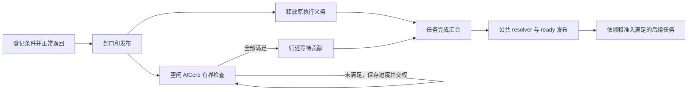

# A5 HBG AICore 异步完成开发参考

更新于 2026-11-08。本文件是本功能唯一的设计与开发参考，可作为下一轮 Goal 的完整输入。
当前状态：**本机验收已按用户要求停止，迁移到新 A5 环境继续。资源声明主链、查询传递和专用 last-use ABI 已移除，相关 CPU／Python、a5sim 与 A5 构建完成；真机／L1 验收尚未完成。历史结果只属于原实现。**
对应 [#2832](https://github.com/hw-native-sys/simpler/issues/2832)，父工作线为 [#2667](https://github.com/hw-native-sys/simpler/issues/2667)。

## 1. 可直接使用的 Goal 与范围

> 基于 nalinaly/simpler 当前 main，按本文件完成 defer_wait 精简。首要目标是移除本轮引入的资源声明框架及其 Host 解析、Device 声明表、owner 查询传递、Python 和 ABI 接线；不得通过改名、搬家、改成可选或增加包装层继续保留同一框架。复用既有 run/domain/buffer owner、条件登记主体、普通依赖释放和 ready 发布流程。未知及手写 kernel 无须额外声明，继续默认预留 64 条条件。同步标识与精确容量不是必须保留项，只有收益明确且实现简单时保留，不能为它们保留资源声明体系。保留普通任务、SPMD、MIX、sync-start、单层 Graph、跨核检查、真实 SDMA、公共入口 DCache 和失败时禁止提前回收的正确性约束。收拢重复校验与诊断，迁移实际调用者及测试，删除失效接口、表和字段；工作代码净减约 3,000～4,000 行是估算目标，不是可以牺牲正确性的配额。复用构建缓存，完成相关 C++/Python、a5sim、A5 验收和小规模 L1 前后对照，分别报告失败、未测项、代码量及资源成本。更新本文件，使最终说明与实现一致；没有完成的工作不得标成完成。
>
> 条件读取沿用当前 DCCI／标量实现，不再评估 `ld_dev` 与它的差异，不安排替代读取版本的构建、专项测试或性能对比。L1 只对照本轮精简前后的实现，两侧保持相同读取方式。历史 `ld_dev` 实验的未测项或失败不列为本轮待办，也不作为完成验收的前置条件。

目标是减少长期维护的概念与信息传递链路。不能因为某个抽象已经实现，就把保留它视为前提。
以下约束优先于历史文档中“保留可选声明校验”“保留所有新增公共 ABI”等要求。

- 工作基于 `nalinaly/simpler` 的 main；实施前核对当前提交、依赖 pin、实际安装与其他会话的在途文件。
- 源码按共享 main 协作，不切换或重置共享分支，不覆盖其他会话修改。需要独立构建、对方版本测试时使用隔离环境，复用已有缓存。
- 保持真实 SDMA 和 COUNTER、普通任务、SPMD、MIX masks 3/5/6/7、sync-start、单层 Graph 内异步任务的范围。
- 任意有服务机会且具备相应观察能力的 AIC/AIV 都可检查；AICPU 仅承担已有启动、退出、错误职责。
- 不扩大为新后端、kernel 抢占/续跑、嵌套 Graph、非阻塞 SDMA 提交或完整模型性能项目，不新增行为开关。
- 不以修改 PyPTO Graph/tensor 格式、要求 extern kernel 提供资源信息或增加编译器声明作为基本使用前提。
- 只维护这一份开发参考；转发用的实现对比是历史分析，不构成保留旧框架的设计要求。
- 本轮 Goal 不自动包含提交和推送，按当次明确授权执行。

这里的 `defer_wait` 延后逻辑任务完成。登记调用本身不隐式 return，也不保存 kernel 栈；kernel 正常返回后执行核才回到调度器。
依赖数据的计算位于后续 task，通过已有依赖连接。现有 PyPTO waiter 的限制由其实际前端合同决定，本轮不修改门禁来扩大支持。

## 2. 目标实现与必须保留的行为

### 最小职责

| 对象或已有机制 | 目标职责 |
| -------------- | -------- |
| 完成条件 | 记录类型、地址、目标值；回答一次观察是否满足 |
| 一次物理执行的 AsyncGroup | 条件登记与封口、剩余条件、检查进度，以及恰好一次完成贡献 |
| CHECK 认领状态 | 让有资格的空闲核独占一个有界检查片段，保存进度后交回认领权 |
| 逻辑 task 完成汇合及 FINISH | 汇合执行释放与条件完成，用公共 resolver 续接依赖释放 |
| 既有 run/domain/buffer owner | 保持真实资源有效，依据已有退出与访问结束事实决定复用或释放 |

CHECK／FINISH 是调度器内部工作，不增加业务 TaskId，不消耗普通 ready ticket，不占业务执行 slot。
Host 只需为稳定记录、物理执行映射、目录及必要后端控制数据规划空间，检查形状、算术边界和总预算。
稳定存储是必需的，Host 静态预分配是沿用的实现选择；这不要求 Host 理解每个条件的 payload 归属。

### 默认预留与登记

- 保留 `get_async_ctx`、`save_expected_notification_counter` 等基础 kernel API 的语义；AICPU 与 resident 路径共用登记主体。
- 缺失能力信息或 UNKNOWN 的合法 kernel，每次物理执行默认预留 64 条条件，不要求资源、consumer、peer 用途声明。
- 实际登记数为 0 时正常完成，不发布 CHECK；1～64 条正常登记，溢出、非法类型、错误对齐和未结束预留明确失败。
- 同步标识和小容量信息只有在调用链确实提供、收益明确且接线简单时保留。不为其维护通用声明框架；若移除，报告同步及小任务的成本变化。
- 保留必要的 token 格式、指针数值边界、容量、运行与执行身份及一次性操作检查；格式正确不证明裸地址属于有效分配。
- immutable 布局在 Host／挂载边界验证，登记状态在 writer／封口边界验证；CHECK 不重复遍历 Host 参数、资源表和已验证的不变身份。
- resident 封口发布实际登记前缀和 writer 状态，再让 CHECK 可见；上下文副本共享预留状态，不能形成两个独立 writer。
- 条件和记录存储在 run 内稳定存在，不能引用返回后复用的栈、slot 或 kernel 私有 UB；本轮不引入动态记录池及容量等待。

### 跨核检查与公共完成

沿用常驻记录、活动位图和版本化 lease。只有成功认领者读取或修改 mutable 进度；内容发布、取得所有权和交权必须有实际屏障。
运行时原子控制行与 cached writer 分离，不能用整行写回覆盖其他核的原子更新；布局压缩继续遵守对齐和地址空间要求。

- 首次发布：内容与 pending 贡献先于 RUNNABLE 和活动位置位。PENDING 只交回 lease，活动位保持，终态只清位一次。
- 认领失败立即返回正常调度；无固定等待核、无固定重试间隔。目录为空、CAS 失败或观察到 OWNED 都不是全局完成。
- 沿用当前有限服务初值：最多 4 个目录字、2 次候选探测、2 次认领 CAS、8 个工作单元，每个片段最多认领一条记录；收尾另有固定上界。
- 游标轮转并分散起点，CHECK／FINISH 交替优先。待定条件在同片段不重复忙读，已满足条件不再读取。
- 忙时最多累计 4 次业务返回后提供一次异步服务；空闲或准入失败时每轮至多一次。已取得 cooperative 执行许可就直接进入 kernel。
- PENDING 扫描、失败 CAS、游标和 lease generation 变化不算真实进展。条件减少、实际后继处理或发布才更新相应进展。
- pending group 的增加先于所属 block 释放；最后 block 与最后条件通过同一汇合机制决定唯一 FINISH。MIX 每 block 只贡献一次执行释放。
- 普通完成、Graph、FINISH 继续共用完整 resolver 与 ready 发布主体，保留直接补位、MIX 前缀和长 fanin 前的 ready 前缀发布。
- FINISH 保存完整续接进度；成功移交后继后不再访问其旧链字段，发布重试不重复摘链、reserve 或 enqueue。
- ticket 预留后必须在不让出的有界尾部发布；队列端点已提交而目录尚未发布时，只续接剩余责任。
- TaskDone、后继发布完成和资源可回收是不同边界；整次运行完成计数晚于完整 resolve drain，CHECK／FINISH 不计作业务任务。

单片段预算不构成全局轮询频率上限；单热点仍可能竞争。全部核运行长 kernel 时，本功能不能抢占，也不承诺固定微秒发现延迟。
一次性目录若继续使用 fetch-add 置位／清位，保留唯一贡献前提、最高位及相邻位测试；该技巧不能替代通用 OR／AND。

### SDMA 与缓存

- 继续使用真实 SDK 完成记录；COUNTER 按有符号 INT32 与非负阈值比较，负值保持 PENDING；SDMA 按完整无符号 64-bit post id 比较。
- 条件地址使用后端单次读取与屏障，不用原子 RMW 猜测外部 DMA／通知状态，不由检查器清零信号。
- 条件读取沿用已验证的 DCCI／标量实现；`ld_dev` 差异评估、替代版本构建及专项对比均不在本轮范围内，不新增读取方式开关。
- 两类 SDMA 入口复用同一提交主体；真实物理队列锁、固定顺序多队列获取、SDK 元数据发布先于解锁必须保留。
- 条件容量按可信的后端记录数上界，在产生 DMA 提交副作用前预留；实际条数与记录格式在返回后核对，不能假设一次请求只有一个条件。
- 删除搬运声明后，队列数及 workspace 配置应直接来自既有 owner／SDK 配置，通过最小必要接口传递；不能丢掉多队列能力或退回无锁路径。
- 保留零工作、合法 UB 偏移 0、实际 SDK 支持的 TPUT 同步回退及非空 TGET 非法事件处理；提交副作用不明时锁存首错误。
- 提交锁只覆盖共享队列状态更新，不覆盖 DMA 整个寿命；SDK 提交自身可能存在背压，本轮不承诺非阻塞提交。
- 实际消费者继续在公共执行入口维护自己的 DCache；更早的 predicate 读取沿用原有独立维护。删除消费者声明、区间表和准备计划。
- 发布方先完成 payload 发布再通知；DMA 写入前处理旧 dirty cache。检查核观察到完成不能替代消费核获取数据。

### 资源持有与失败退出

资源持有与资源区间校验是两件事。复用现有 `PreparedRunResources`、`PreparedRunUse`、借用记录和通信 owner，保证访问结束前资源不释放。
基本 defer_wait 不验证任意裸指针的 owner 或任意业务覆写；调用方仍负责合法地址、信号单调性、数据依赖和 peer 使用约定。

| 场景 | 最小必要处理 |
| ---- | ------------ |
| 正常完成 | 条件与后继发布完成后，沿用实际 run／核／backend 退出路径，再按已有 owner 规则释放 |
| 当前提交前失败 | 当前请求不产生 DMA；保留首错误，已存在的其他访问仍按正常退出约束处理 |
| 提交后失败、超时、核故障 | 停止新的业务和提交，不伪造成功；外部访问未确认结束时保留 owner，禁止复用 |
| 已证实访问结束，但任务结果失败 | 保留错误结果；现有机制可表达时允许回收，不为精细回收再造通用证明框架 |
| 跨 peer 或下一 epoch 复用 | 使用真实依赖和已有通信确认；保活不授予覆写权，本地 ACK 不证明远端停止 |

AICore 退出、普通 stream 完成、活动位图为空、清理函数返回成功都不能单独证明独立 SDMA 或远端访问结束。
不得根据条件类型是 COUNTER 推断 kernel 没有其他外部副作用，也不通过重新命名 CORE_PIPELINES_ONLY 声明恢复原框架。
优先采用既有 owner 的保守失败保留；没有现成证明时可以拒绝复用，必须报告该限制，不能声称已经自动恢复。
若现有退出流程确有缺口，先保留能区分提前释放的针对性失败用例，再在真正负责资源的层补最小修复。
删除专用 last-use 接口之前，要迁移其实际回收判据；目标是减少接口与概念，不是删除这个正确性约束。

## 3. 删除范围与实施顺序

下列名称是当前实现的检索入口，实施时核对实际调用图；整条链路的职责变化必须同时落实到生产代码、调用方、测试和文档。

| 当前范围 | 目标处理 |
| -------- | -------- |
| `AsyncUseDeclaration`、`AsyncUseCacheContract`、`rt_declare_async_*`、`AsyncHostDeclarations` | 删除专用资源／consumer／core-only 声明及登记接口，迁移实际使用者 |
| `host/async_backend_plan.*` | 删除逐任务参数解析、精确区间展开和声明匹配；所需 SDK 配置复用原有资源入口 |
| `AsyncBackendTask`、`AsyncCounterRange`、`AsyncSdmaTransfer`、`AsyncBackendLayout/View` | 删除声明设备表、挂载和查找；保留必要的条件观察及提交适配 |
| `HostApi::query_async_*`、`NativeRunDomainProvider*`、`prepare_run_with_domains_*` | 审计并移除仅服务于该框架的查询和传递；已有通用 domain 业务能力按真实使用保留 |
| `execution_contract`、core-only 声明驱动的资格分流、专用 last-use ABI | 收敛到既有 run／owner 的最小状态与失败保留；独立资源释放证据仍须真实成立 |
| Python、callable 序列化、mailbox 和 cache 接线 | 删除随框架引入的冗余信息传递；能力字段按收益决定保留或迁移，不能残留悬空参数 |
| `scheduler_async_protocol_export.h`、`native_async.py`、`async_lane.py` 等 | 复用已有诊断记录、导出和解析，删除重复校验；保留错误身份和定位进展所需的最小信息 |
| `async_plan.*`、writer、CHECK／FINISH、公共 resolver | 保留必要主体，收拢已由边界保证的重复检查，不重新建立平行流程 |

不能把删除改成 `enabled=false`、空操作声明、保留字段但永不使用，或在另一个目录重建同等权限／资源框架。
库内调用者随实现迁移；如核实仍有外部使用者，记录具体接口和迁移方式，不能以假设兼容性无限期保留整个框架。
基础 kernel API、已有合法 UNKNOWN 入口及未涉及的业务接口继续可用；确需改变内部镜像时升级识别并重建匹配产物，拒绝混读旧格式。
不要求其他仓库增加资源信息来解锁默认路径；若已有生成物确实调用待删除接口，记录该调用并实施最小兼容迁移。

按以下顺序执行，每步复用已有检查，不重复建立评审文档：

1. **固定基线和责任边界。** 保存当前 main、依赖、构建身份及相关 L1 基线；列出声明调用者、已有 owner 能力和必须保留的失败用例。
2. **移除声明主链。** 先迁移实际调用者，删除 Host 解析与 Device 表、登记匹配和消费者声明；保留基本格式检查与 SDMA 真实提交。
3. **收拢公共接口。** 删除不再需要的 Host 查询、provider、ABI、Python/mailbox/cache 传递；维持同一 owner 的资源持有与失败回收判据。
4. **精简调度校验和诊断。** 每个不变量有明确责任边界；删除对已验证不可变数据的重复检查和仅支撑旧框架的诊断，保留并发变化检查。
5. **完成整体验收和收尾。** 迁移实现相关测试、运行必要回归及 L1，清除死符号、空表、未使用字段和文档残留；报告行为及诊断能力的实际变化。

移除资源声明意味着不再提供其逐任务地址白名单和细粒度声明拒绝行为；应在接口迁移中明确，不能宣传成完全保持原有扩展合同。
失败后保留资源、容量溢出和无效 token 等基础行为不能随之削弱。详细诊断可以收缩，错误可追踪性仍是验收要求。
最后一项不能仅因代码可以编译或删除目标行数已达到而提前结束。

## 4. 验证、规模目标与完成判据

### 功能验收

优先复用现有实现无关的场景；实现相关测试随内部结构调整，不能删除核心行为断言来使重构通过。

| 场景 | 必须验证的行为 |
| ---- | -------------- |
| 无声明手写 kernel、UNKNOWN、重复 getter／上下文副本 | 基础 API 可用，默认 64 条，登记状态共享 |
| 0/1/8/64/65 条、非法类型／对齐、负 counter、64-bit post id 边界 | 零登记不悬挂、上限与错误保持、比较语义正确 |
| 等待数超过可用核数、publisher 后提交 | 等待不耗尽执行核；真实 publisher 和普通 ready 工作仍能推进 |
| 普通／SPMD／MIX／sync-start／单层 Graph、多实例及 fanin/fanout | 执行释放与逻辑完成分离，恰好一次完成，无跨实例串扰 |
| 多核竞争、PENDING、交权、终态与最后 block 交错 | 无漏唤醒、重复贡献、错误回收；无效探测不伪装进展 |
| 队列发布 RETRY、长依赖链及准入失败 | 片段有界、服务可达、后继不漏发／重发 |
| 检查核与消费核不同、消费核缓存旧数据 | 公共入口保证实际数据可见性，无 consumer 声明 |
| 真实 SDMA 返回后尚未完成、独立计算与依赖消费者 | 原核可离开，独立计算推进，消费者等待真实完成并得到正确 payload |
| 同簇双 AIV、单／多队列、连续提交与复用 | post id 不重复，逐次独立输出正确，SDK 状态交接和原有多队列配置有效 |
| 提交前／后错误、pending close、未确认外部访问结束 | 首错保持，未证明结束时资源不释放／不复用；不能把 CPU 模拟故障等同真机引擎故障 |
| 重复 run、跨 rank 通知与现有 2/4 rank 场景 | 新旧运行不串记录，真实 peer 协议与资源使用约定成立 |
| 普通同步及既有 AICPU 路径 | 共享 writer／公共接口修改没有带来无关回归 |

至少保留一个能抓住提前完成的负对照；只检查内部计数相等不足以证明数据正确。
真实 SDMA 重叠验收必须实际观察到 kernel 已返回而事件仍 PENDING；没有该窗口只能证明正确搬运，不能宣称已证明重叠。
旧声明专用的白名单测试随接口删除；其中有用的数据边界、寿命和故障场景迁移到公共行为层，不整批丢弃。

### 验证顺序与性能

先做受影响 C++／Python 和小范围 AIC/AIV 编译，再做 a5sim，最后构建匹配的 A5 产物跑相关真机集合。
复用缓存，按依赖合并构建；通过且未受后续修改影响的检查不重复执行，不反复全量优化编译。
硬件测试遵循仓库架构预检和 `task-submit` 设备隔离，最多同时使用 4 张设备；不切换共享源码或覆盖现用安装。

正式性能只使用 L1，在新环境内以同机同卡、相同输入与业务 kernel、相同 CANN/PTO-ISA 对照基线与候选；建议每组 5 次预热、100 次正式调用。
新环境的 CANN/PTO-ISA 版本不要求与旧环境一致，记录实际使用版本并确认构建兼容即可；不复用旧环境的二进制或虚拟环境。
前后对照固定使用相同的 DCCI／标量读取，不加入 `ld_dev` 候选或相关微基准。
覆盖同步链、UNKNOWN 零登记、1/8/64 条条件、热点／稀疏等待叠加 ready、fanin/fanout、双 AIV 单／多队列。
分别报告完整 Device、中位数/P95、kernel 区间、可获得的 Host 初始化／发布耗时和实际存储；没有测到的计数不填估计值。
诊断级别不得混入 L1 样本；稳定回退须复测、定位或明确记录未定位项，不用其他场景加速抵消。
代码行数减少、`sizeof` 缩小及局部 kernel 变快都不能单独证明整次调用更快。

### 规模目标

下面是相对整轮功能干净基线的工作代码净增量，不是文件总长度。估算尚未实现，允许根据必要替代代码修正并说明原因。

| 范围 | 当前净增行 | 预计可净减行 |
| ---- | ---------- | ------------ |
| Host 预规划与导出 | 1,576 | 900～1,100 |
| 公共运行时、资源与 ABI | 1,905 | 800～1,100 |
| DFX 工具与执行器诊断 | 1,126 | 600～800 |
| 调度、条件登记与后端 | 3,634 | 450～700 |
| Python 绑定与 Worker | 369 | 150～200 |
| 平台与其他运行时兼容 | 386 | 50～100 |
| **合计** | **8,996** | **2,950～4,000** |

首轮以净减约 3,500 行、工作代码增量约 5,500 行为参考目标；其中 Host 与公共运行时两项预计合计减少 1,700～2,200 行。
统计扣除替代实现，按模块去重。文件搬迁、压缩排版和删除注释不能冒充结构收益；文档删行不计入工作代码。
测试代码单独统计，不设必须删除的配额；诊断或可选接口功能的收缩单独列出，不能包装成纯等价重构。

### 完成判据

- 声明接口、Host 解析、Device 声明表及仅支撑它们的公共接线已实际移除；没有以可选、改名或包装形式保留同等框架。
- 所有实际调用者和测试完成迁移；保留的公共接口或可选能力都有具体使用者和简短必要性说明。
- 基本异步 API、UNKNOWN 默认预留、跨核进展、全任务形态、真实 SDMA 与公共完成流程成立。
- 失败时资源持有与复用约束经针对性用例确认；没有通过删除检查使未确认外部访问被当成已结束。
- 完成受影响的 C++／Python、a5sim、A5 验收与 L1 对照，报告精确范围、源码／依赖／产物身份、命令和原始日志；相关通过不写成全量通过。
- 报告实际删除的概念、表、接口、重复校验、净代码量与成本变化，并列出保留原因、性能回退和未测能力。
- 更新本文件的目标状态、最终结构和验证边界。真实阻碍附证据与剩余事项；不能以估算行数达标替代完成。

## 5. 基线证据与本轮状态

本轮基线以已提交的 [“优化：统一 A5 HBG 异步发布流程并压缩调度热数据”](https://github.com/nalinaly/simpler/commit/7a68249f9d9d425a50cd28ae77ef6550671c4288) 为核查起点；真正开始开发时重新固定当前 main。
该版本仍含本轮要删除的资源声明框架，使用 v6 内部异步布局和 DCCI 观察；不能把本文件的目标描述当作现有代码已经完成。

历史相关验证摘要：31 个 C++ 测试目标、128 个 Python 测试通过；a5sim 为 48 个独立用例及 2 个场景项／31 个工作负载；
A5 为 53 个独立异步用例、48 个增强工作负载，以及同步回归 5 个测试项／30 个工作负载。
这些集合含重叠覆盖，不能相加当作独立用例总数，也不是全仓结果。

历史限制仍保留：增强双卡首轮因同一 Worker 混用固定 SDMA 配置失败，拆分测试所有者后通过；首次 C++ 接口适配失败及 CCEC 指令探针失败记录仍在。
nanobind 退出对象保留提示未解决；未完成全仓测试或完整模型性能回归，受控 CPU 故障不证明真实 A5 独立引擎故障恢复。
既有 L1 中 register1、register8、双队列 SDMA 设备 4 的重复测量仍分别回退约 9.14%、3.11%、4.54%；这些是更早版本对照，下一轮必须重采当前基线。
此前独立 `ld_dev` 评估仅作历史留档，不产生后续差异分析、复测或优化任务。

历史详细设计和结果可从上述提交查看；原始证据保留在仓库根的相邻日志目录，不在本文件重抄全部开发记录：

- `../logs/async-round2-20261107/qualification/completion-audit.json`：相关构建与验收范围。
- `../logs/async-round2-20261107/qualification/source-to-tested-artifact-relation.json`：源码与受测产物对应。
- `../logs/async-round2-20261107/candidate-l1-comparison.json`、`candidate-dcci-repeat-l1-comparison.json`：历史 L1 原始对照及复测。
- `../logs/async-round2-20261107/observer-evaluation/decision.json`：既有读取评估留档，不列入本轮任务。
- `../logs/defer-wait-overall-distribution-20261108/simpler.json`：整轮代码量、基线和逐文件统计。
- `../logs/defer-wait-peer-comparison-20261108/comparison.json`：双方统计口径及上游差异排除方式。

这些日志是本机证据，转发文档时不假定接收方拥有相同目录。后续开发保存新一轮独立记录，不覆盖历史失败或将旧通过迁移为新结果。

| 本轮工作 | 当前状态 |
| -------- | -------- |
| 目标和开发参考更新 | 已完成 |
| 声明主链删除与调用方迁移 | Host／Device 声明表、登记 API 及受版本管理的实际调用者已迁移；相邻 PyPTO／pypto-lib 检索未发现被删除 API 的调用，其他会话草稿不在范围内 |
| 公共接口与资源退出收拢 | Host 查询、provider、domain sidecar、专用 last-use ABI 和 core-only 回收分流已删除；原有 owner 保活和未确认失败保留继续生效 |
| 重复校验及诊断精简 | 封口复用公共格式校验，后端登记 policy、重复布局重建检查和空资源字段已删除；Python 标准转换只校验一次，汇总统计共用，离线验证完成；实际真机捕获的最终核对待执行 |
| 新候选功能验收、L1 与代码量复核 | 41 个相关 C++ 目标、176 个诊断／SDMA owner Python 用例、补充的 4 个 SDMA 公开接口用例及 413 个 owner／Worker Python 用例通过，另 2 项跳过；a5sim 已验证。A5 构建完成，真机及 L1 未执行；本机排队和自动验收已取消，留待新 A5 环境 |

本轮执行证据位于仓库根相邻的 `../logs/defer-wait-simplify-20261108/`，`checkpoint.json` 记录依赖、验证结果和取消状态。
当前结构与限制：

- 内部异步布局为 v7，mailbox 为 v9；异步诊断导出使用 v12／v13，条件仅导出序号与类型。历史 v10／v11 日志仍可读取，其旧资源字段不再参与校验或资源管理。
- Python 复用已有 run/domain owner，不再向 native prepare 传递资源快照。仅服务于旧传递的 `borrowed_domain_uses` 表及钩子已删除，导入 domain 继续由现有 node owner 管理。实际 SDMA 队列配置、共享提交锁及提交前容量预留保留。
- 条件登记封口同时检查公共 token 格式和允许的条件类型，不再调用可扩展的资源登记 policy。DCCI／标量读取代码与基线一致。
- 失败后没有外部访问结束事实时保留通信 owner，即使模拟 CPU 线程已退出也不据此释放通信区间；这会收缩原先针对声明为 core-only 的失败回收能力。失败测试明确检查 domain 未释放。
- `HbgAsyncRetirementPayload` 仍用于平台将已退核的语义错误经 CANN 传回 Host，避免把业务错误误当传输故障；它不再授予资源回收资格，也没有对应的资源声明或专用公共 last-use 返回接口。
- 当前工作代码净减少 2,569 行，测试净减少 2,357 行，文档另计。本次 Python 统计共用调整及返回类型标注净增 9 行，但消除了重复校验和随后被覆盖的记录构造；不将运行工作量减少包装成额外删行。未达到原先行数估算，不能为凑数删除仍用于并发正确性、因果诊断和安全退出的代码。

`async-storage-comparison.json` 使用基线及候选的实际 Host planner 测量了 7 组布局。关闭诊断、基线不附加旧声明表时，各组完整异步区间大小相同：单个 UNKNOWN AIV 为 10,112 字节，1,024 个为 2,869,632 字节；1,024 个显式同步执行不分配异步区间；单个执行声明 1／8／64 条 COUNTER 时分别为 1,920／2,048／3,840 字节。
UNKNOWN 包含默认 64 条条件及 run 级 SDMA guard 池，COUNTER 精确容量场景不包含该池。布局头从 232 缩到 208 字节，但 128 字节对齐使这些场景的总大小不变。不能把删行数或头部缩小宣传成默认路径的内存／性能收益。

验证记录与失败处理：

- `cpp-related-ctest.log`：32 个相关目标通过，包含两种架构及两类运行时受影响的公共平台路径。`cpp-legacy-ctest.log` 中另外 9 个旧 AICPU 调度 drain、Graph 异步提交与 mailbox 目标通过；不代表全仓测试。此前漏迁移符号、测试辅助函数名称和封口格式校验问题的日志保留；修复后完成上述验证。
- `python-dfx-sdma.log` 首轮为 174 通过、2 失败；两项失败是新增测试错误消息匹配不符，修正断言后在 `python-dfx-retest.log` 中通过。`python-owner-worker.log` 为 413 通过、2 跳过。
- 接口审计发现并恢复了误删的 Orchestrator `sdma_sdk_queue_num` 传递，同时补齐共享 SDMA kernel 的第四个 scalar 签名。`public-sdma-api-before.log` 中 4 项复现入口错误，恢复后在 `public-sdma-api-after.log` 中通过；共享单／多队列 kernel 已重新编译。删除无用途的借用表后，`python-imported-owner-final.log` 中 77 个受影响用例通过，属于前述 owner 集合的复测。
- `a5sim-async.log` 首轮为 44 通过、4 失败；修正两处旧诊断版本断言，并将两个预期失败用例的清理改为验证 owner 保留后，`a5sim-async-retest.log` 中 4 项通过。逐用例结果见 `a5sim-async-qualification.json`。这不证明真实 SDMA 或真机故障恢复。
- `a5sim-shapes-sync.log`：两个跨 rank COUNTER 用例和三个场景项通过；场景项覆盖 28 个任务形态、9 个单核 DAG 和 9 个 Graph 拓扑工作负载，与前述集合有语义重叠，不相加宣传为互不重叠的覆盖。
- 独立候选环境已完成新 Python 绑定、a2a3sim TMR、a5sim HBG 和 A5 HBG 优化构建；A5 本轮构建用时约 22.5 分钟，见 `candidate-a5-build-result.json`。普通、UNKNOWN、共享单／多队列 SDMA kernel 也已编译。源码／依赖与产物已固定，未覆盖日常安装或基线环境。
- 用户已要求取消本机排队并停止后续验收：原 L1 基线任务已取消，串行控制进程已退出；功能验收和候选 L1 从未提交。`hardware-workflow.json` 状态为 `cancelled_by_user`，不要恢复旧控制脚本。后续在新 A5 环境重新建立基线和候选；不将编译成功算作真机通过。
- nanobind 退出对象保留提示仍存在；其他会话未提交的 `async_observer` 与旧声明草稿保持原样，未混入上述受测集合，不能将它们记作已迁移或已通过。

本轮补充的离线收尾记录位于 `offline-diagnostics/`：

- 标准转换器在完整审计后，异步视图复用已有 `protocol_verified` 结果，不再次遍历整份协议。直接调用诊断汇总或未审计视图时仍验证输入；失败／未完成捕获不因此变成已验证结果。
- `native_async.py` 与 `async_lane.py` 共用统计计算；视图直接构造其最终记录，独立的紧凑汇总接口仍保持原输出。输入快照、时间戳、跨核关系及计数含义均保留。
- 新回归用例先复现一次转换调用两次协议读取的问题；修改后，诊断、因果审计、Graph 和 swimlane 相关 Python 测试共 1,156 项通过，见 `tests-after.xml`。这是相关离线集合，不代表全仓或真机验收。
- `replay-after.json` 记录 6 份输入的逐字节输出对照：两个保存的历史 COUNTER／SDMA 捕获，以及现有 C++ recorder 导出的 READY、EMPTY、跳过执行、部分发布四种状态。汇总、视图及可转换的完整 trace 均与修改前一致；这属于解析与展示兼容验证。
- 已构建候选快照保持冻结。本次离线收尾新增的代码变化仅涉及两个 Python 诊断模块及其测试，运行时与 kernel 不变，见 `source-relation.json`；文档另计，其他会话草稿不在快照中。新环境需基于已推送源码构建，并用当前诊断工具核对新真机捕获。
- 真机验收脚本为每个阶段设置独立临时目录，并通过子进程继承的 pytest 选项保留捕获，避免默认只保留最近三次临时目录导致早期证据被清理；实际效果仍随真机任务核对。
