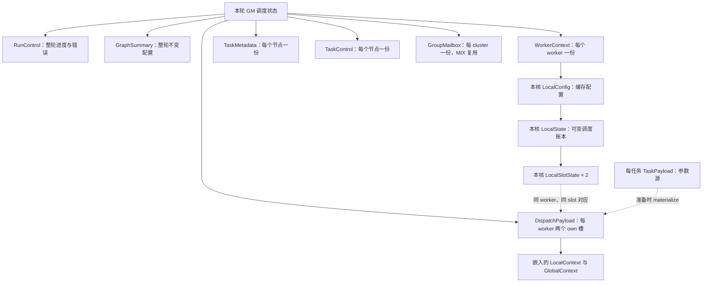

# 数据结构：作用范围、用途与生命周期

[回到执行流程](README.md)

本表覆盖走读材料涉及的 resident 数据结构，以及直接相关的视图、临时结果和采集结构。host 实现与 legacy 调度内部结构继续跳过。字段含义仍放在各执行阶段文档中，先用这里判断“这一份数据属于谁”。

## 读表约定与结构关系

- **一轮运行 run**：一次图的 device 执行。这里的“全局”均指本轮参与者共享，不是所有进程、所有设备或所有运行共用。
- **worker**：一个常驻 AIC 或 AIV 执行核。**cluster**：一个 AIC 和两个 AIV。
- **task/node**：resident 图中一个逻辑调度节点。一个 kernel task 可以有多个 logical block，每个 block 又可以有多个 subtask。
- **slot**：某个 worker 的可复用执行位置。当前主线每核 2 个 own slot；一个 slot 先后可以属于不同 task/block/subtask，靠 generation 区分。
- **GM** 表示对象存于可跨核寻址的设备全局存储；并不表示任何核都可以写它。写权限由协议决定。
- **AICore 私有**表示一个核自己的 C++ 局部对象或成员；是否进入寄存器或栈由编译器决定，不把它当成可跨核共享的数据结构。
- 表里的“份数”描述逻辑对应关系。实际数组可能按最大容量预留，例如 WorkerContext 预留容量为 108，但只有本轮 worker_count 个条目有效。
- “本轮有效”描述数据的语义寿命；底层 GM 分配可以在满足退休条件后被下一轮复用，不意味着每轮一定重新分配。
- **MIX group** 是一个 cluster 协调一个 logical block；**async group** 是一次具体 block/subtask 执行登记的异步条件集合，两者不是同一粒度。

要特别分清：**结构本身的范围与它指向的数据范围不是一回事。**
例如每核都有 WorkerContext，但其中 task_controls_offset 通常指向同一张全局 TaskControl 表，不能理解成每核复制了一整张任务表。

## 启动、整轮控制与每核配置

字段表见 [初始化说明](01-initialization.md)。

| 结构 | 作用范围 / 逻辑份数 | 存放位置 | 用途与主要读写者 | 生命周期 |
| ---- | ------------------- | -------- | ---------------- | -------- |
| `Runtime` | 本轮 device 入口对象视图 | device 端访问 GM 中的 dev 描述区 | AICPU/AICore 由它定位启动描述、握手、退出 gate；完整 C++ 类型还有未上传的 host-only 部分，此处不展开 | 本次 device 使用至少覆盖全部核退休 |
| `DeviceRuntimeLaunchDesc` | Runtime 内的 device 启动描述，1 份 | GM，Runtime.dev 内 | 携带本轮启动配置及 workers/gates；内部包含不同所有者的区域，不是整个描述符都只读 | 启动到退休；子区域按各自协议更新 |
| `SchedulerBootstrapInputs` | 每个启动描述 1 份 | GM，独立 cache line | 提供 runtime_mode 和 worker context 基址；启动前已给定，AICPU/AICore 只读 | 本轮启动输入，执行期间不变 |
| `Handshake` | 每个 worker 1 份 | GM，workers[worker_index] | AICore 报核身份，AICPU 回 context 地址和 READY；字段分工写入，用于启动握手 | 启动发布；确认退休后失效，不能当任务完成记录 |
| `AicoreTeardownControl` | 每个 worker 1 份 | GM，与 Handshake 分开 | AICPU 唯一写者，AICore 只读；exit_request 指定 ACK nonce，post_close_release 允许返回 | 本轮开始清零，退出握手结束才可复用 |
| `AicpuExecutor` | AICPU runtime 模块内 1 个静态实例 | AICPU 进程内存，多线程共享 | 协调 init barrier、supervisor、shutdown 和终态发布；不逐任务调度 AICore | 实例可跨轮保留，本轮协调状态重置 |
| `AicoreLifecycle` | 每个 AicpuExecutor 1 个成员 | AICPU 进程内存，多线程共享 | 管理核发现、拓扑、READY、DMB 和退休；各线程操作自己的核分区，leader 汇总配置 | 对象随 executor；发现结果及计数按轮重置 |
| `AicoreLifecycle::CoreState` | 每个 worker 1 条 | AICPU，cores_ 数组 | 记录物理核、类型和寄存器窗口；发现线程填写，生命周期逻辑读取 | 本轮发现到退休 |
| `AicoreLifecycle::ThreadHandshakeTiming` | 每个 AICPU 生命周期线程 1 条 | AICPU，计时数组 | 该线程写发现起止时间，leader 汇总到共享采集区 | 本轮握手统计 |
| `SchedulerRunControl` | 本轮 1 份 | GM，scheduler state 内 | AICPU 补齐配置/监视进度；AICore 发布 bootstrap、resolved 计数与错误；不同字段有各自写者 | 全轮共享，完成计数及错误贯穿执行 |
| `SchedulerGraphSummary` | 本轮 1 份 | GM | 提供任务形状统计、admission/ready/async 等区域定位；AICPU完成拓扑确认后，所有核只读 | READY 到退休保持不变 |
| `SchedulerWorkerContext` | 每个 worker 1 份 | GM，按 worker_index 索引 | 配置区描述该核身份、资源邻居和全局数据入口；启动输入+AICPU补齐，核读取；统计尾部由该核发布 | 配置 READY 后冻结；统计尾部在本轮采集/收尾更新 |
| `SchedulerGraphView` | 每个 worker 建立自己的值 | AICore 私有 | 对共享图存储的地址、数量、版本做只读描述；不是复制图节点 | 本次 run_resident_scheduler 调用内 |
| `SchedulerGraphAccess` | 从 GraphView 派生/转换的访问值 | AICore 私有 | 给普通/native 图访问提供统一接口；所指内容仍在 GM | 本次调用或其子调用 |
| `SchedulerLocalConfig` | 每个 worker 1 份，嵌在 LocalState | AICore 私有 | 缓存本核常用的不变配置，减少每次循环读 GM context | READY 后初始化，本轮使用 |
| `SchedulerLocalState` | 每个 worker 1 份 | AICore 私有 | 本核 ready bit、slot、generation、候选、完成待汇总数等运行账本；只由本核改写 | 本轮调度循环，退出时清理义务 |
| `SchedulerClusterCoordinate` | 一次 worker 到 cluster/lane 映射的结果 | 当前调用者局部值 | 启动拓扑检查中返回 cluster_index 与 cluster_lane | 该次拓扑映射调用 |

### 采集结构也有不同范围

| 结构 | 作用范围 / 逻辑份数 | 存放位置 | 用途与主要读写者 | 生命周期 |
| ---- | ------------------- | -------- | ---------------- | -------- |
| `AicpuThreadLifecycleTrace` | 每个 AICPU 生命周期线程 1 条 | GM | 对应线程写自己的握手/发布/退出时间，leader 补全配置阶段时间 | 本轮记录；退休后用于汇总 |
| `SchedulerWorkerStats` | 每个 worker 1 份 | AICore 私有 | 本核执行/轮询/阶段统计的累计器；最终写回 WorkerContext 统计区 | 本轮累计 |
| `SchedulerWakeStats` | 本核统计对象内 1 份 | AICore 私有 | 统计依赖读取、挂链、关闭、迁移 | 本轮累计，未启用采集时可不传 |
| `SchedulerReadyStats` | 本核统计对象内 1 份 | AICore 私有 | 统计 ready 入队、批次、领取、偷取、CAS 等 | 本轮累计，未启用采集时可不传 |
| `SchedulerCompletionStats` | 本核统计对象内 1 份 | AICore 私有 | 统计本地完成登记与依赖完成解析 | 本轮累计，未启用采集时可不传 |
| `SchedulerLocalProfilingState` | 启用对应采集的 worker 各 1 份 | AICore 私有 | 保存本核采集配置、各 slot 暂存执行记录和循环编号 | 本轮；不开启时没有该类型的有效采集对象 |
| `SchedulerNoProfilingState` | 未启用采集模板中的空占位类型 | AICore 私有 | 模板实例化时避免分配完整 profiling 状态，无业务字段 | 本轮调用内 |
| `SchedulerWorkerTraceCache` | 本地 profiling 中按 cluster lane 缓存 | AICore 私有 | 缓存目标核的启动时间记录，避免反复读取 WorkerContext | 本轮，首次需要时填充 |
| `SchedulerExecutorTaskTrace` | 当前 own slot 的一次执行暂存记录 | 当前主线为 AICore 私有 profiling 槽 | executor 写 kernel 起止等，completion 读取后合并最终任务记录；额外 MIX trace 区为保留路径 | 随 slot generation 复用 |
| `SchedulerTaskTrace` | 每个 task/block/active subtask 一条 | GM | 派发与完成阶段填入同一次执行的身份和时间，最后发布 valid | 本轮不随 slot 复用，退休后汇总 |
| `SchedulerTaskPmuCell` | 每个 task/block/active subtask 一条 | GM | 执行该 subtask 的核写计数器快照；AICPU 等所有核退休后读取 | 本轮对应执行写入，保存到采集结束 |
| `SchedulerActivityBuffer` | 每个 worker 一块活动记录区 | GM | 本核追加空闲活动记录，并保存 committed/dropped | 本轮追加，退休后读取 |
| `SchedulerIdleRecord` | ActivityBuffer 中一个空闲区间 | GM 数组元素；可先由局部值构造 | 记录一次空闲起止及 loop_iter，不是整个 worker 的总空闲时间 | 提交后保留到本轮采集结束 |

## 任务、ready 队列与执行参数

字段表见 [依赖与执行说明](02-ready-execution.md)。

| 结构 | 作用范围 / 逻辑份数 | 存放位置 | 用途与主要读写者 | 生命周期 |
| ---- | ------------------- | -------- | ---------------- | -------- |
| `ChipTaskStorage` | 每个原始顶层任务条目 1 份 | GM 原始任务数组 | 聚合 task/slot/payload；native 展开的 child 不要求在此再占一个条目 | 本轮图存储，按 task 索引而非 worker |
| `TaskDescriptor` | 每个 ChipTaskStorage 内 1 份 | GM | 保存任务身份、kernel IDs 和输出/子图定位等静态描述；resident 通过访问器读取需要的信息 | 任务图输入有效期 |
| `ChipTaskSlotState` | 每个 ChipTaskStorage 内 1 份 | GM | 共享输入存储的 slot 记录；这里不展开另一调度路径的内部状态，resident 依赖进度由 SchedulerTaskControl 表达 | 随原始 task storage |
| `TaskPayload` | 每个原始任务条目内 1 份 | GM | 该逻辑任务的参数数量、参数源区域、fanin 与 predicate；多个 block 的 materialize 可读取同一参数源 | 整个任务有效期，不因 worker slot 换任务而改归属 |
| `SelfRelativePtr<T>` | 参数源中每个自相对引用字段一份 | 嵌在其所属 GM 对象 | 用字段自身地址+delta定位参数区；读取方解析它，不拥有目标内存 | 随所属 image 布局，移动字段和目标须保持相对关系 |
| `TensorData` | 每个 tensor 描述符的字段集合 | 按具体表示存于 image 或工作副本 | 描述 buffer、形状、步长、来源等；不是 tensor 数据本身 | 所属参数/定义有效期 |
| `Tensor` | 本轮参数区域的每个 tensor 描述符一份 | GM；工作形式按 128B 跨度寻址 | 给 kernel 描述实际数据视图，kernel 参数传其地址 | 必须覆盖读取它的任务执行 |
| `PTOBufferHandle` | 嵌在每个 tensor 描述符中的 buffer 句柄 | 随描述符存放 | 给出底层数据 addr/size；多个描述符可以引用同一 buffer | 句柄随描述符，所指 buffer 另有自己的生命期 |
| `SchedulerTaskMetadata` | 每个 resident 节点 1 份 | GM 表，按 task_ref 索引 | 只读的紧凑任务形状和 kernel 信息，供所有 scheduler 分类/派发 | 本轮不变；没有可执行 kernel 的控制节点也有对应元数据 |
| `SchedulerTaskControl` | 每个 resident 节点 1 份 | GM 表，所有核共享寻址 | 保存 state/wake list 和多 block/admission 进度；拥有当前职责的核按字段协议更新 | 整个逻辑任务；本轮 task_ref 不回绕复用 |
| `SchedulerFaninView` | 一次前驱读取的借用视图 | AICore 私有，指针指向 GM | 统一普通和 native 的前驱列表/映射；不复制边、不拥有边存储 | 当前检查/路由调用 |
| `SchedulerTaskInfo` | 一次 payload 准备的目标描述 | AICore 私有 | 把 task_ref、kernel_id、subtask 与 core type 传给 materialize | 当前准备调用 |
| `SchedulerTaskShape` | 一次任务形状解析的结果 | 调用者局部值 | 保存任务的 kernel IDs 和 active mask，供分类/校验 | 当前分类调用 |
| `SchedulerTaskPayloadArguments` | 一次参数解析/共享 materialize 的视图 | AICore 私有，指向 GM | 缓存 tensors/scalars 区地址及数量；实际参数不归它所有 | 本次准备过程 |
| `SchedulerDispatchPredicate` | 某任务的派发条件描述 | 从 GM 参数/任务存储读取，可形成局部值 | 指定读取地址、比较值、类型宽度和操作；执行前求值 | 条件描述随任务，求值结果保留在候选/slot |
| `SchedulerReadyPoolHeader` | 启用 pool 的本轮 1 份 | GM，只读 | 定义按 AIC/AIV/MIX 和 group 切分的 ticket 队列布局 | 本轮 |
| `SchedulerReadyPoolDescriptor` | 每条 pool queue 1 份 | GM，只读数组 | 给出该队列 entry 区和容量 | 本轮 |
| `SchedulerTicketQueue` | 每条 pool queue 1 份 | GM，原子控制区 | 多核发布者预留 tail，多核消费者 CAS head 领取任务 | 本轮，游标单调推进，entry 不覆盖重用 |
| `SchedulerTicketQueueView` | 某次队列操作的访问视图 | AICore 私有，指向 GM | 把控制指针、entry 指针和边界传给队列函数 | 当前队列操作 |
| `SchedulerTicketRange` | 发布者一次预留区间的结果 | 发布者私有 | 证明它独占哪些 entry 写槽，描述 begin/count | 该次 reserve→publish |
| `SchedulerReadyInbox` | 普通后端：每类型/holder rank一份；native control：每worker一份 | GM | 多生产者/消费者共享 FIFO，endpoints CAS 决定所有权 | 本轮；队列内容持续变化 |
| `SchedulerReadyDirectory` | 本轮 1 份目录 | GM | 聚合各类型/各 shard 的非空提示；帮助决定去哪里找工作 | 本轮，位图不断变化 |
| `SchedulerReadyDirectoryShard` | 每种类型的每个 shard 1 份 | GM，目录成员 | 一组 inbox owner 的提示位，发布者置位、owner 清理自己的位 | 本轮，不能代替队列 claim |
| `SchedulerReadyBatch` | 当前发布核的一批同类型任务 | AICore 私有，链节点在 GM TaskControl 中 | 暂存 head/tail/count，批量提交 ready | 当前收集与发布过程 |
| `SchedulerReadyClaim` | 一次成功领取/直接后继交接的结果 | 当前拥有者私有 | 表示“这个任务现在归我处理”；也记录来源和发布方式 | 到派发、转交 admission 或其他受控交接为止 |
| `SchedulerFreeSlotClaim` | 一次目标 slot 准备操作 | 当前核私有 | 指定 worker/slot/旧generation并核对所有权；不是新分配 payload | 当前认领/准备过程 |
| `SchedulerLocalSlotState` | 当前主线每worker 2份 | AICore 私有，LocalState.slots 内 | 保存 slot 归属的 task/block/subtask、generation、状态；本核独占修改 | slot 对象活到本轮结束，任务绑定逐次复用 |
| `DispatchPayload` | 每worker 2个 own；AIV另有2个保留 MIX payload | GM，按worker+slot定位 | 供一次函数调用读取的入口地址、args及上下文；当前本核准备、本核执行 | 存储按轮有效，内容随slot generation改写；kernel不能跨调用保留它作为旧执行身份 |
| `LocalContext` | 每个 DispatchPayload 内嵌1份 | GM，args[48]指向它 | 告诉本次kernel其logical block_idx/block_num | 地址随payload稳定，block值随派发更新 |
| `GlobalContext` | 每个 DispatchPayload 内嵌1份 | GM，args[49]指向它 | 告诉本次kernel其物理AIV lane和resident async身份；不是全芯片单例 | 地址随payload稳定，执行内容可更新 |
| `SchedulerMixTracker` | 本核保留的一组 MIX 聚合槽 | AICore 私有 | 用active/completed mask聚合另一套MIX slot的完成；当前GM MIX使用mailbox join | 当前resident主线不以它汇总MIX完成 |

例如任务 T 有 10 个 block、2 个 AIV subtask：T 只有一份 TaskMetadata 和 TaskControl，可能发生 20 次业务 kernel 调用；这些调用复用执行核的 own payload。不能由“20 次执行”推导为“某个 worker 有 20 个 payload”。

## 协作准入、MIX 与完成解析

字段表见 [协作与完成说明](03-cooperative-completion.md)。

| 结构 | 作用范围 / 逻辑份数 | 存放位置 | 用途与主要读写者 | 生命周期 |
| ---- | ------------------- | -------- | ---------------- | -------- |
| `SchedulerAdmissionControl` | 含协作任务的本轮1份 | GM | 各scheduler通过commit_lock串行发布日志尾部；所有参与核读取已提交前缀 | 本轮 |
| `SchedulerAdmissionRecord` | 每个协作任务1条有效record；存储按task_ref预留 | GM | 独占认领者准备epoch/成员位图/order_key，提交后成员读取，决定资源义务 | 提交前构造，提交后保持不变到本轮结束 |
| `SchedulerAdmissionLocalState` | 每个worker1份；有协作任务时启用 | AICore 私有 | 本核日志游标、当前义务、候选和MIX局部进度；不与其他核共享同一个局部对象 | 本轮，current task可多次推进 |
| `SchedulerOrderedCandidate` | 每worker最多2个持久候选槽 | AICore 私有，admission.candidates 内 | 暂存本核已领取但尚未执行/提交的任务，保留predicate及参数观察结果 | 从领取到交接/执行，跨调度循环保留 |
| `SchedulerGroupMailbox` | 每个cluster1份 | GM | AIC coordinator发布MIX block，各lane通过分工字段回应；是可复用交接点，不是每task一份 | 本轮持有，依协议按group_seq复用 |
| `SchedulerGroupDescriptor` | 嵌在每个cluster mailbox中1份 | GM | 描述当前MIX task/block/group/资源成员；AIC写，参与核获取后读取 | 一次group发布的描述，安全退休后由后续group覆盖 |
| `SchedulerGroupLaneAck` | 每个mailbox内3份，分别对应3个物理lane | GM | assigned_seq由AIC写；arrived_seq/released_seq由该lane写；用于到场与释放确认 | 整轮保留单调序号，跨group使用 |
| `SchedulerGmMixLocalState` | 每个worker1份，嵌在admission中 | AICore 私有 | 当前核对所属cluster mailbox的观察/推进状态；各核phase可暂时不同 | 本轮，逐group更新 |
| `SchedulerMixCloseSeal` | 每个MIX task × 每个cluster一份 | GM | 该cluster的AIC发布任务不再产生group的凭据，其成员读取后可关闭本地义务 | 本轮为该task保留，不能随mailbox下一group覆盖 |
| `SchedulerRouteCursor` | 一个waiter的一次依赖路由过程 | 私有局部值，或嵌在可持久化resolver中 | 保存当前fanin/producer，预算耗尽可续行；成功挂链后责任交给下一个resolver | 该waiter本次路由过程 |
| `SchedulerRouteProgress` | 一次route_step返回值 | 调用者私有 | 返回推进结果与消耗预算，不保存共享任务状态 | 当前返回值使用期间 |
| `SchedulerReadyPublication` | 一个resolver当前待发布批次 | 私有或作为resolver续行的一部分存GM | 保存最多8个ready ref及发布阶段，确保未完成的发布责任不会丢失 | 批次从收集到完整发布 |
| `SchedulerResolveCursor` | 一个producer完成后的wake链解析过程 | 普通路径局部；native在LocalState持久化；async在GM续行区持久化 | 拥有已摘下的链、当前waiter和未发布批次；这是“正在做哪一步”的记录 | 直到所有后继责任交接完；位置随所用路径不同 |
| `SchedulerResolveProgress` | 一次resolve_step返回值 | 调用者私有 | DONE/YIELD/ERROR及本片work units | 当前调用返回值使用期间 |

关闭一个 worker 的当前 admission 义务，不等于整个任务已经完成。
该核可能已完成自己承担的部分并确认不再领取，而别的核还在运行；逻辑完成还需要全体 block 的 completed_blocks join。

## native 图与异步完成

native 字段表及执行接入点见 [第四篇](04-native-async.md)。

### native graph

| 结构 | 作用范围 / 逻辑份数 | 存放位置 | 用途与主要读写者 | 生命周期 |
| ---- | ------------------- | -------- | ---------------- | -------- |
| `SchedulerNativeGraphHeader` | 启用native图的本轮1份 | GM，只读image头 | 给所有核定位展开节点、定义、实例和control inbox | 本轮 |
| `SchedulerNodeBinding` | 每个展开resident节点1份 | GM，只读表 | 把task_ref映射到kind、源索引和instance；多个核可读 | 本轮 |
| `SchedulerGraphTemplate` | 每个去重Definition模板1份 | GM，只读表 | 描述一套可复用子图结构；可被多个instance共享 | 本轮image有效期 |
| `SchedulerGraphChildPlan` | 每个模板中的每个child1份 | GM，只读表 | 描述child形状、参数区布局和执行前缀；多个instance复用 | 随模板有效 |
| `SchedulerGraphInstance` | 每次实例化的子图1份 | GM，只读定位信息 | 指定模板、enter/exit refs及本实例边界参数/heap/args地址 | 本轮；它指向的child参数在bootstrap绑定发布 |
| `SchedulerNativeNode` | 某次节点访问的聚合视图 | AICore 私有，成员指向GM | 汇合该ref的header/binding/template/instance等定位结果 | 当前访问调用，未复制这些GM对象 |

template描述“这是什么子图”；instance描述“本轮这次子图使用哪些参数和存储”。
同一template的两个instance可以拥有不同args_base/heap_base，不能把template当成当前执行实例。

### async

| 结构 | 作用范围 / 逻辑份数 | 存放位置 | 用途与主要读写者 | 生命周期 |
| ---- | ------------------- | -------- | ---------------- | -------- |
| `SchedulerAsyncLayout` | 启用async的本轮1份 | GM，只读 | 给所有服务核定位任务映射、group、lease、join和目录 | 本轮 |
| `SchedulerAsyncLocalState` | 每个worker1份；存在async布局时启用 | AICore 私有 | 本核服务扫描游标、节奏和错误；共享工作的所有权不由这个局部对象决定 | 本轮 |
| `SchedulerAsyncTaskData` | 每个配置async的逻辑任务1份 | GM，只读 | 定位该任务按block/subtask展开的group范围 | 本轮 |
| `AsyncGroupData` | 每个配置async的task/block/subtask执行1份 | GM | 执行该subtask的kernel登记条件并seal；之后CHECK owner读取。不同于MIX group | 执行开始到条件处理结束，存储保留到run结束 |
| `DeferredCompletionEntry` | 每个已登记异步条件1条，属于一个async group | GM，group的entry区 | kernel写条件；CHECK按engine/type观察完成。只复用其数据格式，不转入legacy mailbox | seal后条件描述稳定，覆盖后续异步完成 |
| `AsyncWriter` | 一次kernel执行的访问句柄，可复制 | AICore 私有，指向同一GM group | 定位本次group并登记条件；句柄副本不拥有独立登记状态 | 当前执行与seal校验 |
| `AsyncReservation` | 一次条件批量登记预留的凭据 | AICore 私有 | epoch/group/serial确认这次预留身份，capacity限制写入数量 | reserve到commit/结束 |
| `SchedulerAsyncGroupProgress` | 每个async group1份 | GM | 当前CHECK owner更新pending mask与检查/acquire游标；释放lease后其他核可接续 | group检查期间，跨服务slice保留 |
| `SchedulerAsyncLease` | 每个CHECK group1份，另每个async task的FINISH1份 | GM，独立原子区 | 多核通过CAS领取独占服务权，generation防止旧owner误提交 | 本轮，多次领取/释放直到terminal |
| `SchedulerAsyncLeaseOutcome` | 一次lease原子操作的返回值 | 调用者私有 | 告知成功、争用或错误，以及新/观察到的word | 当前调用结果 |
| `SchedulerAsyncTaskJoin` | 每个async逻辑任务1份 | GM，独立原子区 | 汇合“所有计算已返回”和“所有异步group已完成”，选出唯一FINISH owner | 整个逻辑任务 |
| `SchedulerAsyncFinishProgress` | 每个async逻辑任务1份 | GM | FINISH owner保存完整依赖resolver；预算耗尽后可换核继续 | 从FINISH启动到全部后继发布完 |
| `SchedulerAsyncDirectoryWord` | CHECK和FINISH目录中每64个工作项1个word | GM | 发布者设置工作位，服务核扫描、领取lease，完成后清理 | 本轮，bits动态变化 |
| `SchedulerAsyncActivity` | 本轮async布局1份 | GM，独立区域 | 发布本轮已经出现async工作；各核读取以减少空轮询 | 本轮只从未激活变为激活 |
| `AsyncSdmaSubmissionGuard` | 按物理cluster准备对应guard | GM，独立原子区 | 同cluster相关AIV提交SDK session/SQ/post-id更新时互斥 | 仅提交临界区独占，不持锁等待整个异步操作完成 |
| `SchedulerAsyncCompletionObserver` | 一次CHECK使用的后端观察适配器 | AICore 私有，无共享任务账本 | 按条件类型观察完成并做后续acquire，将后端语义接到CHECK状态机 | 当前CHECK调用 |

因此，kernel返回后，own DispatchPayload可以在协议允许时复用；仍未完成的异步条件保存在独立的AsyncGroupData/entries及join中，不能依赖旧payload内容继续代表那次执行。
