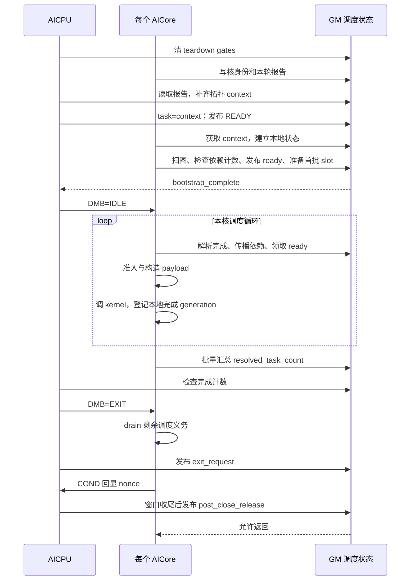

# A5 HBG AICore 调度：按执行顺序走读

本文对应当前 64B 共享布局、GraphView v3、ready pool v8 与 native protocol v10/v11 的 A5 HBG resident 实现。
范围：从 device 已拿到本次运行的 GM 数据开始，覆盖初始化、依赖、取任务、准入、kernel 调用、完成传播和退出。Host 预建的 CSR/remaining 作为输入合同介绍，不展开 Host 构图实现；legacy 只标入口。
本文的源码链接使用相对于本 Markdown 文件的路径，并通过 `#L行号` 跳转到指定行；链接旁也保留行号供对照。VS Code Markdown 会将 `/` 开头的链接按工作区根目录解析，因此此处不使用磁盘绝对路径。切换版本后，行号应重新核对。

## 阅读顺序

阅读字段前可先看 [数据结构的作用范围与用途](00-data-structure-scopes.md)：按整轮、每任务、每worker、每slot、每cluster及每次异步执行说明存储、读写者和生命周期。

1. [初始化与启动数据](01-initialization.md)：谁初始化什么，Handshake、WorkerContext、RunControl 的字段。
2. [依赖、ready 队列与执行](02-ready-execution.md)：任务如何就绪、谁领取它、payload 如何构造、kernel 怎么调用。
3. [MIX/SPMD、完成与退出](03-cooperative-completion.md)：多核准入、MIX mailbox、完成传播、最终退出。
4. [native graph 与异步完成](04-native-async.md)：主链中的条件分支及其数据结构。

首次按上述顺序读；遇到结构表时对照定义。普通单核任务先贯穿主链，再读 MIX/SPMD；native graph 和 async 仍属于 resident，按实际输入条件进入。

## 整条调用链

| 顺序 | 执行者 | 代码位置 | 本步完成的事情 |
| ---- | ------ | -------- | -------------- |
| 1 | AICPU | [pre_handshake_init](../../../src/a5/runtime/host_build_graph/aicpu/aicore_lifecycle.cpp#L68)（第 68 行） | 清 discovery 状态与退出 gate，记录核数和寄存器表 |
| 2，与 1 并行 | 每个 AICore | [平台 kernel 入口](../../../src/a5/platform/onboard/aicore/kernel.cpp#L118)（第 118 行） → [aicore_execute](../../../src/a5/runtime/host_build_graph/aicore/aicore_executor.cpp#L52)（第 52 行） | 建立本核编号，报告物理核和类型 |
| 3 | AICPU 多线程 | [handshake_partition](../../../src/a5/runtime/host_build_graph/aicpu/aicore_lifecycle.cpp#L99)（第 99 行） | 接受本轮报告，按物理核查寄存器地址 |
| 4 | AICPU leader | [post_handshake_init](../../../src/a5/runtime/host_build_graph/aicpu/aicore_lifecycle.cpp#L154)（第 154 行） | 校验 1 AIC + 2 AIV 拓扑，填写每核 context |
| 5 | AICPU 多线程 | [publish_context_partition](../../../src/a5/runtime/host_build_graph/aicpu/aicore_lifecycle.cpp#L300)（第 300 行） | 先写 context 地址，再发布 GM READY |
| 6 | 每个 AICore | [aicore_execute 的 READY 接收](../../../src/a5/runtime/host_build_graph/aicore/aicore_executor.cpp#L139)（第 139 行） → [run_resident_scheduler](../../../src/a5/runtime/host_build_graph/aicore/resident_scheduler_impl.h#L685)（第 685 行） | 重新观察 context，初始化本核私有调度状态 |
| 7 | 所有 AICore | [bootstrap_ready_graph](../../../src/a5/runtime/host_build_graph/aicore/resident_scheduler_impl.h#L268)（第 268 行） | 分片扫描图，按 remaining 或兼容 wake-list 路由，发布初始 ready、准备首批 slot |
| 8 | AICPU leader / 各线程 | [wait_bootstrap_complete](../../../src/a5/runtime/host_build_graph/aicpu/aicore_lifecycle.cpp#L338)（第 338 行） → [release_partition](../../../src/a5/runtime/host_build_graph/aicpu/aicore_lifecycle.cpp#L385)（第 385 行） | 等 bootstrap 完成，写 DMB=IDLE，开放 kernel 执行 |
| 9 | 每个 AICore | [run_ready_dispatch_loop](../../../src/a5/runtime/host_build_graph/aicore/resident_scheduler_impl.h#L403)（第 403 行） | 在本核循环做调度和执行 |
| 10 | 每个 AICore | [service_cluster_completions](../../../src/a5/runtime/host_build_graph/runtime/scheduler/scheduler_completion.h#L395)（第 395 行） | 消费上一轮执行完成，完成逻辑 join，唤醒后继 |
| 11 | 每个 AICore | [fill_own_slots](../../../src/a5/runtime/host_build_graph/runtime/scheduler/scheduler_dispatch.h#L451)（第 451 行） | 领取 ready，必要时走有序准入，再准备自己的 payload |
| 12 | 每个 AICore | [local_ready_pop 与最终准入](../../../src/a5/runtime/host_build_graph/aicore/resident_scheduler_impl.h#L514)（第 514 行） | 选最旧 ready slot，确认该次执行现在可进入 |
| 13 | 每个 AICore | [execute_task](../../../src/a5/runtime/host_build_graph/aicore/resident_scheduler_impl.h#L81)（第 81 行） | 间接调用 `function_bin_addr(args)` |
| 14 | 每个 AICore | [本地完成发布](../../../src/a5/runtime/host_build_graph/aicore/resident_scheduler_impl.h#L635)（第 635 行） | seal async，完成可选参数抓取，写本地完成 generation，回到步骤 9 |
| 15 | AICPU supervisor | [run](../../../src/a5/runtime/host_build_graph/aicpu/aicpu_executor.cpp#L544)（第 544 行） | 等整个图的 resolved 计数满足完成条件 |
| 16 | 双方 | [AICore 收尾](../../../src/a5/runtime/host_build_graph/aicore/resident_scheduler_impl.h#L805)（第 805 行） / [AICPU shutdown](../../../src/a5/runtime/host_build_graph/aicpu/aicore_lifecycle.cpp#L424)（第 424 行） | EXIT → 清理调度义务 → nonce ACK → 窗口收尾 → GM release → 返回 |

步骤 1 与 2 是并行启动，不能理解为 AICPU 先完整执行完所有初始化，AICore 才开始运行。

## resident 的编译边界

启动和模板选择保留在 `aicore_executor.cpp`；常驻循环与辅助函数位于 `resident_scheduler_impl.h`。
`resident_ordinary.cpp`、`resident_native.cpp` 及对应 `_profiled.cpp` 分别实例化普通/native 与采集开/关四种组合。
入口模板的 `CoreType` 参数区分 AIC 与 AIV 符号，内部实现保持 TU 局部链接；每个实例仍执行同一套协议。

[completion resolver](../../../src/a5/runtime/host_build_graph/runtime/scheduler/scheduler_completion_resolver.h#L30) 是显式 `static noinline` 边界，
局部参数类型由 `alignof <= 8` 断言约束。函数边界不改变 DONE、依赖推进、预算续行或 ready 发布合同。
构建方式与 device 调度行为应分别理解，不能仅由外联推断执行耗时下降。

## 编号与存储先分清

| 名称 | 含义 |
| ---- | ---- |
| `worker_index` / 入口 `block_idx` | runtime 的启动编号；用于 workers/context 数组索引 |
| `physical_core_id` | 硬件核编号；用于寄存器寻址，不保证连续 |
| `type_rank` | 在同类型核中的紧凑编号；用于 ready inbox 等寻址 |
| `cluster_index` | 1 AIC + 2 AIV 所在组的编号 |
| `cluster_lane / self_lane` | 0=AIC，1=第一个 AIV，2=第二个 AIV |
| `task_ref` | resident 调度节点索引；不是物理核，也不是公开 TaskId 的完整编码 |
| `LocalContext.block_idx` | 当前逻辑任务的第几个 block；和入口 block_idx 不同 |
| `subtask_slot` | 当前任务的 AIC/AIV0/AIV1 子任务身份 |
| `generation` | 本核一次 slot 发布的代号；用于排除旧完成记录 |
| `group_seq` | 一个 cluster 的 MIX group 序列；不同于 slot generation |

`scheduler_state_base + xxx_offset` 是调度状态内地址；`xxx_address` 通常已经是完整 GM 地址。TaskPayload 中的 SelfRelativePtr 又不同：目标=字段自身地址+delta。

数据分为三处：GM 中的跨核状态、每个 AICore 私有的本地状态、用于生命周期的 DMB/COND 寄存器。普通 resident 任务的领取和完成不经过 AICPU 的逐任务寄存器投递。

## legacy 只标入口

- [AICPU 入口判断](../../../src/a5/runtime/host_build_graph/aicpu/aicpu_executor.cpp#L819)（第 819 行）：`!aicore_scheduler_runtime_enabled(runtime)` 进入 `legacy_aicpu_execute`。
- [AICore 入口判断](../../../src/a5/runtime/host_build_graph/aicore/aicore_executor.cpp#L62)（第 62 行）：mode 不是 `RESIDENT_PENDING` 或 `RESIDENT_READY` 时进入 `legacy_aicore_execute`。
- [mode 常量](../../../src/a5/runtime/host_build_graph/runtime/scheduler/scheduler_layout.h#L18)（第 18 行）：resident 为 1/2，明确 legacy 为 3/4。0 表示未发布选择。
- 以下只走读 resident 路径。

导航时读 `scheduler_dispatch.h`、`scheduler_completion.h`；它们的同名 `.cpp` 是独立的 AICPU 调度实现，不在此次主线。
一些共享文件的开头注释仍以 AICPU 投递模型叙述；判断 resident 行为应沿上述实际调用点。

## 三个不能混同的完成点

1. `slot READY`：payload 准备完成；仍可能受最终 admission 检查约束。
2. kernel 返回：某个 block 的某个 subtask 返回；MIX、SPMD、异步条件可能仍未完成。
3. `resolved_task_count` 增加：逻辑节点的完成传播已走完；这是 supervisor 收敛判断使用的计数。

空 ready 队列只说明本轮没有可领取工作，不能作为整个图已经结束的证明。
