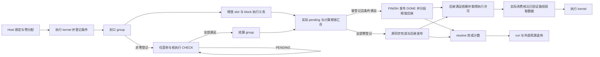

# A5 HBG AICore 异步完成开发方案

本方案为 A5 `host_build_graph` 的 AICore resident scheduler 定义 deferred completion。
业务 kernel 可以登记完成条件后返回，执行核继续处理其他工作；只有计算、异步条件和数据可见性要求全部满足，原逻辑 task 才发布完成并释放消费者。

本文档组规定待实现的目标行为和接口，不表示功能已经交付。适用环境为具有 native Graph、SPMD、GM MIX 和 ordered admission 的 A5 HBG；既有同步调度、通信域和 run 退休机制作为集成基础。

## 1. 功能范围

| 范围 | 开发目标 |
| ---- | -------- |
| 条件类型 | 通知 COUNTER、SDMA post-done；同一 group 可包含多类型、多资源条件 |
| 普通任务 | AIC/AIV 单 lane 任务；完成条件检查可由其他参与核执行 |
| 并行任务 | SPMD、MIX masks 3/5/6/7、`sync_start` |
| Graph | 当前单层 native Graph、多实例、内部与外部依赖、普通任务混排 |
| predicate | 保留单 lane、单 block 的原生支持边界；skip 不执行 kernel、不发起 DMA |
| 前端 | 既有 C++ 登记接口及 PyPTO 专用 waiter 的 `defer_wait` |
| 错误与关闭 | 注册和提交失败、非法条件、超时、核故障、pending 时 close、资源代次隔离 |

SDMA 的发起资格与条件的观察资格分开定义。提交使用经过验证的 backend 发起核；目标要求参与调度的 AIC/AIV 都能检查受支持条件，不把固定代理核作为完成此目标的替代方案。具体硬件操作必须通过[后端资格验证](a5-hbg-async-completion/backends-and-lifetime.md)。

不增加 kernel 抢占/恢复、隐式 continuation、嵌套 Graph、多 block/MIX predicate 或未经验证的 URMA/RDMA/CCU 原生完成事件。不增加正常路径的 AICPU 条件轮询，也不在执行过程中退回 legacy 或阻塞等待。

`defer_wait` 仅登记条件，不隐式 return。依赖异步结果的计算必须放在另一 task，通过真实依赖连接；PyPTO waiter 继续遵守其注册专用 kernel 限制。

## 2. 架构与执行流程

| 层级 | 职责 |
| ---- | ---- |
| 编译器与注册层 | 保持既有 callable 和 kernel 登记接口，生成可正常返回的 waiter |
| Host bind | 从现有图展开 task/block/lane 映射，预分配调度记录；复用既有 run 资源持有 |
| backend adapter | 验证提交、预留条件槽、登记实际完成条件、提供有界观察及可见性操作 |
| AICore resident scheduler | 释放执行资源，领取 CHECK/FINISH，汇合完成，分段释放后继；保持既有消费与准入顺序 |
| AICPU 与 run/domain owner | 既有启动、错误监督、核退出、外部访问确认和最终资源回收 |

每个可能调用登记接口的物理执行预留一个稳定 group，每个含此类执行的逻辑 task 预留独立 FINISH 状态。CHECK 和 FINISH 是控制工作，不创建业务 TaskId，不占 dispatch slot，也不取得 cooperative admission。

基础实现只计入实际非零 group，复用计算释放汇合，采用常驻完成记录、平坦活动位图、有界 strong-CAS 目录更新和有界 FINISH 路径。完成记录在 run 内不移动、不回收。基础实现为可执行任务提供登记空间，所有成员均零登记的任务沿用同步完成路径，不创建 CHECK/FINISH 工作。空间、bind 和同步运行成本单独验证，优化不能引入强制的额外用户声明。

## 3. 完成语义与不变量

| 边界 | 必须成立的事实 | 尚不能据此执行的动作 |
| ---- | -------------- | -------------------- |
| KernelReturned | 调用结束，当前执行的登记封口 | 不能假定异步 payload 已可用 |
| ExecutionReleased | slot 及该执行的局部义务结束；MIX 按参与 lane 收尾 | 不能直接发布逻辑 TaskDone |
| TaskDone | 全部 block 已释放、全部已登记 group 已结算、发布侧可见性合同成立 | 不能假定后继已全部路由或 run 可回收 |
| ResolveDrained | 后继路由、ready 发布及本 task 完成记账全部收敛 | 不能假定外部 DMA/peer 已停止访问 |
| RunRetired | 既有 run/核退休和关联外部访问证明成立 | 不能忽略其他 run/peer 的资源使用 |

消费者在读取 payload 前还必须完成其自身核需要的缓存获取操作；观察核的缓存维护不能代替消费者核。该要求同样适用于同步消费者。优先复用现有 backend 和读取路径；确需额外获取时从现有参数/Graph 绑定生成旁表，MIX/sync-start 在实际成员准备完成后执行。

1. 一个物理执行只有一个登记写者，一个可服务记录同时只有一个 lease owner。
2. group 身份由 run、内部 task ref、block 和 subtask 确定，不依赖可复用 slot 或 DFX 数据。
3. 每个非零 group 恰好登记、结算一次；零登记与合法 skip 仍须封口并释放执行资源，每个逻辑 block 恰好贡献一次计算释放。
4. 只有关闭计算或递减最后 pending 的原子操作返回值能授予 FINISH 激活责任；必须同时满足计算已释放且 pending 为零，普通观察者不能激活。
5. TaskDone 恰好发布一次；run 完成计数晚于该 task 的全部后继发布和最后记录写入。
6. 每次服务有步骤预算，任何私有发布责任都不能跨越下一次业务 kernel。
7. cached 写回不得覆盖 atomic-only 控制行；跨核交权必须有实际 GM 发布/观察顺序。
8. 错误路径不补计数伪造成功，不用核 ACK 代替外部访问结束证明，不复用未知使用状态的资源。

## 4. 文档与实施入口

| 文档 | 唯一定义的内容 |
| ---- | -------------- |
| [接口与数据布局](a5-hbg-async-completion/interfaces-and-layout.md) | 既有登记接口、内部上下文、记录身份、GM 布局和容量 |
| [调度与完成协议](a5-hbg-async-completion/protocol.md) | lease、目录、完成汇合、CHECK/FINISH、任务形状与服务预算 |
| [后端与资源生命周期](a5-hbg-async-completion/backends-and-lifetime.md) | SDMA/COUNTER、提交结果、数据可见性、复用和错误关闭 |
| [消费者数据可见性](a5-hbg-async-completion/consumer-preparation.md) | 既有读取路径、必要获取的范围与执行位置、跨核验证 |
| [实现方案](a5-hbg-async-completion/implementation.md) | 模块接线、依赖顺序、兼容迁移、错误与 DFX 集成 |
| [验证与性能验收](a5-hbg-async-completion/validation.md) | 功能矩阵、负对照、硬件资格、性能方法与交付条件 |
| [待验证选型](a5-hbg-async-completion/choices.md) | 替代实现、验证问题、选择条件及允许改变的合同 |

开发以基础设计建立完整 COUNTER/SDMA 闭环，再扩展全部任务形状和错误关闭，最后逐项比较优化候选。候选的优势必须在相同语义下验证；改变支持范围或错误合同不能作为无说明的性能优化。

各子文档只定义其负责的合同，其他文档通过链接引用。实施结果按验证文档的要求保存为测试产物，采用的接口和协议始终在对应设计文档中保持一致。
