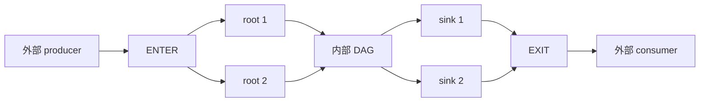

# A5 HBG 原生 Graph task 设计

默认 A5 `host_build_graph` 在 Host 完成 orchestration、Graph 展开和 Call 准备，
由 resident AIC/AIV 执行；AICPU 负责启动、监督、诊断服务和清退。
工作发现采用不可变 AIC/MIX、AIV 目录与 execution token，依赖以 canonical completion gate 证明。
本页及数据布局、协议页描述当前实现；历史测量仅适用于各报告标注的提交。

## 目标与支持范围

Graph 内外的 kernel 共用执行、MIX/sync_start、async 和退休合同。
`rt_submit_graph`、boundary alias/shape、公共 TaskId 及业务 kernel 的 args ABI 不变。
普通 AIC/AIV、多 block、多 wave、MIX、sync_start、单 block/lane predicate、DUMMY、
多实例复用 Definition 和普通/Graph 交错都通过这套模型执行。

非法形状、参数区间或容量在 Host 拒绝；设备损坏的 descriptor、mode、epoch 或 backing
进入首错与失败启动清退，不能另选执行器或伪造完成。
A2A3/WSE 和 percounter 的活跃 materializer 仍使用各自当前合同，默认 HBG 不读取它们的任务镜像。

| 文档 | 当前问题 |
| ---- | -------- |
| [数据布局与 Host 绑定](a5-hbg-graph-task/data-layout.md) | node/ref、80 B 顶层镜像、GM 所有权、256 B trace、实例参数与预算 |
| [调度与发布协议](a5-hbg-graph-task/protocol.md) | 从设备入口、READY、bootstrap 到完成和清退 |
| [Canonical completion gate](a5-hbg-graph-task/dependency-counters.md) | producer DONE、compute/async debt 和控制节点完成 |
| [工作目录与 execution token](a5-hbg-graph-task/ready-queue-design.md) | 目录、四个 token、两个私有 slot、park/resume 与前进性 |
| [Build/execute 合同](a5-hbg-graph-task/build-execute-separation.md) | Call/Claim、参数观察、MIX replacement、优化约束 |
| [Resident 走读](../a5-hbg-aicore-walkthrough/README.md) | 跨 Host/AICPU/AICore 的执行说明 |
| [实施与历史验证](a5-hbg-graph-task/implementation.md) | 分提交的验证证据，不替代当前提交验收 |
| [历史性能与原型](a5-hbg-graph-task/qwen-performance.md) | 被测提交、反例和已撤回候选 |

## 展开模型

每个 Graph shell 替换为 ENTER、所有 children 和 EXIT：

ENTER 继承外部 fanin，root 增加 ENTER 依赖，child 内部引用保持 Definition 的语义。
外部 consumer 对 shell 的引用映射到 EXIT；EXIT 等待全部 sink，包括不连通分量。
控制节点不占 kernel slot，不具有业务 execution identity，也不增加 admission membership。
Host 在 launch 前发布完整拓扑，设备不动态添加节点或绑定 child 参数。

每个实际 block/lane 的 immutable Call 引用稳定的 invocation Binding。
普通 token 可以提前领取执行责任、等待 producer gate；依赖满足后才转入本核 slot 并通过最终执行许可。
MIX 使用 cluster reservation，sync_start 使用全 run 的 cooperative admission 顺序。
Graph 本身不建立新的资源顺序域，一个 cohort 也不扩大为整个 Graph。

## 不变量与资源成本

| 不变量 | 证明方式 |
| ------ | -------- |
| ref 与公共身份分离 | expanded node 连续编号；统一访问器恢复 shell/local TaskId |
| fanin 完整且无环 | Host 验证原始边、边界与 producer_ref < consumer_ref；设备确认 canonical gate |
| 每个真实执行有唯一 owner | block ticket 与 Call control 的 phase/owner/generation CAS |
| 控制进展不依赖 kernel 空槽 | bootstrap scan gate 后的独立有界控制扫描 |
| 参数稳定至 execution 退休 | Host 唯一写者；Call/Binding 不随 slot 复用；consumer 独立观察业务输入 |
| 逻辑 DONE 等待真实 compute 和 async | canonical total/remaining/debt 的合法零状态 |
| 逻辑完成与资源退休分离 | trace、group release、EXIT/ACK 和 post-close release 各有 owner |
| 首错不变成成功 | 禁止新成功执行；未完成 publication 和清退失败保留 backing 所有权 |
| pipeline run 互不借用存储 | 每个 slot 独立持有 epoch、plan、参数、publication source 和 capture backing |

默认顶层 publication 为 64 B 首错头、80 B/task 和实用参数池，Host rich scratch 不上传。
每实例 Graph heap 只包含 required_heap 加实际 tensor/scalar/predicate tail；
Definition 完成时计算并缓存预算，提交和 bind 使用同一算法检查溢出与实例边界。
公共 execution_storage_bytes 继续描述 A2A3/WSE/percounter 的活跃 GraphExecution，不能当作默认 native 参数预算。

resident backing 仍需计入 768 B/node control，以及按真实执行数放大的 512 B Call、
128 B Claim、128 B Binding、256 B trace 和实际启用的诊断/async 区域。
缩小结构或删去重复计划不等于已证明延迟下降；性能必须用同输入、同设备、同 DFX 配置的对照衡量。

当前 Graph view/native image 版本为 6/4，因果诊断采用普通 v22、Graph v23。
Host、AICPU、AICore 与诊断解析器一同迁移，只读取当前格式。
