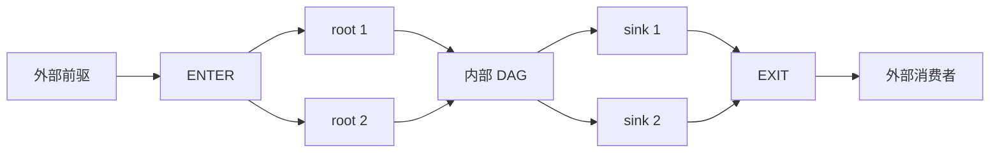

# A5 HBG 原生 Graph task 设计

依赖唤醒见[前向依赖计数](a5-hbg-graph-task/dependency-counters.md)，
SPMD 使用既有 cooperative admission，每个逻辑任务只进入 ready 队列一次。

本文规定 `host_build_graph` 的 Graph task 如何接入 A5 AICore resident scheduler。
**状态：native Graph 与共享 ready 队列已实现，默认 T/H8；开发基线同时包含 CSA/SWA 的普通调度优化。**
双 lane MIX 按资源选择成员，并使用独立的 atomic 领取结束证明；原生 Graph 协议为 v11，普通任务协议为 v10。
历史测量与证据见[实施记录](../../../tests/docs/a5-hbg-graph-task/README.zh-CN.md)。
性能页的数据只对应各节标注的被测提交，不代表叠加普通调度优化后的开发基线性能。
[历史逐 block 队列与 MIX lease 原型](a5-hbg-graph-task/block-ready-scheduling.md)曾因编译成本不可接受而撤回；详见[模型实测](a5-hbg-graph-task/qwen-performance.md)。
纯 AIC/AIV、MIX 和 sync_start 共用 admission 与完成协议，不另设独立 block 领取路径。
原始设计基线为 `main@8f42cef9b3f0ebbda800e239aab0949e95552f25`，核对日期为 2026-10-31。
下文保留设计契约，实际实现与验证范围以当前代码和候选证据为准；阶段名称不对应独立 Git 提交。

## 目标与边界

复用 resident 的依赖 resolver（CSR/remaining 与兼容 wake-list）、direct refill、SPMD admission、
GM MIX 和退出握手，让 Graph 内外的 kernel 在同一套调度协议中执行。
Host 负责拓扑和资源规划，AICore 只解释已验证的执行计划与绑定参数，AICPU 保持生命周期监督职责。

首版包含：普通 AIC/AIV、SPMD、MIX、`sync_start`、单 lane 单 block predicate、
DUMMY、多实例复用 Definition、普通任务与 Graph 交错。
`rt_submit_graph`、boundary alias/shape 契约、原始 `TaskId` 和 kernel 参数 ABI 不变。
嵌套 Graph、动态 topology、Graph boundary 显式依赖、任意异步完成不扩展。
Graph 内合法但 resident 尚不支持的形状在 bind 前整 run 选择 legacy；非法输入失败。
执行开始后不允许 fallback，不引入新的行为环境变量或编译开关。

契约与后续重构设计分为以下几份：

| 文档 | 实现者需要从中取得的答案 |
| ---- | ------------------------ |
| [数据布局与 Host 绑定](a5-hbg-graph-task/data-layout.md) | node 编号、wire 类型、地址来源、容量、GM 载体、prepare 重试 |
| [调度与发布协议](a5-hbg-graph-task/protocol.md) | 控制队列、参数唯一写者、cache 发布、SPMD/MIX、完成与退出 |
| [全局与分级 ready 队列设计](a5-hbg-graph-task/ready-queue-design.md) | 业界方案、A5 原子争用、候选实现与对比验证 |
| [独立 block 调度待选方案](a5-hbg-graph-task/block-ready-scheduling.md) | 已撤回原型的设计、收益/成本、同步安全与重启条件 |
| [实施与功能验收](a5-hbg-graph-task/implementation.md) | 改动入口、分阶段自主实施、功能矩阵、DFX |
| [性能与自主迭代流程](a5-hbg-graph-task/performance.md) | 主线基线、ST 筛选、无 Graph 门禁、现有 A5 Qwen 的验证与优化闭环 |
| [设计复审](a5-hbg-graph-task/review.md) | 反例、修正、证明边界、并行 PR 与剩余风险 |

## 设计基线事实与复用范围（2026-10-31）

| 位置 | 已核对行为 |
| ---- | ---------- |
| [A5 runtime_maker.cpp](../../../src/a5/runtime/host_build_graph/host/runtime_maker.cpp) 的 `create_scheduler_state` | 任意 `TaskKind::GRAPH` 使整个 run 选择 legacy AICPU |
| [A5 resident_scheduler_impl.h](../../../src/a5/runtime/host_build_graph/aicore/resident_scheduler_impl.h) 的 `run_ready_dispatch_loop` | 每个 AIC/AIV 处理完成、准备自己的 payload 并执行 kernel |
| [A5 SPMD 协议](../../../tests/fdwic/pa_hbg/spmd/implementation-contract.md) | 共享 admission 顺序、固定成员、block ownership、GM MIX 和 LocalDone |
| [A2A3 scheduler.h](../../../src/a2a3/runtime/host_build_graph/runtime/scheduler/scheduler.h) | 4-task 物化切片、独立 external-ready、wake-list、root 游标、shell 完成 |
| [公共 graph_execution.cpp](../../../src/common/host_build_graph/device/graph_execution.cpp) | 按实例重定位 Tensor/scalar/predicate，内部 CSR 位于 execution storage |
| [graph_image_source.h](../../../src/common/host_build_graph/device/graph_image_source.h) | onboard Definition 来自每个 AICPU 线程自己的 launch package |

A2A3 的 `remaining_tasks.fetch_sub` 每个 child 执行一次；它没有消除 Graph 聚合原子。
它的两个独立发布事件还存在 portable C++ memory model 的握手审查项，见复审文档的 PR #2533。
本方案继承其 boundary 和完成语义，不直接移植其 execution 对象与发布状态机。

Definition cache 只属于一次 orchestration run。相同 `graph_key` 不是跨 run 的缓存有效性证明。
首次 recording 与后续引用最终都以本次 bind 生成的完整 Definition 和 shell 为输入。

### A2A3 的 Graph 执行链

Host recording 生成 Definition，提交时为每个 shell 预留 graph heap 与 execution storage，并绑定 boundary。
设备 classify 将 shell 的 Definition offset 解码为本线程可读的 image，创建该实例的 `GraphExecution`，
包含 child storage、参数池、fanin、执行状态与内部原子控制；不能把它的 C++ 对象直接搬给 AICore。

AICPU 的物化队列独立于 shell 外部依赖。`materialize_busy` 保证同一实例只有一个物化 owner，
每次默认物化 4 个 child，重建 Tensor/scalar/predicate 和 `SUB_TASK(parent, local)` 身份。
每个切片完成后将新 child 接入内部 wake-list，并发布 materialized/published 前缀；
因此先物化的 child 可以在整个 body 物化完之前运行。

root 的实际可执行需要两个条件：对应 child 已发布，以及 shell 外部依赖已满足。
`route_cursor` 游标避免重复路由；early dispatch 可先暂存合格 root，但不消除外部依赖的执行 gate。
child 完成推进内部依赖并减少 remaining；最后一个 child 才释放外部 shell。
它的正确性关键是切片数据发布、external-ready 与 root 路由的握手，而不仅是 CSR 扫描。

| A2A3 机制 | 本方案对应机制 |
| --------- | -------------- |
| 每实例 execution 对象和物化切片 | 每 Definition 只读计划、每实例 binding、bootstrap 分区内每 child 一次参数准备 |
| materialized/published 前缀与 external-ready | 全拓扑 bootstrap gate + ENTER 依赖，不再动态发布 child 拓扑 |
| route_cursor 游标 | 统一依赖计数与唯一 ready 发布者；无依赖 header 时保留 wake-list 路由 |
| 每 child 更新 Graph remaining | EXIT 的全 sink fanin join；保留 run 的批量 resolve 计数 |
| shell 完成与 execution 退休 | EXIT 逻辑完成，再由全 run resolve/LocalDone/fence 证明可回收 |

因此保留的是 Graph API、boundary 重定位和依赖语义；参数准备时机与物化载体不同，性能须分别测量。

## 调度模型

每个 Graph shell 在 native 调度视图中替换为 `ENTER + children + EXIT`：

- ENTER 继承 shell 的外部 fanin；所有内部 root 增加对 ENTER 的依赖。
- 内部边保持 Definition 的含义；EXIT 等待所有 sink，包含不连通分量的 sink。
- 外部消费者对 shell 的引用映射到 EXIT；boundary 的 RAW/WAR/WAW 顺序因此保留。
- ENTER/EXIT 没有 kernel、block、lane 或 admission membership。
- Host 预建拓扑、fanout CSR 和初始 remaining；bootstrap 屏障内完成初始路由。无依赖 header 时才建 wake-list；执行阶段不动态添加 Graph 节点。
- 参数由 bootstrap 的唯一 node 分区 owner 绑定一次；scan gate 后普通 owner 和 cooperative 成员首次观察，SPMD/MIX 的所有 block/lane 复用。

`p2-bootstrap-bind` 候选把参数准备并入现有 scan gate，不增加新的 barrier；
**它会等待本 run 所有 child 参数准备完成后才开始消费 ready，O(N) 节点注册扫描也仍存在**。
这是以启动并行准备替代 ready 临界路径复制的取舍，收益必须经完整模型测量确认。
它也不复制 AICPU 的 `published_tasks + external_ready` 双事件 root 发布机制。
root 只是依赖 ENTER 的普通节点，参数准备不会使一个尚未 ready 的 task 提前执行。

已实现基底中所有 Graph 共用原有 cooperative admission 顺序；上述 block 调度方案曾重审该约束，现已撤回为后续候选。
`sync_start` 的范围仍是一个 child 的 blocks；
不把整个 Graph 当成一个 cohort，不给每个 Graph 建立独立顺序域。

## 必须保持的不变量

| 编号 | 不变量 |
| ---- | ------ |
| I1 | `node_ref` 是当前 run 的连续索引；公共 `TaskId` 保留原始 shell/local 身份，两者不可互换 |
| I2 | 每条实际调度边满足 `producer_ref < consumer_ref`，每个原始外部依赖经过映射后仍存在 |
| I3 | 每条边只通知一次，remaining 的 1→0 转移产生唯一 ready 发布者；兼容路径节点最多属于一个 wake-list、ready inbox 或私有待处理位置 |
| I4 | 所有控制节点在完整拓扑注册后可无资源槽地推进，不受 kernel admission 等待阻塞 |
| I5 | 一份实例参数只有一个写者，发布后直到 run 退出都只读；不同写者不共享被写回的 cache line |
| I6 | Graph child 完成沿用逻辑 TaskDone；MIX 必须先完成必要 lane release，SPMD 必须完成全部 blocks |
| I7 | EXIT 证明 shell 的逻辑完成；所有节点的 resolve 尾部与 LocalDone/退出握手另外证明资源可释放 |
| I8 | 观察到首错后禁止新成功发布，在途工作沿错误退出协议处理；部分参数、部分上传和退出失败都不能退化为成功 fallback |
| I9 | 每个 pipeline slot 独立拥有 plan、GM backing、epoch 和 publication source，直到安全回收 |

EXIT 通过其 sink 依赖的 remaining 归零成为 ready；无依赖 header 时保留 fanin/wake-list join。
不额外增加每 child 一次的 Graph 全局计数器。
它等待的 sink 集合由 Host 从已验证 CSR 推导，不使用“记录顺序最后一个 child”替代。
所有 sink 完成等价于所有 child 完成的证明只适用于有限无环、完整保留依赖、无异步逃逸的任务图。

## 交付与收益口径

按用户约定，方案确定后自主分阶段实现、分析问题、修复和复测，不为常规实现决策反复确认。
先在修改前主线采集基线，再实现统一访问视图和端到端 native Graph 切片，随后接入完整 cooperative/DFX 契约。
新旧功能验证后推进无 Graph 性能门禁和现有 A5 Qwen3 验证；按用户最新要求，Qwen 实测与反馈不等待无 Graph 性能达标。
交付依赖和验收见[实施文档](a5-hbg-graph-task/implementation.md)。本设计不授权发布 PR 或变更公共 API。

预期减少的是重复拓扑处理、重复参数绑定及 Graph 聚合争用，不宣称参数总写入量下降。
bootstrap 并行绑定会增加首 kernel 前的工作量；虽然移出 ready→kernel 临界路径，
仍不能预先断言比 AICPU 提前物化更快。
该候选仍待功能和性能验证，不引入跨调度轮持有的物化锁。

首版复用公共 Graph 已预留的 legacy execution tail 作为参数 backing。
**不写 `ChipTaskStorage` 不等于不预留这段 heap**；实际内存节省必须在后续 allocator 改造后单独证明。
当前 resident 的 512-byte task control 和按 block/lane 放大的 trace 存储必须纳入预算。
验收同时报告 Host bind、首任务延迟、设备总时间、尾延迟、初始化/H2D 字节和峰值内存。
