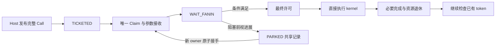

# HBG 调度重构：每核 execution token 的提前领取与连续执行

**状态：实现与验证进行中。** 已接入 Host 预构造、四个具体 execution token、依赖就绪后的直接执行、普通 PARK/接手、MIX 组级前视和控制服务；resident 原 ready 发布/领取路径已移除。普通补给持续扫描且不插入 NOP 退避。完整特性实机验证、共享责任 DFX 与最终性能验收仍需完成，不能把功能代码已接入等同于达到 5 µs。

本文以 `atomic_probe/pa_scheduler/cross_core_only_scheduler` 的实际执行流程为主线，只保留当前实现与拟修改合同。设计中心是每核持有具体 execution token，并在 kernel 返回后优先推进这些 token；Build/Execute 分离、Host 预绑定和任务级原子状态服务于这一执行循环。

只修改 Simpler 调度器、必要的 Host 布局、内部协议与 DFX，不修改用户 kernel、前端语义或参数 ABI。继续使用这一份统一文档；开发按完整功能纵向分阶段本地提交，未经允许不 push。

调度优化必须由通用任务状态、依赖和资源合同驱动，不按模型名、特定 task 编号、shape 或固定图拓扑选择策略。SWA 等单例的泳道图用于提出和验证机制假设，不能替代通用性验收。

最终必须完全废弃原 ready_queue 调度逻辑：不能在 token 旁边保留 ready 发布/领取作为备用执行入口。两类不可变任务目录只承担索引和轮转发现；执行责任归属于 task/unit 状态。MIX 和 sync_start 也要迁移发现入口，只保留整组会合与有序成员协议本身。迁移后同步删除原 ready availability、ready hint/candidate、旧普通 fill/claim、重复 Device prepare 及只服务这些路径的 Host 布局、DFX 和测试代码；不能只换函数名或留长期双轨开关。

## 1. 目标执行循环与当前差距

### 目标的准确含义

有已发布且适合本核类型的工作、本核有补给机会时，提前持有具体待执行单元。前一 kernel 返回并完成必要的结果发布后，若已有 pending 的全部执行条件满足，就直接进入下一 kernel，不再先做一轮全局发现、重新分配 block、构造参数和 READY slot 发布。

这里的 pending 必须含具体 `node_ref/block/lane`、唯一执行票和所有权。只保存 task ID、fanin view 或一个“可提前准备”的 hint，不满足要求。最有价值的 pending 已完成 Claim 和参数接收，停在 `WAIT_FANIN`；只有票号、尚未接收参数的 `TICKETED` 不能计为同一种准备程度。

“有 pending”不等于“有 ready”，也不等于任意时刻都能填满窗口。元数据未发布、真实依赖未满足、MIX 伙伴忙碌、sync 成员尚未到齐时，必须保留等待语义。没有下一项可用 token 的补给路径单独计时，不能混成快入口已达标。

分别测量两个间隙：

- `G_worker`：同一核下一次 kernel 开始减前一次 kernel 结束，回答本核能否快速接续。
- `G_dep`：后继首个 kernel 开始减真正最后一个计算前驱的最后 kernel 结束，回答跨核依赖交接是否接近 5 µs。异步场景另记录最后逻辑条件满足到后继开始，不能把物理返回当作逻辑完成。

同时记录同一 SPMD 任务的全部 block 起跑跨度、实际参与核数、每核执行次数和尾部。仅首个 block 早启动、其余 block 多执行一轮，不算达到目标。5 µs 是拟达到的交接预算，整体收益仍由完整 L0 实测判断。

### 先确定每核运行的主循环

```text
启动：接收 Host 已发布的镜像，初始化本核 token 窗口
循环：
    处理已观察到的终态；履行已承诺的 MIX/cohort 责任
    优先推进已有 token，单次最多访问四槽：
        TICKETED → 唯一 Claim → 接收固定数据 → WAIT_FANIN
        WAIT_FANIN → 检查未确认的依赖；不满足则查看其他 token
        条件满足 → 最终许可 → kernel → 必要完成发布 → 查看下一 token
    到服务预算边界：推进一片 async/control，并给独立发现一次机会
    没有当前可执行 token 且有空位：有界前向扫描；unready 继续填，ready 立即执行
    全窗口等待：继续扫描，找到可运行替代后才 PARK 一个仍未 ready 的普通单元
    无可推进项：有界轮询；不持有 lease 等待外部条件
```

普通 token 的 fanin 已满足时，先用本核 admission 的 current/pending 字段做否定过滤：任一非空就保留 token，不填写和发布必定无法执行的 slot。不提前调用共享许可检查，也不缓存正向许可；本地字段为空仍须在实际 kernel 入口检查共享 admission/MIX 状态。已有 slot 遇到新的跨核发布时，原有本地回收路径继续有效。

一个已有 token 完成后可以解锁本核另一个 token，返回应首先沿这条局部链继续。新票领取和全目录发现是补给入口；已有 token 的执行不能以先完成一轮补给为前置条件。MIX/cohort 的已承诺责任、终态处理和到期的控制服务仍按各自协议处理。

普通任务的一次执行成功返回、而同 task 尚有计算贡献未完成时，只保存一条本核续领提示，不提前占票。已有 pending 优先；没有可直接执行的已有项、有空 token 容量且普通入口许可成立时，提示最多尝试领取一个 fresh block，不 PARK 其他责任。它沿用同一不可变 node_ref 的已满足 fanin，但重新执行 predicate 和最终入口检查。旁路耗尽提示只放弃这次捷径，不关闭目录扫描。连续续领最多为 token 窗口大小减一（当前三次）；之后必须实际访问目录条目才能重新使用提示，目录游标和 PARKED 扫描轮次不因续领重置。MIX、sync_start 不走这条路径，控制和 defer_wait 的服务边界保持独立。

必须区分两条真实路径：

```text
已接收的 pending：前一 kernel 返回 → 必要完成发布
                 → 剩余依赖/最终许可 → 下一 kernel

缺少 pending：   发现任务 → FAA 取票 → Claim CAS → 接收参数
                 → 等待依赖 → 最终许可 → kernel
```

目标是让第一条覆盖足够多的实际交接。第二条也计入总耗时和间隙分布，不能只挑第一条报告小于 5 µs。取票、Claim、参数接收必须在后继自己的入口之前完成；若要让它们与前驱计算重叠，还必须在前驱完成前得到 Scalar 执行机会。

### probe 实际提供了什么

参考目录为工作区 `simpler-fdwic-swimlane-deps/tests/atomic_probe/pa_scheduler/cross_core_only_scheduler/`；硬件合同参考同仓 `tests/atomic_probe/ATOMIC_USAGE_GUIDE.md`。HBG 不移植 ordinary probe 的 Device Build、TensorMap 插入、Submit 或任务生成。

| probe 机制 | 实际入口 | 对 HBG 的含义 |
| ---------- | -------- | ------------- |
| Host 以最终设备地址预绑定不可变参数/context | `common/prebuilt_dispatch_host.h::PrepareStaticExecutionBindings` | 保留并完善现有 Host Call，不再用 Device 重建已知常量 |
| 每核 4 个真实 token，每批 2 个 Execute ordinal | `shared_exec_protocol.h::kExecTokensPerWorker/kExecTicketBatchSize`；`pa_scheduler_core.h::TakeSharedExecTicket` | 借鉴有界前视；不机械照搬批量 2，避免宽 SPMD 囤票 |
| 先绑定具体 task，再领取共享 cell | `BindSharedExecTicketToToken`、`ProgressCrossCoreActiveToken` | 将具体执行票的发放前移到 fanin 就绪之前 |
| 已知 BUILT 字直接做一次 Claim CAS | `pa_exec_adapter.h::PrebuiltPaExecBinding` | 初次领取使用 Host 发布的通用初态，消除 BUILT/PREPARED 双重尝试 |
| Claim 后接收参数，未 ready 时保留 `WaitingFanin` | `shared_exec_protocol.h::ClaimAndBindPreparedExecPayload` | pending 持有具体执行责任，不再只是 task/fanin 观察 |
| 检查剩余 fanin 并在同一 helper 转入执行 | `TryMarkExecutionTokenEngineInflight` | ready 后不再领取、重复确认同一批依赖或重新发布本核 READY |
| 先推进已有 token，有空位再取票 | `ProgressCrossCoreOwnedTokens/ProgressCrossCoreExec` | 将 pending 快入口放在发现/补给之前 |

probe 仍有 AIC、AIV 两个集中 Execute 游标；每批 FAA 与每 task Claim CAS 是不同操作，“单 CAS”只描述 cell Claim，不包含取票、依赖和完成原子。其固定 PA 控制字推导依赖特定任务形状，HBG 必须由通用 Host 计划提供初态，不能复制 `task_id % 5` 等模型规则。

probe 先把一批 ordinal 绑定为 `WaitingBuilt`，再逐槽 Claim、acquire、检查依赖和同步执行；不是先把四槽全部准备好才执行。如果第一槽已经 ready，它可以先执行，第二槽此时仍未完成 Claim。因此不能把“批量领了两张票”直接当作“下一个 kernel 已准备好”。已经停在 `WaitingFanin` 的下一项才具有无新票、无新 Claim 的快接续路径。

同 Scalar 执行同步 kernel 时不补 token，也没有别核写它的私有 token；前视来自此前的调度机会。本文保留这种机会性前视，不承诺强制满窗口，也不为补满窗口延迟已有 ready 工作。HBG 的不可变构造由 Host 完成，其他空闲 Scalar 可以推进依赖、控制服务和自己的 token；接收核自己的 DCache 观察和动态许可仍由接收核完成。

### 当前 HBG 与目标的对应

当前实现基于 `7eae4649f815` 加工作区改动，下面区分已接入的机制与仍需验收的合同。实现、编译和测量前须重新冻结实际 HEAD、diff、输入和二进制；本文不把旧采集标成新版本结果。

| 部分 | 当前实现 | 本次目标 |
| ---- | -------- | -------- |
| Host 镜像 | 每执行单元已有不可变 Call 和独立 Binding | 保留；固定定位信息尽量在 Host 完成 |
| 普通候选 | 4 个具体 execution token，含 block、lane、所有权和阶段 | 验证 pending 覆盖率与整体 block 供给，避免只有首块交接变快 |
| 普通 SPMD 领取 | task 内 `next_block` 发票，初次 Claim 后接收数据并等待依赖 | 验证 fresh 余块和 PARKED 再发现的公平性及尾部开销 |
| 共享准备状态 | Host 发布 BUILT Call，执行者 Claim/接收；Device 重复 builder 已删除 | 保持唯一责任与错误退出/转交合同 |
| 调度循环 | 已有 token 优先；补给每片最多 8 条目录，新 ready 立即返回；主循环无 NOP 退避 | 验证服务公平性与真实交接预算，不用满窗预取推迟 ready 工作 |
| 普通 MIX | 独立未来组与正式 SSBUF 会合；组票在 arming 前领取 | 验证未来组替换和全部 active lanes 的供给拖尾 |
| sync_start | 有序 admission、成员票、hold/frontier/seal | 保留真实成员认领；准备候选与成员票分开 |
| defer_wait | 独立 CHECK/FINISH 服务和共享等待记录 | 保留；普通 pending 不能挡住窗口外通知者 |
| 完成 | N16/C16/D32 权威门控 | 保留，不另造一份普通 DONE/ready 权威 |

## 2. 普通 token：预绑定、取票、等待与停放

### 不可变 Call 与可写运行态分开

一个纯核执行单元的身份为 `(run_epoch, node_ref, block_idx, subtask_slot, execution_index)`。`node_ref` 区分 native Graph 实例，不能用原始 source TaskId 或 Definition ID 替代。MIX 的分配单位是整个逻辑 block，其 active lanes 各有独立 Call。

| 信息 | 构造位置与使用时机 |
| ---- | ------------------ |
| 函数设备入口、Tensor descriptor 地址、scalar、固定 shape、Call/Binding 地址、block 身份 | Host 以最终设备基址构造并检查；Tensor 内容未生成不妨碍绑定稳定地址 |
| async image/bytes/run_epoch、group offset/index 等固定定位信息 | 同一 run 内按执行单元预计算；不等于登记了 deferred condition |
| 实际 execute_owner、可能依赖物理 AIV lane 的 `sub_block_id` | 归属确定后设置；不能把逻辑 slot 一概当物理 lane |
| predicate、Graph 激活、MIX/cohort 当次许可 | Device 执行边界检查，不读取尚未生成的数据来提前决定 |
| async count/error/entries、SEALED、credit、CHECK/FINISH | 真实执行与返回协议推进，不在预取时创建信用或完成通知 |
| DFX 序号/时间戳、args dump 和运行期可写标志 | 真实阶段产生，不伪造预绑定事件 |

沿用 `scheduler_prepare_host_calls()` 和既有 metadata/H2D/launch 发布链。函数入口使用注册时的 resolved entry，不能把 CoreCallable 对象地址当函数地址。固定字段只检查一次；执行者仍需通过正确的接收协议读取它们。

入口解析限定在 A5 HBG 的 Host Call 准备路径，复用原四参数 `set_callable_tables()` 提供的对象地址表。
A5 真机按注册器的既有布局取 `CoreCallable::binary_data_offset()` 对应的代码地址，不解引用设备对象；
A5 模拟器读取 Host 对象中的 `resolved_addr()`。A2/A3、TMR 和公共 Runtime 的绑定接口保持原样。

普通路径删除 `next_prepare_block`、Device `PREPARING/PREPARED` 和相应重复构造职责。Host 发布后的 Call 已是完整执行数据；领取者完成定向观察和 token 私有缓存即可。真正需要实际执行者填写的可写 context 在最终入口有限步填写，不能把整个 Binding 宣称为只读。

静态字段前移和取消 cache 维护必须分开论证。既有 [Binding 发布调查](../../investigations/2026-11-a5-prepared-binding-publication.md) 没有建立“Host 初始化后可省掉 Binding 接收”的依据；本方案保留所需 Binding 定向观察，并为其可写字段规定唯一 writer。不能仅因移除重复 Device store，就顺带删除保护其他字段可见性的 DCCI/DSB。

### 两类目录与初次执行票

保留 AIC/MIX 与 AIV 两个不可变任务目录，不增加第三条业务队列或固定分片。目录负责发现“已发布的执行单元”，不再要求普通任务先 ready 才能领取。控制/inline 节点继续通过各自服务推进，不产生伪业务 token。

本方案采用 task-local `next_block` 每次 FAA 取 **1 个**有效 block，而不是复制 probe 的全局批量 2。原目录已经适合按 task 轮转，也允许在 A 尚有未发 block 时预取 B；不再叠加另一份全局 ordinal 分配。普通有效票只发一次，随后用已知初始控制字做一次 CAS 授予该单元的唯一执行权。

这里改变的是普通任务目录的领取条件：已发布即可领票，ready 决定能否调用 kernel。目录和执行资格分离后，不再需要先把 ready task 发布到公共队列，再由后继竞争队头。但同一宽 SPMD 的 `next_block` 仍是共享热点；任务级分散没有消除同一 task 的并发，不能据此宣称所有原子竞争都已消失。

初次路径的主体成本为“每 unit 一次取票 FAA + 一次 Claim CAS”，不含依赖确认、数据接收、完成和可选停放。目录游标、边界检查、最后发票标记也必须真实计入 DFX，不以“单 CAS”掩盖这些操作。

- 先检查本核是否已有同 `(run_epoch, node_ref)` 的 current/pending，再 FAA；不能取到有效票后为了公平性退款。
- 有效票立即保存到 token，Claim/acquire 重试不重新取票；只有越过 block 上界的超额票可以按既有合同退款。
- Host 已发布、初次唯一票上的 Claim 失配是错误或已确认的终态取消，不是普通竞争落败。
- `next_block >= block_num` 只证明新票已经发完，不证明 kernel 完成，也不能永久关闭 PARKED 的再发现。
- 静态初态由通用计划生成并校验 run、单元范围及布局版本，Device 不预读可变 cell 来猜初态，不提前读取未获许可的 payload。

### 四 token 是有界前视，不是四份物理资源预约

每 worker 初始设置 4 个普通执行 token，包含 current/inflight；同核最多一个同步 kernel 在执行，其余槽可保存尚未执行的具体单元。token 保存身份、Call/Binding 指针、执行票/owner generation、已确认 fanin 前缀和私有阶段，不复制四份 512B 参数包。

token 与现有两个 dispatch slot 分开。slot 可继续承载当前执行、协作责任和 DFX 身份，但普通 pending 不要求先占据物理 slot。不能通过把 `SCHEDULER_PENDING_SLOT_COUNT` 从 2 改成 4 来代替此协议。具体存储选型以小型 owner-private 状态为准，不将 128B GM 对齐传播到局部栈对象。

若通过现有 slot 复用 kernel/完成实现，应把同一执行责任转移给该记录，或让它引用该 token；不能 token 和 slot 各保存一个可独立完成的 owner。token 的 `COMPLETING` 结束必须晚于该责任的最后一次必要使用，DFX 不能依赖已经复用的槽位恢复旧身份。

以下名称是目标协议，不表示当前源码已有同名状态：

| token 阶段 | 持有的责任 | 可否执行/让出 |
| ---------- | ---------- | ------------- |
| EMPTY | 无 | 可以接收新票 |
| TICKETED | 具体单元的唯一新票；尚未完成 Claim | 不可执行、不可遗忘；有限步完成 Claim 或终态处理 |
| ACQUIRING | 已有唯一执行权，正在观察只读 Call/固定定位信息 | 不可执行，不并发转交接收中的私有状态 |
| WAIT_FANIN | 单元已领取并接收；依赖或 Graph 激活尚未齐全 | 可检查其他 token；可沿 PARK 协议让出 |
| ELIGIBLE | 已满足当前观察到的条件，尚待最终资源/动态许可 | 满足最终许可才进入；不把此状态视为永久许可 |
| INFLIGHT | 实际调用已经开始 | 不可偷走、PARK 或提前回收 |
| COMPLETING | kernel 返回或合法 predicate skip，正在归还责任 | 完成必要发布后释放 token，不从复用槽找旧身份 |



### PARK 与再领取是 HBG 新增的通用协议

probe 的固定依赖与同步负载不能证明 HBG 的窗口活性。共享控制需要区分 `UNCLAIMED / OWNED(owner,generation) / PARKING / PARKED(generation) / RETURNED / FAILED`；初次领取、停放、转交和终态必须分别导出，不能混称一次 Claim。

1. 仅旧 owner 能发起停放。只允许尚未调用 kernel、没有实际 async 登记、没有 armed/arrived MIX 或真实 sync 成员责任的普通 token 停放。
2. 旧 owner 停止推进该 token，以 CAS `OWNED → PARKING` 撤销执行资格；必要写回完成后增加 task 的 parked count，再以 release 原子发布 `PARKED`。这是一段有限步骤，不等待外部条件。
3. 发布完成后才清除 owner-private token。新 owner 以 CAS `PARKED(g) → OWNED(new_owner,g+1)` 接手，这是唯一转交线性化点；成功者扣减 parked count。竞争失败属于正常情况，不能污染初次唯一票的错误语义。
4. 新 owner 重新建立自己的缓存观察和私有状态。默认不继承原 owner 的 fanin 前缀或动态许可；共享 Call 不变不代表原核的 DCache 证据可以迁移。
5. 不退款、不重发原 fresh ticket，不把控制字恢复为初始 UNCLAIMED。旧 handle 的 generation 不再匹配，禁止继续写 Binding、调用或贡献完成。

原两类目录同时发现 fresh 和 PARKED 工作。每 worker 只保留 `task_cursor + directory_round`，不分配 worker×task 游标数组。正的 parked-count 旁路提示用于快速探测 `(worker_seed + directory_round) % unit_count`；每四轮目录必须先探测 `(worker_seed + floor(directory_round / 4)) % unit_count`，直接对这个分散的 ownership 状态字做 FAA(0)，不依赖提示且不再强读集中 parked-count。强探测轮最多再检查一个不同的快速探测单元，故每项最多两个状态观察，地址相同时去重。周期性探测优先，不能因快速探测成功而被跳过；即使正负提示以任意顺序陈旧，也在有限轮转内覆盖所有单元。唯一接手资格仍来自单元 CAS，parked-count 只保留发布/接手更新与快速提示。目录不能因新票耗尽或当前 count 为零永久关闭，因为已有 owner 随后仍可能停放。

每个 task 的一次再发现最多检查 2 个不同的 PARKED 执行单元；一次普通补给片段最多访问 8 个目录条目。无票、首批分配去重和竞争失败只推进目录，不结束整个补给片段。接收到的 token 尚未 ready 时继续填充，当前执行与 pending 合计最多 4 个；一旦发现 ready token 则立即返回执行，不为填满窗口推迟 kernel。片段预算耗尽后返回控制、MIX 和异步服务，下一片段从持久游标继续搜索；主调度循环不插入 NOP 退避，启动屏障等待保持独立。

全窗口等待时仍向前发现不同 task；先确认候选有可领取的 fresh/PARKED 责任且 fanin 已满足，再复核 ordinary 入口许可，才主动 PARK 一个仍未 ready 的旧 token。没有可用替代项时保留已有准备，禁止为盲目搜索先 PARK，也禁止立即原地重新领取刚停放的项。让出后若竞争输给其他核，保留新空位继续搜索；有效票不退款。窗口外通知者依靠持续目录轮转被发现，活性还依赖独立服务机会，不能只靠“允许 PARK”这个状态转换。

PARKING 在发布/取消完成之前一直保留责任。错误退出不得遗漏 TICKETED、PARKING 或共享 PARKED；发票耗尽不构成安全退休证明。该冷路径有额外 CAS、count 更新和接收成本，不能承诺与 probe 初次领取具有相同原子次数。

本方案只允许 owner 主动 PARK，不允许其他 worker 随时撤销仍为 OWNED 的 token。否则原 owner 的 kernel 入口还须用同一原子状态与远端抢占仲裁，不能同时承诺“任意偷走”和“持有后无需再次 Claim 直接执行”。

## 3. 快速接续的原子成本、服务边界与 SPMD 分布

### 原子操作分别算在哪条路径

| 操作 | 普通路径的目标成本 | 是否应留在已接收 token 的接续间隙 |
| ---- | ------------------ | --------------------------------- |
| 发现 task、选择本地空位 | 有界目录访问和本核状态操作，实际共享观察另计 | 否；已有可执行 token 不依赖新一轮发现 |
| 初次分配具体 block | 一次有效 `next_block` FAA；超额竞争单列 | 否；应已持票 |
| 初次授予单元所有权 | 一次已知初态 Claim CAS，无预读加双重试探 | 否；应已完成 Claim |
| 接收固定 Call/Binding | 必要范围的 DCCI、尾 DSB 和私有元数据缓存 | 否；应已完成接收，转交后重新接收单列 |
| 检查依赖和最终许可 | 只推进未确认的 fanin 前缀；动态许可按实际合同观察 | 是；不能用旧观察替代新出现的条件 |
| `WAIT_FANIN → INFLIGHT` | 唯一 owner 的私有状态转换，不新增领取 FAA/CAS 或本核 ready 队列原子 | 是；同一 helper 继续调用 |
| kernel 返回及完成发布 | 保留执行权退休、N/C/D 贡献、输出发布和必要协作操作 | 是；不能把完成成本藏在 kernel 时间内 |
| PARK 和接手 | 共享状态转换、计数和接收成本，属于缺货/阻塞处理 | 不属于普通快入口；实际发生时仍计入整体分布 |

“最小原子开销”的本次具体目标是消除重复竞争：首次有效分配为一 FAA 加一 Claim CAS，之后已有 token 就绪时不再次领取。这个计数不包含依赖、完成、错误和协作协议，也不声称已经证明理论上不能再少一次原子。

### 最终入口与有界控制服务

一次 token 扫描最多访问四槽。有后槽完成解锁前槽时可再扫，但在不补新票的这段内最多完成四个已有 token；不能嵌入无界补给循环。最多四个普通 kernel 返回，或四次无 kernel 的推进轮次后，必须提供一次有界 async/control 服务和独立发现机会。已公布的 MIX/cohort 责任按资源协议优先，不等待这个普通预算。

从 `WAIT_FANIN` 成功检查到 kernel 调用由同一入口完成：复用已确认前缀，不再次检查相同依赖；沿用错误观察合同，终态一旦被观察到就禁止新领取或调用。predicate、Graph 激活和会变化的资源许可仍须有效。实际执行责任和必要的动态 context 建立完成后，直接调用，返回时从该执行记录退休。

成功路径不再强制执行 `scheduler_publish_dispatch_slot → fill 返回 → ready mask 重扫 → 再领取`。没有可用 pending、转交失配、资源不允许或需要控制服务时走慢路径；两条路径共用相同的 kernel 调用与完成实现，不能通过快入口漏掉 async writer、合法 skip、输出发布或错误处理。

从串行时间看，已接收 pending 的 `G_worker` 仍包含“前项必要完成 + token 选择 + 剩余依赖观察 + 最终许可/动态 context + 调用入口”，到期的控制服务及已承诺的协作责任也要计入。提前领取只移走发现、取票、Claim 和固定数据接收，不能消除这条剩余链。

`G_dep` 沿真正最后前驱的完成发布、后继观察与调用入口计算；跨核可重叠的工作不相加。实现后若这条剩余链仍超过 5 µs，必须回到泳道细分其 atomic、DCCI/DSB 和普通访存，不能用“四 token 已完成”代替性能达标。

### 普通 SPMD 的分布约束

默认规则用于非 sync 的纯 AIC/AIV；MIX 和 sync 的票据另见下一节。

- 首批有效票尚未达到兼容 worker 数时，同一 `(run_epoch, node_ref)` 的 current/inflight 加普通 pending 最多持有一个 block。兼容数来自本轮已校验的 cluster 数：AIC 为 cluster 数，AIV 为其两条 Vector lane 的总数；不固定为满卡常数。
- 宽任务的首批票发出后，同核可用既有四槽窗口预备同 task 的后续单元，current/inflight 与全部 pending 合计仍不超过四个。若已持有的单元编号越过首批范围，其唯一有效票本身证明门槛已越过；否则先用负向提示过滤，再以现有 `next_block` 的原子读确认。不新增共享分配计数或 per-worker×task 数组，不把取票计数当作完成计数。
- 每次只领取一个新 block；成功后先推进现有 token，不能连续批领同任务多个 block 再考虑执行。扫描 cursor 同样前进到下一 task。
- 实际执行核由动态取票决定，Host 不固定 block→worker，也不按 prepare_owner、prefix 取模或缓存亲和性分配执行权。
- 快核完成并退休后，可以继续领取该任务仍未分配的 block；不能为了等慢核的第一块而新增全局轮次屏障。
- 首批门槛只限制“已持有该 task 的核继续占票”，不限制空闲核取得自己的第一份责任，也不等待首批 kernel 返回。它保护最前面的有效 block 不被重复预取挤占，不保证所有核都同时可用或各拿到一票。多单元前视会增加忙核暂时持有的后续工作，必须观察尾波，不能仅按局部间隙选择保留。

同一任务的多个单元共用不可变 fanin。已验证的依赖前缀可以在本核这些 token 之间传播；一轮有界 token 扫描对同 task 只轮询一次尚未确认的依赖，负向结果不跨轮缓存。Claim、Call/Binding 接收、predicate 和最终资源许可仍逐单元保留；MIX、sync_start 继续走独立协议。全窗口等待时仍只能为已 ready 的替代任务 PARK 一个普通单元，独立通知者与 async/control 的服务预算保持不变。

首批门槛与窗口上限不证明跨 task 的负载完全均衡。多个不同未来任务也可能集中在少数核；必须结合 PARK 行为、空闲核、起跑跨度和每核执行次数验证。不能仅以 Claim 变快、局部 cache 命中增加或 pending 数增多证明整体收益。

## 4. MIX、sync_start、defer_wait、Graph 与内存边界

普通 token 的前视能力不能直接替换其他责任。各类等待占用的资源如下：

| 类别 | 提前持有的内容 | 正式执行前不能提前占用 | 等待时的进展方式 |
| ---- | -------------- | ---------------------- | ---------------- |
| 普通纯 AIC/AIV | 本核窗口内的具体 execution token | 执行流水线、协作成员或伙伴 slot | 查看其他 token；必要时 owner 主动 PARK |
| 普通 MIX | coordinator 的一份未来组 token；可选只读准备公告 | stage/armed/arrived、伙伴 slot、cohort hold | 独立服务当前组；未来组阻塞时有界撤销并 PARK |
| sync_start | 独立有序 continuation 和静态准备信息 | 未获许可的成员票、seal、hold | 按顺序服务真实 admission；已认领成员不能随意让出 |
| defer_wait | 共享等待记录和独立 async 服务进度 | 返回 kernel 的执行 token、通知者所需的业务资源 | 有界 CHECK/FINISH；普通发现和 PARK 保证通知者有执行机会 |

任何类别都不允许本核同时执行两个同步 kernel。独立 continuation 的含义是等待记录和服务机会不被普通窗口耗尽，不是另外增加一套可以并发调用 kernel 的执行器。

### 普通 MIX：提前持组，不提前占伙伴

MIX 以 `(run, node_ref, block, group_generation)` 为组级 pending；AIC coordinator 领取组票，active lanes 不能分别从普通 AIV 目录抢同一组的未来执行。Vector-only MIX 仍由 AIC 协调，AIC 不产生虚假的业务调用或完成贡献。

每簇最多一份未来 group pending，独立于正在服务的正式 group；同 task 的 current/pending 组仍最多一份。MIX 的初次组票也可在逻辑依赖 ready 前取得，但只是一份可挂起记录，不设置 stage/armed、arrived、cohort hold 或业务 slot。保留单独 preparation announcement，伙伴有空时可以观察不可变 Call；该公告不授予执行权，不允许两个准备者并发写动态 Binding。

已有未来组因依赖或资源未满足而阻止组补给时，最多四个服务轮次内必须撤销准备公告、PARK 组票并推进 AIC 目录；不能依赖普通四 token 的“全 WAIT”规则间接释放组候选位置。fresh 和 PARKED 组都按逻辑 block 发现及计数，不按 active lane Call 数计数；隐藏的通知者 MIX P 必须能在这条路径被领取。

正式路径保留 `scheduler_cluster_mix_try_arm/service/retire` 的资源裁决，但 `try_arm` 必须改为消费已持有的 block/owner/generation，移除它当前内部再次执行的 `next_block` FAA。fresh 和 PARKED 接手先汇入同一份组责任，再执行：确认逻辑依赖 → 检查 hold/frontier → stage → 再检查 → 发布 armed generation → 必需 lane 到达 → 执行 → 全部返回后退休。只协调实际 active lanes 和 coordinator，不扩大为无关成员。

已 ARMED 且本 lane 尚未履行的正式责任优先于普通 token 补给。`scheduler_cluster_mix_needs_service` 按本地 PUBLISHED/ARRIVED/RUNNING 或尚未观察的新 generation 判定服务优先级；它不授予执行许可。`scheduler_fill_own_slots` 保留已有 READY/direct slot 的排空入口，然后优先再服务正式组一次，不插入普通 progress/refill。resident 到期预补给也服从这个判定，coordinator 的 RELEASED 先得到 retire 服务。已经 finished 的 peer 不因同一代 staged mask 尚未清零而重复承担到达责任，可以继续有界准备。future reservation 不触发这项限制；async/control、错误检查及现有 slot 回收仍按原路径推进，不能通过跳过整个主循环来实现优先级。

组进入 stage/armed 前可以由 coordinator 有限步撤销准备公告并停放；转交必须携带 generation，旧伙伴不再推进原公告。进入正式 stage 后先完成有界发布或撤销，armed/arrived 后不得正常偷走、迁移或拆组。部分 lane 仍在运行时不覆盖 SSBUF generation，也不让它们与后续 block 配对。

组所有权与 active lane 的执行责任不是一回事；不能将普通单 lane 的“一次 CAS”承诺套到整个 MIX。组级/每 lane 的实际授权和交接操作须分别统计，保留同一 lane 只执行一次的验证。

### sync_start：独立 continuation，真实成员仍按许可认领

每 worker 为有序 cohort 保留独立 continuation，不让四个普通 token 占满后阻止 admission 服务。Host 已知每个 block 的 Call 可以提前准备；未来 cohort 的候选不计入真实成员数、claim seal、hold 或启动完成数。

sync 不沿普通新票路径提前分配真实成员票。依赖与有序 admission 允许后，实际可用 worker/cluster 动态认领成员，完成其参数接收和会合。已承担的真实成员责任不能因为普通 token ready 就 PARK，也不能用预先指定的核代替真实到达。

保留 full/partial 容量检查、共同 cohort sequence、最后有效成员 seal、局部退休及 frontier。普通 pending 不是资源许可：入口必须服从现有 stage/hold/armed 仲裁。已正式公布的普通 MIX 与已有 cohort 双重责任按同一裁决服务；相邻 cohort 不能形成循环等待，也不新增“上一整个 cohort 全部完成才开始下一个”的全局屏障。

协作场景的 5 µs 要区分静态接收、实际成员到达和必需同步。不能为了缩短泳道直接跳过成员许可。

### defer_wait：可提前领取后继，不能占住通知者的执行机会

保留现有共享等待记录与独立 `SchedulerAsyncLocalState`、CHECK/FINISH 服务。W 的物理 kernel 返回后释放执行资源，逻辑完成等待条件结清；不把等待 W 的过程放进普通 execution token 无限轮询，也不新增“每核一个 async slot”作为所有等待的容量上限。

```text
W 登记条件并物理返回
    → 释放当前执行资源；W 的逻辑完成仍未发布
    → B 可以提前领取为 WAIT_FANIN
    → 若所有窗口被 B 占满，PARK B 并继续发现窗口外通知者 P
    → P 执行并通知
    → CHECK / 唯一 FINISH 结清 W
    → B 获得最终执行许可
```

P 可能不在 B 的普通 fanin 链上，也可能是 MIX。不能用“任务表按拓扑排序”或“CHECK 能运行”代替 P 可被发现、可取得所需资源的证明。允许 B 提前持票的前提就是有界 PARK 与独立发现，不再沿用“未 ready 不许取执行票”来回避此问题。

`scheduler_service_async_slice()` 继续每次处理一个 CHECK 或 FINISH；CHECK 最多观察 8 个条件，未满足时保存进度、归还 lease 并轮转。持续命中普通快入口时也按第 3 节预算服务控制路径；任何核不得带 CHECK/FINISH lease 进入业务 kernel。单核正在长 kernel 内无法轮询这一事实不变，协议只能利用其他可运行 Scalar 的机会。

复用现有 N16/C16/D32 完成字：物理返回归还 C 和相应 D；非空异步组的信用由唯一 FINISH 在合法时机结清。同步最后贡献和异步 FINISH 是各自真实逻辑完成点；PARK、取票耗尽、kernel 物理返回都不能伪造 DONE。保留条件登记与最后返回交错的 join 证明，以及真实归零原子的 DFX 因果身份。

不将 defer_wait 改成 wait，不移入用户算子 kernel，不要求用户新增通知保护声明。通知 kernel 也不应先争取一个被等待者耗尽的业务/async slot。

### native Graph、predicate 与安全退出

Host 预构造每个实例的 Call、边界 alias/view、scalar 和 heap 地址；Token 用 run + node_ref 区分实例。稳定元数据发布后允许提前领取 child，但 child 仍等待 ENTER/外部依赖与内部 fanin，外部消费者仍等待 EXIT。未发布实例不发票、不读取占位指针，不恢复 Device 任务生成旁路。

predicate 仍在合法执行边界读取；false 分支按既有整任务/组语义完成 skip，贡献恰好一次，不能让 MIX 某 lane 跳过而伙伴进入等待。提前取得固定 async 定位信息不代表创建 writer 的可写状态、登记条件或发布信用。

错误、取消和 EXIT 按责任清点：TICKETED 新票、OWNED pending、PARKING/PARKED、正式 MIX/cohort、INFLIGHT、完成贡献和 async lease 都必须有最终归宿。只有 owner 可以结束自己的有限写入；inflight 等真实返回后退休，armed 组沿统一失败协议收口。Host 不能以 cursor 发完或某一核本地窗口为空就回收 Call/Binding/Graph heap。

需要同时证明“所有执行单元已实际返回或按失败合同终止”“没有可转交/停放责任”“组资源和 async/control 已安全退休”。PARK 过程 generation 不回绕；越界或旧身份不被当作正常重复消费。内部布局与导出协议变更时，Host、Device、reader 和测试同时迁移，不保留未发布格式的兼容分支。

### 缓存与存储合同

- 共享控制按 **128B atomic-only 隔离**设计；64B 是 Scalar DCache 操作粒度。控制行内不混入 ordinary store 或 DCCI 数据。
- 初次 Claim 成功后，对 Call 和需要接收的固定数据做定向 DCCI、尾 DSB 与 compiler barrier；数据观察可提前到 WAIT_FANIN，不能因为 Host 已构造就省掉。
- 每核 token 只由本 owner 写，可以使用 owner-private 存储；可跨核发现的 ownership/PARK 状态必须是共享原子，不能把普通 GM token 字段当交权信号。
- 可写动态 Binding 延后到最终许可后由唯一 executor 填写；如果实现确实提前写了，PARK 前必须完成写回和停止写入证明。接收者不能以 DCCI 补救生产者未发布的脏数据。
- 提前观察参数地址不等于提前观察业务 Tensor 内容。受前驱或 async 保护的数据仍在实际依赖满足后执行必要的数据观察。
- 沿用启动路径的 DCache 清理合同，不引入每 task 全 cache DCI，不将 DCCI 误当按地址 invalidate-only；SSBUF 使用其专用 release/acquire 屏障。
- 共享记录、Call 和 Binding 在 run 内不复用地址，直到安全退休。记录新增 token、parked 元数据、SSBUF、Host 初始化和实际 H2D 成本，不复制 probe 的固定大 arena。

## 5. 开发步骤、DFX 与验收

### 按目标协议分阶段完成

以下机制已接入，阶段是否完成仍取决于对应验证与审查。每阶段打通可验证的实际调用路径并本地提交；所有受支持特性适配完成后联合验收，不以新增未接入的结构体、某个 helper 变短或已有代码的名称相同作为阶段完成。

| 步骤 | 依赖 | 主要文件与入口 | 可审查的完成条件 |
| ---- | ---- | -------------- | ---------------- |
| 1. Host 预绑定到单元领取 | 当前 Host Call | `host/prepared_execution_plan.h::scheduler_prepare_host_calls`；`scheduler_prepared_layout.h`；`scheduler_prepared_execution.h::scheduler_acquire_execution_token` | Host 初态、固定 Binding 到 Device 单次 Claim/acquire 打通；静态/动态字段和 run/实例/范围校验完整 |
| 2. 普通 token 前视与 PARK | 1 | `scheduler_execution_tokens.h::scheduler_refill_execution_tokens/scheduler_progress_execution_tokens`；`scheduler_ready.h`；`scheduler_dispatch.h::scheduler_fill_own_slots` | ready 前有具体票；四槽有界；同 task 去重；PARK 不丢票、可再发现且不挡 P |
| 3. 直接执行与完成接续 | 2 | `aicore/resident_scheduler_impl.h` 的调用循环；`scheduler_completion.h::scheduler_complete_own_slot/scheduler_contribute_subtask`；`scheduler_async_finish.h::scheduler_service_async_slice` | 已有 token 优先；成功路径不绕 READY；统一调用/返回实现；每次调用或 skip 恰好退休一次；控制服务有界 |
| 4. MIX、sync 和 Graph 适配 | 1–3 | `scheduler_cluster_mix.h::scheduler_cluster_mix_try_arm/service/retire`；`scheduler_admission.h`；`scheduler_gm_mix.h`；Graph 控制入口 | 组级前视不占伙伴；arming 不二次发票；成员票与准备分离；mask/full/partial/实例及交错保持语义 |
| 5. 删除重复路径并统一导出 | 各协议迁移同步进行，最后收口 | `host/scheduler_protocol_export.h`；`simpler_setup/tools/hbg/`；相关已有回归 | 所有共用调用点迁移后删除普通 next_prepare_block/PREPARING/PREPARED 和重复 ready 中转；没有双所有权、双完成权威或长期行为开关 |

上表 Host/AICore 路径以 `src/a5/runtime/host_build_graph/` 为根，未写目录的调度器头文件位于其 `runtime/scheduler/`；`simpler_setup/` 以仓库根为准。列出的是当前改造入口，不要求继续沿用全部旧函数名。保留必要协作路径不等于保留旧普通路径兜底；各功能通过后移除它对应的旧分支。提交前冻结实际源码并核对上游同文件改动，不能复用文档中某个过去 PR 状态代替当前核对。

使用当前 a5-onboard 构建流程，只构建所需运行时。遵守仓内 CCEC 函数跳转约束，对实际编译目录运行 A5 IR 检查，尤其关注过度对齐局部对象地址逃逸到 outlined call；不通过全量强制 inline 掩盖问题。检查结果、人工豁免范围和实机验证分别记录，不把未覆盖的编译单元写成全部通过。

### 功能验证使用明确事件

复用现有 ordered execution、gm_mix、async_control、condition_boundaries、Graph 和协议导出测试；只补新的责任边界，不为每个 helper 增加镜像测试。CPU 测试用显式 gate/ACK 构造状态，A5 验证真实数值、身份及退出；不以睡眠或相对运行速度证明某次交错发生过。

| 场景 | 必须观察到的结果 |
| ---- | ---------------- |
| unready 提前领取 | gate 保持前驱未完成时，后继已持票并进入 WAIT_FANIN，kernel 未进入；释放后恰好执行一次 |
| 已有 pending 接续 | 后续 token 在前一 kernel 返回前已完成 Claim/acquire；返回后不再取新票或 Claim，同入口执行 |
| SPMD 与跨 task 分布 | 同 task 的 current+pending 去重；无有效票退款；快核可继续取剩余工作；不因前视制造多余尾波 |
| 全窗口 WAIT、隐藏通知者 | 所有 worker 窗口占满 B，P 位于后续目录且分别覆盖纯核/MIX；PARK 后能发现和执行 P |
| MIX 未来组阻塞补给 | 每簇未来位置被未 ready 的 MIX B 占据时，有界 PARK 后能领取目录后面的通知者 MIX P；组票不在 arming 时二次分配 |
| PARK 的发布/领取竞态 | PARKING 期间不执行；PARKED 唯一 winner；旧 owner 不再写或完成；新票耗尽后仍能发现停放票 |
| 快路径持续命中 | CHECK/FINISH、Graph control 和窗口外发现仍得到有界服务，不能饿死终端 waiter |
| MIX/cohort 交错 | 双 lane/三 lane/双 AIV、late lane、stage 与 hold 两种顺序、相邻 cohort 均无错误配对或循环等待 |
| Graph 与 predicate | 多实例不串参；ENTER/EXIT 不提前；false 分支合法退休，未发布元数据不被读取 |
| async 与退出 | 条件早到/晚到/登记中满足均不提前 DONE；物理返回释放资源；所有未退休责任阻止成功退出 |

### L3 必须展示真正的前视和串行链

事件统一关联 run/node/block/lane/token/owner generation，区分 initial ticket、Claim/acquire、WAIT_FANIN、PARK/接手、最终许可、kernel、完成、MIX/cohort 和 async/control。真实等待跨度可以展示，但不能算作持续 Scalar 工作。

必须回答：

- 每次进入 kernel 时，已有多少具体 pending？多少已完成 Claim/acquire，多少只是 TICKETED？
- 返回后的下一次调用来自已有 pending 还是临时补给？若缺少 pending，原因是无已发布工作、窗口容量、同 task 去重、协作约束，还是没有获得补给机会？
- 参数接收是否早于前驱完成、早于本核前一次 kernel 返回？后继进入时还缺哪些操作？
- `G_worker` 和 `G_dep` 中是否出现新票、重复 Claim、目录扫描或 READY 中转？快/慢路径分别占多少？
- 首次取票 FAA、Claim CAS、依赖确认、PARK/转交和完成原子分别多少？不能用一个总 atomic 数替代分类。
- 所有 ld_dev、atomic、DCCI、DSB 独立标识；residual 包含普通访存、控制和 profiling，不当作纯 Scalar 指令时间。
- token 扫描含有多少 kernel 调用？inclusive TokenScan 不能当成可移除的调度耗时。
- SPMD 的参与核数、全部 block 起跑跨度、每核执行次数和第二轮尾部是否变差？是否有闲核拿不到已预留的工作？
- fresh/PARKED 的公平扫描、组资源退休与 CHECK/FINISH 是否可证明进展？

延续任务计时与 Scalar observer 的编译分离；必要事件的原始时间戳保留，导出/编码尽量不干扰中间计算调度。记录丢失、截断或不完整因果关系必须显式失败，不能用缺失事件表示零耗时。

`G_worker/G_dep` 使用真实 kernel 起止时间戳，不能用包含 setup/receive 的显示条边界代替。按任务对列出各次采集的间隙、低于 5 µs 的比例和最坏值，并同时列出有 pending 的覆盖率；中位数低于 5 µs 不代表所有交接达标。协作等待、真实依赖等待和调度开销分别归因，但原始间隙必须完整保留。

### 性能与保留规则

- 最终性能以完整 device L0 `chip.run.runner_run.device_wall` 为准，覆盖 AICPU 设备入口到退出；每组 1 次预热、10 次计时。L1/L3 用于定位，不用首末业务 kernel 包络代替 L0。
- 性能验收使用 `dsv41_scheduler` 完整 18 组配对对照，保持各组原 kernel、输入、图、sync_start 配置一致。18 组均须通过数值验证；14 组非通信场景的 L0 综合收益决定是否保留，同时披露逐项回退。四组通信场景记录性能，但不作为性能保留门槛；Graph、MIX、sync_start、defer_wait 的通用功能另按上述合同验证。单个 SWA 或其他模型的收益不能替代全套结果。
- 所有硬件任务使用 `task-submit --device auto --device-num N`，在任务内使用并记录实际 `TASK_DEVICE`；attention 单卡，同一分配内做配对对照，记录先后顺序。
- L1/L3 也区分预热与正式采集；不从单条交接里扣除整次 L1−L0，不累加跨核或嵌套 span 冒充串行耗时。5 µs 判断同时报告低扰动观测、采集开销和未达标原因。
- 对照完整目标方案前后，并保留各独立改动的归因。综合有收益才保留性能改动，1% 收益也记录；无 ±5% 忽略区间。有收益的独立修改分别本地 commit，未经允许不 push。
- Host 准备、实际 H2D、GM/SSBUF 和峰值内存单列；不能把工作搬出 L0 区间后不报告。历史测量与详细采集留在实验结果中，不回填本设计作为实施完成状态。

验收需要同时证明：具体 pending 确实提前持有、已有工作能直接接续、SPMD 分布没有以尾波换局部收益、协作与异步语义完整，以及完整 L0 有实际收益。四个 token、一次 CAS 或某个局部 span 变短，都不能单独替代这些结果。
