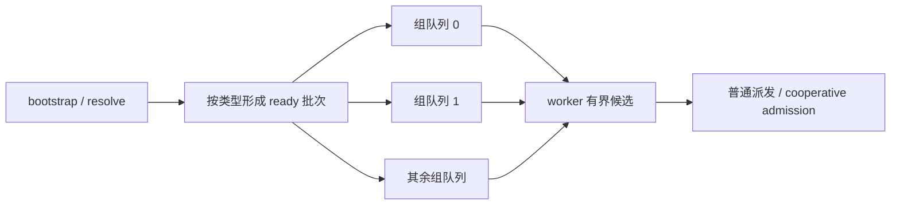

# A5 全局 ready 队列：设计调研与对比实现

本文历史测量所引用的 JSON 仅保存在本地 `outputs/a5-hbg-graph-task/evidence-summary/`，不随仓库分发；下文保留文件名用于追溯。

本页承接[实施约定](implementation.md)，首轮研究时间为 2026-11-02。
跨分片发现和队列重构均已接入并实测，历史阶段以候选名称和证据文件标识，论文结果不作为 A5 性能证据。
用户要求同时实现全局唯一队列与分级队列进行比较，并允许阶段版本保留明确记录的性能退化。
当前代码只提供 T/H8 普通领取额度实现。T/G、T/H4、L/G、C/W1/W4 未完成当前异步验证，相关代码已删除，未来须依据[当前异步协议](../a5-hbg-async-completion/choices.md#ready-queue-implementation-scope)重新实现和验收。下文其他配置、接口与测量均为历史设计记录，不代表当前源码仍提供对应实现。独立 block 重构仍为[后续候选](block-ready-scheduling.md)。

首轮只实现了 **一种底层 ticket 算法、两种拓扑、G/H4/H8 三个测试配置**，不代表算法选型完成。
2026-11-03 起继续研究与实现不同发布/领取协议，状态与实现细节见[队列算法比较](ready-queue-algorithms.md)。

## 问题与共同目标

重构前，`scheduler_ready_push_target` 把解出的 kernel 任务放进完成者 cluster 的 AIC/AIV/MIX inbox。
原实现只允许同类型 shard 内 stealing，因而执行资源的可达范围受到发布位置限制。
早期跨分片候选对 native Graph 扩大到跨 shard 发现，但仍要扫描目录、竞争集中发布的 inbox；
普通图仍保留原策略。任务可被某个核执行，不应取决于哪个 cluster 解出了它。

Qwen 已测跨分片候选为 43.676 ms，上一候选为 56.663 ms，历史主线为 29.478 ms；
这是不同设备的单批初筛。func34 每层使用核数中位数 14→32 支持资源可达性解释，
不能据此声称剩余约 14 ms 都来自队列。完整证据见[模型记录](qwen-performance.md)。

两种方案都提供 AIC/AIV/MIX 三类**全局可达的 ready 工作池**，普通任务和 Graph child 使用同一契约。
AIC 与 AIV 只能领取自己支持的类型；MIX 由合法 AIC coordinator 领取，再进入既有 admission。
这里的全局可达描述语义，不规定必须只有一个物理队头。

## 业界方案与适用边界

下面的机制来自原论文、作者说明或项目源码；“A5 判断”是结合本仓库协议作出的设计推断。
运行时源码链接内容可能更新，核对日期为上述研究日期；不依赖第三方博客的性能转述。

| 方向 | 原设计的关键机制 | A5 判断 |
| ---- | ---------------- | ------- |
| 本地队列 + 全局注入 + 批量 stealing | Crossbeam 区分单 owner 的 Worker、全局 Injector 和 Stealer，支持限制批量大小 | 可减少共享领取次数；跨类型发布不能直接写另一个 worker 的单写者 deque，必须增加正确的注入通道 |
| 本地快速接续 + 公平性约束 | Tokio 保留 next-task/LIFO slot，并限制连续使用；Go 从全局队列批量取得工作时限制数量 | 现有 direct refill 可保留，但私有任务不能无限囤积；尤其不能把一大批 child 藏在等待 admission 的核上 |
| 拓扑组内共享 + 组间代理 stealing | Qthreads 的层次调度在共享 cache 的组内共享队列，由一个线程代表组取得远端工作 | 值得比较减少同时搜索者的方式；A5 cluster 不能直接等同 CPU NUMA 域，固定代理若在执行长 kernel 会拖住整组 |
| 分 consumer 池 + producer 主动均衡 + chunk 转移 | SALSA 将任务组织成 chunk，转移 chunk 的消费所有权，并在生产端避开过载池 | 很贴近单次 resolve 大 fanout；需要独立证明 chunk 转移时旧 owner 停止消费，不能只改一个 owner 字段 |
| 分 producer 子队列 + bulk API | moodycamel 为 producer 建子队列，消费者搜索多个子队列；不承诺跨 producer 的全局线性化 FIFO | 分散生产热点，但单 producer fanout 仍可能集中；需要额外分发或批量转移，不能仅重命名现有 inbox |
| 多队列放松全局次序 | MultiQueues 以多个内部队列和批量操作换取扩展性，研究 rank error 与 delay | 可借鉴分散选择和延迟评估；本任务没有优先级要求，不引入 heap，也不能把放松 ready 次序用于放松依赖/admission |
| FAA 环形队列 | SCQ 使用 ticket、slot cycle 和额外进度机制处理并发、空队列及复用 | FAA 减少 CAS 重试不等于消除同地址串行；需计入 slot 访问、空队列成本与 A5 可用原子宽度 |
| 分离 head/tail 的链式 FIFO | Michael–Scott 队列通过链接发布、推进 head、协助落后的 tail 实现并发进度 | HBG 节点整个 run 常驻、只 ready 一次，有机会免除运行中回收；仍须证明 ready link 的生命周期 |

来源分别为 [Crossbeam 文档](https://docs.rs/crossbeam-deque/latest/crossbeam_deque/)、
[Tokio runtime 文档](https://docs.rs/tokio/latest/tokio/runtime/)、[Go `proc.go`](https://go.dev/src/runtime/proc.go)、
[Qthreads 论文](https://journals.sagepub.com/doi/10.1177/1094342011434065)、
[SALSA 原论文](https://iditkeidar.com/wp-content/uploads/files/ftp/spaa049-gidron.pdf)、
[moodycamel 作者说明](https://github.com/cameron314/concurrentqueue/blob/master/README.md)、
[MultiQueues 论文](https://drops.dagstuhl.de/entities/document/10.4230/LIPIcs.ESA.2021.81)、
[SCQ 原论文](https://rusnikola.github.io/files/ringpaper-disc.pdf)、
[Michael–Scott 原论文](https://www.cs.rochester.edu/u/scott/papers/1996_PODC_queues.pdf)。

### 不直接移植的细节

Tokio 通过限制同时搜索的 worker 减少一齐 stealing 的争用，但其实现中的全局搜索者原子计数
本身可能成为 A5 热点。这里优先研究分组、错开的扫描起点和有界搜索，不直接照搬计数器。
CPU 运行时的 sleep/OS wakeup 也不进入 AICore dispatch 路径。
参见 [Tokio 调度器设计](https://tokio.rs/blog/2019-10-scheduler)。

SALSA 的实验明确区分生产端均衡与 chunk stealing，说明只调整消费者行为不一定足够。
我们据此把发布策略列为独立变量；不照搬其 CPU 扩展比、无 barrier 快路或 hazard-pointer 回收。
HBG 的节点可以保留到 run fence，但 AICore 的缓存与原子发布规则仍须逐字段证明。
参见 [SALSA §4、§6.4](https://iditkeidar.com/wp-content/uploads/files/ftp/spaa049-gidron.pdf)。

SALSA 的具体转移协议还处理三个陷阱：旧 owner 的边界项与 stealer 用 CAS 仲裁，
owner 携带递增 tag 防止 ABA，先让 chunk 在接收方可发现再转移所有权以防暂时消失。
其 §6.1 实现通过线程迁移抢占旧 consumer 来提供内存屏障；AICore 没有对应的 OS 抢占路径，
所以论文的无 fence 消费快路不能直接成为本项目的正确性依据。若实现 H2，必须另外证明
index 发布与 owner 读取的设备顺序，或接受显式 barrier/原子仲裁的成本。
参见 [SALSA §4.3、§6.1](https://iditkeidar.com/wp-content/uploads/files/ftp/spaa049-gidron.pdf)。

Vyukov 的 bounded MPMC ring 将生产/消费位置和 slot sequence 分开，结构简洁，
但作者明确说明它不满足严格 lock-free 定义。预留 slot 后未发布形成的空洞必须处理，
不能把“使用原子且没有 mutex”当作进度证明。
参见 [作者实现说明](https://sites.google.com/site/1024cores/home/lock-free-algorithms/queues/bounded-mpmc-queue)。

2026 年的 GPU queue 研究用 wave 内合并 ticket reservation 降低共享计数器原子次数。
可借鉴批量摊销，但其中 ballot/shuffle 和同 wave leader 不对应独立运行的 AIC/AIV scheduler，
因此不照搬为跨核同步代理。该来源是研究论文，不是 A5 上已验证的成熟实现。
参见 [Scalable Concurrent Queues for GPU §G-LFQ](https://arxiv.org/html/2606.01693v1)。

## 必须保持的协议

1. fanin 满足后，节点只属于一个位置：待发布 batch、共享池、唯一私有 claim 或已执行/完成状态。
   发布重试不能重复挂链，领取重试不能重复执行；队列空与暂时没取得任务不是 run 完成证明。
2. 普通 ready 次序不要求跨所有 producer 的总 FIFO；依赖图才决定可执行性。
   同一物理队列的发布顺序、MIX 的 direct 路径与既有 admission 次序要分别说明，不能偷换。
3. 领取 MIX/SPMD 逻辑任务不授予 kernel permit。固定成员、commit log、frontier、block claim、
   sync_start 和最后真实完成仍由原协议处理。
4. private 领取额度由实际可持有的 candidate/slot 限制。初版上限沿用两个 candidate；
   不能默认偷一半任务后让其它核无法访问剩余工作。
5. 每次搜索/竞争有预算并返回主循环服务完成、控制节点和错误；不等待特定 peer，不加 sleep。
   短时原子竞争耗尽预算应返回 RETRY，保留唯一所有权，不能按损坏图处理或丢 batch。
6. 同地址新 run 重新初始化，旧 run 的安全退出证明前不得覆盖 queue、节点或待发布存储。

A5 特有约束见 [scheduler_memory.h](../../../../src/a5/runtime/host_build_graph/runtime/scheduler/scheduler_memory.h)
及[缓存一致性](../../../hardware/cache-coherency.md)：`ld_dev` 只作原子状态的提示，
所有权通过原子确认；必要 payload/cache barrier 保留。
共享原子行不能混入 cached store/writeback。`st_dev` 信号只有满足单写者和整行隔离时才可使用。
不把 C++ acquire/release 参数当作 CCEC 自动提供了同样的设备内存顺序。

## 普通任务的私有领取额度

`queue-ordinary-credit-v1` 保持 T/H8，限制 ordered discovery 的继续领取：本核已持有普通任务时，
空 candidate 不再从共享队列 pop；已有 cooperative candidate 仍按原流程发布，新领取普通任务后，
本次 fill 的其余空 candidate 同样停止领取。每次 fill 重新判断，不新增共享计数器或缓存执行许可。

该限制只作用于队列预取，direct successor retention 仍可填满两个 candidate，
因此不能把它理解为“每核最多拥有一个普通任务”。协作成员、commit log、kernel entry gate、
permit tail、谓词结果保存和真实 completion 消费均保持原协议。
已提交的 obligation 继续排空，已持有的普通任务按原 gate 执行后释放领取额度；
不能用跳过整个 discovery 循环来实现，否则会连已有 cooperative candidate 一起推迟。

动机来自已有 L4：`out_proj` 的 1,040 个普通任务中，279 个在领取时，本核另有普通任务尚未进入 kernel。
这是同一 worker 的 claim-to-entry 区间交叠，不是空闲核数量或可节省的墙钟时间。
额外元数据读取、减少预取对流水的影响，以及协作任务发现延迟，都必须由完整 Qwen 计时验证。
完整 Qwen 实测为 38.454 ms，低于历史 T/H8 的 40.948 ms；两次设备不同，仍未达到主线性能。
实现保留，完整数值、定向功能与协议验证边界见领取额度证据（本地 `qwen-ordinary-credit.json`）。
设备 7 的单轮 L4 中，`out_proj` 每层核数中位数由历史设备 1 的 19 增至 26，
首尾启动间隔由 167.907 µs 降至 20.025 µs；整组跨度由 181.033 µs 降至 32.931 µs。
剩余关键路径上 func31 的等待以领取前为主；关键路径成员也发生变化，不能把分函数累计差值当作净加速。
L4 包含插桩开销，以上诊断不替代 38.454 ms 的无插桩稳态测量。

## 对比候选与实施顺序

首轮交付为 G 与 H1；H2 保留为独立、有明确竞争指标触发的候选，不预设 H1 一定最快。
共同抽象是“发布 ready batch、有限领取、可继续的搜索/发布”，不把队列布局暴露给 kernel。
复用同一底层队列协议作第一轮拓扑对比，避免同时换算法和队列数量而无法归因。
完成共同原语的 CPU 并发验证后再接 bootstrap、completion、control resolve 和 dispatch。

### G：每类型一个全局 FIFO

所有 producer 按 AIC/AIV/MIX 类型发布；所有合法消费者直接访问对应队列。
取消 owner/shard directory 的发现依赖，保留可直接执行的有限 direct refill。
一次 resolve 形成批量后发布，consumer 只领取当前有 credit 的任务；初版 MIX 逐逻辑任务进入 admission。

现有 `SchedulerReadyInbox.endpoints` 把 head/tail 打包在同一 64-bit 字中，生产者与消费者共享原子热点。
不能仅把所有 inbox 地址改成同一个，就把结果当作全局队列设计的上限。
共同原语先比较两个适配方向：分离 head/tail 的常驻节点 FIFO，以及利用 HBG 有限任务集的
append-only ticket 数组。两者都分离控制字，空转只读提示；仍需实测消费者对 head 的集中竞争。

拟定的链路约束如下，属于本项目的适配方案，不声称是原论文已证明的批量扩展：

- 每队列有初始 sentinel；head 指向 sentinel 或最近出队的节点，tail 允许暂时落后并可被协助推进。
- batch 链接和内容完整发布后，CAS 旧 tail 的空 next 到 batch head；成功即转移整个 batch 所有权。
- 出队 CAS 推进 head；失败不持有任何节点。一次领取多个节点时，必须用同一成功 CAS 确认整个前缀。
- 节点/链路在 run 中不回收、不重新入队，移交执行后的节点仍可能充当 sentinel。
  必须审计 `next_waiter` 的全部写者：若无法保证出队后的 link 不再被修改，就分配独立 queue link，不能强行复用。
- 生产端只在尚未发布时返回 RETRY；成功挂链后即使 tail 更新失败，也不能再发布一次。

ticket 数组的适配依据是每个逻辑 kernel 最多发布一次，所有槽位保留到 run fence。
Host 按类型统计容量，生产者一次 FAA 预留一个 batch 的连续槽位，再发布每个 ref；
消费者只对已经发布的槽位 CAS 推进 head，不提前占走空位置。head/tail 分行，槽位没有回绕或运行中回收。
immutable ref 可以兼作发布值，但其 bypass store、barrier 与读取方式必须符合 A5 的整行隔离规则。
该方案是从本项目生命周期推导出的候选，不是对 SCQ 的等价实现，也不自动继承其 lock-free 证明。

这里有明确取舍：先预留的 producer 暂停，会挡住同队列后续已发布元素。
poll 必须返回 `NOT_READY` 并继续服务其它调度职责，不能将其当作严格的队列为空或成功结束；
发布过程中不得等待 peer 或执行 kernel。单 run 容量按真实 metadata 计数，不能未经证明就分配三个 N。
分级版本可按稳定的 ref 混合映射统计每组容量，避免 O(N×组数) 预留；
这种静态分散与动态负载路由是两个方案，须分别评估不均衡和空间代价。
CPU 先注入预留后暂停、乱序发布、并发最后槽位和越界，之后再决定是否进入 G/H1 的共用实现。

### H1：有界本地候选 + 类型分组队列 + 全局补充

按同类型 worker 建若干组，每组共享 ready 队列，组间都可领取。组大小是待测参数，
不是沿用旧 7-owner shard 的架构约束；优先比较 4/8 个同类型 worker，实际尾组按活跃核数裁剪。
MIX 分组以 coordinator 为单位，不拆分一个 MIX 的固定成员。

发布策略同时处理单任务链与宽 fanout：可立即执行的一个 successor 允许 direct refill；
首轮 ticket 版本把 ref 每四个划为一段，对段号作整数混合，再映射到同类型组；
Host 与设备使用同一个映射，按实际可执行 metadata 逐组计数。总 entry 数不超过逻辑节点数，
没有全局轮转原子计数器，也没有为每组预留 N 个槽位。
这是一种静态生产端分散：相邻 ref 容易批量发布，稀疏依赖可能打散批次；
不声称 hash 保证负载均衡，需实测单 producer fanout 和 stride 图。
动态“两组选较空队列”需要额外溢出池或 chunk 容量协议，不与首轮的静态精确容量混用。

消费者优先自己的组，有剩余 credit 再补充。远程扫描使用每核游标，轮转覆盖所有组；
局部组持续非空时，也必须周期性给远端工作机会，不能只证明局部为空时才全局可达。
一次失败不允许永久缓存 empty，也不以随机采样没找到任务宣布全局为空。
初版直接读取各组状态，不维护所有核频繁 set/clear 的全局非空位图。

每组 publication 和 claim 的 FIFO/线性化契约与 G 相同；整体允许 ready 任务跨组重新排序。
不把 queue group 当作 A5 已证实的物理 NUMA/cache 域；分组首先用于分散原子地址和控制搜索范围。

### H2：按块转移所有权的 producer/consumer 池

若 H1 仍出现大量 per-task CAS，继续比较受 SALSA、producer 子队列与批量 stealing 启发的 chunk 方案。
producer 发布小段 ready ref；空闲消费者领取段的有限前缀，或接管未消费的后缀。
初步比较 2/4/8 个任务粒度，不能为了降低 CAS 把整组 85 个 child 私有化。

CPU 原型必须先覆盖旧 owner 正在读、stealer 接管、producer 仍在追加、chunk 到尾、abort 的交错。
明确谁能写当前消费位置，以及转移以后旧 owner 如何撤销/重试。
优先采用 seal 后不可变的块降低状态空间；不能因论文存在就假定新增块协议正确。
若实现需要每 producer×consumer 一套 mailbox，必须报告 O(P×C) 空间、空扫和初始化成本，
不得只报告没有全局队头的好处。是否进入硬件对比由其正确性与热点诊断决定。

## 发布预算与失败处理

当前 push 在 64 次 CAS 失败后返回 false，调用者可能据此终止 run；扩大竞争范围后必须重审。
共用接口区分 `PUBLISHED`、`RETRY`、`INVALID`，不会把正常竞争当成非法图。
RETRY 时未发布链由本核 continuation 持有；下一有限调度回合继续发布。
若继续接收新 batch，只能拼接本核仍独占的链；已经转移给共享池的节点绝不修改。
每次返回执行 kernel 前先处理待发布工作，不能把大 fanout 长时间留在一个运行慢 kernel 的核上。
bootstrap 的发布也受同一规则约束，scan gate 不得掩盖尚未持久保存的 ready 工作。

可见性、线性化与进度分别复审：没有丢任务不等于延迟有界；CAS 成功不等于其余 payload 已经发布。
发生 fatal 后保留原错误身份和 fence 规则，不通过继续推进成功计数掩盖错误。

## 验证与选型

| 层次 | 覆盖 | 评价 |
| ---- | ---- | ---- |
| CPU 并发 | 空/单元素、并发批量发布与领取、延迟 tail、发布重试、最后元素竞争、尾组、跨类型与跨组、同址新 run | 无丢失、无重复、无越界；精确验证 RETRY 的所有权 |
| A5 协议 | bootstrap/control/kernel 三种发布者，ordinary/MIX/SPMD/sync_start/predicate、abort/fence | 原始 golden 和独立协议审计；无隐式 legacy fallback |
| 队列微基准 | 1→多、多→1、多→多、空队列、1/2/4/8 等发布粒度、不同活跃核数 | 吞吐、延迟、成功/失败原子次数、热点分布；不替代模型数据 |
| 调度初筛 | Qwen 完整模型、宽 fanout、多 root、短链、MIX 交错与长链 | Device/Host/bind 与 p95；原始数值校验不放宽 |
| 最终候选 | 全部原功能/新增用例、故障矩阵、固定 19 项、CSA、现有 A5 Qwen | 同一冻结版本完成验收，历史子集不拼成最终通过 |

首轮在同一持锁设备依次运行 G/H1，输入、kernel callable、工具链、计时轮数相同；
若 H2 满足进入条件再增加该臂。初筛不反复交叉、不重新采主线。
只有候选接近、波动影响选型时，再对相关项进行有针对性的确认。
独立 profiling 记录每核/每组的 claim、CAS retry、扫描空队列次数、batch 大小和就绪到执行间隙；
计数在本核积累并在结束时汇总，禁止为测争用再加共享逐任务原子计数器。
最终延迟关闭诊断，正式测量期间不并行编译或跑仿真。

实现使用内部策略类型/源码常量与独立冻结产物比较，不新增用户环境变量、pytest 开关或行为宏。
两版先共享队列原语和调度语义；如果某版需要不同底层算法，额外保存消融对照，明确收益来自哪层。
选择依据是完整模型与代表调度负载的端到端表现、正确性和实现成本，不能只凭队列微基准吞吐选型。

## 共用原语与首轮实现

`scheduler_ticket_queue.h` 提供 append-only 原语：256-byte 控制块分开 head/tail，
一次 FAA 为 batch 预留范围，immutable entry 通过独立 bypass 区发布，领取用一次 CAS 确认最多两个候选。
零 credit 或未发布槽位不会预留未来工作；`NOT_READY` 不宣称严格空队列。
容量错误是 terminal，失败范围不会访问数组，调用者不得在溢出后重试预留；
每个成功 reservation 只能发布一次，真实调度接入还须证明这两项调用契约。

11 项 CPU 测试覆盖批次顺序、早期预留暂停/后批先发布、部分连续前缀、candidate credit、
并发批量生产与唯一消费、payload 发布顺序、最后任务竞争、越界和同址新 run。
AIC/AIV 编译探针实例化单项与批量接口，CCEC 编译通过；CPU hooks 通过。
原始证据保存在 `outputs/a5-hbg-graph-task/queue-refactor/`。
共用原语及接入版本包含 `SchedulerReadyPoolHeader`、
逐组 descriptor 和 Host 规划器；`SchedulerGraphSummary.ready_pool_offset` 明确定义新字段，
summary 仍为 128 bytes。每个队列的 head/tail 各占 128-byte 行，entries 独立按 128-byte 对齐。
Host 按实际 metadata 分配；同址新 run 清空全部 backing，并将每个 entry 置为 -1。

bootstrap、kernel completion 和 control resolve 的 kernel batch 共用新发布入口；
control node 仍使用独立控制 inbox。领取先检查类型，MIX placement 在需要时先于 claim；
暂时无法安置的 MIX 留在共享池。分级消费者每第四次搜索优先轮转远端组，
其余搜索优先本组、再遍历远端组；CAS 每队列最多重试两次，无 peer 等待。
远端优先轮必须跳过本组，查完其它组才回本组；本组成功不得重置远端游标。
否则即使每第四次都搜索远端，持续非空的近端组仍可能让较远组饥饿。
这轮接入先逐项领取，尚未把原语的两个候选批量领取用于 dispatch，不能声称已获得批量消费收益。
原 linked batch 的构建仍保留，后续需要单独评估其 `next_waiter` 原子开销。

首轮 8 项 CPU 接入测试通过，覆盖 G/H4/H8 容量、尾组、跨原 shard 可达性、类型隔离、
本地持续非空时远端进展、MIX 安置和并发唯一领取、损坏布局拒绝。
完整 95 个 C++ 测试目标通过；G/H4/H8 各自的 A5/A5sim 构建和 65 项仿真通过。
每版 6 个 Graph 真机目标通过，独立审计各覆盖 15 份新 capture、2,881 次执行。
首轮三版使用相同 AICore/AICPU 二进制，只改变 Host 输出的布局；当前源码的内部组宽为 8。

设备 1 同一持锁任务 `task_20261102_180152_30361246408` 的完整 A5 Qwen 首轮结果如下。
每版先执行三轮并核验完整 out/K/V，再独立运行 5 轮预热和 100 稳态轮；108 次均为 fresh native mode=1。

| 候选 | AIC/AIV/MIX 队列数 | Device 中位数（ms） | p95（ms） |
| ---- | ------------------ | ------------------- | --------- |
| G | 1/1/1 | 49.520 | 49.788 |
| H4 | 8/16/8 | 40.917 | 41.143 |
| H8 | 4/8/4 | 40.747 | 41.023 |

H4/H8 比 G 快约 17%–18%，支持继续采用分组方向；两种组宽只差约 0.4%，不宣称稳定排名。
先以队列更少的 H8 继续；相对设备 3 的历史主线 29.478 ms 仍慢约 38.2%，没有重采主线。
原始统计、逐轮数据、source/binary manifests、golden 与协议证据索引见
候选对比记录（本地 `ready-pool-candidates.json`）。

复审仍保留三项边界：reservation 后暂停会挡住同物理队列后续工作，不能声称严格 lock-free；
普通 kernel ready 的旧 inbox helper/分配暂留用于既有测试与控制队列，生产 Host 均构造新池；
batch2 消费、linked batch 开销、无 Graph 全量性能与最终故障矩阵仍待完成。
这份首轮数据不是最终性能验收，也不能用三版之间的收益抹去与主线的差距。

提交前复审发现首轮游标会被本组成功领取重置，使多个远端组持续非空时的轮转失效。
新增回归用例在旧实现上失败；修复为仅远端探测推进游标、远端优先轮最后访问本组后，
9 项池测试通过，包括 H4/H8、游标初始指向本组/远端、连续两轮全组非空。
上表保留首轮冻结版本的实测身份，不混用修复版本的证据。
修复后公共实现 95 个 C++ 目标通过，G/H8 各 65 项仿真、6 个 Graph 真机目标及 15 份协议审计通过；
H8 常规真机回归为资源阶段 74 passed/6 skipped、L2 场景 40 passed/2 skipped。
两版在设备 0 使用同一修正后的 AICore 二进制测得 Qwen 中位数 G 49.496 ms、H8 40.642 ms，
完整 out/K/V 通过；本轮 H8 比 G 低约 17.9%，距历史主线仍有约 37.9% 的差距。
详见[修正版模型结果](qwen-performance.md)；首轮五项无 Graph 的退化记录继续保留。
