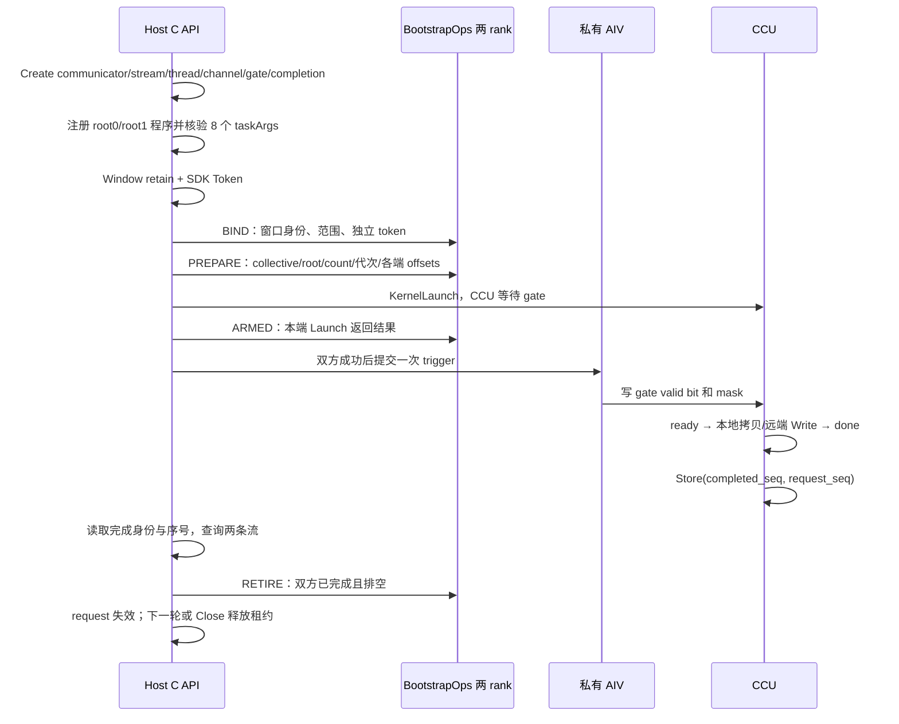

# PR-1 CCU 执行层：实现与编译验证

> 范围修订：本页描述旧 Host 兼容路径的实现与验证，不能作为开发计划 v6 的完整 PR-1 验收。新版公共会话、设备协议与服务循环的逐项状态见[接口对齐说明](ccu-pr1-interface-conformance.md)。

本实现面向两 rank、UBC_CTP、连续 float32 Broadcast，count 为 1–1024，每个 context 只容纳一个未退休请求。当前验证环境是 Linux x86_64 / CANN **9.2.0-beta.2**；没有 A5 设备，也没有完成 CANN 9.3 或设备运行验收。

## 实现入口

| 职责 | 文件与入口 |
| ---- | ---------- |
| 兼容 Host C ABI | `src/a5/platform/include/host/ccu_execution.h`，13 个 `ccu_*` 接口 |
| 双 rank 协议、请求和关闭 | `src/a5/platform/onboard/host/ccu/ccu_execution_api.cpp` |
| Host owner 租约和 registry | `ccu_execution_registry.cpp`；`CcuOwnerLeaseV1` |
| HCCL/HCOMM 资源适配 | `ccu_device.cpp`；`A5Device::Open/Token/Launch/Observe/Close` |
| CCU 指令程序 | `ccu_device.cpp`；`BroadcastProgram` |
| 独立 AIV 触发器 | `src/a5/platform/onboard/aicore/ccu_trigger.cpp` |
| 编译与安装 | `ccu/CMakeLists.txt`、`ccu/ccu_trigger.cmake` |
| 正式 runtime 接入 | A5 onboard Host `CMakeLists.txt`、`simpler_setup/runtime_compiler.py` |
| 无硬件故障注入测试 | `tests/ut/cpp/a5/platform/test_ccu_execution_api.cpp` |



## 资源与调用契约

调用方先初始化 AscendCL，再调用 `ccu_get_root_info` 获取并通过可信控制面分发 HCCL root-info；同时在两个 rank 调用 Create。库不负责启动进程或自建网络控制面。

Create 查询 communicator 所有的 CCU instance，通过 channel probe 确认唯一 IO die，再分配同 die gate。completion 使用独立、128B 对齐的 256B HBM allocation，模块 ID 为 3；初始化时写入固定身份和零序号，随后只有 CCU 写入成功序号。两个 root 程序一次注册，复用 channel、gate 和固定 completion 地址。

Window 的 `allocation_owner_ops` 必须 retain **实际 allocation 的所有权**，release 失败必须保留该引用；返回失败的 retain 不得遗留已获取的引用。调用方不得在租约仍持有时自行 free、解除 registration 或复用 allocation generation。库复制回调表，保留 bootstrap owner 和 allocation owner；回调代码所在模块也必须由 owner 保持加载。`Token` 校验设备归属并查询 SDK token，不根据地址伪造 token。input/output 可以来自不同 allocation。

调用顺序为 `create → window_register × 2 → bind → prepare → arm → trigger_host → wait → retire`。下一轮从 Prepare 开始。Bind 在 V1 中仅允许一次；替换窗口使用新 context。root 可逐轮切换。taskArgs 固定为：

```text
input, output, input_token, output_token,
peer_output, peer_output_token, bytes, request_seq
```

peer_output 包含对端窗口偏移和**对端本轮 output_offset**。两端的本地 sequence 可以不同；相同 collective ID 标识同一通信轮次。调用方不得在同一 group/context 中重用 collective ID。新进程组使用新的 group identity 和 root-info。

所有 C ABI 捕获异常。同一 context 的操作通过 busy claim 串行化，SDK 调用与 bootstrap 回调不持有 context mutex；重入返回 Busy。请求未提交时可以通过双方 Cancel 退出；Launch 或 Trigger 结果不确定时禁止重试和自动释放。超时保留所有权，后续 Wait/Poll 只有看到匹配完成记录及两流排空才恢复。错误身份、超前序号及 SDK 查询故障使请求 poisoned。

Close 设置 Closing，禁止新 Prepare；对未提交请求尝试双方取消，对已经触发的请求在共同 deadline 内尝试完成和退休。停在 gate 或提交不确定时保留，绝不自动触发或 reset device。SDK 清理和 owner release 失败保留 context 供重试。Create 回滚失败时返回 `RETAINED` 和非零 context handle，调用方必须保留 owner 并重试 Close。未退休 registry 在进程静态析构阶段不执行设备释放或外部回调。

Bind、Prepare、Arm、Cancel 的控制面默认预算为 5000ms；Wait/Retire/Close 使用调用方 timeout。Retire 和 Close 的各阶段共用剩余预算。SDK 同步初始化、复制和释放本身没有可中断调用保证，timeout 不被表述为能中止 SDK 内部执行。

## 控制面 wire 格式

每个 phase 交换 32 个 uint64_t。0–7 为 ABI、wire 大小、group、collective、phase、rank、context ID、context generation。结果必须有且仅有 rank0/rank1，且本端 echo 完全一致。Bind 后固定两端 context 身份。

- BIND：8 为 binding generation；9–16 为 input，17–24 为 output。每个窗口包含 allocation ID/generation、base、allocation size、window offset/size、device、token。
- PREPARE：8–12 为 op、dtype、root、count、binding generation；13 为本地 seq；14–19 为 input/output generation、offset、allocation ID。库检查两端已绑定的 lease 和范围；不比较含 padding 的 C++ struct。
- ARM：8 为本地 Launch 是否成功，9 为 binding generation。只要一端失败或通信中断，就不会发布有效 trigger。
- CANCEL：双方都在未提交状态时确认同一 collective 的取消。
- RETIRE：8 为 binding generation；只有本端 sequence 匹配、trigger/CCU 流都排空后才发送。

## Store 与验证边界

程序显式调用并检查 `AscendC::ccu::Store(fixed_completed_seq_address, sequence)`，不是 Host memcpy 成功标志。安装 SDK 存在 `CcuStoreVar`、`HcommCcuKernelLaunch` 和相关 DSL 接口，正式库链接真实 `libhcomm`。

公开 HCOMM 的 [Store translator](https://github.com/hicann/hcomm/blob/10ea0c689f0598712dabda38ae96deb2dfb96363/src/base_comm/resources/ccu/ccu_representation/reps/translator/ccu_ins_generator_v1.cc#L1056) 使用给定地址、内部 `memTokenInfo` 和 XN 资源 token 构造搬运，并追加等待。这里直接传入 SDK 分配得到的完成地址，不自行拼接物理地址或 token 位域。**token 查询成功和编译成功不证明硬件上内部 token 与 allocation 的访问契约、8B 写回或跨引擎可见性已经验证**；这些是 A5 后续验收项，不能以测试后端的完成观测代替。

## 可复现构建

在安装了相应 SDK 的 Linux 中执行（工作目录为仓库根）：

```bash
source <CANN_INSTALL>/cann/set_env.sh
cmake -S src/a5/platform/onboard/host/ccu -B build/ccu \
  -DSIMPLER_CCU_BUILD_TESTS=ON
cmake --build build/ccu --parallel 4
ctest --test-dir build/ccu --output-on-failure
cmake --install build/ccu --prefix <OUTPUT_DIRECTORY>
```

需要 C++17、CMake、OpenSSL 开发包、GoogleTest、SDK 的 ccec/ld.lld。生成 `libsimpler_ccu.so` 和 `ccu_trigger.o`；两者同目录安装，旧 C ABI 也可通过 `trigger_binary_path` 显式指定触发器。正式 A5 Host runtime 同样编译这套源文件和触发器，Python 编译流程把必需的 `ccu_trigger.o` 放在 Host `.so` 同目录，缺失时明确报错。新版公共会话同时在该独立目标中构建，协议与所有权见[接口对齐说明](ccu-pr1-interface-conformance.md)。

编译验证包含严格 `--no-undefined` 链接、真实 A5 `dav-c310-vec` ELF 生成，以及 ABI/validation/state/API 四组无硬件测试。API 测试使用两个独立 rank 的有界 rendezvous，并注入 SDK 结果；不执行真实 CCU 指令。

完整 A5 Host runtime 在 CANN 9.2.0-beta.2 下另有既有 URMA 头文件兼容问题：仓库 PTO-ISA pin `5487a6b0e8d9bd3653dbee8d7c874c667ee8db2f` 的 `urma_workspace_channels.hpp:593` 使用 `HCCL_CHANNEL_CONFIG_SHARED_QUEUE_TAG_MAX_LEN`，该 SDK 未提供此常量。独立 CCU 构建成功不等于整个运行时或 9.3 工具链已验收；实现没有向 SDK 注入猜测的常量来掩盖这一差异。
