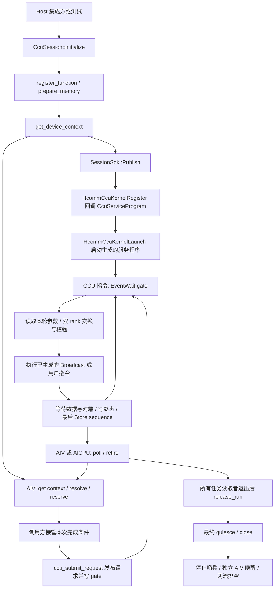
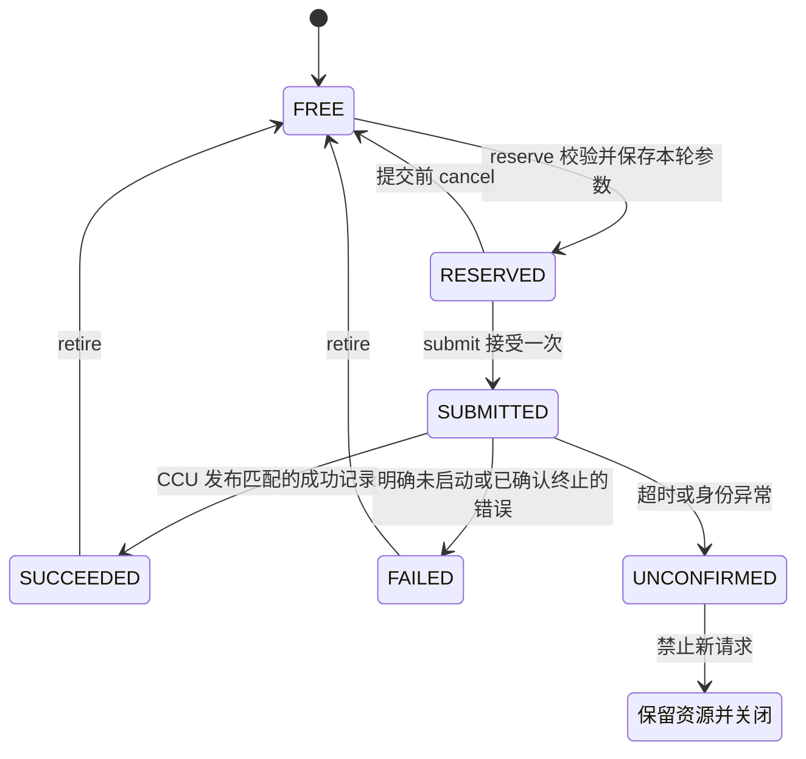

# PR-1 调用流程与主要函数注释

分析版本：PR-1 CCU 会话与常驻服务实现。以下函数链接固定到实现快照 `568e25352860d786e6a9fb65e494208f795fc3ae`，便于按代码行阅读；本次提交已迁移到 upstream `main`，CCU 调用链与该快照一致。

本文说明源码构建出的调用链，未将它表述为 A5 实机执行轨迹。新版组件目前主要由单元测试和编译探针直接使用；Worker/callable 的自动会话管理以及 CcuCall/TMR 接入分别属于 PR-3、PR-2。

## 1. 调用全景与运行位置

主链为：Host 准备资源和程序定义 → 发布上下文并启动 CCU 服务 → AIV 逐轮提交 → CCU 执行本轮指令并写完成记录 → AIV/AICPU 查询与退休 → Host 最终排空和关闭。



`CcuServiceProgram()`、`BuiltinBroadcast()` 和用户构建入口都是 **Host 注册期执行的 C++ 函数**。它们调用 DSL 记录指令；CCU 后续反复运行这些指令。源代码中的 `CcuWhileBegin` 描述设备循环，C++ 的 `for (functions)` 则在注册期为所有函数记录分发分支。

代码中还保留旧 Host C ABI：`ccu_context_create → ccu_window_register → ccu_bind_windows → ccu_prepare → ccu_arm → ccu_trigger_host → ccu_poll/ccu_wait → ccu_retire → ccu_context_close`。它位于 `ccu_execution_api.cpp / ccu_device.cpp`，采用逐轮 Host 准备。本文主线是新版 `CcuSession / ccu_session_sdk.cpp / ccu_service_program.cpp`，两条路径分别维护自己的状态和参数 ABI。

## 2. Host 准备：主要函数、调用者与产物

| 函数与位置 | 谁调用 | 函数注释 |
| ---------- | ------ | -------- |
| [CcuSession 构造函数][s316] | Host 集成方、测试 | 保存 `CcuSessionConfig` 并建立 Impl；不创建 communicator、stream 或设备内存。调用方须先持有会话和父环境 owner，再 initialize。 |
| [initialize()][s321] | Host 集成方、测试 | 校验 allocation_id/epoch/device/rank/timeout/parent/exchange；经工厂创建 `SessionSdk`，调用 `Initialize(config)`。失败后保留中间资源，初始化不得直接重复尝试。 |
| [ccu_make_session_backend()][k404] | `initialize()` | 正式构建创建 `SessionSdk`；测试可链接可控假后端工厂。返回的是适配器，不是设备程序句柄。 |
| [SessionSdk::Initialize()][k39] | `initialize()` | 建立 CCU 专用 communicator、执行流/停止触发流、thread、channel、instance 和同 die gate；加载独立 `ccu_trigger.o`。此时还未注册、启动常驻服务。 |
| [ccu_builtin_broadcast(root)][s174] | Host 集成方、测试 | 生成 root0 或 root1 的函数定义：`src`、`dst`、`count` 和允许的 src/dst 完全别名，并计算 program_key。它不执行 Broadcast。 |
| [ccu_compute_program_key()][s163]、[ComputeKey()][s79] | 构建工具、`register_function()` | 根据库内容、入口、签名、aliases、构建 ABI/指纹计算完整 SHA-256。名称和文件所在路径不作为定义身份。 |
| [register_function(id, spec, out)][s336] | Host 集成方、测试 | 校验 key；登记事务 ID；复用相同定义；新定义经 `MakeFunction` 整理。用户库执行 dlopen/dlsym、构建 ABI 校验，并保存入口指针。这里只登记 Host 元数据；HCOMM 注册在 Publish 中发生。 |
| [MakeFunction(spec)][s114] | `register_function()` | 检查参数名称、类型和 aliases；生成唯一的底层参数布局、word_offset 和参数区大小，供设备写入和 DSL 读取共同使用。 |
| [prepare_memory(id, addr, size)][s419] | Host 集成方、测试 | 登记整块 allocation/内存池的可访问范围；同 ID/范围幂等，变更范围或与另一 ID 重叠报错；获得真实 token 后标记上下文 dirty。 |
| [SessionSdk::PrepareMemory()][k100] | `prepare_memory()`、`Publish()` | `aclrtPointerGetAttributes` 检查设备内存归属，`HcommCcuGetMemToken` 查询这段地址的访问凭据；不自行分配普通 Tensor 内存，不伪造 token。 |
| [get_device_context(out)][s456] | Host 集成方、测试 | dirty 时调用 `Impl::Image → SessionSdk::Publish`，成功后提交注册元数据并缓存 view；未 dirty 则返回已有 view。首次调用具有分配、注册和启动副作用，虽声明为 const，也不是纯查询。 |
| [Impl::Image(active)][s259] | `get_device_context()` | 收集有效函数，按完整 key 排序；生成绑定表、签名表、访问范围表、请求记录与参数区。内部定位用 offset，容量按实际注册签名分配。 |
| [retain_run()][s477] / [release_run()][s487] | Host 集成方、测试 | 前者保护设备上下文及资源在整个 run 中稳定，首版只接纳一个活动 run；后者在所有任务及完成读取者退出后解除引用。它们不替调用方持有普通 allocation 的实际 owner。 |
| [native_error()][s541] | Host 错误处理方 | 查询最近 Host SDK 异常对应的原生错误码，与每轮设备请求的 PollResult 分开。 |

`register_function()` 返回的 out 是未发布的 Host 事务引用，`context_addr=0`；设备可用的引用由发布后的 `ccu_resolve_program()` 返回。program_key 标识定义，program_index 是当前上下文的内部排序/分发索引，sequence 标识本轮调用，registration_id 标识 Host 注册事务，这些值不能相互替代。

`SessionSdk::Initialize()` 内部的具体调用顺序为：

```text
aclrtSetDevice                         // 选择本会话设备
HcclCommInitRootInfo                   // 创建两 rank 子 communicator
aclrtCreateStream × 2                  // CCU 服务流、Host 停止触发流
HcclThreadAcquireWithStream            // 绑定 COMM_ENGINE_CCU 与执行流
HcclRankGraphGetLinks                  // 查询到 peer 的可用链路
HcclChannelDescInit / HcclChannelAcquire// 选择 UBC_CTP，申请 channel
HcclCommQueryCcuIns                    // 借用 communicator 所有的 CCU instance
HcommCcuKernelQueryResReq(Probe)       // 探测该 channel 所属唯一 IO die
HcommCcuEventAlloc / EventGetAddr      // 同 die gate 与其 AIV 可写地址
aclrtBinaryLoadFromFile / GetFunction // 加载停止用的独立 AIV 入口
```

[Probe()][k34] 仅用于 SDK 的资源查询录制，帮助定位 IO die；它不在 Host 上实际等待通信完成。真正每轮等待 gate 的指令在 `CcuServiceProgram()` 中。

### Publish 怎样把这些资源变成设备可用的服务

[SessionSdk::Publish()][k136] 的输入是有效函数集合和 Host 生成的 image，输出是可发布到 CCU workspace 的 `CcuDeviceContextView`：

1. `Idle()` 要求旧槽 FREE，`Stop()` 排空旧服务；已有上下文时保留 `next_sequence`。
2. `Allocate()` 记录并分配 image、接收 peer 参数的 mailbox、状态交换用 scratch；填 gate 地址、上传 image，并分别查询 token。
3. `Exchange()` 调用配置中的 bootstrap 回调：phase0 交换固定 manifest header，phase1 比较完整 key 表，phase2 交换 mailbox 地址/token。结果按 rank 排列，并核验本端 echo。
4. 函数集合变化时执行 `HcommCcuKernelRegisterStart → Register(CcuServiceProgram) → RegisterEnd`；函数集合相同则复用已有程序。`GetTaskArgsNum` 必须返回 9。
5. `HcommCcuKernelLaunch(thread, program, taskArgs, 9)` 提交常驻服务任务；phase3 确认两端 Launch 都返回成功，然后释放旧内部 allocation 并输出 view。Launch 返回成功不等于本轮通信完成。

| 内部辅助函数 | 主要调用者 | 函数注释 |
| ------------ | ---------- | -------- |
| [Impl::Protect][s231] / [Claim][s214] | CcuSession 公共方法 | 用 busy claim 串行化会话操作并转换异常/状态；SDK 和 bootstrap 调用期间不持有 mutex，重入返回 BUSY。 |
| [Impl::Editable()][s249] | register、prepare、release、dirty context 发布 | 限制为已初始化、未关闭、未封禁、无 run 引用且槽空闲的会话；无法确认 idleness 时保留并封禁。 |
| [SessionSdk::Idle()][k119] | Editable、Publish、ReleaseMemory | 经 ReadRecord 读取当前槽，只有 FREE 才允许元数据更新；它不表示常驻 CCU 流已经退出。 |
| [Allocate()][k349] | Publish | 在所有者容器中先留记录，再申请 module ID=3 的 HBM；后续步骤失败时 allocation 仍可追踪。 |
| [ReadRecord()][k358] | Idle、Stop | 通过 device-to-host memcpy 读取本会话记录，用于判断槽及终态；不制造成功标志。 |
| [Exchange()][k370] | Publish 的四个控制面 phase | 调用外部 bootstrap 回调，接收 rank0/rank1 两份结果并检查本端 echo；不负责创建网络控制面。 |

公开 HCOMM 源码中的后续链为 `HcommCcuKernelLaunch → GeneTaskParams → LaunchCcuTasks → rtCCULaunch`；见固定版本的 [SDK 启动实现][hcomm-launch]。这部分是 SDK 内部实现，不是 simpler 新增的同名函数。

这里有三组不同参数，阅读时需要分别看待：

| 参数层 | 内容 | 何时使用 |
| ------ | ---- | -------- |
| `CcuServiceBuildArgs` | channel、gate、rank、最大参数字节数、epoch、Host functions 指针 | Host 注册回调；不是 CCU 的运行时实参 |
| 服务 taskArgs，9 个 uint64_t | request 地址、参数区地址、context token、本端 mailbox 地址/token、peer mailbox 地址/token、scratch 地址/token | 启动服务时绑定，在生成指令的循环外 LoadArg |
| Broadcast 每轮参数，7 个 uint64_t | src 地址/token/view_bytes、dst 地址/token/view_bytes、count | reserve 写入本轮快照；CCU 在循环内 Load |

普通数据 allocation 的所有者由调用方保留。新的 src/dst 只要位于已 prepare 的范围内，设备就能提交；无需逐轮重新登记程序。Host 改变范围表后需要重新 get_device_context，并更新 workspace；上下文地址可能随发布改变。

## 3. 设备提交：每个函数怎样改变本轮请求

| 函数与位置 | 直接调用者 / 下级调用 | 函数注释 |
| ---------- | --------------------- | -------- |
| [ccu_get_device_context(addr, size, out)][d189] | AIV 包装、编译探针；内部 `Sync / Accepting` | 从 workspace 地址取上下文，检查对齐、ABI、结构大小、各表边界、epoch、会话状态和准入行；通过后才输出 GM 指针。 |
| [ccu_resolve_program(ctx, key, out)][d214] | AIV 包装；模板重载传入 `Binding::key` | 比较完整 32 字节 key，返回本会话的 `{context_addr, epoch, binding_offset}`。查表不计算哈希、不请求 Host 注册。 |
| [ccu_reserve_request(ctx, program, out, args...)][d238] | AIV 包装；内部 `Value / WriteArgument` | 校验本会话引用、签名、单槽空闲；消耗新序号、占 RESERVED 槽，写入参数与请求身份并执行缓存维护。成功后尚未写 gate。 |
| [Value(arg)][d102] | reserve 的参数展开 | 从现有 Tensor 视图推导实际地址及字节数，检查 FLOAT32/连续性/越界/溢出；标量按 UINT64 或 INT64 保留类型。 |
| [WriteArgument(...)][d132] | reserve 的参数展开 | 对照签名检查类型，查已准备范围取得该 allocation 的 token，检查别名；直接写唯一底层参数区，不要求 PR-2 另做打包数组。 |
| [ccu_submit_request(request)][d285] | 完成条件接管该请求后的 AIV 包装 | 仅接受 RESERVED，先改为 SUBMITTED；确认准入与 gate 后记录时间、发布控制区、写 `(1ULL<<63)\|1`，再做缓存/屏障处理。重复 submit 报错，不再次触发。 |
| [ccu_cancel_reserved_request(request)][d309] | 完成登记失败等提交前错误路径 | 仅对匹配序号且仍 RESERVED 的请求释放槽；不撤销已经写 gate 的请求，也不回退已消耗序号。 |
| [ccu_poll_request(request)][d316] | 同步 AIV 等待方；未来的 AICPU/TMR 适配器 | 经 `Record()` 维护缓存并核验存活请求；读取本地提交错误或 CCU 终态。仅在序号、epoch、program 精确匹配后接受完成；超时标记 UNCONFIRMED 并封禁会话。 |
| [ccu_retire_request(request)][d354] | 已接管完成的消费方 | 再核对序号和终态；只有已确认 SUCCEEDED/FAILED 才释放槽。重复 retire 或旧 request 不得释放下一轮新槽。 |

[Record()][d174] 校验记录地址/序号并回查其上下文；[Sync()][d41] 承担 AIV/AICPU/CPU 对应的记录缓存维护。`RequestRef` 只有地址和序号，记录生命周期仍必须由 run/会话 owner 保护，不能在释放记录内存后再靠 epoch 检查有效性。



图中的 FREE/RESERVED/SUBMITTED 是槽状态，PENDING/SUCCEEDED/FAILED/UNCONFIRMED 是 poll 结果；代码使用两套枚举分别表达。reserve 参数校验失败会恢复 FREE，但消耗的 sequence 不复用；seq 不能回绕。两 rank 的 seq 可以不同，各自必须递增。

首次 submit 如果确认 gate 无效或已经停止准入，会留下可查询的本地 FAILED，完成区的 `completed_sequence` 不由 AIV 伪造。输入写入的可见性、消费者核读取结果前的失效，以及完成条件登记与调度放行，由 PR-2 包装承担。

## 4. CCU 程序构建与真正的每轮执行

核心构建入口是 [CcuServiceProgram(build)][p199]，由 `SessionSdk::Publish()` 传给 HCOMM。它返回的 `CCU_SUCCESS` 表示 DSL 录制成功；每轮数据请求的成功由完成记录表达。

它记录的指令流程如下，注释中的每一步都对应当前源码：

```text
LoadArg × 9                         // 服务稳定资源，循环外绑定
running=1; last_sequence=0; last_peer_sequence=0
CcuWhileBegin(running != 0)          // 生成设备上的可重复服务循环
  EventWait(gate, 1)                 // 等本轮 AIV gate；源码第 213 行
  LoadOffset(program_index)         // 读取本轮选择，不是固定 Host 指针
  program_index == UINT64_MAX        // 停止哨兵：running=0，退出循环
  否则:
    LoadOffset(sequence / epoch)     // 读取本轮控制身份
    Transfer(control, peer_mailbox)  // 写本端 128B 控制区到 peer
    Transfer(args, peer_args)        // 写本轮地址、token、标量到 peer
    NotifyRecord/Wait(0, 1)          // 双方参数已就绪
    校验本端/peer 的序号、槽状态、program 和 epoch
    按 program_index 执行已生成的函数分支
    NotifyRecord/Wait(0, 2)          // 双方算法数据操作完成
    Store(scratch, status)          // 本端状态先写到可传输的 GM 区
    Transfer(status, peer_status)   // 交换状态，再 NotifyRecord/Wait(0,4)
    StoreOffset(完成身份和状态)      // epoch / program / state+status / native_error
    StoreOffset(completed_sequence) // 第 304 行，最后提交终态记录
CcuWhileEnd                         // 回到 gate 等待下一轮
```

`CcuServiceProgram` 在 Host 遍历全部注册函数，为每个 `program_index` 记录一个条件分支：内置入口调用 `BuiltinBroadcast(builder, root)`；用户入口调用 `function.entry(&builder)`。CCU 运行时执行选中分支中的指令，不逐轮调用这个 Host 函数指针。

| 构建函数与位置 | 谁调用 | 函数注释 |
| -------------- | ------ | -------- |
| [BuiltinBroadcast(builder, root)][p155] | `CcuServiceProgram()` 注册期的内置分支 | 记录 count=1–1024、双方 count 一致、输入输出范围检查。root 记录本地复制和远端写，另一 rank 参加公共同步。root0/root1 是不同的程序定义/key。 |
| [Builder::tensor / peer_tensor][p37] | 内置或用户构建入口 | 按签名名称找到 tensor，记录从本端参数区或收到的 peer 参数区加载 address/token/view_bytes 的指令，返回符号对象。 |
| [Builder::scalar / peer_scalar][p39] | 内置或用户构建入口 | 按名称记录读取本端或 peer 标量的 Load；值来自本轮参数，不是注册时固定的 count。 |
| [Builder::constant / multiply][p41] | 内置或用户构建入口 | 记录常量和乘法；multiply 先记录溢出保护。例如 `bytes=count*4` 在设备执行时计算。 |
| [Builder::require_le / require_equal][p52] | 内置或用户构建入口、复制操作 | 记录设备条件判断，失败时设置本轮 status。返回 OK 表示成功录制检查，不能据此认定运行时实参已经通过。 |
| [Builder::local_copy(dst, src, bytes)][p66] | root 分支或用户构建入口 | 记录源/目标边界及 4096B 上限检查；status 正常时，执行 `src GM → CcuBuffer → dst GM`，两段 LocalCopy 各自等待 event。 |
| [Builder::write_peer(dst, src, bytes)][p85] | root 分支或用户构建入口 | 记录两端范围检查及 `ccu::Write(channel, RemoteAddr, LocalAddr, bytes, event)`，随后 EventWait；数据访问使用各自 token。 |
| [Builder::peer_barrier()][p101] | 用户构建入口 | 使用 channel 的 notify index1 录制双端 barrier；算法必须在两 rank 匹配调用。公共协议使用 index0 的不同 mask。 |
| [LoadOffset / StoreOffset][p171] | 公共 prologue/epilogue | 在符号 base 上加结构字段 offset，记录 Load 或 Store；StoreOffset 最终进入 HCOMM `ccu::Store`。 |
| [Transfer(...)][p181] | 公共参数/状态交换流程 | 用 source/destination 地址和各自 token 组装 LocalAddr/RemoteAddr，记录远端 Write，并等待该次传输 event。 |

例如 root0 Broadcast，数据流为 `rank0.src → rank0.dst` 和 `rank0.src → rank1.dst`。两端都提交符合签名的 src/dst/count；真正的源数据搬运由 root 分支执行，之后两端进入公共完成出口。

完成记录的控制区与 CCU 写回区各占 128B。最后的 `completed_sequence` Store 是提交标记：**精确匹配序号仍需同时检查 epoch、program、state/status**。已确认的失败出口同样会发布本次序号，不能只看到序号相等就放行消费者。当前公共 CCU 出口将 native_error 写 0，Host SDK 原生错误通过会话诊断单独保留。

## 5. 结束 run、停止服务和关闭的函数注释

| 函数与位置 | 谁调用 | 函数注释 |
| ---------- | ------ | -------- |
| [abort_registration(id)][s402] | 注册事务失败后的 Host 回滚 | 撤销该事务引用，仅在未提交函数的最后引用退出时卸载新库；不删除复用的已发布函数。发布失败而封禁的会话不能以此丢弃资源，需进入 close。 |
| [release_memory(id)][s440] | allocation owner 释放前的 Host 集成方 | 仅在无活动 run、槽空闲时移除访问范围，标记 image dirty；不 free allocation。该 SDK 的 GetMemToken 查询没有独立 deregistration handle。ID 在会话内不得复用。 |
| [quiesce(timeout)][s493] | 最终关闭或错误收尾的 Host 方 | 设置 closing，经 PreventRequests 禁止后续 reserve/submit；有 run 引用则返回 BUSY，引用退出后重试；无引用时调用 Stop。普通 run 结束只 release_run，保持会话复用。 |
| [SessionSdk::PreventRequests()][k124] | quiesce/close | 仅写 Host 独占的 admission 行；与设备更新的请求状态隔离，避免混合写同一缓存行。 |
| [SessionSdk::Stop(timeout)][k256] | Publish、quiesce、close | 首次停止先检查没有未确认数据访问，写 program_index=UINT64_MAX，用私有 AIV 唤醒 gate；查询服务流和停止触发流，均 COMPLETE 才确认排空。已提交停止后，重试只查询，不重复触发。 |
| [simpler_ccu_trigger(gate_va, mask)][a15] | Stop 中的 `aclrtLaunchKernel`；旧 C ABI 的 Host 触发 | 独立 AIV 入口，执行缓存维护、写 gate valid bit/mask、屏障；不搬运 Broadcast 数据、不写成功完成记录。新版正常请求由设备 submit 直接写 gate。 |
| [close(mode)][s510] | Host 生命周期管理方 | NORMAL 接受已发布会话；ABORT_UNPUBLISHED 要求尚未发布，支持部分初始化的局部清理。先禁准入、检查 run 引用、Stop，再调用 SDK Close；最后卸载用户库、解除父环境与回调。 |
| [SessionSdk::Close()][k308] | `CcuSession::close()` | 未证明服务排空时拒绝释放；按依赖释放 descriptor、communicator、streams、内部 allocation 和 binary。失败的句柄仍保留，已释放的项立即清空，允许重试；不 reset device。 |
| [CcuSession 析构函数][s318] | C++ 对象销毁 | 已尝试初始化但未成功 close 时保守保留 Impl，不依赖析构进行隐式设备回收；调用方需要显式 close，并在回收未确认时保留实际 allocation owner。 |

服务初始化和程序注册失败的回滚，与已提交请求的取消不同：`cancel_reserved_request` 仅处理提交前请求；`abort_registration` 处理 Host 注册事务；`Stop/close` 负责已启动服务与资源链。超时返回 UNCONFIRMED 表示仍可能访问内存，不能把释放失败当作成功。

推荐阅读顺序是 `ccu_host.h → CcuSession::get_device_context → SessionSdk::Publish → CcuServiceProgram → ccu_device.h → Stop/close`。本版本的 9 组 54 个 C++ 用例包含协议、DSL 记录和 SDK 替身故障测试；A5 多轮实际执行、动态 token 与缓存可见性仍未实机验收。完整 Host runtime 的 SDK/PTO-ISA 兼容限制见[构建说明](ccu-pr1-build-validation.md)，接口职责边界见[接口对齐说明](ccu-pr1-interface-conformance.md)。

[s79]: https://github.com/inevitable-mkk/simpler/blob/568e25352860d786e6a9fb65e494208f795fc3ae/src/a5/platform/onboard/host/ccu/ccu_session.cpp#L79
[s114]: https://github.com/inevitable-mkk/simpler/blob/568e25352860d786e6a9fb65e494208f795fc3ae/src/a5/platform/onboard/host/ccu/ccu_session.cpp#L114
[s163]: https://github.com/inevitable-mkk/simpler/blob/568e25352860d786e6a9fb65e494208f795fc3ae/src/a5/platform/onboard/host/ccu/ccu_session.cpp#L163
[s174]: https://github.com/inevitable-mkk/simpler/blob/568e25352860d786e6a9fb65e494208f795fc3ae/src/a5/platform/onboard/host/ccu/ccu_session.cpp#L174
[s214]: https://github.com/inevitable-mkk/simpler/blob/568e25352860d786e6a9fb65e494208f795fc3ae/src/a5/platform/onboard/host/ccu/ccu_session.cpp#L214
[s231]: https://github.com/inevitable-mkk/simpler/blob/568e25352860d786e6a9fb65e494208f795fc3ae/src/a5/platform/onboard/host/ccu/ccu_session.cpp#L231
[s249]: https://github.com/inevitable-mkk/simpler/blob/568e25352860d786e6a9fb65e494208f795fc3ae/src/a5/platform/onboard/host/ccu/ccu_session.cpp#L249
[s259]: https://github.com/inevitable-mkk/simpler/blob/568e25352860d786e6a9fb65e494208f795fc3ae/src/a5/platform/onboard/host/ccu/ccu_session.cpp#L259
[s316]: https://github.com/inevitable-mkk/simpler/blob/568e25352860d786e6a9fb65e494208f795fc3ae/src/a5/platform/onboard/host/ccu/ccu_session.cpp#L316
[s318]: https://github.com/inevitable-mkk/simpler/blob/568e25352860d786e6a9fb65e494208f795fc3ae/src/a5/platform/onboard/host/ccu/ccu_session.cpp#L318
[s321]: https://github.com/inevitable-mkk/simpler/blob/568e25352860d786e6a9fb65e494208f795fc3ae/src/a5/platform/onboard/host/ccu/ccu_session.cpp#L321
[s336]: https://github.com/inevitable-mkk/simpler/blob/568e25352860d786e6a9fb65e494208f795fc3ae/src/a5/platform/onboard/host/ccu/ccu_session.cpp#L336
[s402]: https://github.com/inevitable-mkk/simpler/blob/568e25352860d786e6a9fb65e494208f795fc3ae/src/a5/platform/onboard/host/ccu/ccu_session.cpp#L402
[s419]: https://github.com/inevitable-mkk/simpler/blob/568e25352860d786e6a9fb65e494208f795fc3ae/src/a5/platform/onboard/host/ccu/ccu_session.cpp#L419
[s440]: https://github.com/inevitable-mkk/simpler/blob/568e25352860d786e6a9fb65e494208f795fc3ae/src/a5/platform/onboard/host/ccu/ccu_session.cpp#L440
[s456]: https://github.com/inevitable-mkk/simpler/blob/568e25352860d786e6a9fb65e494208f795fc3ae/src/a5/platform/onboard/host/ccu/ccu_session.cpp#L456
[s477]: https://github.com/inevitable-mkk/simpler/blob/568e25352860d786e6a9fb65e494208f795fc3ae/src/a5/platform/onboard/host/ccu/ccu_session.cpp#L477
[s487]: https://github.com/inevitable-mkk/simpler/blob/568e25352860d786e6a9fb65e494208f795fc3ae/src/a5/platform/onboard/host/ccu/ccu_session.cpp#L487
[s493]: https://github.com/inevitable-mkk/simpler/blob/568e25352860d786e6a9fb65e494208f795fc3ae/src/a5/platform/onboard/host/ccu/ccu_session.cpp#L493
[s510]: https://github.com/inevitable-mkk/simpler/blob/568e25352860d786e6a9fb65e494208f795fc3ae/src/a5/platform/onboard/host/ccu/ccu_session.cpp#L510
[s541]: https://github.com/inevitable-mkk/simpler/blob/568e25352860d786e6a9fb65e494208f795fc3ae/src/a5/platform/onboard/host/ccu/ccu_session.cpp#L541
[k34]: https://github.com/inevitable-mkk/simpler/blob/568e25352860d786e6a9fb65e494208f795fc3ae/src/a5/platform/onboard/host/ccu/ccu_session_sdk.cpp#L34
[k39]: https://github.com/inevitable-mkk/simpler/blob/568e25352860d786e6a9fb65e494208f795fc3ae/src/a5/platform/onboard/host/ccu/ccu_session_sdk.cpp#L39
[k100]: https://github.com/inevitable-mkk/simpler/blob/568e25352860d786e6a9fb65e494208f795fc3ae/src/a5/platform/onboard/host/ccu/ccu_session_sdk.cpp#L100
[k119]: https://github.com/inevitable-mkk/simpler/blob/568e25352860d786e6a9fb65e494208f795fc3ae/src/a5/platform/onboard/host/ccu/ccu_session_sdk.cpp#L119
[k124]: https://github.com/inevitable-mkk/simpler/blob/568e25352860d786e6a9fb65e494208f795fc3ae/src/a5/platform/onboard/host/ccu/ccu_session_sdk.cpp#L124
[k136]: https://github.com/inevitable-mkk/simpler/blob/568e25352860d786e6a9fb65e494208f795fc3ae/src/a5/platform/onboard/host/ccu/ccu_session_sdk.cpp#L136
[k256]: https://github.com/inevitable-mkk/simpler/blob/568e25352860d786e6a9fb65e494208f795fc3ae/src/a5/platform/onboard/host/ccu/ccu_session_sdk.cpp#L256
[k308]: https://github.com/inevitable-mkk/simpler/blob/568e25352860d786e6a9fb65e494208f795fc3ae/src/a5/platform/onboard/host/ccu/ccu_session_sdk.cpp#L308
[k349]: https://github.com/inevitable-mkk/simpler/blob/568e25352860d786e6a9fb65e494208f795fc3ae/src/a5/platform/onboard/host/ccu/ccu_session_sdk.cpp#L349
[k358]: https://github.com/inevitable-mkk/simpler/blob/568e25352860d786e6a9fb65e494208f795fc3ae/src/a5/platform/onboard/host/ccu/ccu_session_sdk.cpp#L358
[k370]: https://github.com/inevitable-mkk/simpler/blob/568e25352860d786e6a9fb65e494208f795fc3ae/src/a5/platform/onboard/host/ccu/ccu_session_sdk.cpp#L370
[k404]: https://github.com/inevitable-mkk/simpler/blob/568e25352860d786e6a9fb65e494208f795fc3ae/src/a5/platform/onboard/host/ccu/ccu_session_sdk.cpp#L404
[d41]: https://github.com/inevitable-mkk/simpler/blob/568e25352860d786e6a9fb65e494208f795fc3ae/src/common/platform_comm/ccu/ccu_device.h#L41
[d102]: https://github.com/inevitable-mkk/simpler/blob/568e25352860d786e6a9fb65e494208f795fc3ae/src/common/platform_comm/ccu/ccu_device.h#L102
[d132]: https://github.com/inevitable-mkk/simpler/blob/568e25352860d786e6a9fb65e494208f795fc3ae/src/common/platform_comm/ccu/ccu_device.h#L132
[d174]: https://github.com/inevitable-mkk/simpler/blob/568e25352860d786e6a9fb65e494208f795fc3ae/src/common/platform_comm/ccu/ccu_device.h#L174
[d189]: https://github.com/inevitable-mkk/simpler/blob/568e25352860d786e6a9fb65e494208f795fc3ae/src/common/platform_comm/ccu/ccu_device.h#L189
[d214]: https://github.com/inevitable-mkk/simpler/blob/568e25352860d786e6a9fb65e494208f795fc3ae/src/common/platform_comm/ccu/ccu_device.h#L214
[d238]: https://github.com/inevitable-mkk/simpler/blob/568e25352860d786e6a9fb65e494208f795fc3ae/src/common/platform_comm/ccu/ccu_device.h#L238
[d285]: https://github.com/inevitable-mkk/simpler/blob/568e25352860d786e6a9fb65e494208f795fc3ae/src/common/platform_comm/ccu/ccu_device.h#L285
[d309]: https://github.com/inevitable-mkk/simpler/blob/568e25352860d786e6a9fb65e494208f795fc3ae/src/common/platform_comm/ccu/ccu_device.h#L309
[d316]: https://github.com/inevitable-mkk/simpler/blob/568e25352860d786e6a9fb65e494208f795fc3ae/src/common/platform_comm/ccu/ccu_device.h#L316
[d354]: https://github.com/inevitable-mkk/simpler/blob/568e25352860d786e6a9fb65e494208f795fc3ae/src/common/platform_comm/ccu/ccu_device.h#L354
[p37]: https://github.com/inevitable-mkk/simpler/blob/568e25352860d786e6a9fb65e494208f795fc3ae/src/a5/platform/onboard/host/ccu/ccu_service_program.cpp#L37
[p39]: https://github.com/inevitable-mkk/simpler/blob/568e25352860d786e6a9fb65e494208f795fc3ae/src/a5/platform/onboard/host/ccu/ccu_service_program.cpp#L39
[p41]: https://github.com/inevitable-mkk/simpler/blob/568e25352860d786e6a9fb65e494208f795fc3ae/src/a5/platform/onboard/host/ccu/ccu_service_program.cpp#L41
[p52]: https://github.com/inevitable-mkk/simpler/blob/568e25352860d786e6a9fb65e494208f795fc3ae/src/a5/platform/onboard/host/ccu/ccu_service_program.cpp#L52
[p66]: https://github.com/inevitable-mkk/simpler/blob/568e25352860d786e6a9fb65e494208f795fc3ae/src/a5/platform/onboard/host/ccu/ccu_service_program.cpp#L66
[p85]: https://github.com/inevitable-mkk/simpler/blob/568e25352860d786e6a9fb65e494208f795fc3ae/src/a5/platform/onboard/host/ccu/ccu_service_program.cpp#L85
[p101]: https://github.com/inevitable-mkk/simpler/blob/568e25352860d786e6a9fb65e494208f795fc3ae/src/a5/platform/onboard/host/ccu/ccu_service_program.cpp#L101
[p155]: https://github.com/inevitable-mkk/simpler/blob/568e25352860d786e6a9fb65e494208f795fc3ae/src/a5/platform/onboard/host/ccu/ccu_service_program.cpp#L155
[p171]: https://github.com/inevitable-mkk/simpler/blob/568e25352860d786e6a9fb65e494208f795fc3ae/src/a5/platform/onboard/host/ccu/ccu_service_program.cpp#L171
[p181]: https://github.com/inevitable-mkk/simpler/blob/568e25352860d786e6a9fb65e494208f795fc3ae/src/a5/platform/onboard/host/ccu/ccu_service_program.cpp#L181
[p199]: https://github.com/inevitable-mkk/simpler/blob/568e25352860d786e6a9fb65e494208f795fc3ae/src/a5/platform/onboard/host/ccu/ccu_service_program.cpp#L199
[a15]: https://github.com/inevitable-mkk/simpler/blob/568e25352860d786e6a9fb65e494208f795fc3ae/src/a5/platform/onboard/aicore/ccu_trigger.cpp#L15
[hcomm-launch]: https://github.com/hicann/hcomm/blob/10ea0c689f0598712dabda38ae96deb2dfb96363/src/base_comm/primitives/api_c_adpt/ccu/ccu_launch.cc#L291
