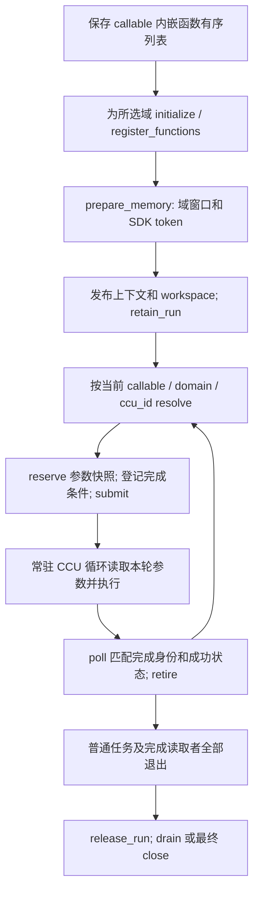

# PR-1 与 CCU 开发计划 v7 的接口对齐

核对日期：2026-11-06。契约依据为 CCU 开发计划 `new-doc/index.html` 的 v7 页面。本页说明 PR-1 执行层，以及 PR-2、PR-3 接入时必须保持的约束；构建和真机证据见[验证说明](ccu-pr1-build-validation.md)。

## 公开调用与职责

CCU 函数与 L2、AICore 函数一起封装进 `ChipCallable`。`ccu_functions` 列表从零顺序编号，列表下标就是 `uint32_t ccu_id`，与 AICore kernel ID 分开。设备调用目标由 **当前 callable、所选通信域、ccu_id** 共同确定；用户无需传内容键、签名或每次 Host 启动后产生的硬件 ID。

`worker.register` 保存函数定义时不要求通信域已经存在。域仍在 Host 编排中通过 `orch.get_or_allocate_domain` 创建；运行时必须在相关设备任务启动前，为该 callable 在该域上准备执行实例。域重建可以更换资源地址和访问凭据，但不能改变 callable 内的函数编号。释放域 A 不能使域 B 的实例失效。

| 层次 | 责任与边界 |
| ---- | ---------- |
| PR-1 执行层 | 共享 ABI、嵌入模块加载、位置参数、域内范围准备、常驻 CCU 服务、请求完成与安全排空 |
| PR-2 设备任务接入 | `CcuCall`、wait/send、TMR 完成登记；成功 retire 后才放行后继 |
| PR-3 callable 与域管理 | 保存函数有序列表、提供隐藏 callable 身份、按域准备和发布上下文、持有完整运行与资源所有权 |

`CcuCall(domain_ctx, ccu_id, parameters)` 构造局部描述符，只复制 Tensor 视图和标量，不占用请求槽、不触发硬件。接受请求时，运行时才保存独立参数快照。参数不带 input/output/workspace 方向分类；任务间读写依赖由外层 `CoreTaskArgs` 描述，调用顺序可由 order Tensor 串行化。

旧 `CcuProgramKey`、`CcuSignature`、按名称的构建接口和 Host C ABI 仍用于兼容代码。内部内容摘要可以用于一致性检查和缓存，但不是 v7 要求用户填写的接口。旧路径逐轮 Host prepare/arm 的测试不能代替 v7 的设备循环验收。

## 嵌入模块与位置参数

PR-1 的 Host 入口是 `CcuSession::register_functions(vector<CcuEmbeddedFunction>)`。每项包含模块字节、入口名、模块种类和 ABI 版本；当前种类为 `HOST_BUILDER`，位置参数 ABI 为 **2**。函数列表在会话发布前按顺序注册一次，注册中途失败需要回滚该次新增资源。

模块导出 `extern "C" uint32_t simpler_ccu_module_abi_version()`，返回 `2`，以及 `extern "C" int entry(CcuBuildContext*)`。构建回调使用 `tensor(index)`、`peer_tensor(index)`、`scalar(index)`、`peer_scalar(index)` 读取位置参数，记录数据搬运和双方匹配的 barrier；公共完成记录由执行层发布。该接口包含 Host C++ 虚函数，模块和运行时必须使用兼容的工具链与公共头文件，ABI 版本号不代表跨任意编译器兼容。

部署使用嵌入模块字节，不依赖原始独立 `.so` 路径。加载器检查模块和入口，通过临时文件加载后删除临时路径；同一模块字节的多个入口共享加载对象。模块对象必须保留到相关执行实例安全关闭。

| 参数 | 当前编码与约束 |
| ---- | -------------- |
| Tensor | 有序 Tensor 数组，每项为 address、token、byte_size 三个 `uint64_t`；最多 16 项 |
| scalar | 随后的有序标量数组，每项包含 bits、kind、width；最多 16 项，编码支持有符号、无符号和浮点的 32/64 位表示 |
| 参数快照 | `CcuPositionalArguments` 固定为 648 字节，包含数量及上述数组；接受请求后由运行时拥有 |
| Tensor 范围 | 连续 FP32 Tensor，包括 src、dst 和用户 scratch，必须完全位于所选域已准备的内存范围中；允许合法子视图 |

Tensor 地址及长度需要满足 4 字节对齐、非空和不溢出要求。运行时根据准备范围写入可信 token，不信任调用方传入的 token。窗口名称不进入 CCU 参数 ABI；外部分配的 Tensor 需要先显式复制到域内窗口。位置 ABI 不替用户函数推断参数语义或别名安全性，函数与调用方必须约定参数数量、顺序、标量类型和允许重叠的范围。

`prepare_memory` 校验设备归属并取得 SDK token；`release_memory` 撤销会话范围，不释放 allocation 本体。相同 ID 和范围的准备幂等，范围冲突报错，成功释放后的 ID 不复用。运行期间不能修改函数列表、范围或请求布局；父层在安全撤销范围和所有运行引用退出后才能释放实际 allocation。

## 执行、完成与资源所有权

每个 callable/domain 执行实例只有一个活动请求和一个逻辑生产者。它可以连续接受设备决定的多轮串行请求，但不提供同一实例上的并发提交。设备接口保持 resolve / reserve / submit / cancel / poll / retire 两阶段协议：reserve 占槽并取得不复用的序号，完成条件登记后才 submit；cancel 仅适用于尚未提交的请求。

CCU 服务在循环内读取本轮 Tensor 地址、标量和序号，交换对端参数并执行用户构建的操作。服务程序的注册与启动属于实例准备，Host 不逐轮 prepare、launch 或同步。上下文重发可能更换地址，父层必须更新 workspace，并保证旧读者已经退出。

完成必须匹配上下文代次、程序和精确的 64 位请求序号，且状态成功；较大的序号不能证明当前请求成功。CCU 等待数据操作、双方完成及状态交换后，最后写入成功序号。旧完成记录、超时或普通 AIV FIN 都不能冒充该完成。

**普通 AIV FIN 单独不足以释放模块、域窗口或请求区。** 成功路径还需要 CCU 完成匹配、请求 retire、普通任务及完成读取者全部退出。PR-3 在提交前 `retain_run`，直到上述读者退出才 `release_run`；PR-2 在成功 retire 后放行后继。`poll_idle`/`drain` 提供实例排空检查，调用 `drain` 前普通任务读者必须已经停止；最终 `close` 还需证明服务流和停止触发流排空。

错误不得放行成功后继。已确认停止时可以按错误清理路径回收；停止结果未确认时，必须保留模块、父环境、域窗口、请求和完成记录，禁止复用实例。超时不等于硬件已经停止，迟到成功也不自动恢复业务提交。关闭失败保留句柄和 owner 供重试，析构不隐式释放未确认安全的 SDK 资源，不通过 reset device 收尾。

## 实现入口与当前证据

| 入口 | 文件 | 状态 |
| ---- | ---- | ---- |
| 位置参数与会话 ABI | `src/common/platform_comm/ccu/ccu_types.h`、`ccu_host.h`、`ccu_builder.h` | 设备 ABI 和位置模块 ABI 均为 2；Host/AIV 构建通过 |
| ordered ccu_id、嵌入模块、内存与所有权 | `src/a5/platform/onboard/host/ccu/ccu_session.cpp` | CPU 测试覆盖注册、回滚、加载和资源保留 |
| SDK 初始化、常驻服务 | 同目录 `ccu_session_sdk.cpp`、`ccu_service_program.cpp`、`ccu_v1_arithmetic.h` | CANN 9.3 编译和严格链接通过；V1 有界运算通过 DSL 解释执行回归及真机验证 |
| 设备请求生命周期 | `src/common/platform_comm/ccu/ccu_device.h` | CPU 协议测试、A5 AIV 编译及双 rank 1000 轮执行通过 |
| PR-2/PR-3 共享接入 | 同目录 `ccu_device_protocol.h`、`ccu_device_access.h`、`ccu_run_lease.h` | 提供域目录、callable/ccu_id 绑定和所有权桥；联合快照通过 worker/provider/TMR 单域双卡 4/1000 轮实机验证 |
| 通信 workspace | `CommContext` 的 CCU 槽 3，类型数量 4 | 共享上下文为 1104 字节；保留槽不等于 provider 已接入 |

快照 `d7af83d3d6b09e75901f5d0b929cced4e70d91de` 在 Linux aarch64 / CANN 9.3.0 上通过 **9 组、63 个 CPU C++ 用例**，真实 SDK 库、AIV 内核、Host 真机 harness 和嵌入测试模块均构建成功。V1 运算适配已完成：乘法使用有界倍增与加法，立即数先赋给变量，变量比较使用固定次数的加法及立即数相等判断；范围、溢出、序号和身份检查均保留。

同一快照的双 rank 真机 **4 轮和 1000 轮均通过**：两个 rank 均报告 `status=0`，完成轮数与请求轮数精确一致，随后正常 close 并释放资源。该结果覆盖 PR-1 独立 harness 的嵌入用户函数、动态域内视图、数据与保护区校验和连续设备提交。PR-2/PR-3 的 worker/provider/TMR 后续集成证据另列于下文；任务编号、日志和验证范围见[构建与验证记录](ccu-pr1-build-validation.md)。

后续快照 `138f44865df257077651f2a2e2365fec70fe4020` 保留合法的域及内存编号 0，不对编号做偏移映射。严格构建及 63 个 CPU 用例再次通过，包含使用编号 0 的 1000 次设备协议请求回归；它没有放宽 owner、代次、地址或范围检查。

后续快照 `ba178c4ca3509ed3f8682bf283ff56cd01d88f90` 严格构建及 67 个 CPU 用例通过。比较临时变量改为每个服务共享，修复集成模块需要 407 个变量、超过默认 400 个的注册失败；增加资源不足诊断，并保留原始注册错误和清理所有权。集成快照 `2af036ee` 已完成服务注册；首个通信任务的校验失败随后定位到测试内核的 Tensor 复制方式并完成修复。

新版快照 `ba178c4ca3509ed3f8682bf283ff56cd01d88f90` 的双卡 1000 轮独立验证也已通过：任务 `task_20261106_182755_41458312678`，设备 0、1，日志目录 `onboard-ba178c4c-r1000/`。两个 rank 均报告 `status=0`、`completed_rounds=1000`，数据及保护区检查通过，正常关闭并以退出码 0 结束。此结果覆盖共享比较临时变量和编号 0 的修复，仍不替代 PR2/PR3 的完整运行时联调。

联合快照 `68e00c466eefaa66d5cf771c2d79c3ccd6f0109d` 已在正式 Worker/provider/TMR 路径完成双卡 **4 轮和 1000 轮** 验证。两个场景均校验每轮动态 root、域内偏移和长度、依赖后继的数据及保护区、最终域释放和正常 Worker 关闭，并以退出码 0 结束。AIV 不逐轮等待 CCU，Host 不逐轮准备实例；请求完成后才放行后继。此证据覆盖单域串行请求主路径，不覆盖多域重建、跨域隔离和全部硬件故障场景。

2026-11-08，联合快照 `e8d6081b5264b87a879a7f6faa883d6468950e11` 补齐多域与专项故障验收，8 项 A5 双卡测试全部通过。新增覆盖保留域复用和重建、域与 callable 隔离、非法及跨域请求拒绝、单 rank 准备失败后的恢复、AIV 结束后仍 pending 的真实 CCU 请求，以及活动请求失败后的后继阻止和安全回收。故障修复保留原始错误，只有独立停止确认齐备后才释放资源；未确认停止仍保留所有权。任务、日志和具体边界见[构建与验证记录](ccu-pr1-build-validation.md)。
