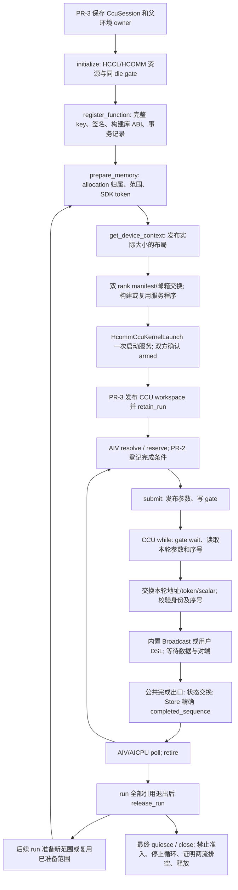

# PR-1 与开发计划 v6 的接口对齐

核对日期：2026-11-06。依据：[CCU 开发计划](https://icc.gt.tc/ccu?i=1) 中的“PR-1 / PR-2 / PR-3 开发接口”和 v6 接口定稿，页面接口更新日期为 2026-11-05。

完整执行顺序、调用关系图和主要函数说明见[调用流程与主要函数注释](ccu-pr1-call-flow.md)。

## 约束优先级

本页作为原《CCU 执行层与完成记录》设计说明书的接口修订。保留原设计中的精确完成序号、独立完成区、失败保留所有权和安全排空要求；以下与旧设计冲突的部分以开发计划 v6 为准：

- PR-1 的正式公共类型位于 `src/common/platform_comm/ccu/`，不得绑定 TMR、Python 或 examples。
- `CcuProgramKey` 是 32 字节完整 SHA-256 内容键。设备通过编译期 key 查找当前会话资源；SDK 句柄留在 Host 适配器中。
- 正式设备接口为 resolve / reserve / submit / cancel / poll / retire。reserve 和 submit 分离，完成登记成功后才允许提交。
- 正式 Host 内部接口是 `CcuSession`，包括函数事务、prepare_memory / release_memory、设备上下文发布、quiesce 和两种 close。
- 数据来自已准备的普通 allocation / 内存池，不要求绑定固定输入输出窗口。每轮使用实际 Tensor 视图及带类型标量，允许声明的完全别名，拒绝部分重叠。
- 注册一次后的真实服务循环必须持续接受设备发起的请求。不能用每轮 Host Prepare/Arm、固定次数 Host Launch 或重复 gate 写入代替该执行机制。
- PR-1 预留 CCU workspace 槽并同步共享 ABI；PR-2 负责 TMR CompletionToken 接入；PR-3 负责域配置、callable 元数据及 key 生成和绑定。

## 当前符合性矩阵

| 契约 | 当前实现状态 | 验证边界 |
| ---- | ------------ | -------- |
| CCU=3 / COUNT=4，CommContext=1104 | 已修改 C++、Python 和测试镜像，既有字段偏移不变 | C++ workspace 测试通过；所有消费者仍须随最终产物重建 |
| CcuProgramKey / ProgramRef / RequestRef / PollResult / 强类型 CcuStatus | 已提供公共 `ccu_types.h` 及布局断言 | Host 编译、AIV 编译探针通过 |
| device context 校验、完整 key 查找、两阶段提交 | 公共 `ccu_device.h` 与会话发布的真实布局共用定义 | CPU 协议测试、真实 ccec A5 与 AICPU 交叉编译通过 |
| 视图、标量类型、已准备范围、别名、序号检查 | 已实现设备 helper；参数直接写入统一后端布局 | 1024 次动态地址串行请求测试通过，完成由测试显式注入，不是硬件执行 |
| 真实 HCOMM 资源适配、Broadcast、CCU Store、独立 AIV trigger | 旧 Host 兼容路径已实现并编译 | 对应原设计，不能作为新版常驻服务验收 |
| CcuSession / ccu_host.h | 已实现初始化、注册、发布、停止准入、排空与可重试关闭 | 部分初始化、关闭失败保留 parent owner 等故障注入通过 |
| 用户函数构建 / ccu_builder.h、事务回滚 | 已实现 dlopen、构建 ABI 校验、符号参数、内置和用户 DSL 入口 | 测试动态库覆盖错误 ABI、缺失入口、复用后撤销；真实构建回调记录测试通过 |
| prepare_memory / release_memory、run 引用与范围表发布 | 已实现 SDK 设备归属检查、独立 token 查询、范围表及 run 租约 | 幂等准备、ID 不复用、范围冲突、活动 run 禁止修改均有测试 |
| 真实常驻 CCU dispatcher、逐轮参数读取、远端信息交换与退出 | `CcuServiceProgram` 使用真实 HCOMM DSL 记录 while / gate / 动态传参 / 公共完成出口；SDK 适配器实际注册并 launch | SDK 编译和严格链接通过；DSL 记录测试核对循环、数据操作、同步及最终 Store 顺序；无硬件执行证据 |
| A5 的至少 1000 轮硬件验证、可见性与访问资格 | 未执行，无设备 | 当前用户范围是可编译代码，不能宣称硬件运行通过 |

当前代码同时包含原 Host C ABI 兼容路径与新版公共会话路径。验收必须区分二者；CPU 假完成和 DSL 记录不证明 CCU 硬件执行。当前环境仅完成 Linux x86_64 / CANN **9.2.0-beta.2** 编译及无设备测试，没有完成 CANN 9.3 或 A5 设备验收。整个 Host runtime 的既有 URMA SDK 版本阻塞见[构建说明](ccu-pr1-build-validation.md)。

## 实现入口与执行顺序

| 入口 | 文件 | 责任 |
| ---- | ---- | ---- |
| 共同类型与共享 ABI | `src/common/platform_comm/ccu/ccu_types.h` | 固定宽度 POD、完整内容键、offset 布局、128B 隔离的控制/完成区 |
| `CcuSession` 全部方法、内容键计算 | `src/a5/platform/onboard/host/ccu/ccu_session.cpp` | 元数据、注册事务、动态库生命周期、范围表、run 引用、错误保留 |
| `SessionSdk::Initialize/Publish/Stop/Close` | 同目录 `ccu_session_sdk.cpp` | communicator/channel/thread/stream、同 die gate、内部 HBM、程序缓存、真实启动与排空 |
| `CcuServiceProgram`、`Builder` | 同目录 `ccu_service_program.cpp` | 常驻循环、公共 prologue/epilogue、Broadcast 和用户构建入口 |
| `ccu_*_request`、resolve/get context | `src/common/platform_comm/ccu/ccu_device.h` | AIV/AICPU 查询、参数快照、一次触发、超时封禁、精确退休 |
| 独立停止触发器 | `src/a5/platform/onboard/aicore/ccu_trigger.cpp` | Host 最终关闭时唤醒等待中的服务；正常设备请求直接使用公共 submit helper |

构造函数只保存配置；调用方先保存会话 owner 再 initialize。所有局部 SDK 资源保存在适配器内，失败的 allocation/descriptor 仍有记录。注册失败可按 registration_id 局部 abort，不删除复用的已发布函数。发布失败使会话封禁，不能自动重复 launch；调用方进入关闭/回滚。

第一次发布时注册服务程序。仅修改准备内存时复用已注册程序，停止旧的空闲服务、发布新布局，再用新的内部 taskArgs 启动；同一 L2 的重复调用只由设备提交，Host 不逐轮 Prepare/Arm。只有函数集合改变时重新记录服务程序。

Host `register_function` 返回未发布的 opaque 事务引用，`context_addr=0`；不能将它当作已编译的设备常量。设备可用引用来自发布后的 `ccu_resolve_program(key)`。上下文重发可能更换地址，PR-3 必须更新 workspace，且旧任务引用全部退出后才允许更新。

## 参数、构建与内存契约

程序键按 `simpler.ccu.program.v1` 域标签、构建 ABI、SDK/公共接口指纹、入口、库文件内容、输入/输出/workspace/scalar 的有序名称和类型、规范化 aliases 计算 SHA-256。整数采用 8 字节小端编码，字符串/字节串带长度；name 和 library_path 的显示路径不参与身份。构建元数据与 AIV Binding 使用同一计算结果，PR-3 负责生成并贯通它们。

用户库导出 `extern "C" const CcuBuildModuleAbi ccu_build_module_abi` 和 `extern "C" int entry(CcuBuildContext*)`。`sdk_build_id` 使用安装的 `ccu_build_config.h` 中 `CCU_BUILD_SDK_ID`，版本/结构大小/指纹均需匹配。构建库直到会话安全关闭后才卸载。`CcuBuildContext` 提供本端和对端 tensor/scalar、常量、带溢出保护的乘法、运行时断言、本地复制、远端写和对端 barrier；不能发布公共完成记录。barrier 必须由算法的两个 rank 匹配调用。

每个 tensor 只在底层参数区写入 address/token/view_bytes 三个 uint64_t，scalar 写入一个 uint64_t；顺序为 inputs、outputs、workspaces、scalars。参数区按签名实际大小分配，PR-2 直接传现有 Tensor 与类型化标量。首版支持连续 FLOAT32、UINT64/INT64 标量、最多 64 个参数；本地复制上限 4096B，内置 Broadcast 的 count 为 1–1024，root0/root1 分别具有内容键。

服务启动的九个 taskArgs 是内部稳定资源：request 地址、参数区地址、context token、本端 mailbox 地址/token、对端 mailbox 地址/token、scratch 地址/token。它们在循环外加载；每轮实际 Tensor 地址和 count 在循环内读取。双方先交换固定大小 manifest header，再交换同大小的完整 key 表和 mailbox 凭据；bootstrap 回调须按 rank0/rank1 填充结果并有界返回，所有阶段检查本端 echo。普通 rank 数据地址不要求一致。

普通 allocation 的真实所有权由 PR-3 保留。`prepare_memory` 校验设备归属并查询 `HcommCcuGetMemToken`，不默认使用其他区域 token；该 SDK 查询不返回独立 deregistration handle。`release_memory` 撤销会话的访问范围，不 free allocation 本体。相同 ID/范围准备幂等，不同范围报错，成功释放后的 ID 不得复用；不同 ID 的范围不允许重叠。PR-3 在 release 成功后才能释放对应 allocation；窗口和内存池走相同规则。

## 完成、停止与所有权

每个上下文有一个活动槽和一个逻辑生产者。reserve 占槽并消耗不复用的序号；cancel 只撤销尚未 submit 的请求。submit 只能接受一次；明确未启动的失败仍可由 poll 查询，不写成功序号。设备和 AICPU 原始完成读取执行对应缓存维护，最终完成必须匹配完整 epoch/program/64 位 sequence；`>=` 不代表成功。

公共 CCU prologue 检查两端 program/epoch/槽状态和单调序号，之后执行数据操作。数据事件等待、双方 done 和状态交换完成后，CCU 写完成身份/状态，最后 `Store(completed_sequence)`。只有 CCU 发布成功序号；Host/AIV 超时只修改独立控制状态，返回 UNCONFIRMED/TIMEOUT 并封禁会话。迟到成功不自动恢复业务请求；最终关闭可在确认匹配完成及服务/停止触发流排空后回收。

quiesce 使用 Host 独占的 128B admission 行禁止后续 reserve/submit；已有任务仍持有 run 引用时返回 BUSY，调用方在引用退出后继续关闭。停止命令只在没有未确认数据访问时写入，并用独立 AIV trigger 唤醒服务退出 while。Stop 查询 CCU 流与 trigger 流；超时不是硬件停止。未知停止提交不得重复触发。

ABORT_UNPUBLISHED 不要求未初始化的对端参加 collective，只执行可证明安全的局部停止和清理；NORMAL 在已发布路径使用。清理失败保留对应句柄和父环境，允许 close 重试。析构函数不执行隐式 SDK 释放；未成功 close 的底层所有权会被保守保留，调用方必须保留会话并显式收尾。

设备/AICPU 持有的记录引用由会话/run 所有权保护，不能释放内存后再读取 epoch 判断有效性。PR-3 必须先 retain_run，直到全部任务和完成读取者退出才 release_run；run 中不能更改函数、范围或请求区。TMR 成功路径先 retire 再放行后继由 PR-2 实现；本 PR 不提供 TMR 接入或 Python `engine="ccu"`。

## 编译与测试证据

使用[独立构建命令](ccu-pr1-build-validation.md#可复现构建)生成真实 HCOMM/AscendCL 链接的 `libsimpler_ccu.so`、独立 `ccu_trigger.o`，并安装四个公共头文件和构建指纹。需要 OpenSSL 开发包；启用测试还需要 GoogleTest，AICPU 编译探针使用 aarch64-linux-gnu-g++。主 C++ UT 集成会话与公共协议测试；启用既有 `SIMPLER_ENABLE_HARDWARE_TESTS` 且 SDK 包含 CCU 头文件时还编译 DSL 记录测试，该记录测试本身不需要设备。

PR-2/PR-3 可复用 `tests/ut/cpp/a5/platform/support/ccu_session_fake.h/.cpp`：在 initialize 所在线程调用 `ccu_test::QueueBackend(control)`，将正式 `ccu_session.cpp` 与测试工厂链接，不链接 SDK 适配器。`SessionControl` 可注入初始化/内存/发布/停止/关闭结果，`Complete(request, result)` 显式注入匹配完成。假后端的上下文沿用正式布局，不能用于宣称数据搬运或硬件服务循环通过。

无硬件验证分别覆盖：旧 C ABI 的两 rank rendezvous/故障注入；公共设备协议的 1024 次参数变化、延迟完成、取消、旧序号、别名、超时；Host 会话的部分初始化/事务/模块 ABI/内存/关闭；真实 `CcuServiceProgram` 回调的指令记录与 SDK 错误传播。AIV 探针直接传 GM `ChipTensor` 引用，AICPU 探针编译同一公共头文件。

本地已通过 9 组、54 个 C++ 用例，以及 6 个 runtime artifact Python 用例；独立 SDK 库使用 `--no-undefined` 完成链接，并验证安装产物。资源适配器故障注入覆盖停止超时后重试、更新范围复用程序/序号、部分释放失败和初始化失败后局部清理。clang-format 21.1.0、Ruff 0.14.8、cpplint 和版权/接口隔离/命名检查分别执行。完整仓库 pre-commit、完整 sim 测试及远端 CI 未因此被视为通过。

这些证据不替代 A5 上的一次注册、至少 1000 轮真实执行、动态地址访问资格、Store 地址契约和跨引擎缓存可见性验收。没有设备时只交付可编译实现及协议测试，不能宣称可运行或硬件验收通过。
