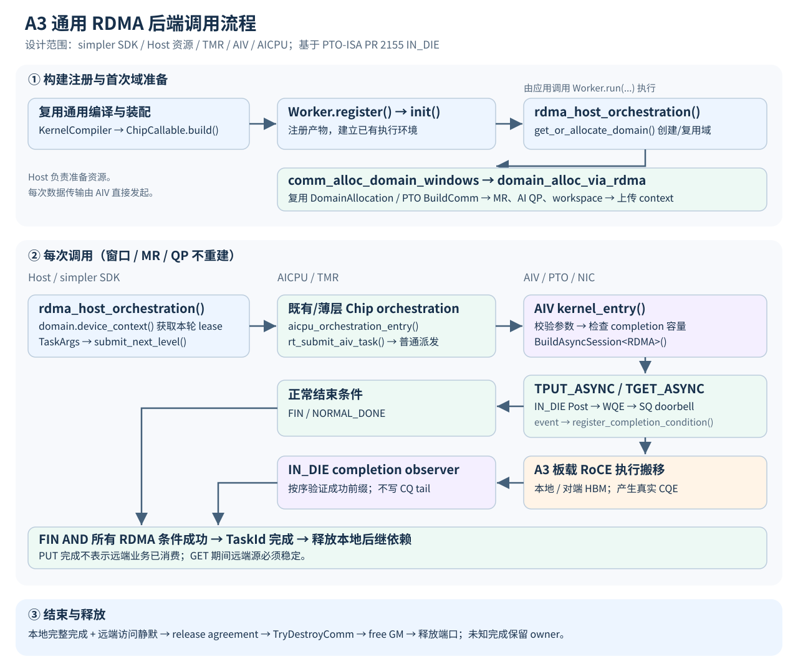
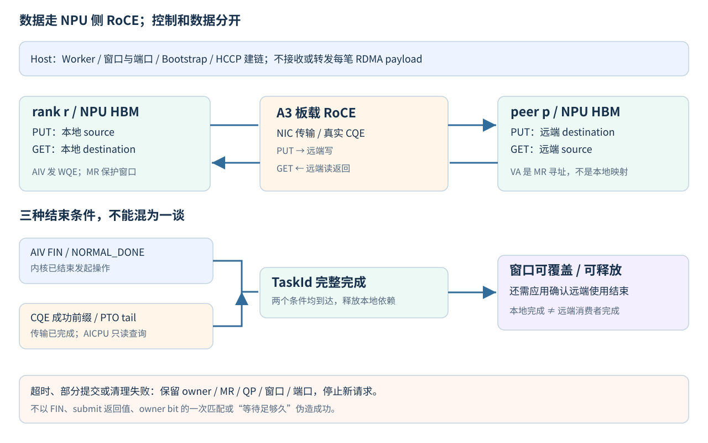

# A3 通用 RDMA 后端接入 simpler 设计说明书

设计日期：2026-11-25。范围：simpler 的 SDK、通信资源、AIV callable、AICPU 完成调度及构建验证。本文不设计 lib/PyPTO 的接口、IR、Pass 或 codegen，也不修改已有 A5 设计。

**采用 PTO-ISA PR 2155 的 `IN_DIE` 直接提交路径：Host 建链，AIV 发起 PUT/GET，A3 板载 RoCE 搬移 NPU 显存，AICPU 查询真实完成。** 不需要 Host 轮询请求、代理提交每笔传输。

## 1. 阅读入口

| 文档 | 主要内容 |
| ---- | -------- |
| [架构与源码依据](rdma-a3-simpler/architecture.md) | 两个 PR 的职责、已核对的函数位置、资源和调用流程 |
| [新增、修改与复用接口](rdma-a3-simpler/interfaces.md) | SDK、Host 内部、设备、调度、构建接口的签名和功能 |
| [请求与完成协议](rdma-a3-simpler/completion.md) | 48 B 参数、事件编码、CQE、只读完成查询和 FIN 汇合 |
| [窗口、建链与生命周期](rdma-a3-simpler/lifecycle.md) | alloc_domain、Bootstrap、窗口复用、端口租约、异常和释放 |
| [实施与验收](rdma-a3-simpler/implementation.md) | 文件清单、依赖、构建接入、确定性测试和实施顺序 |
| [完整离线阅读版](rdma-a3-simpler.html) | 合并全文和内嵌流程图，可直接用浏览器打开 |

各表中的“已有”指下表固定的 simpler main 或 PTO PR 源码；“新增/修改”标出本后端相对基线的改动。实现与构建证据见[实施与验收](rdma-a3-simpler/implementation.md)；真实 A3 NIC 验收另行进行。

## 2. 设计基线

| 依据 | 固定版本 | 用途 |
| ---- | -------- | ---- |
| simpler [PR 2157](https://github.com/hw-native-sys/simpler/pull/2157/changes) | head `5cdfdb9f6f341369b5feadb3765f7188048851cb` | A5 AIV 提交、deferred completion、AICPU CQ 查询的历史参考 |
| simpler [设计初稿 main 快照](https://github.com/hw-native-sys/simpler/commit/ec5dd4fc0fa29e977b6b71a533c191439fb96ff9) | `ec5dd4fc0fa29e977b6b71a533c191439fb96ff9` | 初稿的函数与生命周期参考 |
| 本次实现的 [fork main](https://github.com/makangkang2026/simpler/commit/70415c727abd3e5a6dbb25fdec485379bb308c79) | `70415c727abd3e5a6dbb25fdec485379bb308c79` | 2026-11-27 核对的提交基线；包含本地 peer cancellation，RDMA 已接入该取消后的请求排空路径 |
| upstream 提交基线 [main](https://github.com/hw-native-sys/simpler/commit/9f9beac34c7b62efa0abafab7eb9ad0dea3d6dcf) | `9f9beac34c7b62efa0abafab7eb9ad0dea3d6dcf` | 2026-11-28 重新对齐并验证；保留上游 A3 epoch retirement，按新的 CPU/SDK/device 测试分层放置资源协议测试 |
| 上述 main 的 PTO-ISA pin | `45435c0624c1d0d056bf38aa60d4f56dc0ef3b6b` | 尚无本设计依赖的 A3 `IN_DIE` 后端，必须升级 |
| PTO-ISA [PR 2155](https://gitcode.com/cann/pto-isa/pull/2155/diffs) | head `596dc095892da42f1990622830c5209309d025cf`；base `d77753cfc652db5b994f1e9253692ec24fd34c39` | A2/A3 HCCP、AI QP、AIV WQE、IN_DIE CQE 和自动建链 |

PR 2155 在核对时仍为 opened。实施时固定包含该实现的不可变 commit；若其合入版本改变布局或签名，生产者、AICPU 查询器和测试必须同时更新。本文已读取该 head 的完整源代码，不能用旧 pin 下“A5 only”的文档否定该 PR 的新能力。

## 3. 总体流程

1. 应用通过既有通用编译/装配流程构建并注册普通 `ChipCallable`，与 SDMA 接入方式一致。`Worker.init()` 启动执行环境并准备 Host Orchestrator，不自动创建本次通信域。
2. 应用调用 `Worker.run(rdma_host_orchestration,...)`；运行时执行该 Python Host 编排函数，由其显式调用已有 `allocate_domain()` 或 `get_or_allocate_domain()`，请求 `workspace_engines=("rdma",)`。首次创建域时延迟建立基础 communicator。
3. simpler A3 平台层分配本地设备窗口，调用 PTO 的 `GetCommWorkspaceSize()`、`BuildComm()`，得到 MR、AI QP、RDMA workspace 和各 rank 的显存地址。
4. 每次调用通过 `TaskArgs` 传递 context、peer、本地/远端偏移、长度和 QP 号。`orch.submit_next_level()` 提交同一个 callable，不重新注册 MR/QP。
5. Chip orchestration 使用已有 `rt_submit_aiv_task()` 派发 AIV `kernel_entry()`；AIV 在提交前确认完成记录容量，再调用 `BuildAsyncSession<RDMA>()` 和 `TPUT_ASYNC/TGET_ASYNC<RDMA>()`，随后复用 `register_completion_condition()` 登记事件。
6. NIC 执行传输。AIV 返回并发布普通 FIN；AICPU 只读查询 IN_DIE CQ 的成功前缀。**FIN 与真实传输完成都满足后**，运行时才完成 TaskId 并释放后继依赖。

## 4. 数据路径与首版范围

业务数据路径是 `本 rank NPU HBM → A3 板载 RoCE → 对端 NPU HBM`，GET 的方向相反。Host 负责资源、Bootstrap 和调度；Host 的文件/控制消息仅交换连接信息，不中转业务 payload。远端 VA 是 MR 寻址信息，不能当作本地可解引用的 peer mapping。

首版支持 A3、`platform="a2a3"`、TMR、同一 Host 的双 rank L3、设备内存窗口、连续字节 PUT/GET、持久窗口和多次调用。PTO 支持 A2 不等于 simpler 的 A2 已经验证；更多 rank、HBG、跨 Host L4、Host-backed RDMA、通知操作、任意 Tensor 自动注册及 InCore 融合不在本次范围。

`CommWorkspaceKind.RDMA` 已存在，无须新增枚举值；`RdmaConfig` 已存在，但要补齐 A3 的 QP/地址/端口配置。现有 `allocate_domain()` 的公开签名保持不变，**其 A3 实现必须修改**：当前非零 `workspace_mask` 被拒绝，原有 Fabric/IPC peer 映射路径也不能直接承担 RDMA-only 资源准备。

PUT 完成表示本次 RDMA 写的传输完成，不表示远端业务已消费；GET 要求远端源在读取期间保持稳定。跨 rank 的数据就绪、消费和下一轮覆盖许可仍由应用阶段协议保证。

## 5. 必须落实的设计约束

| 约束 | 设计要求 |
| ---- | -------- |
| A3/A5 队列布局不同 | A3 使用 `RdmaBackend::IN_DIE`、workspace v3、`RDMA_IN_DIE_CQE=4`；禁止复用 HNS1825 CQE 解析和 doorbell 格式 |
| 完成注册失败不能丢请求 | 发 WQE 前检查容量，在本任务独占 slab 的合同下复用原登记函数；不使用失败后 `event.Wait()` 的阻塞兜底 |
| CQ 只有一个回收主体 | PTO 的 AIV `Progress()` 修改 CQ/SQ tail 和 CQ doorbell；AICPU 只读观察成功前缀 |
| 队列绕圈不能误判 | 查询同时使用完整事件目标、workspace generation、已回收 tail 和 CQE 状态；不能只比较一个 owner bit |
| 生命周期必须覆盖 DMA | run lease、已提交任务、远端阶段访问和 provider 清理都结束后，才能释放 MR/窗口 |
| 失败保留所有权 | 初始化残留或提交结果未知时保留 owner；不重试同一写、不自动清空队列、不 reset 设备 |
| 真机结果不能由编译替代 | 代码、构建、模拟和 A3 实机验收分别记录；无设备的编译验证不等于实机可运行 |
