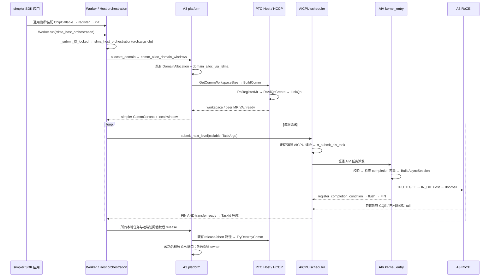

# A3 RDMA 架构与源码依据

[返回设计入口](../rdma-a3-simpler.md)

## 1. 复用 A5 机制，替换设备提供方

| 维度 | simpler PR 2157 / A5 | 本设计 / PTO PR 2155 |
| ---- | -------------------- | -------------------- |
| 设备后端 | HNS1825，经 UB 连接的 NIC | A3 板载 RoCE，`IN_DIE` |
| Host 资源 | HCOMM 通道及 HNS1825 workspace | HCCP `RaRegisterMr`、`RaAiQpCreate` 和 `BuildComm` |
| 架构 | `__NPU_ARCH__=3510` | `__NPU_ARCH__=2201`；Host 同时检查实际 SoC |
| AIV 发起 | PTO 生成 HNS1825 WQE | PTO `in_die::Post()` 生成 64 B WQE 并提交 doorbell |
| CQE | HNS1825 owner/opcode/syndrome | 32 B CQE，word0 owner 位 7、status 位 8～15 |
| 事件 | RDMA event handle | 同一高低字编码，但高字是 `peer * qpNum + qpIdx` |
| 真实完成 | AICPU HNS1825 adapter | 新增 AICPU IN_DIE 只读 observer |
| 可复用部分 | deferred slab、FIN 汇合、普通 AIV 调度 | 复用这些机制，补齐 A3 dispatcher 和资源生命周期 |
| 不直接移植的部分 | A5 低地址阈值、dbCos patch、旧 workspace 镜像 | 不在 A3 应用这些假设 |

PR 2155 已包含 AIV 多核共享 QP 的 tournament lock 和 SQ/CQ 容量回收。本设计不再添加另一套 WQE、锁、socket/MR 交换实现。simpler 负责将自身资源和完成语义接到它上面。

## 2. 已有 simpler 函数与作用

下列位置均相对于 simpler main `ec5dd4fc0fa29e977b6b71a533c191439fb96ff9`；链接固定 commit，行号不随 main 漂移。

| 函数 / 位置 | 当前作用 | 本设计处理 |
| ----------- | -------- | ---------- |
| [`Orchestrator.allocate_domain()`，orchestrator.py:572](https://github.com/hw-native-sys/simpler/blob/ec5dd4fc0fa29e977b6b71a533c191439fb96ff9/python/simpler/orchestrator.py#L572) | 同步创建通信域、窗口和指定 workspace | 复用签名，更新 A3 支持说明 |
| [`get_or_allocate_domain()`，同文件:627](https://github.com/hw-native-sys/simpler/blob/ec5dd4fc0fa29e977b6b71a533c191439fb96ff9/python/simpler/orchestrator.py#L627) | 精确配置命中则复用现有域 | 配置比较加入 RDMA 参数；命中不重置窗口 |
| `Worker._submit_l3_locked()`，`python/simpler/worker.py` | 在当前 run scope 内执行 `callable(self._orch,args,cfg)`，即调用用户 Host 回调 | 复用；回调自行调用 get_or_allocate_domain，不由 register/init 隐式触发 |
| [`Worker._comm_domain()`，worker.py:11290](https://github.com/hw-native-sys/simpler/blob/ec5dd4fc0fa29e977b6b71a533c191439fb96ff9/python/simpler/worker.py#L11290) | 创建/查找 owner，组织域使用与释放 | 接入 A3 RDMA capability、端口租约和失败保留 |
| [`Worker._allocate_domain()`，同文件:11708](https://github.com/hw-native-sys/simpler/blob/ec5dd4fc0fa29e977b6b71a533c191439fb96ff9/python/simpler/worker.py#L11708) | 校验并向各 chip 发起域分配控制请求 | 在分发前协调 RDMA 配置和端口 |
| [`_handle_ctrl_alloc_domain()`，同文件:2925](https://github.com/hw-native-sys/simpler/blob/ec5dd4fc0fa29e977b6b71a533c191439fb96ff9/python/simpler/worker.py#L2925) | chip 子进程解码控制请求，调用 native | 增加 RDMA 配置解码，不新增控制操作种类 |
| [`ChipWorker::comm_alloc_domain_windows()`，chip_worker.cpp:2861](https://github.com/hw-native-sys/simpler/blob/ec5dd4fc0fa29e977b6b71a533c191439fb96ff9/src/common/worker/chip_worker.cpp#L2861) | Python/native/platform 转发 | 携带扩展配置，保留原输出契约 |
| [`comm_alloc_domain_windows()`，A3 comm_hccl.cpp:1502](https://github.com/hw-native-sys/simpler/blob/ec5dd4fc0fa29e977b6b71a533c191439fb96ff9/src/a2a3/platform/onboard/host/comm_hccl.cpp#L1502) | 当前拒绝非零 workspace mask | 新增 RDMA-only 分支，调用 PTO 建链 |
| [`release_domain_allocation()`，同文件:1744](https://github.com/hw-native-sys/simpler/blob/ec5dd4fc0fa29e977b6b71a533c191439fb96ff9/src/a2a3/platform/onboard/host/comm_hccl.cpp#L1744) | collective/local abort 释放入口 | RDMA 分支必须确认静默，清理失败保留 map 中 owner |
| [`comm_release_domain_windows()` / `comm_abort_domain_windows()`，同文件:1810/1815](https://github.com/hw-native-sys/simpler/blob/ec5dd4fc0fa29e977b6b71a533c191439fb96ff9/src/a2a3/platform/onboard/host/comm_hccl.cpp#L1810) | 正常释放 / 初始化失败后的本地清理 | 复用 C ABI，分别落实正常和残留清理条件 |
| [`CommDomainHandle.device_context()`，task_interface.py:1265](https://github.com/hw-native-sys/simpler/blob/ec5dd4fc0fa29e977b6b71a533c191439fb96ff9/python/simpler/task_interface.py#L1265) | 返回选中 worker 的 GM context，并登记 domain 使用 | 每个 run 内调用，保证纯 scalar 参数也持有窗口 owner |
| [`Worker._use_domain()`，worker.py:11395](https://github.com/hw-native-sys/simpler/blob/ec5dd4fc0fa29e977b6b71a533c191439fb96ff9/python/simpler/worker.py#L11395) | 将域 owner 绑定到本轮 cleanup fence | 复用，错误运行不能提前解除 DMA 保护 |
| [`orch.submit_next_level()`，orchestrator.py:328](https://github.com/hw-native-sys/simpler/blob/ec5dd4fc0fa29e977b6b71a533c191439fb96ff9/python/simpler/orchestrator.py#L328) | 向目标 chip 提交 callable、参数和依赖 | 复用，不新增 RDMA 专用 Host submit API |
| [`register_completion_condition()`，A3 async_kernel_api.h:45](https://github.com/hw-native-sys/simpler/blob/ec5dd4fc0fa29e977b6b71a533c191439fb96ff9/src/a2a3/runtime/tensormap_and_ringbuffer/runtime/async_kernel_api.h#L45) | 向当前 AIV 任务的 deferred slab 写完成条件 | 直接复用；RDMA helper 在发 WQE 前检查容量 |
| [`completion_backend_ops_for()`，A3 async_wait.h:87](https://github.com/hw-native-sys/simpler/blob/ec5dd4fc0fa29e977b6b71a533c191439fb96ff9/src/a2a3/runtime/tensormap_and_ringbuffer/runtime/async_wait.h#L87) | 当前只分发 counter 和 SDMA record | 新增 IN_DIE 完成条件处理 |

`Worker.register()` 位于同一基线 `worker.py:8672`，`Worker.init()` 位于 `:9689`，公开 `Worker.run()` 位于 `:14870`。三者分别注册产物、初始化执行环境、驱动一次运行；不能把 callable 注册误认为 MR 注册或网络传输。

## 3. PTO PR 2155 的关键调用

以下为 head `596dc095892da42f1990622830c5209309d025cf` 的真实函数。路径链接到该 PR 的 source repository；这是依赖源码，不是 simpler 需要重写的接口。

| 函数 | 代码位置 | 作用 |
| ---- | -------- | ---- |
| `GetCommWorkspaceSize()` | `kernels/include/communication/host/comm_context.hpp:63` | 查询 RDMA workspace、PTO 设备 context 和业务窗口需求 |
| `BuildComm()` | 同文件 `:182` | 组织 Bootstrap、寻址、transport 和 RDMA 资源；返回可保留失败 owner |
| `BootstrapComm()` | `kernels/include/communication/host/detail/bootstrap.hpp` | RDMA-only 加 HostExchange 时可不创建额外 HCCL 域 |
| `SetupRdmaTransport()` | `kernels/include/communication/host/detail/rdma_transport.hpp` | 调用初始化、回填远端 MR 地址并全 rank 确认 |
| `InitRdmaWorkspace()` | `kernels/include/communication/host/detail/rdma_workspace.hpp` | 分阶段汇总能力、端点、建链结果及清理状态 |
| `RdmaWorkspaceManager::{Preflight,Init,Finalize}` | `include/pto/comm/async/rdma/rdma_workspace_manager.hpp` | 选择 `IN_DIE`，检查 SoC，分派后端并管理所有权 |
| `in_die::WorkspaceManager::Init()` | `pkg_inc/pto/comm/async/rdma/backends/in_die/in_die_workspace_manager.hpp:39` | 注册业务 MR/operand MR，创建连接，拷贝队列和 MR 表到 GM |
| `Connection::{CreateQp,LinkQp}` | `.../in_die/in_die_connection.hpp` | `RaAiQpCreate` 创建 AI QP，注册 QP 关联 MR，连接并等待 ready |
| `BuildAsyncSession<RDMA>()` | `include/pto/comm/async_common/async_event_impl.hpp:86` | AIV 将 workspace、rank、scratch、sync、QP 装成会话 |
| `in_die::Post()` | `.../in_die/in_die_backend.hpp` | 校验 MR 范围、Reserve/Lock、StageWqe、doorbell、返回事件 |
| `in_die::Progress()` | 同文件 | 在队列锁内按顺序消费成功 CQE，更新 CQ/SQ tail 和 CQ doorbell |
| `AsyncEvent::CompletionRecordCount/At()` | `include/pto/comm/async_common/async_event_impl.hpp` | 返回 IN_DIE CQE 地址、owner 预期和完成种类 |
| `in_die::GetRdmaCompletionRecord()` | `.../in_die/in_die_backend.hpp:339` | 设置 `CompletionKind::RDMA_IN_DIE_CQE`，owner 位与 A5 不同 |
| `TryDestroyComm()` | `kernels/include/communication/host/comm_context.hpp` | 释放 PTO owner；失败保留仍被 provider 引用的资源 |

固定版本入口：[PTO PR source tree](https://gitcode.com/mengxun233/pto-isa/tree/596dc095892da42f1990622830c5209309d025cf)。上表中的缩写 `.../in_die/` 指 `pkg_inc/pto/comm/async/rdma/backends/in_die/`。

## 4. simpler 到 PTO 的完整调用关系

图中的 AICPU 编排复用现有契约：业务可直接在已有入口提交 RDMA AIV；独立 RDMA ChipCallable 的共享模板实现默认 `aicpu_orchestration_entry()` 和 `aicpu_orchestration_config()`，仅检查入参形状并转发六个 scalar，不新增 RDMA 专用编排 API。默认符号并不自带可执行函数体，独立 callable 的薄层源码位于 builtins/rdma；PUT/GET 内核也由该目录提供。

编译和装配复用现有 KernelCompiler/CoreCallable/ChipCallable；示例可用私有 `_build_rdma_callable()` 包装这些步骤，不新增 RDMA 专用公共 builder。AICPU 派发和 AIV `kernel_entry` 走现有 TMR dispatch，不增加第二个常驻 runtime、Host progress 线程或 CCU mission。入口/config 的必要性与 SDMA 对照见[接口清单](interfaces.md#aicpu-orchestration)。

## 5. 资源边界

每个 rank 有独立的 Host owner 和 GM `CommContext`。simpler 的 `CommContext` 与 PTO 的 `pto::comm::domain::CommContext` 是不同类型：前者是现有 simpler 设备 ABI，后者是 Host 侧 provider owner。禁止互相强转。

Host owner 持有业务窗口、PTO workspace、PTO 临时设备 context、PTO domain owner、端口租约和状态。最终仅向 AIV 发布 simpler context：`rankId/rankNum/winSize`、各 peer 的 MR VA，以及 `workspaces[RDMA]={addr,size}`。RDMA-only 域无需导入 peer Fabric/IPC mapping。

该 Host owner 是现有 `DomainAllocation` 的扩展字段，不新增 A3RdmaDomain 类及 Prepare/Close/Abort 生命周期。初始化保留文件内 `domain_alloc_via_rdma()` 和必要的 HostExchange 回调；校验、端口协调、释放与失败保留接入现有路径。SDMA/PTO 复用边界见[接口清单](interfaces.md#host-resource-ownership)。

业务窗口属于应用数据；workspace 属于传输元数据。PTO 自动路径可能按自身公共约定初始化 signal prefix，simpler 不把该 prefix 作为新增用户通知能力；新域初始化完成后才公开，复用命中不再调用 `BuildComm`、不重置数据。业务 `CommBufferSpec` 的 carve 仍由 simpler 管理，不把 UB scratch 或 provider operand 页算进用户窗口。
