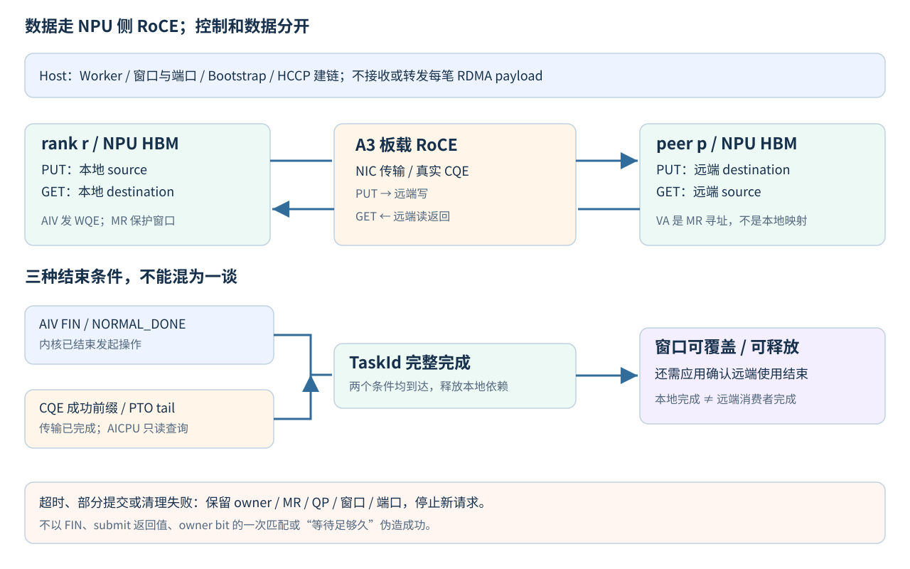

# A3 请求参数与真实完成协议

[返回设计入口](../rdma-a3-simpler.md)

## 1. 每次触发如何传参数

同一个已注册 callable 可多次提交，每次的六个 uint64 是独立 `TaskArgs`。固定 ABI 见[接口清单](interfaces.md#aiv-request-interfaces)。例如同一个域可以先 PUT `local+0 → peer+4096, 4096 B`，下一次 GET `peer+8192 → local+16384, 2048 B`；更换 offset/peer/长度不需要重新编译或重新注册 MR。

| 参数 | PUT | GET |
| ---- | --- | --- |
| `comm_context` | 当前 rank 的 simpler GM context | 相同 |
| `peer_rank` | 远端目标 rank | 远端源 rank |
| `local_offset` | 本地源窗口偏移 | 本地目标窗口偏移 |
| `remote_offset` | 远端目标窗口偏移 | 远端源窗口偏移 |
| `nbytes` | 搬移字节数 | 搬移字节数 |
| `qp_index` | `[0, qp_num)` 中的 QP | 相同 |

构建出的普通 chip orchestration 将它们交给 AIV；不是把这些值写死到 Host 注册 callback，也不通过 CCU task args 传递。TaskArgs 和 CoreTaskArgs 的内部表示不一定就是 48 B 连续内存，**六个逻辑 uint64 的次序和取值**才是两个边界必须共同遵守的合同。

AIV 在发 WQE 前检查：有效 TMR AsyncCtx、非空 context、当前任务对应的有效域、RDMA workspace 范围、magic/version/IN_DIE、rank/peer/QP、peer 非自身、窗口与 MR 一致、地址加法不溢出。首版要求 `nbytes>0`、`nbytes<=0x7fffffff`，offset 和长度均为 64 B 倍数；这是 simpler 的保守合同，不声称是 PTO 的最小硬件对齐要求。

所有范围使用 `offset <= extent && nbytes <= extent-offset` 校验，不能先相加再比较。先在 64 位上判断 peer/QP 范围，再窄化。远端地址只用于 PTO tensor 的 MR 寻址，AIV 不以普通 load/store 访问它。

## 2. AIV 提交与完成登记 {#aiv-submission}

1. `kernel_entry()` 解析参数并校验；获取本任务的 `AsyncCtx`。
2. helper 检查 task token、count/entries/error 指针、已有错误和容量；要求当前 count 小于 capacity。容量不足时在发 WQE 前失败。首版每次 kernel 只发一个 PUT/GET event，所需容量上界为1。
3. 使用独立 UB scratch 建立 `BuildAsyncSession<DmaEngine::RDMA>()`。公共 scratch 大小沿用 PTO 的 `kRdmaScratchBytes=256`，不侵占业务 GM；IN_DIE 的具体最小值不能替代通用接口约定。
4. 独立 wrapper 独占 pipeline event 0 和 UB scratch；组合业务调用 checked helper 时由调用者分配合法 `syncId`，使用 `qp_index`，发起 `TPUT_ASYNC<RDMA>(...,peer)` 或 `TGET_ASYNC<RDMA>(...,peer)`。
5. PTO `Post()` 在 MR 检查后进入 `Reserve/Lock`，生成 WQE，通过 MTE 写 NIC 可访问 SQ 并提交 SQ doorbell，返回事件。
6. 校验 `postFailed`、非零 handle、error-handle 和 `CompletionRecordCount/At()`。成功事件必须解析到 `RDMA_IN_DIE_CQE`，记录地址与当前队列匹配。
7. 构造 `CompletionToken`，调用已有 `register_completion_condition(ctx,token)` 写条目并更新 count，再执行 `defer_flush(ctx)`；AIV 之后返回普通 FIN。

内置 wrapper 使用动态长度、连续一维的 `uint8_t` GlobalTensor 表示 payload，形状长度就是 `nbytes`，不把字节数乘成元素数。PUT 的 dst 是 peer MR VA 加 remote_offset，src 是本地 MR VA 加 local_offset；GET 的 dst/src 相反。这样相同内核可处理不同业务 dtype 的窗口字节，不为每种 dtype 重编译一个搬移实现。

session 采用 peer-independent 重载 `BuildAsyncSession<RDMA>(scratch,workspace,my_rank,session,sync_id,qp_index)`，随后在 PUT/GET 调用中显式传 peer。`sync_id` 必须满足当前 IN_DIE 的 0～7 范围，并由 wrapper 的 UB/流水线资源分配保证与同一 AIV 内其他事件不冲突；不能把 TaskId 或 peer_rank 当 sync_id。

直接复用登记函数成立的关键是 slab 所有权：本任务的 AIV kernel 在返回前独占该 slab；从容量检查到登记之间，不调用其他会消耗其槽位的 simpler API；PTO 的 RDMA 提交只操作自己的 session/队列，不写这个 AsyncCtx。共享 QP 的不同任务仍有独立的 slab，因此 QP 多核并发不会抢占本任务的完成槽。

现有 A3 SDMA [send_request_entry()](https://github.com/hw-native-sys/simpler/blob/ec5dd4fc0fa29e977b6b71a533c191439fb96ff9/src/a2a3/runtime/tensormap_and_ringbuffer/runtime/backend/sdma/sdma_completion_kernel.h#L127) 已在发起传输前检查所需容量，然后调用最终使用 `register_completion_condition()` 的登记路径。源码中明确说明 kernel 返回前没有其他 writer 消耗这些槽位。本设计沿用这一模式，无需新增登记或取消 API。

仍须检查 `register_completion_condition()` 的返回值。在上述不变量成立且内存有效时，提交后不会因容量耗尽而失败；若仍失败，应视为 runtime 不变量或上下文失效，记录错误并保留已提交请求的 owner，不调用 event.Wait 兜底，也不伪装为“未提交”。不得在发布 FIN 后补写记录。未来若改变为多 writer 或允许交错调用消耗同一 slab，必须先修订该所有权协议；已知 N 个事件的单 writer 批量提交也可先检查 N 条容量。

PTO 的 `AsyncEvent.valid()` 只判断 handle 非零，不代表成功；error-handle 也可能非零。`TestEvent()` 返回非 pending 也可能包含失败。simpler 必须检查状态，不能把这些布尔结果当作成功完成。

IN_DIE 的 `Reserve()` 本身可能等待锁或队列空间，并可能调用 AIV `Progress()`，当前源码有内部 cycle timeout。因此本设计的“异步”表示不在 AIV 等待本笔传输完成，**不承诺提交路径严格 wait-free**。无需把 PTO 的锁或回收逻辑再移植进 simpler。

## 3. 完成 token、CQE 与游标所有权

### 事件编码和资源身份

PTO 事件高 32 位为 `queueIndex=peer*qpNum+qpIdx`，低 32 位为提交后的目标 SQ head。高字 `0xffffffff` 表示错误。IN_DIE 在 32 位 head 耗尽前返回错误，不能自行允许整数回绕或仅用有符号差值推断无限复用。

simpler 条件保存完整 handle、workspace 地址和当前 TaskId 身份。domain generation 由既有 run lease 关联，只有旧 run 的设备访问已静默才允许释放和重用地址。每次登记清空条件的私有 cursor，TaskId 派生身份仅用于该条件内部校验，不被宣称为跨 run 的唯一 generation，也不增加 token ABI 字段。

PTO record 提供目标 CQE 地址、预期 owner 和 kind。AICPU 可用它交叉验证，但首版以“完整事件目标 + 已成功回收前缀 + 有界 CQE 扫描”查询：一个 CQE 地址和一个 owner bit 不足以防止 AIV 回收后绕圈覆盖，也无法表达此前 SQ 项的错误。

### 只读 observer

IN_DIE 的 `Queue` 包含 `sq/cq Ring`、错误字段和 AIV tournament gates。`Ring` 提供 GM buffer、doorbell、head/tail 地址、深度和 stride。所有布局从固定 PTO 的 Host-safe `rdma_workspace_types.hpp`、`in_die_types.hpp` 获取；不得复制旧版 HNS1825 结构。

**唯一修改 CQ 消费位置的主体是 PTO AIV `Progress()`。** AICPU 不写 `cq.tail`、`sq.tail`、`Queue.error`，不敲 CQ doorbell，也不参与 AIV 的 COREID tournament lock。实现采用每条件私有 cursor，访问受既有 AsyncWaitList 锁保护；多个条件没有共享缓存，也不把 cursor 写入 PTO Queue。

`poll_rdma_in_die_event()` 的算法：

1. 验证 owner/generation 和全部地址范围；读取并校验队列实际深度、stride=32、target 非零且不超过已发布 SQ head。
2. invalidate 相应 cache line，acquire 读取 PTO `cq.tail`。这是 PTO 已逐项检查成功的前缀。如果 `tail>=target`，可报告该事件完成；后面新出现的错误不追溯否定这个已成功前缀。
3. 从 `max(tail, observer.success_prefix)` 扫描到 target，每次 tick 最多扫描 32 项。每项地址是 `cq.buffer+(index & (depth-1))*stride`。
4. 使用 **同一个 word0 快照**判断 owner 和 status。owner 是 `(word0>>7)&1`，ready 预期为 `(index & depth)==0 ? 1 : 0`；ready 后 status=`(word0>>8)&0xff` 必须为 0。
5. 读取每个 CQE 后重新 acquire 读取 tail。若 tail 已越过该项，采用 PTO 已确认的成功前缀，丢弃可能属于新一圈的快照；若 tail 未越过该项，基于“SQ/CQ 最多 outstanding depth-1，未回收槽不可重用”的 PTO 不变量解释快照。
6. owner 未就绪返回 PENDING；发现错误 CQE 返回 FAILED 并缓存该绝对错误位置。不能只检查最后一项，也不能因后续成功 CQE 覆盖而丢失错误。
7. 只有逐项扫描或已回收 tail 证明整个目标前缀成功，才返回 READY；扫描到更早已缓存的失败位置时返回 FAILED。最后执行适合 AICPU 的 acquire/设备可见性屏障，沿既有调度协议释放后继。

这个 observer **不推进硬件 CQ**。队列逐渐满时，PTO 下一次 `Reserve()` 调用自己的 `Progress()` 回收；少量请求完成后即使 tail 尚未更新，AICPU 也可凭真实 CQE 完成任务。关闭时确认所有已提交 target 完成，再由 provider 销毁 QP，不为清空计数而伪造 tail。

### 必须验证的硬件前提

上述只读算法是 simpler 的设计，并非 PR 2155 已提供的 AICPU 查询 API。它依赖 HCCP 返回的 CQ buffer/tail 所在 GM 可被 AICPU 正确访问，以及 IN_DIE 的有序 CQ 语义。集成时需要在实际 A3 SDK/驱动验证；编译可见的结构体不能证明这些硬件性质。

仓库当前 [cache-coherency.md](../../../hardware/cache-coherency.md) 已列出可选 A3 IN_DIE 后端的 CQE 保守失效策略，不能套用 A5 的“无需 invalidate”。本设计采用 A3 DMA 读取的 cache maintenance，并要求 observer 对 PTO 数据页始终只读，避免 clean+invalidate 将 AICPU 脏数据写回覆盖 provider 状态。具体内存属性、刷新范围、完成屏障，以及 CQE 发布与绕圈复用仍须通过 A3 硬件验收。

若发现任何前提不成立，应先在 PTO/provider 增加正式 Host-safe 完成快照能力并同步设计，不能退回“FIN 就完成”、Host 代理 payload 或竞争写 CQ tail。AICore 无法访问 SPR 控制窗的限制也不能靠自定义 MMIO 规避；NIC doorbell 仅使用此 PR 的正式路径。

## 4. FIN 汇合、错误与数据可见性

TMR 完成需要 `normal_done && all_registered_conditions_ready && no_error`。AIV 发出 WQE、AIV FIN、Host submit 返回、CQ owner 尚未更新都不是成功条件。AIV FIN 早于 CQE时等待网络；CQE早于 FIN 时仍等待正常执行结束。

既有 `SchedulerContext::drain_cancelled_run()` 增加 ROCE/type4 分支：先按原协议确认 AIV 已停止，再用同一只读 observer 检查 wait-list、mailbox 和 slab 中的事件。只有真实 CQ 成功才确认该条件 drained；错误或超时保留 owner，不完成 TaskId，不释放失败图的依赖。raw slab 条件按当前 TaskId 初始化私有观察身份。

GET 后续本地消费者必须通过完整完成的依赖再读取目标，沿用 TMR 的 AICPU→AIV 派发和 cache/流水线协议；AICPU 的普通 acquire 不能单独替代 AIV 的 GM 可见性处理。PUT 的本地源到传输结束前不可覆盖；远端目标消费仍需要应用阶段协调。

| 错误发生点 | 处理 |
| ---------- | ---- |
| 参数、能力或 completion 容量错误，确定未提交 | 失败结束本任务，不发 WQE，不阻塞等待 |
| session/event 错误，无法证明未提交 | 标记 run failed，停止新任务，保留相关 owner；不能因缺少登记记录而释放资源 |
| CQE status 错误 | 缓存队列失败位置，传播原状态、peer、QP、target 和 stage；不要继续将失败目标报成 READY |
| 等待超时 | 返回超时并保留 in-flight 所有权；超时不是 DMA 已停止的证据 |
| 完成 ABI 或 workspace generation 不匹配 | fail closed，保留诊断，禁止猜测历史布局 |

`retire` 只清空当前条件的私有 cursor，不改变 PTO 的队列，也不会清除其他条件的观察状态。每次新登记重新初始化 cursor，避免跨任务/跨 run 缓存污染；工作区本身由 domain generation/run lease 保持存续。资源清理由[生命周期协议](lifecycle.md)统一控制。

## 5. 多次触发与并发边界

多任务可以发往同一个 peer/QP，PTO 的 AIV lock 保证 WQE 发布；但不同任务访问重叠窗口范围仍须用 TaskId/deps 串行化。QP 排序不等于应用数据竞争已解决。多 QP 和多 rank 不提供隐式全局顺序。

内置 callable 每个请求只派发一个 AIV block。重复或并发请求在不同物理 AIV 上运行时使用 PTO 的 COREID 锁；不在同一 AIV 上创建可重入发布流。实际 QP 数以域配置和 provider 结果为准，不能一直按 `peer*qpNum` 固定选择 QP0。

任务只能访问同一有效域的窗口。首版没有跨 domain 请求，也不把普通 Tensor 地址直接变成临时 MR。若业务输入在普通 Tensor，应用通过既有 copy 机制放入通信窗口并建立依赖后，再调用该后端。
